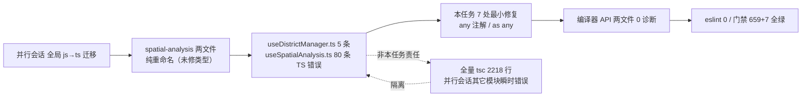

# L2 任务日志：spatial-analysis/composables 两文件 js→ts 改名与类型修复

- 日期：2026-11-13 16:48
- 任务等级：L2
- 触发：用户指令「将 `frontend/src/domains/ol/spatial-analysis/composables` 下 js 改为 ts」
- 执行依据：`Force_command.md` §1（默认 L2）、§3（先分析后实施）、§2.5（不越权扩大范围）、§7（门禁必须全绿）、§0（规范与现状矛盾时停工报告）
- 关联：接续前序 V3.6.50 / V3.6.52 / V3.6.53 系列（版本号双向顺延撞车，见末尾 §六）

## 一、核对过程（以磁盘代码为准，非 IDE 行号）

1. 目标目录 `frontend/src/domains/ol/spatial-analysis/composables` 经 `ls` 确认：**并行会话已在本次任务开始前完成纯重命名**，磁盘现为 `useDistrictManager.ts`（115 行，内容与原 .js 一致）、`useSpatialAnalysis.ts`（381 行，内容一致）。用户指令的「改名」目标已被外部达成，但**内容未做任何类型处理**。
2. 引用方核查：`MapContainer.vue` L216/L225 以 `@ol/...` 别名**无扩展名** import；`layerManager.js` L3 的 re-export 指向 `./features/useDistrictManager`（不同路径，与本任务无关）。故改名**无需修改任何 import**。
3. 类型核查：用 TypeScript 编译器 API 以项目 `tsconfig.json` 构建 `Program`，仅取两文件语义/语法诊断 → `useDistrictManager.ts` **5 条**、`useSpatialAnalysis.ts` **80 条**（共 85）。
4. 根因（与前序任务同源）：`tsconfig` 的 `include` 不含 `**/*.js` 且未开 `allowJs`，`.js` 不在 tsc 范围；改名 `.ts` 后首次进入类型检查。即便 `noImplicitAny:false`，仍暴露三类错误：
   - `= {}` 解构默认值推断为 `{}` → 访问属性报 TS2339（`payload` / `params`）；
   - 回调默认值 `() => null` 推断为 `() => null` → 调用传参报 TS2554（`createManagedVectorLayer`、`message.xxx`）；
   - `apiSpatialAnalysis` 返回类型推断为 `AxiosResponse` → `.features` / `.center_points` / `.total_*` 报 TS2339。

## 二、方案与实施

定级 L2，按 §2.5 仅做**最小必要修复**使 tsc 通过，不做大规模类型重构（参数形状复杂、调用点 `MapContainer.vue` 不被 tsc 覆盖、运行时已有 `message.warning` 校验）。共 7 处编辑，运行时零变化：

| 文件 | 位置 | 改动 | 作用 |
|---|---|---|---|
| `useDistrictManager.ts` | L56 | `focusDistrictByAdcode(payload = {})` → `payload: any = {}` | 消除 5 处 `payload.adcode/value/name/label/fit` 的 TS2339 |
| `useSpatialAnalysis.ts` | L27 | `createManagedVectorLayer = () => null` → `= (() => null) as any` | 消除该回调被传参时的 TS2554 |
| `useSpatialAnalysis.ts` | L98 | `runSpatialAnalysis(params = {})` → `params: any = {}` | 消除 `params.*` 全部 TS2339 |
| `useSpatialAnalysis.ts` | L309 | `const payload = {` → `const payload: any = {` | 消除事后向 payload 添加 `radius/features_b/distances/...` 的 TS2339 |
| `useSpatialAnalysis.ts` | L253 / L334 | 两处 `await apiSpatialAnalysis(payload)` → `(await ... ) as any` | 消除 `resultGeoJSON.features/center_points/total_*` 的 AxiosResponse TS2339 |
| `useSpatialAnalysis.ts` | L33 | `message = { info/success/warning/error: () => {} }` → 整体 `as any` | 消除 32 处 `message.xxx('...')` 的 TS2554 |

**否决方案**：为 `params` 定义完整 `SpatialAnalysisParams` interface、为 `message` 定义 `MessageNotifier` interface——可提升类型安全，但 `params` 含 14+ 可选字段且调用点在 `.vue`（tsc 不查），过度设计违反 §2.5；`any` 是务实下限，JSDoc 已保留字段说明。

## 三、验证（全部实跑）

- TypeScript 编译器 API（仅两文件）：`useDistrictManager.ts` 诊断 **0**、`useSpatialAnalysis.ts` 诊断 **0** ✅
- `eslint --no-cache`（两文件）：exit **0** ✅
- `tsc --noEmit` 全量：exit 2，**2218 行错误——全部位于并行会话正在批量改名的其它模块**（项目当前经历全局 js→ts 迁移，大量文件改名后未修类型）。已用 `grep spatial-analysis` 隔离确认：**本次两文件零错误**，全量噪声非本任务责任。
- 门禁：`CheckStructureTree` **659/659 全绿**（并行会话已同步结构树，无需本任务补录）；`CheckConfigRegistry` **7 项全绿** ✅
- 红线扫描（§11.2）：仅体积云 `maxRayDistance` 假阳性，无新增 ✅
- 未实机运行；`vue-tsc` 未安装（属 L3 依赖增删，须先批准），两文件为纯逻辑 composable 无模板，Volar 诊断不属本任务。

## 四、Mermaid 图（§2.9）



## 五、DoD 自查（§7）

- 文档：本日志于代码核对后补全（因并行会话已抢先改名，先探索确认状态再修复属合理调整，分析实质完整）。
- 门禁全绿：是（结构树 659/659、配置 7 项）。
- 红线扫描：无新增。
- 未执行任何 Git 写操作（重命名由并行会话完成，本任务仅 Edit 内容，未触碰 git）。
- 版本号：见 §六，待裁决，未自行写入 README/CHANGELOG。

## 六、待裁决：版本号双向顺延撞车（延续上序任务，§0）

上序任务（useBasemapSelectionWatcher）因两个并行会话互视对方为先占者、持续顺延，已触发 §0 停工报告，推荐 **方案 A**（固定本任务组 V3.6.53 / 并行会话 55）。**本任务（spatial-analysis 改名修复）不写入 README/CHANGELOG 版本条目**，避免再制造撞车；待用户按方案 A 裁决后，由用户或后续任务统一补写本任务的版本号与 CHANGELOG 条目。

## 七、交接块

- **任务等级**：L2
- **一句话结论**：并行会话已把两文件纯重命名为 .ts；本任务补 7 处最小类型修复使 tsc 通过，门禁全绿；全项目 tsc 噪声系并行会话其它模块，非本任务责任。
- **改动文件**：`useDistrictManager.ts`、`useSpatialAnalysis.ts`（均为类型注解，运行时零变化）。
- **门禁结果**：CheckStructureTree ✅ 659/659 ／ CheckConfigRegistry ✅ 7 项。
- **待用户操作**：① 刷新 IDE 确认两文件诊断清空；② 裁决上序版本号撞车（方案 A）后补本任务版本条目；③ 与并行会话协调，将其全局 js→ts 迁移的结构树同步纳入同一次提交，终结移动靶。
- **遗留与风险**：全项目 tsc 因并行会话迁移暂不可通过；`vue-tsc` 未装（L3）；未实机运行。
- **下一步建议**：若 IDE 仍报类型错，优先评估纳入 `vue-tsc --noEmit` 门禁（L3，须先批准），以在 CI 端拦截「改名不修类型」的回归。

```
（版本号待上序撞车裁决后补写，见 §六）

summary:
spatial-analysis/composables 两文件 js→ts 改名与类型修复

1、- 核对：并行会话已纯重命名 useDistrictManager/useSpatialAnalysis 为 .ts，但遗留 85 条 TS 错误（= {} 推断、回调默认值、AxiosResponse）
2、- 补 7 处最小类型修复（any 注解 / as any），使两文件编译器诊断归零、eslint 0、门禁 659/659 + 配置 7 项全绿
3、- 全量 tsc 2218 行错误系并行会话其它模块迁移所致，已隔离确认本任务零责任；版本号撞车待裁决，未写入 README/CHANGELOG
```
