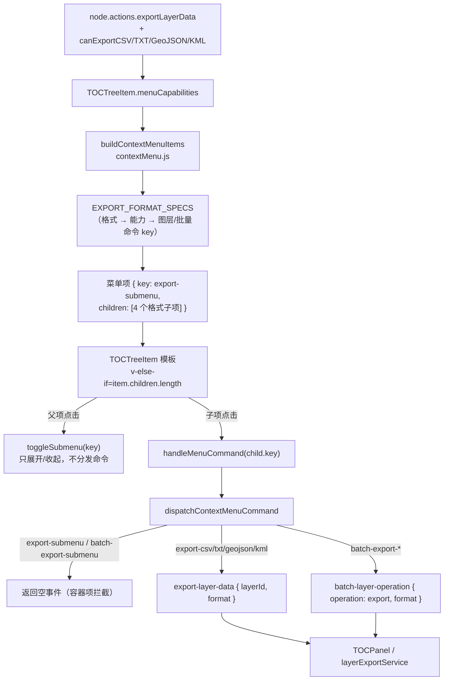

# TOC 图层菜单导出项收敛为「导出数据」子菜单

- **日期与时间**：2026-11-13 10:28
- **任务等级**：L2（常规：UI 结构调整 + 菜单构建逻辑改动，涉及 4 个文件协同）
- **版本**：V3.6.45

---

## 一、问题分析

### 核心症状

TOC 图层行右侧「更多操作」菜单中，**CSV / TXT / GeoJSON / KML 四个导出项平铺**在编辑区组内（外加分组线）。图层可导出时，主菜单长期常驻 4 个同质项：

- 菜单高度被导出项吃掉约 1/3，移动端更明显（上一版刚为「底部命令点不到」加过 `max-height` + 内部滚动，滚动本身即是这个问题的代价）；
- 四项目标文字长（`导出坐标(CSV)` 等），菜单 `min-width: 190px` 被顶宽；
- 「导出」是一个动作族，平铺后与「重命名 / 图层属性」等单动作项视觉权重相同，用户扫读成本高；
- 多选场景另有 4 个 `批量导出坐标(xxx)` 平铺，一次可堆出 7 项。

### 根本原因

`buildContextMenuItems` 把「格式」当作菜单项的一等维度直接展开成平级项，菜单模型里**没有「分组项 + 子项」的概念**：`TOCTreeItem.vue` 的渲染链只有 `divider / opacity / set-height / set-material / 普通项` 五种形态，任何多值动作都只能平铺。

### 受影响模块

| 模块 | 影响 |
|---|---|
| `layer-tree/menu/contextMenu.js` | 菜单项构建：图层导出 + 批量导出两组 |
| `layer-tree/menu/commandDispatcher.js` | 命令分发：容器 key 若不加拦截会被 `startsWith('export-')` 兜底成 CSV |
| `layer-tree/components/TOCTreeItem.vue` | 菜单渲染与定位：新增分组项渲染、展开态、视口贴边 |
| `layer-tree/protocol.js` | 命令常量登记（子菜单容器 key） |

---

## 二、解决方案

### 方案对比

| 方案 | 做法 | 结论 |
|---|---|---|
| A. 右侧浮层（flyout） | 悬停/点击父项，在菜单右侧弹出二级浮层（桌面端 GIS 惯例） | ❌ 菜单容器是 `overflow-y: auto` 的滚动区，`position: absolute/fixed` 的浮层会被容器裁切；触屏无 hover，触发器不成立；还要另写翻转/夹取逻辑 |
| B. 就地手风琴（选定） | 父项下就地插入子项列表，父项箭头 90° 旋转，再次点击收起 | ✅ 不依赖额外定位，不会被裁切；桌面与触屏行为一致；改动集中在渲染层 |
| C. 弹二级模态 | 点导出再弹一个格式选择框 | ❌ 多一层打断，导出是低频轻操作，不值得模态 |

选 **B**：与「节省主菜单空间」的诉求直接对齐，且复用现有菜单容器（含 `max-height` / 触屏 44px / 安全区规则），不再引入新的定位与裁切风险。

### 实施要点

1. **菜单模型加 `children` 字段**：`contextMenu.js` 新增 `EXPORT_FORMAT_SPECS`（格式 → 能力开关 → 图层/批量两套命令 key）+ `buildExportSubmenuChildren(capabilities, batch)`，图层与批量两条链路共用一份格式表，避免两处漏项。
2. **容器 key 与命令隔离**：`protocol.js` 新增 `EXPORT_SUBMENU: 'export-submenu'`、`BATCH_EXPORT_SUBMENU: 'batch-export-submenu'`。**二者必须以「容器项」身份存在**：`export-submenu` 命中 `startsWith('export-')`、`batch-export-submenu` 命中 `startsWith('batch-export-')`，若走到分发尾部会被 `resolveTocExportFormatFromCommand` 兜底成 **csv**，表现为「点一下分组标题就静默导出了 CSV」。故 `commandDispatcher.js` 在两条前缀分支**之前**显式返回空事件。
3. **渲染**：模板链新增 `v-else-if="item.children?.length"` 分支——父项按钮（`has-submenu` + `aria-expanded` + 右侧 Chevron）+ 展开时的 `.menu-subitems` 容器；子项复用 `.menu-item` 的点击态与触屏 44px 最小高度。
4. **展开态管理**：`openSubmenuKey` 单一展开（同时只允许一个子菜单），打开菜单与关闭菜单时都重置，避免上一次展开态把菜单撑高。
5. **定位补偿**：展开后菜单变高，`nextTick` 里重跑 `normalizeMenuPosition()`；再由 `ensureSubmenuVisible()` 只调菜单自身 `scrollTop`，把新增子项滚进可视区（不用 `scrollIntoView`，避免连带滚动页面）。

### 数据流（改动后）



---

## 三、修改内容

| # | 文件 | 改动 |
|---|---|---|
| 1 | `frontend/src/domains/common/layer-tree/protocol.js` | 新增 `EXPORT_SUBMENU`、`BATCH_EXPORT_SUBMENU` 两个「子菜单容器」命令 key，并注释其不承载命令 |
| 2 | `frontend/src/domains/common/layer-tree/menu/contextMenu.js` | 新增 `EXPORT_FORMAT_SPECS` + `buildExportSubmenuChildren()`；图层编辑区的 4 个平铺导出项收敛为 1 个「导出数据」分组项（含 4 个子项）；批量区的 4 个平铺项收敛为 1 个「批量导出数据 (n)」分组项 |
| 3 | `frontend/src/domains/common/layer-tree/menu/commandDispatcher.js` | 在 `batch-export-` / `export-` 前缀判定之前拦截两个容器 key，返回空事件，防「点分组标题静默导 CSV」 |
| 4 | `frontend/src/domains/common/layer-tree/components/TOCTreeItem.vue` | 模板新增分组项分支（父项 + 子项列表）；脚本新增 `openSubmenuKey` / `toggleSubmenu()` / `ensureSubmenuVisible()`，打开与关闭菜单时重置展开态；样式新增 `.menu-item-text`、`.submenu-chevron`、`.menu-subitems`、`.menu-subitem` 与展开动画（`prefers-reduced-motion` 下关闭动画） |
| 5 | `frontend/src/locales/zh-CN.js` / `en-US.js` | 「复制坐标失败」提示同步新菜单路径：「改用右键**导出数据 → CSV**」（原提示的「导出坐标」已不是菜单项名） |

**未改**：导出实现（`layerExportService.js` / `cesiumLayerSerialization.ts`）、批量导出执行链路、TOCPanel 事件消费——子项命令 key 与改造前完全一致，导出行为零变化。

---

## 四、修改原因

- 菜单项数量与高度是移动端 TOC 的老问题（V3.6.45 才因底部命令点不到而给菜单加了 `max-height` + 内部滚动）。滚动是「兜底」，减少常驻项才是「治因」。
- 导出四格式是**同一动作的不同取值**，天然适合折叠；分组后主菜单少 3 项、批量区少 3 项，图层菜单在移动端基本回到一屏内。
- 顺带统一了图层与批量的格式列表（原先两处各写 4 个 `if`，格式增删要改两遍）。

---

## 五、影响范围

| 维度 | 说明 |
|---|---|
| 图层管理 | 右键菜单 / 「更多操作」菜单结构变化（导出项 → 子菜单） |
| 导出链路 | 命令 key 不变，导出内容与文件名不变；仅入口层级变化 |
| 批量操作 | 「批量导出数据」同样收敛，批量导出行为不变 |
| 移动端 | 菜单更矮；子项继承 `.menu-item` 的 44px 触屏最小高度 |
| 键盘 / 无障碍 | 父项为 `<button>`，带 `aria-expanded`；Tab + Enter 可展开并选择子项 |
| 配置 / 后端 / 鉴权 | 无影响 |

---

## 六、性能指标

不适用（纯菜单结构改动，无渲染热点变化）。菜单项数量在图层场景由 **N+4** 降为 **N+1**（展开时 +4）。

---

## 七、测试方案

### Agent 已执行

| 项 | 命令 / 方式 | 结果 |
|---|---|---|
| ESLint | `npx eslint protocol.js contextMenu.js commandDispatcher.js TOCTreeItem.vue` | ✅ 0 error / 0 warning |
| SFC 编译 | `@vue/compiler-sfc` `parse` + `compileTemplate` | ✅ SFC + template compile OK |
| 菜单构建 / 分发单测（脚本自检） | esbuild 打包 `buildContextMenuItems` + `dispatchContextMenuCommand` 后用 node 跑断言 | ✅ 见下 |
| 结构树门禁 | `python Scripts/CheckStructureTree.py` | ✅ 通过（未新增文件） |
| 配置登记门禁 | `python Scripts/CheckConfigRegistry.py` | ✅ 通过（未新增 key） |
| 行尾一致性 | `git diff --numstat` | ✅ 仅目标行变更，无整文件噪音 |
| 平台红线自查（§11.2） | `grep -RIlE --exclude-dir=.venv <§11.2 模式串> backend/ deploy/ frontend/src/ .github/` + `deploy/.env` 基线检查 | ✅ 无命中（两条均 exit=1） |

脚本自检输出（摘要）：

```
导出项数量(图层): 1
子项: export-csv|CSV（坐标 + 属性） , export-txt|TXT（WKT 文本） , export-geojson|GeoJSON , export-kml|KML
是否残留扁平导出项: false
批量导出父项: 批量导出数据 (2)
批量子项: batch-export-csv,batch-export-txt,batch-export-geojson,batch-export-kml
容器项分发事件: []
容器项分发事件(batch): []
CSV 子项分发: [{"type":"export-layer-data","payload":{"layerId":"layer-1","format":"csv"}}]
KML 子项分发: [{"type":"export-layer-data","payload":{"layerId":"layer-1","format":"kml"}}]
无格式能力时是否有导出项: false
```

### 待用户实机验证

1. 2D 视图加载一个矢量图层 → 行尾「⋯」→ 菜单中只出现一项「**导出数据**」（带右箭头），点击后就地展开 4 个格式子项；再次点击收起。
2. 依次点 CSV / TXT / GeoJSON / KML → 各下载一份文件，内容与上一版一致（属性 + 坐标齐全）。
3. 多选 2 个以上图层 → 菜单出现「批量导出数据 (n)」→ 展开选格式 → 与改造前的批量导出结果一致。
4. 移动端（真机）：靠近屏幕底部打开菜单并展开「导出数据」，子项应自动滚入可视区且可点击；菜单整体不超出视口，底部安全区不被压住。
5. 无导出能力的图层（如栅格 / 底图节点）→ 菜单不应出现「导出数据」项。

---

## 八、变更文件清单

| 文件 | 一句话说明 |
|---|---|
| `frontend/src/domains/common/layer-tree/protocol.js` | 登记 `EXPORT_SUBMENU` / `BATCH_EXPORT_SUBMENU` 容器命令 key |
| `frontend/src/domains/common/layer-tree/menu/contextMenu.js` | 导出四格式收敛为「导出数据」/「批量导出数据」分组项，新增共用格式表与子项构建函数 |
| `frontend/src/domains/common/layer-tree/menu/commandDispatcher.js` | 容器 key 提前返回空事件，避免被前缀规则兜底成 CSV 导出 |
| `frontend/src/domains/common/layer-tree/components/TOCTreeItem.vue` | 分组项渲染 + 展开态管理 + 子项可见性滚动 + 样式 |
| `frontend/src/locales/zh-CN.js` / `en-US.js` | 「复制坐标失败」提示改为指向「导出数据 → CSV」 |
| `README.md` | 版本号三处（简介 / 版本演进表 / 页脚）→ V3.6.45 |
| `Docs/Guide/CHANGELOG.md` | 追加 V3.6.45 条目 |
| `Docs/LLM_record/26-11/2026-11-13/2026-11-13-toc-export-submenu.md` | 本日志 |

---

## 九、遗留与风险

| # | 内容 | 处置 |
|---|---|---|
| 1 | 二级菜单为就地手风琴，未做右侧浮层 | 已知取舍。若后续要桌面端 flyout，需先把菜单容器改为「不裁切」（如把滚动区下沉到内层列表），属独立改造 |
| 2 | 子项无格式图标（仅文字） | 四个格式图标区分度低，统一走父项 `FileDown`；如需要可在 `resolveMenuIcon` 加 `export-csv` 等细分映射 |
| 3 | 子菜单展开态不跨菜单实例记忆 | 有意为之：每次打开菜单从全收起开始，避免菜单高度不可预期 |
| 4 | 未做 e2e 自动化 | 仓库暂无组件测试基建，本次以构建/分发脚本自检 + 真机手测覆盖 |

> **红线扫描已知误报**：若不排除本地 `backend/.venv`，会命中 `hermes`（numpy `polynomial/hermite_e.py`）与 `start_keepalive`（`websockets` 的 ping API）。该目录已被 `.gitignore:95 .venv/` 忽略，不属仓库内容；扫描时加 `--exclude-dir=.venv` 即可。
