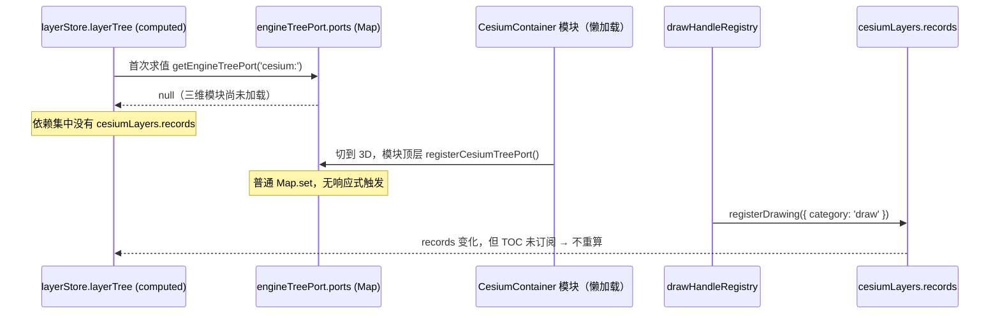

# 修复：Cesium 侧栏绘制成品不进图层管理（TOC）

- **日期与时间**：2026-11-14 16:55
- **任务等级**：L2（Bug 修复）
- **版本**：V3.7.1（原标注 V3.7.6，已并入统一版本 V3.7.1）

> 说明：本记录正文出现的 V3.7.x 均为合并前的中间标注，已统一并入 V3.7.1。

---

## 一、问题分析（阶段一产出，先于代码）

### 核心症状

三维模式下，通过侧栏「绘制」面板（`CesiumDrawMeasurePanel`）绘制点 / 线 / 面 / 矩形 / 圆后，
成品在场景中可见，但 TOC「三维数据」分组里**看不到对应条目**，无法显隐 / 透明度 / 定位 / 移除 / 编辑，
违反 Force_command §3「数据源注册前置」。

### 事件逻辑链条

1. 绘制成品链路本身完整：`finishInteraction → handleRegistry.createHandle → cesiumLayersStore.registerDrawing`，
   记录确实写入了 `cesiumLayers.records`（`drawHandleRegistry.ts` L116–127）。
2. V3.7.0 为清零 `ol → cesium` 跨域依赖，把 `useLayerStore` 中对 `useCesiumLayersStore` 的直接引用
   改为经 common 的 `engineTreePort` 读取。
3. `engineTreePort` 的端口表是**普通 `Map`**，非响应式；而三维端口由 `CesiumContainer` 模块顶层注册，
   该模块经 `importCesiumContainerWithRetry()` **懒加载**。
4. `layerTree` / `editableLayers` / `availableLayerIds` 三个 computed 在 2D 启动阶段首次求值时端口尚未注册，
   直接返回空数组，**依赖集中不包含 `cesiumLayers.records`**；端口注册后 Map 写入也不会通知这些 computed。
5. 于是 `registerDrawing` 写入记录后 TOC 不重算 → 绘制条目「入店不入树」。仅当二维侧其它依赖碰巧变化
   （展开/折叠、2D 图层增删）触发重算后，三维记录才会“突然出现”，表现为偶发、难排查。

### 根本原因

`engineTreePort` 端口注册表缺乏响应性，与「三维端口懒注册」组合后，
TOC 相关 computed 永久丢失对三维记录店的依赖追踪（V3.7.0 引入的回归）。

### 受影响模块

- 图层管理：TOC 树（`useLayerStore.layerTree`）、样式页签目标列表（`editableLayers`）、
  多选全集（`useTreeActionDispatcher.availableLayerIds`）
- 受害功能：三维绘制 / 测量成品、路线成品（`registerDrawing({category:'route'})`），
  以及首次进入 3D 前 TOC 已求值情形下的导入数据

## 二、解决方案

| 方案 | 做法 | 评价 |
|---|---|---|
| A（选定） | `engineTreePort` 的端口表改为 `shallowReactive(new Map())` | 一处修复覆盖全部消费方；端口注册即触发 computed 重算并建立对 records 的追踪；`shallowReactive` 不对端口对象做深代理；common 仅依赖 `vue`，不破坏域隔离 |
| B | HomeView 启动时提前注册三维端口 | 需在 2D 启动期加载三维 store / nodeBuilder，违背「2D-only 不加载三维代码」，且未消除端口表无响应性这一隐患 |
| C | 在绘制面板 / 管理器中额外调用 TOC 刷新 | 治标；路线、导入等其它入口仍失效，属第二套入列逻辑，违反 dev-conventions 契约第 4 条 |

## 三、修改内容

1. `frontend/src/domains/common/layer-tree/engineTreePort.ts`：端口表 `ports` 由普通 `Map` 改为
   `shallowReactive(new Map())`，并补充设计要点第 4 条说明原因。

## 四、修改原因

绘制成品不可管理属于严重违规（§3 数据源注册前置）。注册链路本身无误，问题出在 TOC 读取侧丢失依赖追踪，
因此在读取侧端口表修复，而非在绘制侧补丁。

## 五、影响范围

图层管理（TOC 三维分组、样式页签、多选全集）。不涉及绘制交互、场景实体、配置 key、后端与部署面。

## 六、性能指标

未实测。端口表仅在注册时写入一次，读取开销为 Vue 集合代理的常数级追踪，可忽略。

## 七、测试方案

### Agent 已执行

| 项 | 结果 |
|---|---|
| 最小复现脚本（node + vue，模拟「computed 先求值 → 端口后注册 → registerDrawing」） | 普通 `Map`：`afterDraw=0`（复现 Bug）；`shallowReactive`：`afterDraw=1`（修复生效） |
| `npx vue-tsc --noEmit -p tsconfig.json` | 退出码 0 |
| `python Scripts/CheckStructureTree.py` | 734/734，漏登记 0 · 幽灵 0 ✅ |
| `python Scripts/CheckConfigRegistry.py` | 全部通过 ✅ |
| `python Scripts/CheckDomainDeps.py` | 跨域违规 TOTAL 0 ✅ |
| §11.2 红线自查 | 未改后端 / 部署面，不适用 |

> 未在浏览器实机运行，以下步骤需用户执行。

### 待用户实机验证

1. 刷新页面（2D 启动）→ 切换到 3D。
2. 打开侧栏「绘制」，依次绘制点 / 线 / 面 / 矩形 / 圆。
   - **预期**：每完成一个，TOC「三维数据」分组即时新增一条（`绘制_…`），无需任何其它操作。
3. 对新条目逐项验证 adapter 闭环：勾选显隐、透明度滑杆、右键定位（flyTo）、移除、样式设置；
   线 / 面 / 点另验「编辑要素」。
4. 侧栏「测量」做一次测距，**预期**同样进入 TOC。
5. 面板「撤销」「清空」后，TOC 条目同步消失。

## 八、变更文件清单

| 文件 | 说明 |
|---|---|
| `frontend/src/domains/common/layer-tree/engineTreePort.ts` | 端口表改为 `shallowReactive`，修复依赖追踪丢失 |
| `Docs/LLM_record/26-11/2026-11-14/2026-11-14-fix-cesium-draw-toc-registration.md` | 本日志 |
| `Docs/Guide/CHANGELOG.md` | 追加 V3.7.6 条目 |
| `README.md` | 三处版本号 → V3.7.6 |
| `Docs/TODO/bugfix-optimization-plan.md` | 新增 P3-11 顺带发现登记 |

## 九、遗留与风险

- `CesiumDrawMeasurePanel.vue` / `.ts` 本身无需改动：面板只发意图，注册在 `drawHandleRegistry` 中已正确执行。
- `registerCesiumTreePort.ts` 头注释「注册必须早于图层树首次渲染」的约束在本修复后不再必要，
  属文档措辞问题，未顺手修改（§2-5），已记入 `Docs/TODO/bugfix-optimization-plan.md`。
