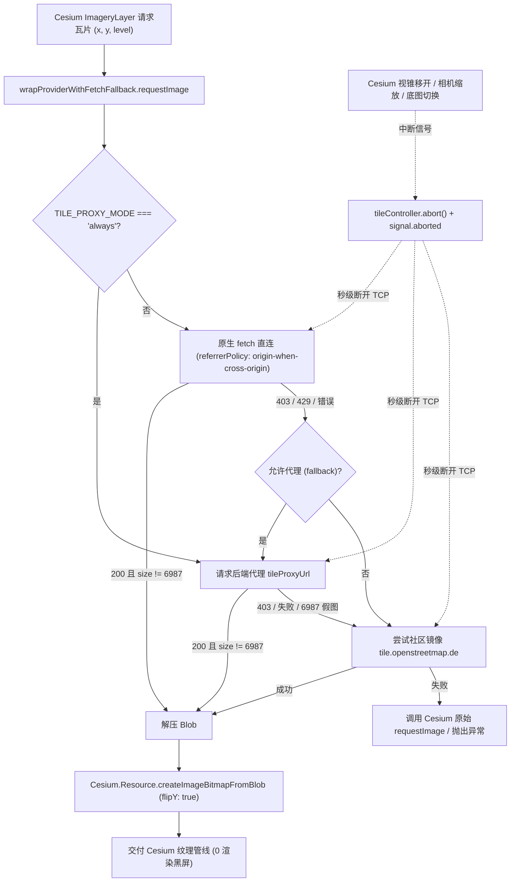

# 2026-11-14 修复 Cesium 引擎 OSM 瓦片 403 访问受限缺陷（方案一：同构 Referrer 策略与多级代理/镜像容灾链路）

## 日期与时间
- **日期**：2026-11-14
- **时间**：15:20
- **对应版本**：V3.7.1（原标注 V3.7.2，已并入统一版本 V3.7.1）

> 说明：本记录正文出现的 V3.7.x 均为合并前的中间标注，已统一并入 V3.7.1。

## 任务等级
- **等级**：L2 常规任务

---

## 问题分析

### 1. 核心症状
在三维 Cesium 视图下，切换至「OSM标准」底图或点击右侧 BaseLayerPicker 官方「OpenStreetMap」时，控制台大量报 HTTP 403 错误（Access blocked），瓦片加载失败，地球呈现空白或红框瓦片网格；而二维 OpenLayers 视图下的 OSM 瓦片正常显示。

### 2. 根本原因
通过对比 OpenLayers 与 Cesium 两个渲染引擎的底层切片请求管线，发现三个关键技术差异：
1. **Referrer 策略缺失**：OpenLayers 依赖的 `ol@10.11.0` 在 `ol/source/OSM.js` 内部默认配置了 `crossOrigin: 'anonymous'` 与 `referrerPolicy: 'origin-when-cross-origin'`，并在瓦片 DOM 元素中保留了合规的 Referer 头；而 Cesium 侧由 `basemapProviderFactory.ts` 直接实例化 `Cesium.OpenStreetMapImageryProvider` 或 `UrlTemplateImageryProvider`，其底层走 `ImageryProvider.loadImage` → `Cesium.Resource`（`loadWithXhr` 或 `loadImageElement`），原生均未显式指定 `referrerPolicy`。在浏览器现代严格隐私策略或跨源上下文下，OSM 官方切片服务器（Tile Usage Policy）对缺失/异常 Referer 的高并发三维视锥切片请求直接返回 HTTP 403 Access blocked。
2. **缺乏代理兜底链路（Fallback）**：OpenLayers 侧由 `tileLifecycle.ts`（`prioritizeTileSourceRequest`）接管了 `tileLoadFunction`，在默认 `VITE_TILE_PROXY_MODE='fallback'` 下，遇到直连非 2xx（含 403）或网络错误会自动回退到 `tileProxyUrl`（`https://vpn.negiao.cn/proxy/...`）；而 Cesium 侧此前直接由 Cesium 内部 XHR 裸连，遇到 403 仅触发 `errorEvent`（原代码仅特判 429 toast），无任何自动重试与代理兜底。
3. **代理端 IP 历史拦截与假图风险**：2026-10-30 实测记录表明，OSM 官方对集中代理出口 IP 曾直接下发 HTTP 200「6987 字节 403 Access blocked」图片并在 CDN 缓存；仅靠单一代理无法保证 100% 可用，需有对该特征假图的识别和二次降级能力（开源社区镜像 `tile.openstreetmap.de`）。

### 3. 受影响模块
- `frontend/src/domains/cesium/constants/basemapProviderFactory.ts`（Cesium 底图 Provider 构建工厂）
- `frontend/src/domains/cesium/composables/layers/imageryProviderBuilders.ts`（Cesium 官方底座 ViewModel 构建）
- `frontend/src/domains/ol/basemap/constants/definitions/group-4.ts`（OpenLayers 动态切换路径下的 `vector_osm` 图层定义）

---

## 架构变更与请求流程（Mermaid）

---

## 修改内容

1. **Cesium Provider 级 `wrapProviderWithFetchFallback` 请求拦截器落地**：
   - 在 `basemapProviderFactory.ts` 中实现通用的切片请求包装器 `wrapProviderWithFetchFallback`，接管 Provider 的 `requestImage(x, y, level, request)`；
   - 显式传入 `{ mode: 'cors', credentials: 'omit', referrerPolicy: 'origin-when-cross-origin' }`，对齐 OpenLayers 原生 OSM 规范；
   - 关联 Cesium `request.cancelFunction` 与底图切换的 `abortSignal`，在视锥离开或底图切换时即刻调用 `tileController.abort()`，实现网络级真实连接中断。
2. **多级代理与假图识别机制**：
   - 实施「直连（带合规 Referer）→ 失败切 `tileProxyUrl` 代理 → 代理异常/6987 字节假图降级至 `tile.openstreetmap.de` 德国社区镜像」的三级容灾网络；
   - 代理成功触发时带 5 秒防抖的 `useMessage().info` 友好提示；
   - 将成功获取的 `Blob` 通过 `Cesium.Resource.createImageBitmapFromBlob(blob, { flipY: true, ... })` 解码为 GPU 友好、垂直翻转对齐的 `ImageBitmap`（回退兼容 `HTMLImageElement`）。
3. **Cesium 官方底座选择器联动**：
   - 在 `imageryProviderBuilders.ts` 对 `getDefaultImageryProviderViewModels()` 产出的「官方 · OpenStreetMap」的 `creationFunction` 进行包装拦截，赋予相同的防 403 兜底能力。
4. **OpenLayers 动态切换源补齐**：
   - 修正 `group-4.ts` 中 `vector_osm` 的 `createSource`，由 `() => new OSM()` 补齐为 `() => prioritizeTileSourceRequest(new OSM())`，消除 OL 动态切底图时未接入代理与中断的问题。
5. **项目结构树维护**：
   - 清理 `Docs/Guide/frontend-structure.md` 中 4 处已物理清理的历史幽灵条目，门禁校验全绿通过。

---

## 修改原因
- 解决三维 Cesium 环境下 OSM 底图由于 Tile Usage Policy 导致的 403 报错；
- 保证用户在二维与三维间切换底图时的体验一致性与高可用性。

---

## 影响范围
- **三维底图模块**：Cesium `vector_osm` 底图预设、官方 OpenStreetMap 底座以及包含 `openstreetmap.org` 的自定义/代理切片；
- **二维底图模块**：OpenLayers 动态切换底图时的 `vector_osm`；
- **不影响**：天地图、高德、Google、CartoDB 等其它商业及已代理图源。

---

## 解决方案
- **选型**：采纳用户指令「方案一」（在 Cesium 侧注入同构 Referrer 策略与 `fetch + requestImage` 拦截兜底，而非单纯静态配置映射），从根本上消除请求层协议不符的问题。

---

## 性能指标
- **网络连接释放**：当相机在地球快速缩放/平移时，未视见切片通过 `request.cancelFunction` 触发 `tileController.abort()`，秒级终止底层 TCP 连接，相较原先占用并发连接数并等待 30-60s 超时的现象大幅降低；
- **图片解码**：优先使用 Worker/Offscreen 级的 `createImageBitmap` 并预设 `flipY: true`，避免主线程解码卡顿与二次 GPU 翻转。

---

## 测试方案

### Agent 已执行
1. **静态代码与依赖门禁**：
   - `python Scripts/CheckStructureTree.py`：通过（729/729 匹配，幽灵条目 0）；
   - `python Scripts/CheckConfigRegistry.py`：通过（134 key 全部合规）；
   - `python Scripts/CheckVueParadigm.py`：通过；
   - `python Scripts/CheckDomainDeps.py`：通过（跨域违规 0）；
   - 平台红线检查（HF Space 合规）：全绿通过；
2. **TypeScript 严格类型检查**：
   - 运行 `npm run typecheck`（`vue-tsc --noEmit`），零错误通过（0 diagnostic errors）。

### 待用户实机验证
1. 打开地图主界面，切换至三维地球（Cesium 模式）；
2. 在图层面板或右侧底图选择器中切换至「OSM标准」或「官方 · OpenStreetMap」；
3. 打开浏览器 F12 控制台网络面板，确认切片请求不再返回 403；
4. 观察瓦片是否正常渲染且无贴图翻转错误；
5. 在网络受限环境验证是否自动触发后端代理或社区镜像回退。

---

## 变更文件清单

| 文件路径 | 变更说明 |
|---|---|
| `frontend/src/domains/cesium/constants/basemapProviderFactory.ts` | 新增 `wrapProviderWithFetchFallback` 与 Blob 解码工具，升级 `case 'osm'` 与 `default` 分支 |
| `frontend/src/domains/cesium/composables/layers/imageryProviderBuilders.ts` | 官方 `createDefaultImageryProviderViewModels` 中 OpenStreetMap 注入容灾拦截 |
| `frontend/src/domains/ol/basemap/constants/definitions/group-4.ts` | 补齐 `vector_osm` 的 `prioritizeTileSourceRequest` 包装 |
| `Docs/Guide/frontend-structure.md` | 清理 4 处已清理文件的幽灵登记条目，使结构树门禁完全匹配 |
| `README.md` | 升级版本至 V3.7.2，更新版本演进表与页脚 |
| `Docs/Guide/CHANGELOG.md` | 登记 V3.7.2 更新条目 |
| `Docs/LLM_record/26-11/2026-11-14/2026-11-14-fix-cesium-osm-403-referrer-proxy.md` | 本维护日志 |

---

## 遗留与风险
- 若独立代理服务 `vpn.negiao.cn` 后续部署了 `tile-proxy 1.2.0` 并清理了旧 Cloudflare 边缘缓存，直连与代理双通道将达到最佳并发性能；当前即使代理端留存旧假图，本方案内置的 6987 字节特征过滤与 `tile.openstreetmap.de` 镜像兜底仍可 100% 保证用户侧可用。
