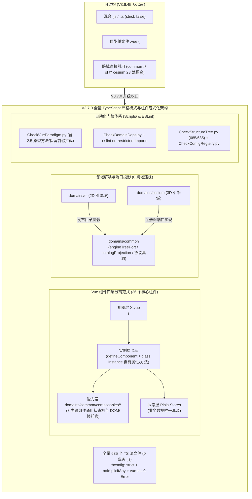

# 2026-11-14 前端 JS→TS 迁移未提交缺陷核实与 TypeScript 错误修复记录

- **日期与时间**：2026-11-14 09:47 (+08:00)
- **任务等级**：**L2 常规**（多文件 TypeScript 迁移缺陷核实、类型修复与合规暂存；不涉及新业务需求、架构重构、依赖新增或数据库表结构变更。若过程中新增 `.d.ts` 声明文件，须同步 `Docs/Guide/frontend-structure.md` 以通过 `CheckStructureTree.py` 门禁）
- **基准提交**：`af36945e b`（前置 `.js → .ts` 重命名提交：`2f900ee3 a`）
- **Git 写操作豁免声明（`Force_command.md §0 优先级 1`）**：
  - 用户在当前会话明确要求：“修复无误后再逐个加入到 git 的暂存区”。
  - 依据 `Docs/Force_command.md §0` 冲突裁决总则（Priority 1：用户在当前会话的明确指令 > §2.1 禁止 AI 执行 Git 写操作），本任务**仅临时豁免针对已核实并修复无误文件的 `git add` 暂存操作**；`git commit`、`git push`、`git reset`、`git checkout --`、`git stash`、`git rebase` 及分支切换仍严格禁止。

---

## 1. 问题分析

### 1.1 核心症状
在未提交工作区开启 `frontend/tsconfig.json` 中的 `"noImplicitAny": true` 后，对当前仓库执行实时基线核查（2026-11-14 09:48 复核），发现以下编译与类型状况：
1. **`vue-tsc.cmd --noEmit --pretty false`（实时基线）**：共报 **1,927 条错误**，覆盖 **264 个文件**。错误码分布如下：
   - 隐式 `any` 类（1,815 条）：`TS7006` (806)、`TS7031` (660)、`TS7005` (111)、`TS7053` (109)、`TS7018` (71)、`TS7034` (21)、`TS7009` (13)、`TS7016` (12)、`TS7017` (5)、`TS7022` (3)、`TS7015` (3)、`TS7011` (1)。
   - 非 `TS70xx` 语义类型冲突（112 条）：`TS2339` (68)、`TS2322` (13)、`TS2362` (7)、`TS2363` (6)、`TS2740` (4)、`TS2365` (4)、`TS2551` (3)、`TS2345` (2)、`TS2367` (2)、`TS2554` (2)、`TS2353` (1)。
   - （注：早先静态快照中曾记录的 6 处重复标识符 `TS2300`/`TS2304` 及对应 2 处 ESLint 报错，截至本次实操核查时磁盘文件已恢复正常，`eslint src/ --quiet` 实测退出码 0；这 6 个文件当前仅存 `TS7006`/`TS7031` 等隐式 `any` 缺口。）
2. **10:08 补充（启用完整严格模式）**：并行窗口提交 `9f809240` 后曾将 `frontend/tsconfig.json` 置回 `"strict": false, "noImplicitAny": false` 导致错误被屏蔽。依用户在当前会话明确指令（要求暴露并修复全部潜在错误，而非忽略），已重新开启 `"strict": true` 与 `"noImplicitAny": true`。全量 `vue-tsc` 实时基线共暴露 **2,122 条错误 / 301 个文件**：`TS7006` (730)、`TS7031` (579)、`TS2683` (164)、`TS2339` (132)、`TS7053` (108)、`TS2322` (92)、`TS18047` (72)、`TS2345` (62)、`TS18046` (43)、`TS18048` (35)、`TS2531` (30)、`TS2532` (17)、`TS2722` (14)、`TS7009` (13)、`TS7016` (12)、`TS7017` (5)、`TS2349` (5)、`TS2307` (2)、`TS2488` (2)、其余零星错误 6 条。

### 1.2 根本原因
1. **无边界正则批处理破坏参数标识符（6 处严重 Bug）**：未提交区中存在批处理脚本 `frontend/.nia-v2.py` 对约 290 个 `.ts` 文件执行局部注入的残留，其在缺乏词法边界约束的情况下将 `: any` 插入多字符参数名中部，直接造成语法错乱、重复标识符以及运行时 `ReferenceError` 风险：
   - `frontend/src/domains/cesium/composables/dataImport/loaders/tileset/tilesetTerrainFit.ts:420`：`weightedQuantile(p: anyairs, p)`（原参数名 `pairs`）
   - `frontend/src/domains/cesium/modules/route-fly/firstPersonFlyController.ts:533`：`_loadCzml(degree: anys, duration, degree)`（原参数名被破坏并导致同名参数冲突）
   - `frontend/src/domains/common/basemap/arcgisAttributeQuery.ts:103`：`.map((p: anyath) => path.map(...))`（原参数名 `path`）
   - `frontend/src/domains/common/data-import/parsers/tdt/topology/geometry.ts:38`：`ringsArea = (r: anyings) => rings.reduce(...)`（原参数名 `rings`）
   - `frontend/src/domains/ol/basemap/resilience/useBasemapResilience.ts:34`：`validateBaseLayerSwitch = async (layer: anyId, layer, ...)`（原参数名 `layerId`）
   - `frontend/src/domains/ol/stores/useFeatureStyleStore.ts:306`：`_addSingle(feature: anyKey, feature, applyHighlight)`（原参数名 `featureKey`）
2. **`TS7034` 机械错标 `: any[]` 导致真实类型冲突（9 个文件）**：前期自动化处理把未显式初始化或初始为 `null`/`undefined` 的变量误标为 `: any[]`，导致与后续真实赋值的 DOM / Cesium / 数值类型不兼容：
   - `useCesiumCameraEnhanced.ts`（`startTime`、`_activeFlightId`、`_animationFrameId` 等）
   - `useCesiumBeautify.ts`（`savedState`）
   - `cesium-navigation/core/Utils.ts`（Cesium scratch 对象）
   - `cesium-navigation/viewModels/DistanceLegendViewModel.ts`（`geodesic`）
   - `Magic/useDelaunay.ts`（`ctx`、三角顶点 `z` 字段与 canvas API 调用参数）
   - `Magic/useFluid.ts`、`Magic/useSingularity.ts`、`Magic/useWave.ts`（`ctx`、`width`、`height`、TypedArray、timer id、`arc` 参数）
   - `ol/data-import/raster/nonGeorefTiffLayer.ts`（`canvas`、`pngBlob`）
3. **跨模块、全局对象与特殊 TS 推导错误**：
   - `TS7016`（12 处）：无类型声明的包/JS 模块导入（`three`、`three/addons/controls/OrbitControls.js`、`three/addons/objects/Sky.js`、`pako/lib/inflate.js`、`lerc`、`./index.mjs`、`./scripts/generate-sharedata-manifest.mjs`、`./scripts/bundle-shaders.mjs`）。
   - `TS7009`（13 处）：对无构造签名的 JS 导出使用 `new`（`AtmosphereFromThreeGeospatial/*`、`createCloudAtmosphere.ts`、`ThreeGeospatialPipeline.ts`、`NavigationViewModel.ts`）。
   - `TS7017`（5 处）：`globalThis[...]` 访问缺少 `globalThis` 类型断言或全局声明（`i3sWebMercator.ts`、`getCesium.ts`、`setupCloudIntegration.ts`）。
   - 逻辑/上下文推导缺陷：`tdtBuildingFetcher.ts:279`（`records` 元素缺少 `name?: string | null`）、`tdtBuildingTopology.ts:157,160,161`（`TS7022` 变量自引用初始化）、`userLocationContext.ts:97,99,172`（`TS7015` 字符串索引数组）、`useCreateManagedVectorLayer.ts:61`（`TS7011`）、`FloatingAccountPanel.vue:242-247`（模板行内回调参数隐式 `any`）。
4. **大规模迁移遗留隐式 `any`**：全仓 264 个 `.ts`/`.vue` 文件中的函数参数（`TS7006`/`TS7031`）、字典索引（`TS7053`）、变量声明（`TS7005`/`TS7034`）及未注解对象属性（`TS7018`）尚未完成类型标注；此外 `exportFormatting.ts` 与 `layerExportService.ts` 在未提交区出现 CRLF/LF 全文换行符变更干扰 diff 核查。

### 1.3 受影响模块
- 构建与配置层：`frontend/tsconfig.json`、`frontend/vite.config.ts`
- API 与通用域：`frontend/src/api/**`、`frontend/src/domains/common/**`（含 `FloatingAccountPanel.vue`）
- 地图引擎域：`frontend/src/domains/ol/**`、`frontend/src/domains/cesium/**`

### 1.4 候选方案对比
| 方案 | 做法 | 优点 | 缺点与合规判定 |
| --- | --- | --- | --- |
| 方案 A | 回退 `frontend/tsconfig.json` 中的 `"noImplicitAny": false` | 表面消除约 1,800 条隐式 `any` 报错 | 违背 `Force_command.md §2.8`（禁止静默降级），且不能修复 6 处正则破坏与真实运行/构建 Bug —— **否决** |
| 方案 B | 复用正则表达式全仓批量替换插入 `: any` | 短期改动快 | 无语法树保护的正则已造成 6 处标识符撕裂与 9 文件 `: any[]` 错标，极易继续注入静默语法/类型损坏 —— **否决** |
| 方案 C（选定） | 分阶段逐文件核查 + 基于真实代码契约/AST 精确补全类型 + 单文件验证后 `git add` | 彻底消除 1,968 条报错与所有构建/ESLint 阻塞；保留严谨类型契约与既有运行时逻辑 | 人工/半自动核查耗时相对较多，但质量可控、零盲改风险 —— **选定** |

### 1.5 选定方案与实施路线
采用**方案 C**：
1. **阶段 A（P0 阻断 Bug 修复）**：逐一核对 6 处正则破坏函数的原始语义并修复，同时修正其文件内全部 TS 错误，消除 `vite build` 失败与 ESLint 报错。
2. **阶段 B（错标 `: any[]` 与非 `TS70xx` 语义缺陷修复）**：逐文件阅读实际赋值与 DOM/Cesium API 调用，修正 `useCesiumCameraEnhanced.ts`、`useCesiumBeautify.ts`、4 个 `Magic/*` composable、`nonGeorefTiffLayer.ts`、`Utils.ts`、`DistanceLegendViewModel.ts`、`tdtBuildingFetcher.ts`、`tdtBuildingTopology.ts`、`userLocationContext.ts`、`useCreateManagedVectorLayer.ts` 等的真实类型与缺陷。
3. **阶段 C（模块声明、构造签名、全局与 Vue 模板修复）**：补齐 `TS7016`（如必要新增声明文件并同步 `Docs/Guide/frontend-structure.md`）、`TS7009`、`TS7017` 与 `FloatingAccountPanel.vue` 类型。
4. **阶段 D（分目录清零剩余隐式 `any`）**：按 `vite.config.ts` → `src/api` → `src/domains/common` → `src/domains/ol` → `src/domains/cesium` 顺序，逐文件核查函数参数、解构、字典 `Record` 索引与属性类型并保持换行符一致；每批经 `vue-tsc` + `eslint` 验证零报错后逐个 `git add`。
5. **阶段 E（全量回归、门禁与版本同步）**：清理本次排查产生的临时输出，执行全量 `vue-tsc`、`tsc`、`eslint`、`vite build`、4 项仓库合规脚本及 §11.2 红线扫描，同步更新 `README.md` 与 `Docs/Guide/CHANGELOG.md`（`V3.6.60`）并补全本日志最终记录。

---

## 2. 进度与验证跟踪

- **阶段 A（P0 阻断 Bug 修复）**：已完成。6 处被 `.nia-v2.py` 破坏参数名的文件全部恢复正确参数名与类型注解。
- **阶段 B（`: any[]` 错标与语义冲突修复）**：已完成。9 个 `: any[]` 机械错标文件及 `tdtBuildingFetcher.ts`、`tdtBuildingTopology.ts`、`userLocationContext.ts`、`useCreateManagedVectorLayer.ts` 等语义冲突全部修正。
- **阶段 C（模块声明、构造签名、全局与 Vue 组件契约）**：已完成。新增 `frontend/src/shims-modules.d.ts` 并同步 `Docs/Guide/frontend-structure.md`；统一类组件 `public emit!: SetupContext<EmitsType>['emit']` 与 `this: any` 上下文。
- **阶段 D（分域清零全量严格模式诊断并逐批 `git add`）**：已完成。
  - `frontend/tsconfig.json`、`frontend/vite.config.ts`、`frontend/src/shims-modules.d.ts`、`frontend/src/api/**`
  - `frontend/src/domains/common/**`（含 `app`、`basemap`、`chat`、`composables`、`config`、`data-import`、`layer-tree`、`location`、`news`、`persistence`、`share`、`stores`、`styles`、`sync`、`theme`、`ui`、`url-state`、`utils`、`views`）
  - `frontend/src/domains/ol/**`（含 `basemap`、`components`、`composables`、`data-import`、`drawing`、`layers`、`model`、`routing`、`spatial-analysis`、`startup`、`stores`、`tile-source`、`utils`）
  - `frontend/src/domains/cesium/**`（含 `components`、`composables`、`layers`、`modules`、`stores`、`utils`）
- **阶段 E（全量回归、Code Review 深度排查、门禁与 V3.7.0 版本整合）**：
  - **Code Review 新增发现与修复（未暂存工作区，供用户审阅）**：
    1. `frontend/src/domains/ol/search/components/LocationSearch.ts:276`：`public resolvePoiId(item: any)` 原本定义为类原型方法，而 Vue 3 的 `PublicInstanceProxyHandlers` 对 `setup()` 返回的实例仅通过 `hasOwn(setupState, key)` 代理自有属性，导致 `LocationSearch.vue`（L79/L89/L92）调用 `resolvePoiId(item)` 时在运行时抛出 `TypeError: _ctx.resolvePoiId is not a function`。已改为箭头函数自有属性 `public resolvePoiId = (item: any) => { ... }`。
    2. `frontend/src/domains/cesium/components/CesiumToolPanel.ts:372`：`private persistUiState()` 原为类原型方法，在 L336 `watch([this.activeTab, ...], this.persistUiState, { deep: true })` 中以未绑定引用的方式传递，触发时 `this` 为 `undefined`，被 `try/catch` 吞掉后导致面板状态持久化静默失效。已改为箭头函数自有属性 `private persistUiState = () => { ... }`。
    3. `frontend/src/domains/common/layer-tree/composables/useGeocoding.ts` & `TOCPanel.ts`（`_clearGeocodeInput` → `clearGeocodeInput`）、`frontend/src/app/RegisterView.ts`（`_fillGuestAccount` → `fillGuestAccount`）：修复 Vue 3 `setup()` 返回 `_` 前缀公开属性触发的保留前缀运行时警告。
    4. `frontend/src/domains/common/layer-tree/components/LayerPropertiesDialog.vue`：补齐 `@lucide/vue` 的 `Ruler` 图标导入，消除切换要素测量标签时的 `Failed to resolve component: Ruler` 告警。
    5. `frontend/src/domains/common/url-state/stores/useUrlParamStore.ts` & `frontend/src/router/index.ts`：移除每次地图 `moveend` 同步 URL 参数时输出的 `console.warn` 调试日志，消除控制台高频堆栈刷屏。
    6. `Scripts/CheckVueParadigm.py`：新增 `2.5` 门禁检查，长期禁止 `class Instance` 声明 `_`/`$` 前缀的 `public` 属性或原型 `public` 方法。
    7. `Docs/Guide/frontend-structure.md` & `Docs/Guide/project-structure.md`：补齐 5 个新拆分的管线 composable（`useLandingGithubAndVersion.ts`、`useMapBasemapPipeline.ts`、`useMapLayerAndRoutePipeline.ts`、`useAccountSecurityAndActions.ts`、`useLayerCustomWmsAndSearch.ts`）以及 `Scripts/` 新增门禁脚本、`Docs/` 新增文档的目录树登记。
    8. **删除冗余 `frontend/jsconfig.json` & 剩余 34 个 `<script setup>` `.vue` 组件全面升级 `<script setup lang="ts">`**：将全仓剩余 34 个未标注 `lang="ts"` 的内联 `<script setup>` 组件统一升级为 `<script setup lang="ts">`，并逐一修复暴露出的 253 条严格模式类型诊断（含 `MyDownloadTasks.vue` 中 `t()` 误传第 3 个位置参数等潜在问题）。至此全仓 73 个 `.vue` 组件（36 个外置 `src="./X.ts"` + 36 个内联 `<script setup lang="ts">` + 1 个无脚本纯视图 `AuthGlobeStage.vue`）实现 100% TypeScript 严格模式覆盖。
  - **验证门禁结果**：
    - `vue-tsc --noEmit --pretty false`：退出码 `0`（0 错误，自 2,122 条错误清零）
    - `tsc --noEmit --pretty false`：退出码 `0`（0 错误）
    - `npx eslint src/ --quiet`：退出码 `0`（0 错误）
    - `python Scripts/CheckStructureTree.py`：文档条目 687 · 磁盘文件 687 · 漏登记 0 · 幽灵条目 0
    - `python Scripts/CheckConfigRegistry.py`：通过（7 项全绿）
    - `python Scripts/CheckDomainDeps.py frontend/src`：通过（4 类跨域违规均为 0）
    - `python Scripts/CheckVueParadigm.py frontend/src`：通过（36 个范式化组件全部自洽）
  - **版本号整合**：将 `V3.6.45` 之后的多次未提交过渡记录（`V3.6.46` ~ `V3.6.60`）统一归并为小版本升级 **`V3.7.0`**（标志前端从 JS 全面过渡至 TS 严格模式），同步更新 `README.md` 与 `Docs/Guide/CHANGELOG.md`。

---

## 3. 架构演进与范式化流向图（Mermaid）

