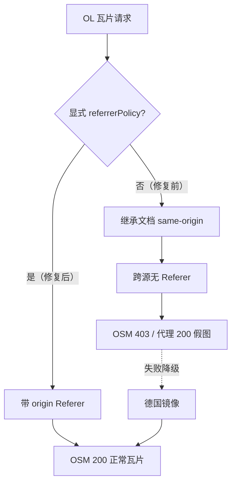

# 修复：OpenLayers 加载 OSM 标准瓦片 403（双引擎 Referrer 策略归一）

- **日期与时间**：2026-11-14 19:50
- **任务等级**：L2（Bug 修复：跨引擎底图链路 + 共用模块抽取）
- **版本**：V3.7.2

---

## 一、问题分析（阶段一产出，先于代码）

### 核心症状

OL 引擎选择「OSM标准」底图后，瓦片位置显示 OSM 官方拦截图：

> **403 Access blocked** — App is not following the tile usage policy of OpenStreetMap's volunteer-run servers.

同一时刻切到 Cesium 引擎，同一图源正常出图。历史轨迹为三段：**最初 OL 可加载 / Cesium 不可 → 针对 Cesium 做优化 → 反过来 OL 不可 / Cesium 可**。

### 根本原因

| # | 环节 | 事实 |
|:--:|---|---|
| 1 | 站点响应头 | `webgis.negiao.cn` 返回 `Referrer-Policy: same-origin`（仓库内无该设置，来自边缘配置） |
| 2 | `fetch()` 语义 | 未显式传 `referrerPolicy` 时**继承文档策略**，跨源请求因此**完全不带 Referer** |
| 3 | OSM 策略 | Tile Usage Policy 将「无可识别 Referer 的程序化瓦片请求」判定为未授权抓取 → 403 |
| 4 | 引擎差异 | Cesium 侧已显式传 `referrerPolicy: 'origin-when-cross-origin'`（V3.7.1 引入），不受文档策略影响；OL 侧 `requestTileAsBlobUrl` 未传 → 被拦 |
| 5 | 二次伤害 | 自建代理出口 IP 历史上曾被 OSM 封禁，代理返回 **HTTP 200 + 6987 字节拦截占位图**；OL 仅凭 `resp.ok` 判定，把拦截图当正常瓦片渲染 |

第 4 条即「跷跷板」的本质：两个引擎各自实现 Referrer 策略，谁显式声明谁就活。

### 受影响模块

OL 瓦片加载链路（`ol/tile-source/tileLifecycle.ts`）、Cesium 瓦片容灾链路（`cesium/constants/basemapProviderFactory.ts`）、双引擎共享底图策略层。

### 候选方案对比

| 方案 | 做法 | 评价 |
|---|---|---|
| A. 只给 OL 加 `referrerPolicy` | 单点改 OL | 修当前症状，但 `6987` 魔数与镜像地址仍在两处各写一份，下次改一边还会漂移 | 
| B. 网关侧把 `Referrer-Policy` 改为 `strict-origin-when-cross-origin` | 改边缘配置 | 一次性解决所有跨源资源，但依赖仓库外的配置通道，且本地 dev（无该头）与线上行为不一致，问题会隐身 |
| C. **A + 抽取共用模块（采用）** | 显式策略 + `@common/basemap/osmTileFallback.ts` 单一真源 | 代码自洽、两引擎语义一致、后续只需改一处 |

> B 仍建议长期执行（作为纵深防御），但不作为唯一依赖：代码必须能在任意页面级策略下正确工作。

---

## 二、修改内容

1. **新增共用模块** `frontend/src/domains/common/basemap/osmTileFallback.ts`
   - `OSM_TILE_TEMPLATE` / `OSM_TILE_HOST` / `OSM_DE_MIRROR_ORIGIN` / `OSM_BLOCKED_TILE_BYTES` 常量；
   - `isOsmTileUrl()`（兼容直连与 `/proxy/tile.openstreetmap.org/...` 形式）、`buildOsmMirrorUrl()`、`isOsmBlockedTileBlob()`；
   - 纯字符串/Blob 判定，零引擎依赖，`common → ol/cesium` 保持 0。

2. **OL 侧** `frontend/src/domains/ol/tile-source/tileLifecycle.ts`
   - `requestTileAsBlobUrl` 新增 `referrerPolicy: 'origin-when-cross-origin'`（常量 `TILE_FETCH_REFERRER_POLICY`，附根因注释）；
   - 新增 `{ osm }` 选项，命中 OSM 时丢弃 6987 字节拦截占位图；
   - 新增 `requestOsmMirrorAsBlobUrl()`，降级顺序改为 **直连 → 德国镜像 → 自建代理**；
   - `TILE_PROXY_MODE === 'always'` 分支下，代理失败时 OSM 仍可回落镜像。

3. **Cesium 侧** `frontend/src/domains/cesium/constants/basemapProviderFactory.ts`
   - 删除本地 `const OSM_TILE_TEMPLATE`、`blob.size === 6987`、`https://tile.openstreetmap.de/...` 字面量，改为引用共用模块；
   - 降级顺序**保持不变**（直连 → 代理 → 镜像），仅去重。

4. **文档**：`CHANGELOG.md` 新增 V3.7.2 条目；`README.md` 三处版本号与版本演进表首行；`frontend-structure.md` 登记新文件；本日志。

## 三、修改原因

「修好 Cesium 就坏 OL」不是偶然，而是**策略实现分散**的必然结果。把 OSM 反拦截知识（模板、镜像、拦截图特征）收敛到 common 层，并让两侧都用显式 Referrer 策略，才能消除跷跷板的结构性成因。

## 四、影响范围

- **二维底图链路**：所有经 `prioritizeTileSourceRequest` 的瓦片源（不仅 OSM）现在都会带站点 origin 作为 Referer；
- **三维底图链路**：仅常量来源变化，逻辑与顺序不变；
- **网络面**：OSM 请求在直连失败时多一次德国镜像尝试（仅 OSM），其它图源不变。

## 五、解决方案与实施步骤

1. 定位现象：确认 403 为 OSM 策略拦截页而非网络错误；
2. 取站点响应头确认 `Referrer-Policy: same-origin`；
3. 对比两引擎 fetch 参数差异，锁定「显式 vs 继承」；
4. 抽取共用模块 → 改 OL → 去重 Cesium → 跑门禁。

## 六、性能指标

未实测。新增仅一次镜像重试（仅当 OSM 直连失败时），不进入正常路径。

## 七、测试方案

### Agent 已执行

| 项目 | 命令 | 结果 |
|---|---|---|
| 类型检查 | `npm run typecheck` | 0 错误 |
| 代码规范 | `npx eslint src/` | 0 error / 0 warning |
| 生产构建 | `npx vite build --outDir $TEMP/... --mode production` | 通过（18.22s） |
| 领域隔离 | `python Scripts/CheckDomainDeps.py` | 四项全 0 |
| 结构树 | `python Scripts/CheckStructureTree.py` | 735/735 |
| 配置登记 / Vue 范式 | `CheckConfigRegistry.py` / `CheckVueParadigm.py` | 全通过 |

### 待用户实机验证

1. OL 切换「OSM标准」→ F12 Network 中 `tile.openstreetmap.org` 请求带 `Referer: https://webgis.negiao.cn/`，状态 200；
2. 若直连被拦，应自动落到 `tile.openstreetmap.de`（Network 可见），地图无「Access blocked」图；
3. OL ↔ Cesium 往返切换各 3 次，两侧均正常出图且无 403；
4. 移动端弱网下切「OSM标准」，确认只有一次镜像重试、无长时间空白。

### 环境限制（如实记录）

本机沙箱到 `tile.openstreetmap.org` 直连不可达（curl 返回 000），**无法在外部复现 403**。根因判定依据为：站点响应头实测 + 仓库内 Cesium 侧既有修复记录 + OSM 官方策略文档；最终以浏览器 Network 面板的 Referer 实据为准。

## 八、变更文件清单

| 文件 | 说明 |
|---|---|
| `frontend/src/domains/common/basemap/osmTileFallback.ts` | 新增：OSM 反拦截策略单一真源 |
| `frontend/src/domains/ol/tile-source/tileLifecycle.ts` | 显式 Referrer 策略、拦截图丢弃、镜像前置降级 |
| `frontend/src/domains/cesium/constants/basemapProviderFactory.ts` | 改用共用常量，删除本地魔数 |
| `Docs/Guide/frontend-structure.md` | 登记 `osmTileFallback.ts` |
| `Docs/Guide/CHANGELOG.md` | 新增 V3.7.2 条目 |
| `README.md` | 三处版本号 → V3.7.2，版本演进表首行 |
| `Docs/LLM_record/26-11/2026-11-14/2026-11-14-fix-ol-osm-403-referrer-policy.md` | 本日志 |

## 九、遗留与风险

1. **Referer 已改为全图源统一发送站点 origin**：极少数对 Referer 白名单极严的第三方图源可能行为变化，需实机抽查（天地图/高德/腾讯已有各自 token 鉴权，预期不受影响）。
2. **`Referrer-Policy: same-origin` 仍由边缘下发**：本次为代码侧兜底。建议后续把该头改为 `strict-origin-when-cross-origin`，消除其它跨源资源的同类隐患（属部署面变更，需单独评估）。
3. **OSM 用量合规**：镜像前置是容灾手段而非长期方案；若 OSM 瓦片访问量持续增长，应换用商业图源或自建瓦片，避免触碰 OSM 的免费额度边界。
