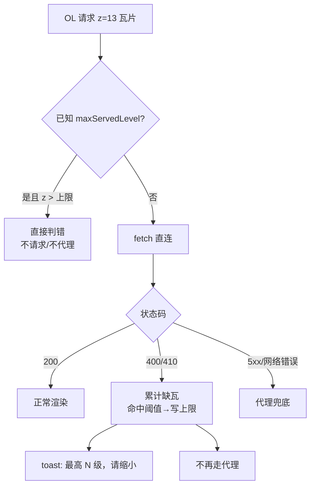

# 修复：底图超出实际瓦片层级后仍持续请求（运行时层级学习 + 代理兜底收敛）

- **日期与时间**：2026-11-14 20:55
- **任务等级**：L2（Bug 修复：OL 瓦片加载链路 + 代理兜底策略）
- **版本**：V3.7.3

---

## 一、问题分析（阶段一产出，先于代码）

### 核心症状

加载河南大学 ArcGIS WMTS 底图 `China_Blender` 后，放大到 13 级仍然持续请求 `.../GoogleMapsCompatible/13/{y}/{x}.png`，服务返回 `400`；随后触发 VPS 代理兜底，代理同样拿不到瓦片，控制台成片 4xx，地图空白且无任何提示。

### 根本原因（三层叠加）

1. **服务元数据与实际缓存不一致**（本次最关键，且此前未被发现）
   - `GetCapabilities` 的 `GoogleMapsCompatible` 矩阵集声明 `0–23` 级；
   - `?f=json` 的 `tileInfo.lods` 同样列出 `0–23` 级（24 条）；
   - 实测：**12 级 `200 / 5046B`，13 级与 14 级均 `400 / 2472B`**。
   - 结论：**任何「按能力文档裁剪 TileGrid」的方案对这台服务器都无效**，因为它宣称的层级本身是假的。

2. `wmtsSource.ts` 依元数据构建 TileGrid → OpenLayers 认为 13–23 级合法 → 持续创建瓦片并调用 `tileLoadFunction`。

3. `tileLifecycle` 对所有 `!resp.ok` 一律触发代理兜底 → `400` 也被重试一次 → 双份 4xx + 一次必然失败的往返。

### 受影响模块

OL 瓦片加载链路（`ol/tile-source/tileLifecycle.ts`）、WMTS 源创建、代理兜底策略。

### 候选方案对比

| 方案 | 做法 | 评价 |
|---|---|---|
| A. 按 capabilities 限级 | 读 TileMatrix 最大值设 `maxZoom` | **无效**：该服务宣称 0–23，与实况不符 |
| B. 在代码里写死这台服务的 `maxZoom: 12` | 针对 `henu.edu.cn` 特判 | 可行但不可扩展，每换一个服务就要改一次代码 |
| C. **运行时学习真实层级上限（采用）** | 依据服务端的确定性拒绝反推上限 | 对任意"元数据说谎"的服务均成立，且无需配置 |

> 采用 C，并保留「4xx 不走代理」的通用收敛。

---

## 二、修改内容

全部改动集中在 `frontend/src/domains/ol/tile-source/tileLifecycle.ts`。

1. **层级上限学习状态（挂在 source 上，随源生命周期回收）**
   - `maxServedLevel`：该源实际可服务的最高层级；
   - `levelMissCounter`：各层级「确定性缺瓦」累计次数。

2. **判定规则**
   - `400` → 阈值 1（服务端明确声明请求不合法，如 ArcGIS 对超出缓存层级的瓦片）；
   - `410` → 阈值 2；
   - 只采信**直连**响应：代理或镜像返回的 4xx 可能源于代理自身（目标改写、限流），不能反推上游层级；
   - **`404` 刻意不参与学习**：稀疏数据集（仅覆盖某省市）在无数据区域会大量 404，据此降级会把「该层存在但此处无数据」误判为「该层不存在」。

3. **降级动作**：命中阈值后把 `level - 1` 写为上限，并 `message.warning('该图源最高仅支持 N 级，已停止请求更高层级瓦片，请缩小地图查看')`，8s 防抖。

4. **入口拦截**：`tileLoadFunction` 首段读取 `maxServedLevel`，`tileCoord[0] > maxServedLevel` 直接 `markTileAsError` 返回，**不发请求、不走代理**。

5. **代理兜底收敛**：`requestTileAsBlobUrl` 改为返回 `{ blobUrl, status, blocked }`；`400/404/410` 与 OSM 拦截假图不再进入 `/proxy` 重试；`5xx` 与传输层失败仍保留兜底。

## 三、修改原因

用户诉求是「不要再请求、不要 console 报错、不要无效代理请求，并提示我缩小」。三项诉求分别对应：入口拦截（不再请求）、确定性缺瓦不代理（无无效往返）、学习成功后的 toast（提示）。三者共用同一份学习状态，不能分开实现。

## 四、影响范围

- **OL 瓦片链路**：所有经 `prioritizeTileSourceRequest` 的栅格源；正常服务（404 稀疏空洞）不受影响，因为 404 不参与学习。
- **代理链路**：4xx 不再经过 `/proxy`，代理请求量下降；5xx/网络错误行为不变。
- **Cesium 链路**：未改动。

## 五、解决方案与实施步骤

1. 复现并实测服务真实层级（curl 12/13/14 级 + capabilities + `?f=json`）；
2. 确认元数据不可信，排除「按文档限级」方案；
3. 在瓦片加载入口引入学习式上限；
4. 收敛代理兜底条件；
5. 跑门禁并实机验证。

## 六、性能指标

未实测。预期收益为定性：单次越界交互从「每块瓦片 2 次失败请求」降为「1 次失败请求 + 0 次代理请求」。

## 七、测试方案

### Agent 已执行

| 项目 | 命令 | 结果 |
|---|---|---|
| 服务实况 | `curl` 12/13/14 级瓦片 | 200 / 400 / 400 |
| 元数据核对 | GetCapabilities + `?f=json` | 均声明 0–23 级（与实况不符） |
| 类型检查 | `npm run typecheck` | 0 错误 |
| 代码规范 | `npx eslint src/` | 0 error |
| 生产构建 | `npx vite build --outDir $TEMP/... --mode production` | 通过（16.24s） |
| 结构树 / 配置 / 范式 / 领域 | `CheckStructureTree` 等四项 | 735/735、全通过、72/72、全 0 |

### 待用户实机验证

1. OL 加载 `China_Blender`，放大到 13 级：Network 中应**只有 1 条** 400 请求，随后弹出「该图源最高仅支持 12 级…」；
2. 继续放大到 14/15 级：**不再出现任何瓦片请求**（Network 无新增），地图空白；
3. 缩小回 12 级：瓦片恢复正常；
4. 切换其它底图（天地图 / OSM / CartoDB）放大到 18 级：行为不受影响，无错误提示。

## 八、变更文件清单

| 文件 | 说明 |
|---|---|
| `frontend/src/domains/ol/tile-source/tileLifecycle.ts` | 层级上限学习、入口拦截、4xx 不走代理 |
| `Docs/Guide/CHANGELOG.md` | 新增 V3.7.3 条目 |
| `README.md` | 三处版本号 → V3.7.3，版本演进表首行 |
| `Docs/LLM_record/26-11/2026-11-14/2026-11-14-fix-ol-tile-level-cap.md` | 本日志 |

## 九、遗留与风险

1. **404 型越界不触发学习**：若某服务对越界层级返回 404 而非 400，仍会有后续 404（但不再走代理）。这是为保护稀疏数据集而做的取舍，如需覆盖应改为「按当前视口缺瓦比例」判定，属独立优化项。
2. **学习结果不持久化**：`maxServedLevel` 挂在 source 上，刷新或重建图层后需重新学习一次（表现为每次会话多 1 次 400）。
3. **未做「自动缩小」**：按用户要求只提示不强制改变视口，若后续希望自动回落到可用层级，需在提示回调里接 `view.animate`。
4. **服务元数据问题应反馈给服务提供方**：`webgis.henu.edu.cn` 的 `China_Blender` 缓存只到 12 级，但 capabilities 声明到 23 级，属发布配置缺陷。
