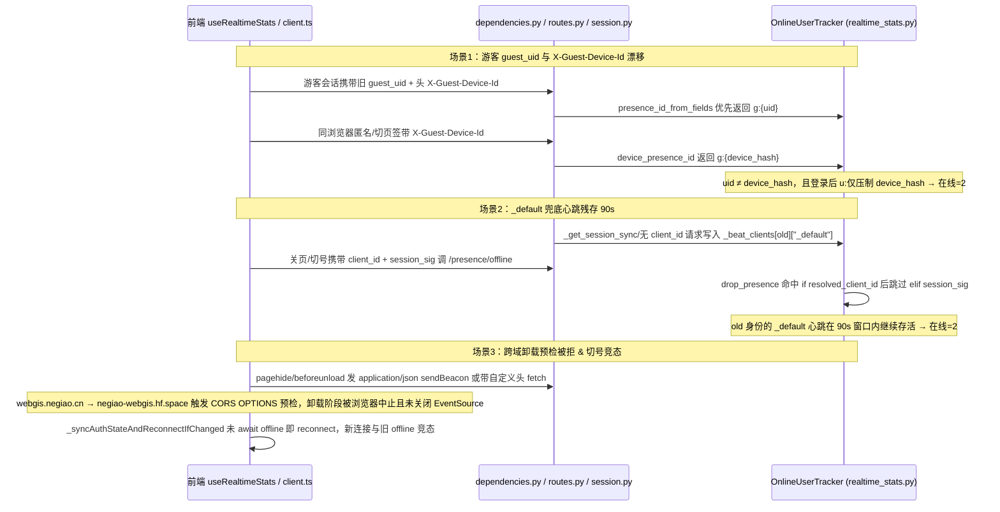

# 修复：用户中心全站实时在线人数在单人在线时显示 2 的逻辑缺陷

- **日期与时间**：2026-11-14 17:45
- **任务等级**：L2（Bug 修复）
- **版本**：V3.7.1（原标注 V3.7.7，已并入统一版本 V3.7.1）

> 说明：本记录正文出现的 V3.7.x 均为合并前的中间标注，已统一并入 V3.7.1。

---

## 一、问题分析（阶段一产出，先于代码）

### 核心症状

在已合入同一 V3.7.1 批次的实时在线优化（`OnlineUserTracker` 连接级追踪与游客去重）之后，用户反馈**仅自己一人在线时**，用户中心「全站实时 → 在线用户」仍显示为 `2`（而不是 `1`）。

### 全链路排查与逻辑拓扑

### 根因清单（对照代码逐项核实）

1. **`presence_id_from_fields` 游客身份分裂，同浏览器压制失效**（[realtime_stats.py](file:///d:/Dev/GitHub/WebGIS-Dev/backend/api/realtime_stats.py#L994-L995)、[dependencies.py](file:///d:/Dev/GitHub/WebGIS-Dev/backend/api/auth/dependencies.py#L34-L67)）：
   - `presence_id_from_fields` 在 `device_id` 非空时仍写为 `f"g:{uid or _build_guest_uid('', '', device_id)}"`；当历史/缺省游客会话的 `guest_uid` 与 `_build_guest_uid('', '', device_id)` 不一致时，会生成 `g:{uid}` 而非规范化的 `device_presence_id(device_id)`。
   - 同时 `statistics_ticket`、`_resolve_presence_context`、`_mark_active_safe`、`statistics_heartbeat`、`logout_user` 调用 `presence_id_from_session(session)` 时未把请求头里的 `X-Guest-Device-Id` 透传进去；若游客 DB 会话记录中 `guest_device_id` 为空而请求头带着 `X-Guest-Device-Id`，就会并存 `g:{random_uid}` 与 `g:{device_hash}`，或使同浏览器已登录账号 `u:<name>` 对 `g:{random_uid}` 压制失效 → 单人被计为 2。
2. **`OnlineUserTracker` 未清理 `_default` 兜底心跳与并发降级残留**（[realtime_stats.py](file:///d:/Dev/GitHub/WebGIS-Dev/backend/api/realtime_stats.py#L220-L235)、[#L447-L466](file:///d:/Dev/GitHub/WebGIS-Dev/backend/api/realtime_stats.py#L447-L466)）：
   - 无 `client_id` 路径（如 `_get_session_sync(..., touch_presence=True)` 或未带 `X-Presence-Client-Id` 的请求）会把兜底心跳记在 `_beat_clients[pid]["_default"]`。
   - `mark_connection` 按 `client_id` 建连时只移除同键 `beat_key`，不会清理同 `session_sig` 下残余的 `"_default"`；`drop_presence` 在同时传入 `client_id` 与 `session_sig` 时走完 `if resolved_client_id:` 分支就跳过 `elif session_sig:`，导致旧身份的 `"_default"` 兜底心跳在 `HEARTBEAT_WINDOW_SECONDS`（90 秒）内继续参与计数 → 单人切号或重连期显示 2。
3. **前端跨源卸载 Beacon 触发 CORS 预检被丢弃 + `EventSource` 未主动关闭**（[useRealtimeStats.ts](file:///d:/Dev/GitHub/WebGIS-Dev/frontend/src/domains/common/user/composables/useRealtimeStats.ts#L170-L281)）：
   - 生产部署为前后端分离跨域（`webgis.negiao.cn` → `negiao-webgis.hf.space`）：`navigator.sendBeacon` 使用 `type: 'application/json'`，且登录态下跳过 `sendBeacon` 改走携带 `Authorization` / `X-Guest-Device-Id` / `X-Presence-Client-Id` 的 `fetch`，两者在跨域下均需先发 CORS `OPTIONS` 预检请求，在 `pagehide` / `beforeunload` 页面卸载期常被浏览器取消或丢弃；同时 `pagehide` 未显式调用 `_eventSource.close()`，代理层可能延迟感知半开断开。
   - `_syncAuthStateAndReconnectIfChanged` 异步 `void _sendPresenceBeacon(..., { tokenOverride: prevToken, force: true })` 后立即 `reconnect()`，同一 `client_id` 的旧 `offline` 与新 `mark_connection` 产生到达竞态。

---

## 二、修改原因与影响范围

- **修改原因**：单人仅打开单个会话或切换身份/关闭页面时，因游客 ID 归一化缺失、`OnlineUserTracker` 兜底心跳清理盲区以及跨域页面卸载 Beacon 触发 CORS 预检被取消，导致同一个人被统计为 2 个在线身份。
- **影响范围**：后端鉴权与在线统计（`backend/api/realtime_stats.py`、`backend/api/auth/dependencies.py`、`backend/api/auth/routes.py`）、前端实时在线状态订阅（`frontend/src/domains/common/user/composables/useRealtimeStats.ts`）、后端回归单测（`backend/tests/test_realtime_stats.py`）。

---

## 三、解决方案与修改内容

### 方案选型与实施

1. **后端身份归一与 `X-Guest-Device-Id` 透传**：
   - 修改 `backend/api/realtime_stats.py` 中 `presence_id_from_fields`：当 `device_id` 非空时始终按 `_build_guest_uid("", "", device_id)` 返回规范化 `g:` 键，避免历史或错配 `guest_uid` 与 `device_presence_id` 分裂。
   - 为 `presence_id_from_session` 与 `mark_presence_active` 增加 `guest_device_id: Optional[str] = None` 关键字参数；在 `_resolve_presence_context`（同时向 `_get_session_sync` 传入 `update_last_seen=False`）、`statistics_ticket`、`statistics_heartbeat`、`backend/api/auth/dependencies.py` 的 `_mark_active_safe` 及 `backend/api/auth/routes.py` 的 `logout_user` 中统一透传请求里的 `X-Guest-Device-Id` / `guest_device_id`。
2. **后端 `OnlineUserTracker` 兜底心跳清理**：
   - 新增 `OnlineUserTracker._drop_session_beats_locked`，在 `mark_connection` 按 `client_id` 建连时清理同 `session_sig`（或无 `session_sig` 时的 `user_id`）残余的 `"_default"` 兜底心跳；
   - `drop_presence` 同时收到 `client_id` 与 `session_sig` 时，若内存中已无同 `session_sig` 的存活 SSE 连接，一并清理该 `session_sig` 名下残余心跳（含 `"_default"`）；`logout_user` 同步传入 `session_sig=session_signature(token)`。
3. **前端卸载信令零预检与切号串行化**：
   - 修改 `frontend/src/domains/common/user/composables/useRealtimeStats.ts`：`_sendPresenceBeacon` 新增 `preferBeacon` 参数，在 `pagehide` / `beforeunload` 时优先使用 `type: 'text/plain;charset=UTF-8'` 的 `Blob` 通过 `navigator.sendBeacon` 发送 JSON 载荷（CORS 简单请求零预检）；`pagehide` 时通过 `_closeActiveEventSourceOnUnload()` 主动关闭 `_eventSource` 并停止降级 ping；
   - `_syncAuthStateAndReconnectIfChanged` 使用 `_authSyncInFlight` 串行化，先 `await` 旧身份 `offline` 信令再调用 `reconnect()`；使用具名 `_onAuthChangedEvent` 保证事件监听对称销毁。
4. **回归单测补充**：
   - 在 `backend/tests/test_realtime_stats.py` 新增 3 条单测：`test_guest_uid_conflict_normalized_to_device_presence_id`、`test_default_fallback_beat_cleaned_on_connect_and_drop_presence`、`test_offline_beacon_accepts_text_plain_cors_simple_payload`。

---

## 四、性能指标

- 未实测（本次为在线计数准确性修复，未引入额外轮询或定时任务）。

---

## 五、测试方案与验证结果

### Agent 已执行（全部于最终代码编辑后运行）

| 检查项 | 命令 | 结果 |
|---|---|---|
| 结构树门禁 | `python Scripts/CheckStructureTree.py` | ✅ 通过（文档条目 734 · 磁盘文件 734 · 漏登记 0 · 幽灵条目 0） |
| 配置登记门禁 | `python Scripts/CheckConfigRegistry.py` | ✅ 通过（`[B1]`-`[B4]`、`[F1]`-`[F3]` 全通过，catalog 134 key，前端使用 `VITE_` 11 个） |
| 域边界门禁 | `python Scripts/CheckDomainDeps.py` | ✅ 通过（`common->ol: 0`、`common->cesium: 0`、`cesium->ol: 0`、`ol->cesium: 0`、`TOTAL: 0`） |
| 实时在线单测 | `cd backend; uv run --with pytest python -m pytest tests/test_realtime_stats.py -v` | ✅ 24 passed in 0.53s |
| 后端全量单测 | `cd backend; uv run --with pytest --with pytest-asyncio python -m pytest tests/ -v` | ⚠️ 63 passed, 1 failed（失败项为无关既有测试 `tests/test_webhook_helpers.py::test_shutdown_webhook_watches_noop_when_idle`，`pytest-asyncio` STRICT 模式下未标 `@pytest.mark.asyncio`） |
| 前端类型检查与 Lint | `cd frontend; npx vue-tsc --noEmit -p tsconfig.json` + `npx eslint src/domains/common/user/composables/useRealtimeStats.ts` | ✅ 退出码 0，无报错 |
| 平台红线自查（§11.2） | Windows 无 `rg`，改用等价 `git grep -inE` 扫描 `backend/ deploy/ frontend/src/ .github/` 及 `git grep -nE` 扫描 `deploy/.env` | ✅ 红线 1–8 仅命中文档已登记假阳性 `maxRayDistance`/`maxRayDist`（Cesium 云体渲染参数，均在 `cloud*` 与词条中）；红线 9 退出码 1（无匹配，基线完整） |

### 待用户实机验证

1. 启动后端与前端（或部署测试环境），仅在一个浏览器标签页保持登录态打开页面，打开「用户中心 → 概览 → 全站实时」，确认「在线用户」显示 `1`。
2. 在同一浏览器内切换登录态 / 退出到游客模式 / 刷新页面或关闭再重开标签页，观察 5~10 秒后在线用户数仍稳定为 `1`。

---

## 六、变更文件清单

- `backend/api/realtime_stats.py`：归一化 `device_id` 游客在线 ID、支持 `guest_device_id` 兜底透传、清理 `_default` 兜底心跳与并发残余心跳。
- `backend/api/auth/dependencies.py`：`_mark_active_safe` 向 `mark_presence_active` 透传请求中的 `guest_device_id`。
- `backend/api/auth/routes.py`：`logout_user` 向 `presence_id_from_session` 传入 `guest_device_id` 并向 `drop_presence` 传入 `session_sig`。
- `backend/tests/test_realtime_stats.py`：新增游客 ID 冲突归一、`_default` 心跳清理及 `text/plain` 简单请求 Beacon 三项回归测试。
- `frontend/src/domains/common/user/composables/useRealtimeStats.ts`：页面卸载改用无 CORS 预检 `text/plain` `sendBeacon` 并主动关闭 `EventSource`，串行化认证状态切换与重连。
- `README.md`、`Docs/Guide/CHANGELOG.md`：并入统一版本 V3.7.1 并记录变更摘要（原标注递增至 V3.7.7，现已废弃）。
- `Docs/LLM_record/26-11/2026-11-14/2026-11-14-fix-realtime-online-count-duplicate-presence.md`：本次 L2 修复维护日志。

---

## 七、遗留与风险

- 同一自然人若同时在两台不同设备、或同一设备两个互相隔离浏览器/无痕窗口以匿名游客身份访问，因双方持有不同 `X-Guest-Device-Id` 且未绑定同一账号，按设备去重机制仍会统计为 2（属匿名设备统计边界）。
- `backend/tests/test_webhook_helpers.py::test_shutdown_webhook_watches_noop_when_idle` 存在既有异步测试标记缺失导致 `pytest --with pytest-asyncio` 下失败，本次按规范未越界修改无关模块。
- 生产环境部署于跨源前后端架构，需实机观察一次部署后确认代理层无残余半开 SSE 连接。
