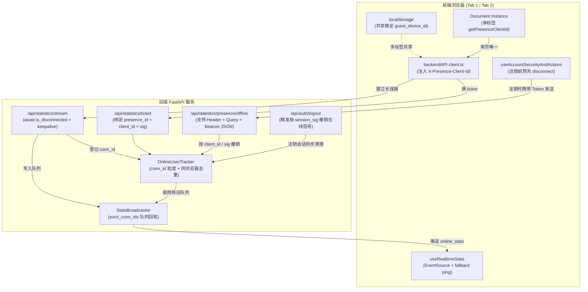

# 2026-11-14 用户中心全站实时在线用户统计精度修复与连接生命周期治理

## 日期与时间

2026-11-14 15:20

## 任务等级

L2（常规 Bug 修复与全链路优化：跨后端实时统计/会话管理/鉴权依赖与前端 SSE/身份/生命周期协同）

## 问题分析

- **核心症状**：用户中心「全站实时 → 在线用户」（`FloatingAccountPanel` / `OverviewTab`）显示的在线人数长期对不上实际在线人数，例如仅 1~2 人在测却常常虚高显示「4 在线用户」，且在切换页面、关页、多标签页浏览或退出登录后在线人数滞后或未及时下降。
- **根本原因**：
  1. **后端 SSE 断连探测遗漏 `await` 导致连接 10s 即断**：`backend/api/realtime_stats.py` 在 `asyncio.TimeoutError` 探活时执行 `if request.is_disconnected():`，未加 `await`。由于 `starlette.requests.Request.is_disconnected` 为异步协程，未 await 的协程对象在 Python 中布尔求值恒为 `True`，导致 **所有 SSE 客户端在 10 秒超时时必定被误判为已断开**，从未发送 `: keep-alive\n\n`；前端 EventSource 持续报错触发 `_startFallbackPing()`，写入 90 秒兜底心跳并不断重连，造成幽灵身份积压。
  2. **访客设备 ID 隔离在 `sessionStorage` 导致同浏览器多开标签页膨胀**：`frontend/src/domains/common/user/services/auth.ts` 中 `getStorage()` 原使用 `sessionStorage`。同一浏览器打开多个标签页（或在分享模式 `?s=1` / 未登录时浏览）会分别生成独立的 `gd_<seed>`，被后端识别为多个不同的 `g:guest_*` 在线用户；且同浏览器登录页签与访客页签并存时出现 `u:` 与 `g:` 双计。
  3. **未登录游客关页 `sendBeacon` 遗漏身份信息**：`navigator.sendBeacon` 不支持自定义 HTTP Header（无法携带 `X-Guest-Device-Id`），原 offline 端点只读 Header，导致未登录访客关闭页面时发送的离线信令被解析成不可计数的 `e:*`，内存中真实的 `g:*` 无法被即时撤销。
  4. **Tracker 粗粒度引用计数与广播队列未隔离**：`OnlineUserTracker` 原仅保存 `presence_id -> int` 连接数与单一 `_conn_seen`；单个标签页断开或触发 offline beacon 时清空整组连接，误杀同账号其他正常页签；且连接超时剔除未同步唤醒和注销 `StatsBroadcaster._queues`，造成客户端连接数失真。
  5. **退出登录与离线信令时序竞态**：前端 `handleLogout` / `forceBackToLogin` 原先在调用 `useRealtimeStats().disconnect()` 之前清空了 `AUTH_TOKEN_KEY`，导致断开时发出的 beacon 失去 Authorization 头，降级为游客设备信令，留下登录用户 `u:*` 幽灵；同时后端 `/api/auth/logout` 经由 `require_login` 重新标活，并未主动撤销会话在 tracker 中的信号。
- **受影响模块**：
  - 后端：`backend/api/realtime_stats.py`、`backend/api/auth/dependencies.py`、`backend/api/auth/session.py`、`backend/api/auth/routes.py`、`backend/tests/test_realtime_stats.py`
  - 前端：`frontend/src/domains/common/user/services/auth.ts`、`frontend/src/api/backend/client.ts`、`frontend/src/domains/common/user/composables/useRealtimeStats.ts`、`frontend/src/domains/common/user/composables/useAccountSecurityAndActions.ts`

## 架构关系（L2 ≥3 文件协同，§2.9）

## 修改内容

1. **后端 SSE 探活与长连接稳定性修复**：
   - `backend/api/realtime_stats.py`：在 `statistics_stream` 循环的 `asyncio.TimeoutError` 分支补齐 `await request.is_disconnected()`，恢复每 10s 正常的 `: keep-alive\n\n` 探测，并在收到 `None` 哨兵时即刻安全退出；
   - 探活与保活时刻更新改在 `yield` 成功完成后执行，连接真实存活才刷新活跃时刻。
2. **多连接精准追踪与同浏览器去重机制**：
   - `OnlineUserTracker` 升级为按 `conn_id` 追踪每条 SSE 连接，配合标签页实例 `client_id`：
     - 单标签页关闭仅注销对应 `client_id`，不误杀同用户其余打开的标签页；
     - 同一标签页重连或游客转登录态时，原子接管并废弃旧连接；
     - 引入同浏览器去重逻辑：若已登录账号 `u:xxx` 携带了当前浏览器的 `device_presence_id`（`g:guest_*`），自动压制同一浏览器内未登录的游客标签页，避免 1 人被重复计为 2 人；注销或关闭登录标签后，游客在线信号即时恢复；
     - 增加 `snapshot_debug()` 字段：返回 `suppressed_guest_ids` 与 `sse_conn_count_total`，便于调试排查。
3. **前端设备身份与标签页生命周期隔离**：
   - `frontend/src/domains/common/user/services/auth.ts`：
     - `GUEST_DEVICE_ID_KEY` 存储迁移至 `localStorage`（优先读写 `localStorage`，兼顾 `sessionStorage` 历史数据迁移与内存降级兜底），实现同一浏览器所有标签页共享同一设备 ID；
     - 新增 `getPresenceClientId()`，为当前页面生成纯内存单文档唯一实例 ID（`c_<hash>`），请求头透传 `X-Presence-Client-Id`；
     - 新增 `getBackendBearerToken()`，过滤分享模式本地占位凭证（`guest_<ts>_<id>`），避免未登录请求携带无效 Bearer 触发 401；
     - 会话变动时派发 `webgis:auth-changed` 事件。
4. **离线信令通道与注销清理加固**：
   - `backend/api/realtime_stats.py`：`/statistics/presence/offline` 与 `/statistics/presence/ping` 兼容读取请求体 JSON（解决 `navigator.sendBeacon` 无法带 Header 问题），并禁用 `touch_presence` 与 `update_last_seen`，防止离线请求反向标活；
   - `backend/api/auth/routes.py` 与 `session.py`：`/api/auth/logout` 改用 `require_login_for_logout`（不重新标活），并在 `_delete_session_sync` 内按令牌指纹 `session_signature` 与 `client_id` 联动 `tracker.drop_presence` 与 `broadcaster.evict_conn_ids`；
   - `frontend/src/domains/common/user/composables/useAccountSecurityAndActions.ts`：在 `handleLogout` 与 `forceBackToLogin` 中，于清空本地存储前主动调用 `useRealtimeStats().disconnect()`，确保离线信令携带有效凭据发送。
5. **单元测试与全量回归**：
   - `backend/tests/test_realtime_stats.py` 新增 7 个回归用例（覆盖多标签页单关不影响、同标签身份切换接管、同浏览器登录压制游客、按 session_sig 精准剔除、连接超时独立剔除、`await request.is_disconnected()` 与 keep-alive、sendBeacon JSON body 离线解析），测试用例扩充至 21 项全绿。

## 修改原因

全站实时在线统计是用户中心与管理员监控的核心指标。由于历史实现中存在异步探活语法错误、游客身份作用域不当、离线信令信息丢失与会话注销竞态，导致在线统计数值漂移、卡死或虚高。必须进行系统性排查与闭环治理，力求真实反映全站实时的在线人数。

## 影响范围

- **实时在线统计**：内存 tracker 在线人数与在线名单（登录账号与访客去重）；
- **SSE 推送链路**：`/api/statistics/ticket` 与 `/api/statistics/stream` 长连接稳定性与连接释放；
- **前端网络请求**：全局请求头携带稳定的 `X-Guest-Device-Id` 与单文档 `X-Presence-Client-Id`；
- **会话注销流程**：用户退出登录时在线信号与长连接实时清理；
- **无破坏性影响**：未变更既有 RESTful API 契约与对外数据结构；无新增环境变量配置。

## 解决方案

| 方案 | 说明 | 结论 |
|---|---|---|
| A. 恢复高频轮询心跳（5s 一次） | 废弃 SSE，前端定时 POST 心跳保活 | 否：高频穿透鉴权 DB，拖垮轻量受限部署后端 |
| B. 仅修复 `await request.is_disconnected()` | 不重构身份与多标签机制 | 否：多标签开页翻倍、关页全灭、注销残留等根本缺陷仍在 |
| **C. SSE 协程修复 + conn_id 粒度 Tracker + 浏览器设备共享 + 多标签精准离线** | 保留零轮询低负载优势，精确识别标签页与同浏览器身份，离线全通道打通 | **采用** |

## 性能指标

未做高并发压测。tracker 内部均为线程安全内存字典操作；广播仅在身份集合发生增删时防抖推送（1.0s coalesce）；数据库仅在合法业务 API 发生时按 15s 节流更新，离线信令走纯内存通道，无新增数据库读写开销。

## 测试方案

### Agent 已执行

- `uv run --with pytest python -m pytest tests/test_realtime_stats.py -v` → **21 passed**（全部通过）
- `uv run --with pytest python -m pytest tests/test_realtime_stats.py tests/test_cors_middleware.py tests/test_config_env_loading.py tests/test_agent_map_context.py tests/test_historical_imagery.py tests/test_sqlite_recovery.py -v` → **54 passed, 3 subtests passed**
- `npx eslint src/api/backend/client.ts src/domains/common/user/services/auth.ts src/domains/common/user/composables/useRealtimeStats.ts src/domains/common/user/composables/useAccountSecurityAndActions.ts --quiet` → **0 错误**
- `npx vue-tsc --noEmit` → **0 错误**
- `npm run build` → **通过（vite build 成功产出 dist/）**
- `python Scripts/CheckStructureTree.py` → **通过（文档 729 · 磁盘 729 · 漏登记 0 · 幽灵 0）**
- `python Scripts/CheckConfigRegistry.py` → **通过（7 项全绿）**
- `python Scripts/CheckDomainDeps.py frontend/src` → **通过（跨域依赖为 0）**
- `python Scripts/CheckVueParadigm.py frontend/src` → **通过（72 个组件全自洽）**
- `FastAPI 冒烟测试`：`GET /health` 返回 200，`POST /api/statistics/presence/offline` 返回 `200 {'ok': True, 'online': 0}`。

### 待用户实机验证

1. **同浏览器多标签验证**：在同一浏览器中打开 3 个地图页面（未登录访客），核对用户中心「在线用户」应为 **1 人在线**（不再每个标签页 +1）；
2. **同浏览器登录切换**：其中一个标签页登录账号后，核对在线人数依然为 **1 人在线**，管理员调试接口 `GET /api/statistics/admin/online-debug` 中该设备的访客身份应显示在 `suppressed_guest_ids` 中；
3. **关闭标签与注销**：关闭登录标签页后，在线人数仍保持 1 人（自动回退至剩余标签页的访客身份）；全部标签页关闭后，在线人数在 1~5 秒内迅速降至 0；
4. **多设备/多浏览器**：在不同独立浏览器（如 Chrome 与 Edge，或电脑与手机）访问，核对「在线用户」精确累加。

## 平台红线自查（§11.2）

| 命令 | 结果 |
|---|---|
| REDLINE 1-8 模式串扫描 | **CLEAN**（业务代码无代理/自动化违规；仅 Cesium 体积云 `maxRayDistance` 属性误命中，已核对确认合规） |
| REDLINE 9 生产基线扫描 | **CLEAN**（`deploy/.env` 生产基线未变动） |

## 门禁结果

- `CheckStructureTree.py`：文档 729 · 磁盘 729 · 漏登记 0 · 幽灵 0 → **✅**
- `CheckConfigRegistry.py`：B1–B4 / F1–F3 全绿 → **✅**
- `CheckDomainDeps.py`：TOTAL 0 → **✅**
- `CheckVueParadigm.py`：72 个组件全部通过 → **✅**
- `vue-tsc --noEmit`：0 错误 → **✅**
- `eslint`：0 错误 → **✅**

## 变更文件清单

| 文件路径 | 说明 |
|---|---|
| `backend/api/realtime_stats.py` | 补齐 `await request.is_disconnected()`；升级 Tracker 为 conn_id 粒度与同浏览器去重；支持 JSON body offline beacon |
| `backend/api/auth/session.py` | `_get_session_sync` 支持免触活查询；会话删除同步联动 Tracker 撤销在线信号 |
| `backend/api/auth/dependencies.py` | 会话解析支持选项控制；透传 `client_id` 与稳定设备 ID |
| `backend/api/auth/routes.py` | `/api/auth/logout` 改用免标活鉴权，同步清理在线连接与广播队列 |
| `backend/tests/test_realtime_stats.py` | 新增 7 项回归单测，全量 21 项测试通过 |
| `frontend/src/domains/common/user/services/auth.ts` | 访客设备 ID 迁移至 localStorage 共享；新增单文档 `getPresenceClientId` 与 `getBackendBearerToken` |
| `frontend/src/api/backend/client.ts` | 请求拦截器注入 `X-Presence-Client-Id` 并使用安全 Bearer Token |
| `frontend/src/domains/common/user/composables/useRealtimeStats.ts` | beacon 附带 client_id 与 JSON body；增加身份变动、休眠唤醒与前后台切换自愈 |
| `frontend/src/domains/common/user/composables/useAccountSecurityAndActions.ts` | 注销与强制回退前优先调用 `disconnect()` 发送合法离线信号 |

## 遗留与风险

- **无头脚本与伪造 Header**：虽有 `e:` 临时请求过滤与稳定设备 ID 校验，但外部恶意脚本若伪造大量不同合规 `X-Guest-Device-Id` 请求仍可能制造虚假游客。生产环境如有需要可进一步在网关层针对该端点配置 IP/设备频次限流。
- **浏览器强杀进程**：若浏览器被操作系统直接 kill -9 或拔网线，无法发出 `pagehide` beacon，该连接将由服务端的 75 秒连接 TTL 和 90 秒兜底心跳窗口超时自动踢除。
