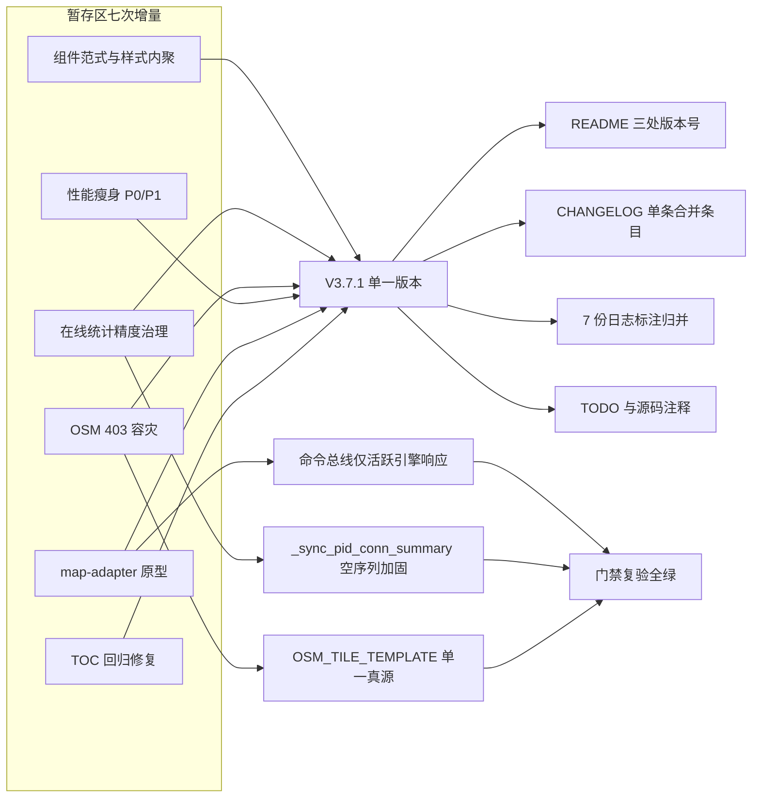

# 2026-11-14 V3.7.1 暂存区 Code Review、缺陷修复与版本号整合收口

- **日期与时间**：2026-11-14 18:10
- **任务等级**：**L2 常规**（跨前后端 Code Review + 缺陷修复 + 版本号/文档整合；不新增业务能力，不改目录结构与依赖）
- **用户明确指令（§0 优先级 1）**：将暂存区多次不规范提交整合为**统一版本 V3.7.1**；只读审查暂存区代码；**禁止任何 Git 写操作**（含 `git add`），以便用户自行核对 diff。

---

## 一、问题分析（阶段一产出）

### 1.1 核心症状

暂存区积压 168 个文件（+22,828 / −56,786），对应七次**未提交**的增量工作，版本号已递增至 `V3.7.7`，而仓库最后一次提交仍是 `V3.7.0`（`a478fc63`）。症状有三类：

1. **版本号倒挂**：`README.md` 三处、`CHANGELOG.md` 七条、7 份维护日志与若干源码注释分别标注 `V3.7.1 ~ V3.7.7`，git 历史中并不存在这些提交，版本语义与提交粒度脱节。
2. **不可审计的提交信息**：七次增量混在同一暂存区，无法用一条 message 表达，也无法二分定位回归。
3. **潜在缺陷未收口**：新落地的 `@common/map-adapter` 原型、`OnlineUserTracker` 重构与瓦片容灾链路存在若干**类型检查查不出**的运行时缺陷。

### 1.2 根本原因

- 逐次增量均以「会话」为切分单位，而非以「可提交单元」为切分单位；每次会话结束只更新文档版本号，未落提交，导致文档领先于 Git 历史。
- 阶段一缺失：先写文档再施工的流程被遵守了，但**提交边界**从未被定义。

### 1.3 受影响模块

`frontend/src`（组件范式、双引擎适配器、瓦片链路、实时统计前端）、`backend/api`（实时统计、鉴权、会话）、`Docs/`（版本与结构树）、`.github/`（依赖机器人策略）。

### 1.4 候选方案对比

| 方案 | 做法 | 优点 | 缺点 | 结论 |
|---|---|---|---|---|
| A. 保留七个版本号，逐条写进一条 commit | 只写 message | 保留原貌 | 与 Git 历史不符，版本号永久倒挂 | 否决 |
| B. 七个版本号全部保留，拆成七次提交 | 拆提交 | 语义清晰 | 需 `git add`/`commit`，触碰 §2.1 红线，且用户明确禁止 | 否决 |
| C. 七个版本号归并为单条 `V3.7.1`，过程日志保留 | 文档归并 + 保留过程记录 | 与「一次提交 = 一个版本」对齐；§CHANGELOG 已有 2026-11-07 归并先例 | 需在日志头部标注「原标注」 | **采用** |

---

## 二、Code Review 结论与修复

### 2.1 已修复缺陷（4 项）

| # | 位置 | 缺陷 | 修复 |
|:--:|---|---|---|
| 1 | `domains/ol/adapter/OpenLayersAdapter.ts`、`domains/cesium/adapter/CesiumAdapter.ts` | `MapCommandBus` 为全局单例，OL 与 Cesium 适配器**同时订阅**同一批命令。一旦业务面板 `dispatch('camera:flyTo')`，两个引擎会同时飞行；`tool:activate` 亦会双引擎同时进入绘制态。属原型期埋雷，类型系统无法发现。 | 两个适配器各加 `isActiveEngine()` 守卫（`getActiveMapEngineAdapter() === this`），并显式 `void` 掉返回 Promise，避免浮空 Promise。 |
| 2 | `backend/api/realtime_stats.py` `_sync_pid_conn_summary_locked` | `max(generator)` 的生成器按 `if cid in self._connections` 过滤；当 `_pid_conns[pid]` 非空但对应连接全部已移除时，`max()` 对空序列抛 `ValueError`，会打断 SSE 建立/断开主流程。 | 先收集 `live_seen` 列表再判空；为空时按「该身份已无连接」回收 `_pid_conns` / `_conns` / `_conn_seen` 三张表，顺带使连接计数只统计真实存活连接。 |
| 3 | `domains/cesium/constants/basemapProviderFactory.ts` `wrapProviderWithFetchFallback` | OSM 分支的 URL 模板取自 Cesium **私有字段** `provider._resource.url`。官方 `OpenStreetMapImageryProvider` 若不保证该字段含 `{z}/{x}/{y}`，所有瓦片会请求同一 URL（表现为整屏同一张图或全黑），且不会有任何报错。 | 新增 `OSM_TILE_TEMPLATE` 常量作单一真源：`isOsm` 时优先使用显式模板，`_resource` 仅作末位兜底；`case 'osm'` 的字面量同步收敛到该常量。 |
| 4 | 三个 adapter / bus 文件 | 3 条 `// eslint-disable-next-line no-console` 属无效抑制（该规则未启用），ESLint 报 3 warning。 | 删除无效抑制注释，`eslint src/` 归零。 |

补充加固：`CesiumAdapter.flyTo` 的 `camera.flyTo` 若同步抛错（非法经纬度/视锥参数），原实现使 Promise 永久悬挂，调用方 `await` 死等；改为 `try/catch` + `resolve()`。

### 2.2 复核通过、判定为「非缺陷」的疑点

| 疑点 | 结论 |
|---|---|
| `statistics_stream` 的 `finally` 引用未初始化的 `queue` | 已在 `try` 前 `queue = None`，不会 `UnboundLocalError`。 |
| `_offlineBeaconSent` 置位后是否吞掉真正的 `pagehide` beacon | `connect()` 与 `reconnect()` 均重置该标志，切号路径 `await` 后即 `reconnect()`，链路自洽。 |
| 10 份外置 `.scss` 回迁 `.vue` 后是否为纯 CSS 可解析 | 9 个组件样式块内 SCSS 专有语法（`$var`/`@use`/`@mixin`/`//`）计数为 0，`vite build` 通过。 |
| 9 个巨型 `.vue` 是否夹带模板/脚本改动 | 逐文件比对「`<style>` 之前」内容：8 个完全一致，`CesiumContainer.vue` 仅 1 行注释措辞变化。 |
| 10 个被拆分模块是否丢实现 | 逐函数名核对 + 目标文件全文匹配，被移动函数全部存在；宿主文件保留 `export {}` 再导出，导入路径不变。 |
| `onUnmounted` 在 `class Instance` 构造函数中是否有效 | `setup()` 内 `return new Instance(...)`，存在活跃组件实例，合法。 |

### 2.3 提交前必须由用户决策的事项（Agent 不擅自处置，§0/§2.4）

`.github/workflows/dependabot-automerge.yml`（新增）与 `.github/dependabot.yml`（撤销 ignore 块）会开启 **Dependabot patch/minor 全自动 squash 合并**，与 `Docs/Force_command.md` §12.7.1「禁止开启仓库级 auto-merge 或使用 `gh pr merge --auto`」及 §12.1「`allow_auto_merge=false`、机器人不自行合并」的事实基线**直接冲突**。该文件属部署面（§2.3）且由用户会话产出，Agent 不删除、不改写，仅在交接块与 TODO 中登记，等用户裁决。

---

## 三、版本号整合

| 对象 | 处理 |
|---|---|
| `README.md` | 三处（项目简介 / 版本演进表 / 页脚）统一为 `V3.7.1`；版本演进表由「V3.7.7 / V3.7.6 / V3.7.5」替换为「V3.7.1 合并摘要 / V3.7.0 / V3.6.45」，恒定 3 行，`更早版本（V3.6.44 及以前）`。 |
| `Docs/Guide/CHANGELOG.md` | 七条 `V3.7.1 ~ V3.7.7` 合并为单条 `V3.7.1`，按主题重组为 7 个条目（组件范式 / 模块拆分 / 在线统计 / OSM 容灾 / 性能专项 / 适配器原型 / 回归修复与门禁）；顶部新增「版本号归并（2026-11-14）」说明。 |
| 7 份 `Docs/LLM_record/26-11/2026-11-14/*.md` | **不改写正文**（§6 日志不可改写），仅在版本行标注「原标注 V3.7.x，已并入统一版本 V3.7.1」，并补一行归并说明。 |
| 源码注释 | `engineTreePort.ts`、`public/min-enhanced.js`（3 处）的中间版本号改为 `V3.7.1`。 |
| `Docs/TODO/bugfix-optimization-plan.md` | P3-11 条目中的 `V3.7.6` 改为 `V3.7.1`；新增 P0-1（auto-merge 决策）与 P3-12（登出后 SSE 不自动恢复）两条登记。 |

---

## 四、影响范围

- **鉴权与在线统计链路**：`presence_id` 归一、`conn_id` 级追踪、离线 beacon、注销剔除。
- **三维底图链路**：OSM 瓦片请求路径、代理兜底、镜像降级。
- **跨引擎架构层**：命令总线响应域（本次修复后由「全引擎」收敛为「活跃引擎」）。
- **构建与发布面**：`public/cesium/index.{js,cjs}` 删除（−8.78 MB）、`min-enhanced.js` 瘦身、`.github/` 工作流新增（待决策）。
- **文档与版本号**：README / CHANGELOG / 7 份日志 / TODO。

## 五、解决方案与实施步骤

1. 只读盘点暂存区（`git status` / `git diff --cached --stat`），建立 63 新增 / 17 删除 / 88 修改的清单。
2. 跑通全部门禁取得基线：`vue-tsc --noEmit`、`eslint src/`、`vite build`（`--outDir dist-verify` 规避沙箱批量删除保护）、`CheckStructureTree`、`CheckConfigRegistry`、`CheckVueParadigm`、`CheckDomainDeps`、`pytest tests/test_realtime_stats.py`。
3. 按 2.1 修复四项缺陷，复跑类型检查与单测。
4. 归并版本号（README / CHANGELOG / 日志 / 源码注释 / TODO）。
5. 复跑全部门禁 + 结构树门禁，确认 734/734 无漂移。

### 变更关系图

## 六、性能指标

未实测。本次修复均为正确性缺陷，无性能目标；`public/cesium/index.{js,cjs}` 删除带来的静态产物体积下降（−8.78 MB）为文件体积口径，非运行时指标。

## 七、测试方案

### Agent 已执行

| 项目 | 命令 | 结果 |
|---|---|---|
| 类型检查 | `npm run typecheck`（`vue-tsc --noEmit`） | 0 错误 |
| 代码规范 | `npx eslint src/` | 0 error / 0 warning（修复后） |
| 生产构建 | `npx vite build --outDir dist-verify --mode production` | 成功（22.8s），CSS 内联块解析通过 |
| 结构树门禁 | `python Scripts/CheckStructureTree.py` | 文档 734 · 磁盘 734 · 漏登记 0 · 幽灵 0 |
| 配置登记 | `python Scripts/CheckConfigRegistry.py` | 7 项全通过（catalog 134 key / 前端 11 个 VITE_） |
| Vue 范式 | `python Scripts/CheckVueParadigm.py` | 72/72 通过 |
| 领域隔离 | `python Scripts/CheckDomainDeps.py` | common→ol 0 / common→cesium 0 / cesium→ol 0 / ol→cesium 0 |
| 后端单测 | `pytest tests/test_realtime_stats.py -q` | **24 passed** |
| 后端全量 | `pytest tests/ -q` | 63 passed / 1 failed（`test_webhook_helpers.py::test_shutdown_webhook_watches_noop_when_idle`，因本机临时安装的 pytest 未启用 `asyncio_mode`，与本次改动无关，属环境差异） |

> 说明：为运行后端单测，向 `backend/.venv` 临时安装了 `pytest` / `pytest-asyncio`（未改动 `pyproject.toml` 与 `uv.lock`）。

### 待用户实机验证

1. **在线人数**：同一浏览器仅登录一个账号 → 用户中心「全站实时 → 在线用户」应为 `1`；再开一个同站游客标签页仍应为 `1`；关闭其中一个标签应保持 `1`，全关后 ≤90s 归零。
2. **三维底图**：进入 Cesium 视图并切到 OSM 底图，F12 Network 中 `tile.openstreetmap.org` 不得出现 403；受限网络下应出现「已自动切换至代理/镜像」提示且瓦片完整。
3. **三维绘制入树**：侧栏绘制一个面 / 量算一段距离 / 生成一条路线 → 图层面板应立即出现对应条目，可显隐、调透明度、飞行定位、删除。
4. **组件样式**：`HomeView`、`LandingView`、`TOCPanel`、`AttributeTable`、`LogMonitor`、`ApiManagementPanel`、`CesiumToolPanel`、`MapContainer` 八个界面与 V3.7.0 视觉一致，重点看嵌套媒体查询与悬停态。
5. **移动端**：以上界面在真机（触屏）下无整页缩小、无横向滚动，TOC 抽屉 `min-width` 为 0。

## 八、变更文件清单

**本次会话直接改动（在暂存区内容之上）**

| 文件 | 说明 |
|---|---|
| `frontend/src/domains/cesium/adapter/CesiumAdapter.ts` | 命令总线活跃引擎守卫、`flyTo` 异常兜底、去除无效 eslint 抑制 |
| `frontend/src/domains/ol/adapter/OpenLayersAdapter.ts` | 命令总线活跃引擎守卫、去除无效 eslint 抑制 |
| `frontend/src/domains/common/map-adapter/mapCommandBus.ts` | 去除无效 eslint 抑制 |
| `frontend/src/domains/cesium/constants/basemapProviderFactory.ts` | 新增 `OSM_TILE_TEMPLATE` 常量，OSM 模板不再依赖 Cesium 私有字段 |
| `backend/api/realtime_stats.py` | `_sync_pid_conn_summary_locked` 空序列加固与计数口径修正 |
| `frontend/src/domains/common/layer-tree/engineTreePort.ts` | 注释版本号归并 |
| `frontend/public/min-enhanced.js` | 注释版本号归并（3 处） |
| `README.md` | 三处版本号 → V3.7.1，版本演进表合并为 3 行 |
| `Docs/Guide/CHANGELOG.md` | 七条 V3.7.x 合并为单条 V3.7.1 + 归并说明 |
| `Docs/LLM_record/26-11/2026-11-14/*.md`（6 份） | 版本行标注「原标注 → 已并入 V3.7.1」 |
| `Docs/TODO/bugfix-optimization-plan.md` | P3-11 版本号归并；新增 P0-1 / P3-12 |
| `Docs/LLM_record/26-11/2026-11-14/2026-11-14-v371-review-and-consolidation.md` | 本日志 |

**暂存区既有改动（本次仅审查，未改写）**：63 新增 / 17 删除 / 88 修改，明细以 `git diff --cached --stat` 为准。

## 九、遗留与风险

1. **【待决策·高】** `.github/workflows/dependabot-automerge.yml` 与 §12.7.1 冲突（详见 2.3）。合并前需用户裁决：保留则须同步修订 `Force_command.md` §12 的事实基线与禁令，删除则须同时恢复 `dependabot.yml` 的 `ignore` 块。
2. **【已登记 P3-12】** 注销/`forceBackToLogin` 调用 `useRealtimeStats().disconnect()` 后，`_dead = true` 且鉴权监听被移除；若停留在同一路由（不触发 `HomeView` 重挂载），SSE 不会以游客身份自动恢复，在线统计对该用户静默失效直至刷新。当前判定为可接受折衷（注销后不再计入在线），如需恢复应新增「暂停/恢复」语义而非复用 `disconnect`。
3. **【环境】** 后端 `test_webhook_helpers.py` 的 async 用例在本机 pytest 下失败，属 `asyncio_mode` 配置缺失，与本次代码无关；CI 是否具备同等配置未验证。
4. **【未实测】** 真机触屏与 OSM 受限网络下的容灾表现，需按第七节第 2、5 条实机复验。
