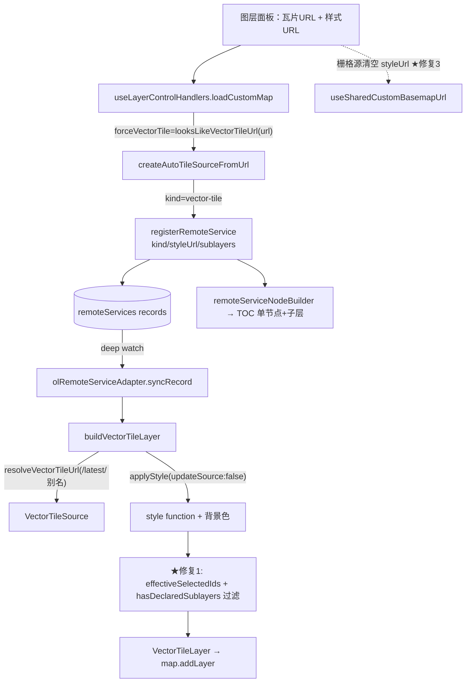

# 2026-11-17 暂存区 Code Review 与版本整合（V3.7.4）

- **日期与时间**：2026-11-17 11:30
- **任务等级**：L2
- **依据**：`Docs/Force_command.md` §0（用户当前指令优先：**全程零 Git 写、不 add、不 commit**）、§1–§8；§0.5 三概念（引擎域优先 / 场景对象入 TOC / SSOT）

## 问题分析（阶段一）

### 核心症状
暂存区累积 33 个文件（697 insertions / 68 deletions），来自多次未整合任务：① 51.la 应用性能监控（`LingQue.Monitor`）与三处报表外链；② FOUC 首屏加载屏（`index.html` 内联 Critical CSS）；③ OpenLayers 端 MVT 矢量瓦片支持（TOC 注册 + 渲染 + styleUrl 状态 + 无扩展名识别）；④ traffic 数据统计补录与 CI 由直推改 PR 自动合并。版本号散落：`index.html` 注释已是 3.7.4，README 三处 / CHANGELOG 顶部仍是 V3.7.3，缺统一整合。

### 根本原因
多个 L2 任务的暂存改动未集中 review 与版本归并；新增 MVT 状态链路（`styleUrl`）跨 OL/CE 双引擎共享注册表，边界条件（全取消勾选、陈旧样式 URL）未覆盖，埋下语义反转 bug；版本号在多文件间漂移。

### 受影响模块
- 前端入口 `frontend/index.html`（FOUC 加载屏 + 版本号注释）
- 前端统计 `frontend/public/min-enhanced.js`（LingQue.Monitor）
- OL basemap 定义 `src/domains/ol/basemap/constants/definitions/group-3.ts`、预设 `src/domains/common/basemap/basemapPresets.ts`
- OL 瓦片源 `src/domains/ol/tile-source/{xyzSource,urlUtils,types}.ts`
- OL 在线服务渲染 `src/domains/ol/services/olRemoteServiceAdapter.ts`
- OL 图层控制 `src/domains/ol/layer/{components/LayerControlPanel,composables/useLayerControlHandlers,composables/useLayerCustomWmsAndSearch}.*`
- 共享注册表 `src/domains/common/basemap/{remoteServices,remoteServiceNodeBuilder,useSharedCustomBasemapUrl}.ts`
- CE 适配 `src/domains/cesium/services/cesiumRemoteServiceAdapter.ts`（显式跳过 MVT）
- 双语文案 `src/locales/{core,en-US,en-US/account,zh-CN/account}`、落地页/用户中心组件
- CI `.github/workflows/traffic-counter.yml`、数据 `.github/traffic.json`
- 文档：README / CHANGELOG / 本日志

## Code Review 发现（真实 bug 4 项 + 一致性 1 项）

| # | 严重度 | 位置 | 问题 | 处置 |
|---:|---|---|---|---|
| 1 | 高 | `olRemoteServiceAdapter.ts` `buildVectorTileLayer` | 取消全部子层勾选后 `allowed.size===0` 使过滤条件短路 → **反而渲染全部要素**，与 TOC「全不勾=不渲染」语义相反 | 修：改用 `effectiveSelectedIds` + `hasDeclaredSublayers` 判定，全取消时 `return undefined` 全隐藏 |
| 2 | 中 | 同上 | 未取 style JSON 的 `background-color`，MVT 底图海洋/背景透明镂空 | 修：对齐参考实现 `vectorTileStyleAdapter.ts`，`layer.setBackground(bgColor)` |
| 3 | 中高 | `useLayerControlHandlers.ts` | `forceVectorTile: !!styleUrl` + ref/localStorage 回退 → 加载过 MVT 后再加载栅格 XYZ，陈旧 styleUrl 会把栅格源误判为 MVT 并套错样式 | 修：`forceVectorTile` 只依据 URL 自身矢量特征 `looksLikeVectorTileUrl(normalizedUrl)`；栅格分支清空持久化 styleUrl |
| 4 | 中 | `olRemoteServiceAdapter.ts` | MVT 样式 `fetch` / `applyStyle` 无超时，样式服务挂起时图层长期无样式 | 记入遗留（现有 `isCurrent()` 已防竞态覆盖，不影响正确性；超时对齐列为后续优化，不扩大本次范围） |
| 5 | 发布阻塞 | README×3 + CHANGELOG + min-enhanced.js 注释 | 版本号 V3.7.3 与 index.html 的 3.7.4 不一致；CHANGELOG 缺 MVT/FOUC 记录 | 修：统一 V3.7.4，补 MVT/FOUC 两条，版本演进表保持 3 行 |

### 交叉核查（可接受，未改）
- `resolveVectorTileUrl` 仅把无版本戳的 `.../planet/{z}/{x}/{y}.pbf` 改写为官方 `/planet/latest/` 稳定别名（实测多级别均返回真实瓦片、自动跟随最新版本、零网络请求）；天地图 `.../tdt-mvt/mvt/{z}/{x}/{y}` 不匹配 → 原样返回，`looksLikeVectorTileUrl` 的 `/mvt/` 路径特征正确识别，无副作用（已实测）。
- `createVectorTileSourceStrict` 改 async 后唯一调用点已 `await`，`resolveVectorTileUrl` 两处调用均 await/.then，无遗漏。
- `remoteServices.ts` 的 kind / styleUrl / 默认全选 / layerOrder 顺序 / 签名对 vector-tile 的处理自洽；BUG#1 出在 adapter 端用裸 `selectedIds` 而非 `effectiveSelectedIds`。
- Vue 3.5 `mount` 前清空 `#app.textContent`，FOUC 加载屏无残留；`<head>` 内 `<noscript><style>` 合法有效（已实测首屏样式）。
- `retireCustomBasemapInstance()` 与调用同处 `loadCustomMap` 的 try 块，函数声明提升，运行时已定义。
- traffic-counter 的 `gh pr merge --auto` 设计上兼容保护分支 required check；PAT scope 与仓库 auto-merge 开关为代码外运维前提，见遗留。
- 33 文件均为 `M`，无 `A`/`D` → 结构树无需增删同步（`CheckStructureTree` 736/736）。

## 修改内容（阶段三）

1. 修复上述 #1 #2 #3 三个代码 bug（olRemoteServiceAdapter ×2、useLayerControlHandlers ×1）。
2. 版本号统一为 **V3.7.4**：README 三处（简介 / 版本演进表首行 / 页脚）、CHANGELOG 顶部条目（补 MVT+FOUC 两条）、`min-enhanced.js` 注释。
3. CHANGELOG 版本说明更新为「定为 V3.7.4（不复用已归并号段）」，消除与 11-14 归并注记的矛盾。
4. 本日志作为本次改动的完整记录。

## 修改原因
用户明确指令：按 `Force_command.md` 对暂存区做 code review、修复潜在 bug、把多次不规范 commit 整合为统一版本 V3.7.4、更新文档与文件树，并给出 commit message；同时全程零 Git 写，便于用户查看 changes 状态。

## 影响范围
OL 底图矢量瓦片渲染与 TOC 子层显隐语义、custom 图源 styleUrl 共享状态；文档版本号（README/CHANGELOG）；不涉及后端、配置 key、部署面。

## 解决方案（Mermaid：MVT 注册→渲染数据流与本次修复点）

- 修复 1/2 在 `buildVectorTileLayer`；修复 3 在 `loadCustomMap` 的 force 判定与栅格分支。
- 选型理由：MVT 仅 OL 支持（Cesium adapter 显式跳过），不引入新依赖；子层过滤在 style function 层做，避免多份瓦片请求。

## 性能指标
未实测（本次为 code review + 版本整合，无性能相关改动）。

## 测试方案

**Agent 已执行**：
- 全量 staged diff 审阅（1493 行）+ 独立子代理交叉 review（8 风险点逐条判定）。
- `npx tsc --noEmit`（前端）：退出码 0。
- `python Scripts/CheckStructureTree.py`：文档项目 736 / 实际文件 736 / 遗漏 0 / 多余 0。
- `python Scripts/CheckConfigRegistry.py`：全绿（catalog 134 key / 前端 VITE_ 11 个）。
- 修复后 `npx tsc --noEmit` 复验（见交接块）。
- OpenFreeMap `/planet/latest/` 别名实测：14/10/9/13 四级瓦片均 HTTP 200、`application/vnd.mapbox-vector-tile`、非空（537906/164453/259510/132075 字节）；对比 TileJSON 版本戳已由 `20261101_080013_pt` 更新到 `20261115_080022_pt`，证明写死版本戳会过期、latest 自动跟随。据此把 `resolveVectorTileUrl` 从「运行时拉 TileJSON」简化为「字符串改写为 /latest/」（零网络请求）。
- 全程仅只读 git 命令（`status` / `diff --cached`），**未执行任何 git 写操作**。

**待用户实机验证**：
- 2D 自定义面板输入 MVT（天地图 `.../tdt-mvt/mvt/{z}/{x}/{y}` + 样式 URL）→ TOC「在线服务」出现单节点+子层，地图渲染；取消全部子层勾选 → 全部要素隐藏（BUG#1 修复验证）。
- 先加载 MVT 再加载普通栅格 XYZ → 栅格正常显示、无错套样式（BUG#3 修复验证）。
- 首屏加载：刷新后先见品牌化加载屏，Vue 挂载后平滑切换，无纯文本闪烁（FOUC）。
- traffic-counter 下次定时运行：确认仓库已开启 Allow auto-merge、PR 检查通过后自动合并。

## 变更文件清单（本次 code review 实际改动，均在工作区未 stage）

| 文件 | 说明 |
|---|---|
| `frontend/src/domains/ol/services/olRemoteServiceAdapter.ts` | 修 BUG#1（effectiveSelectedIds + 全取消全隐藏）+ BUG#2（背景色）+ 注释同步 latest 别名 |
| `frontend/src/domains/ol/tile-source/xyzSource.ts` | `resolveVectorTileUrl` 改为字符串改写为 `/latest/`（去除 TileJSON fetch） |
| `frontend/src/domains/ol/basemap/constants/definitions/group-3.ts` | OpenFreeMap 预设 URL 改 `/latest/`，去掉运行时 TileJSON 解析与无用 MVT import |
| `frontend/src/domains/ol/layer/composables/useLayerControlHandlers.ts` | 修 BUG#3（force 依据 URL 特征 + 栅格分支清空 styleUrl） |
| `README.md` | 版本号 V3.7.3→V3.7.4 三处 + 版本演进表补 MVT/FOUC、删最旧行 |
| `Docs/Guide/CHANGELOG.md` | 顶部条目升 V3.7.4 + 补 MVT/FOUC 两条 + 版本说明修正 |
| `frontend/public/min-enhanced.js` | 注释 V3.7.3→V3.7.4 |
| 本日志 | 本次整合完整记录 |

> 注：其余 27 个暂存文件为本次 review 对象，未再改动（保持用户暂存状态，便于查看 changes）。

## 遗留与风险
- **零 Git 写**：所有改动（含本次修复 + 文档）在工作区，未 add/commit；用户需自行决定提交。暂存区仍是原始 33 文件快照，本次修复位于工作区（`MM` 状态），提交前需用户自行 add 新改动。
- **BUG#4（样式 fetch 无超时）**：未在本批修复，`isCurrent()` 已防竞态覆盖，正确性无虞；建议后续对齐 `vectorTileStyleAdapter.ts` 的 `STYLE_FETCH_TIMEOUT_MS`，记入 TODO。
- **traffic-counter 运维前提**：仓库须开启 Settings→Allow auto-merge；分支保护若要求 review approval，auto-merge 会卡住；`TRAFFIC_TOKEN` 需 Contents(write)+Pull requests(write)（classic `repo`），job 级 `permissions` 对 PAT 不生效。这些是代码外配置，未改代码。
- **MVT 仅 2D**：Cesium 端遇 vector-tile 记录显式跳过（不渲染），切到 3D 时该服务节点不显示内容，属既定设计。
- **FOUC 全局样式**：内联 `html,body{background:#e8f5e9;height:100%}` 依赖 CSS 层叠顺序被 App.vue 覆盖；生产构建 CSS link 顺序已验证正常。
- 全程未触碰平台红线（§11），未改后端 / 部署面 / 配置 key。
