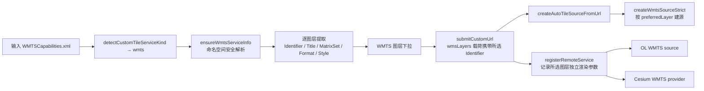

# 2026-11-18 自定义 WMTS Capabilities 图层下拉（V3.7.6）

- **日期与时间**：2026-11-18 17:23
- **任务等级**：L2
- **依据**：用户提供的 EOX `https://tiles.maps.eox.at/wmts/1.0.0/WMTSCapabilities.xml` 与「当前下拉支持 WMS、优化支持此类 WMTS」指令；`Docs/Force_command.md` §1–§8

## 问题分析

### 核心症状

- 自定义底图输入框虽声明支持 WMTS，底层也有 `createWmtsSourceStrict`，但图层下拉仅在 `detected.kind === 'wms'` 时触发。
- 输入 EOX Capabilities 地址后不能选择图层，提交时固定使用解析结果首层；下拉选择也无法传入 WMTS 建源函数。
- EOX 使用 `ows:` / `wmts:` 命名空间前缀，原轻量解析器通过 `getElementsByTagName('Identifier'/'Title')` 查询，无法可靠读取这些节点。
- 原实现按整份文档选择第一个 WebMercator 矩阵集和第一个 Format，没有按所选图层匹配其 `TileMatrixSetLink`，混用 3857/4326 的服务会得到错误参数。
- EOX 在 OperationsMetadata 与 ResourceURL 中声明 `http://` 端点，HTTPS 页面直接使用会触发 mixed content。

### 受影响模块

- OL 自定义图层面板：`LayerControlPanel.vue`、`useLayerCustomWmsAndSearch.ts`
- 自定义加载与在线服务注册：`useLayerControlHandlers.ts`
- WMTS 元数据解析：`common/basemap/xyzWmtsCapabilities.ts`
- OL 建源：`wmtsSource.ts`、`xyzSource.ts`、`types.ts`
- OL 在线服务重建：`olRemoteServiceAdapter.ts`

## 解决方案

- 保留现有 `wmsLayers` 载荷作为 WMS/WMTS 共用的「首选图层」通道，不扩大面板到 HomeView 的公共接口。
- 仅把具有 3857 / 900913 / GoogleMapsCompatible 矩阵集的图层加入可加载选项，维持双引擎现有 WebMercator 渲染合同；EOX 的 4326-only 图层不伪装成已支持。
- 从 OperationsMetadata 读取 GetTile KVP 端点；用户输入为 HTTPS 时，将文档中的 HTTP GetTile/ResourceURL 升级为 HTTPS。

## 修改内容

1. `xyzWmtsCapabilities.ts`
   - XML 查询统一为 `getElementsByTagNameNS('*', localName)`，保留无前缀文档回退。
   - 逐图层解析 Identifier、Title、Format、默认 Style 和兼容 TileMatrixSet。
   - 读取 GetTile OperationsMetadata 端点并执行 HTTPS 协议归一。
2. `useLayerCustomWmsAndSearch.ts`
   - WMTS 输入触发 `fetchWmtsLayerOptions`；沿用 request token 防止旧请求覆盖新输入。
   - 下拉 change 允许 WMS/WMTS 两种类型，提交时携带所选 Identifier。
3. `LayerControlPanel.vue`
   - 选择器标签按类型显示「WMS 图层」或「WMTS 图层」。
4. `useLayerControlHandlers.ts`
   - 以 matchedOption 的矩阵集、格式、样式、CRS 注册所选 WMTS 图层。
5. `wmtsSource.ts` / `xyzSource.ts` / `types.ts`
   - `createWmtsSourceStrict` 接收 `preferredLayer`；自动检测编排器把现有 `preferredLayers` 传入。
   - 按图层选择兼容矩阵集，归一 KVP/ResourceURL 协议。
6. `olRemoteServiceAdapter.ts`
   - 异步重建 WMTS source 时同步归一 Capabilities 中的 URL 协议。
7. 文档：README V3.7.6 三处、CHANGELOG 顶部条目、前端结构树注释、本日志。

## 性能指标

- Capabilities 沿用现有 Promise 缓存，下拉枚举与正式注册复用同一元数据，不新增重复解析链路。
- 未做渲染性能基准；本次为协议解析与交互接入，不涉及逐帧路径。

## 测试方案与实测结果

**Agent 已执行**：

- `npm run typecheck`（vue-tsc）：通过。
- 8 个涉及代码/模板文件的 ESLint：通过。
- `npm run build`：通过（10 秒级，既有 chunk size 警告不属本次新增）。
- EOX Capabilities 实测：HTTP 200，67911 字节，`application/xml`，`Access-Control-Allow-Origin: *`。
- 图层结构实测：47 个图层，22 个具有当前支持的 WebMercator 矩阵集，25 个 4326-only 图层被排除。
- 非首图层 `s2cloudless-2024_3857` + `GoogleMapsCompatible` + `image/jpeg` 的 GetTile 实测：HTTP 200，13476 字节，`image/jpeg`，CORS `*`。
- KVP GetCapabilities 端点 `https://tiles.maps.eox.at/wmts?...` 实测同样返回完整文档，验证 OperationsMetadata 端点可用于注册表重建。

**待用户实机验证**：

1. 2D 图层面板选择「自定义图层」，粘贴本题 EOX 地址，确认出现「WMTS 图层」下拉及 22 个可选图层。
2. 选择不同年份 Sentinel-2 或 `osm_3857`，确认地图和「在线服务」记录切换到所选图层，而非固定首层。
3. 在 HTTPS 部署页确认无 `http://tiles.maps.eox.at` mixed-content 请求。
4. 切换 3D 后确认同一 WMTS 记录按所选图层重建；4326-only 图层暂不支持属既定限制。

## 变更文件清单

| 文件 | 说明 |
|---|---|
| `frontend/src/domains/common/basemap/xyzWmtsCapabilities.ts` | 命名空间解析、逐图层参数、GetTile 端点与协议归一 |
| `frontend/src/domains/ol/layer/composables/useLayerCustomWmsAndSearch.ts` | WMTS 自动枚举与下拉提交 |
| `frontend/src/domains/ol/layer/components/LayerControlPanel.vue` | WMS/WMTS 动态选择器标签 |
| `frontend/src/domains/ol/layer/composables/useLayerControlHandlers.ts` | 所选图层的独立注册参数 |
| `frontend/src/domains/ol/tile-source/wmtsSource.ts` | 指定图层建源、矩阵选择与 URL 协议归一 |
| `frontend/src/domains/ol/tile-source/xyzSource.ts` | 自动检测传递 preferredLayers |
| `frontend/src/domains/ol/tile-source/types.ts` | preferredLayers 注释扩展为 WMS/WMTS |
| `frontend/src/domains/ol/services/olRemoteServiceAdapter.ts` | 重建 WMTS source 时归一 URL 协议 |
| `README.md` | 当前版本、版本演进首行、页脚更新为 V3.7.6 |
| `Docs/Guide/CHANGELOG.md` | 新增 V3.7.6 条目 |
| `Docs/Guide/frontend-structure.md` | composable 职责注释同步 WMTS |
| 本日志 | 完整任务记录 |

## 遗留与风险

- 4326-only WMTS 图层仍需专用 GeographicTilingScheme / 投影适配，不在本次双引擎 WebMercator 合同内。
- 未在浏览器中实际点击下拉；UI 路径已通过类型检查、构建和真实服务端点验证，最终视觉与交互需用户按上节四项复核。
- 工作区原已存在 V3.7.5 暂存改动；本轮新增修改未执行 `git add` / `commit`，用户需自行归并暂存。
