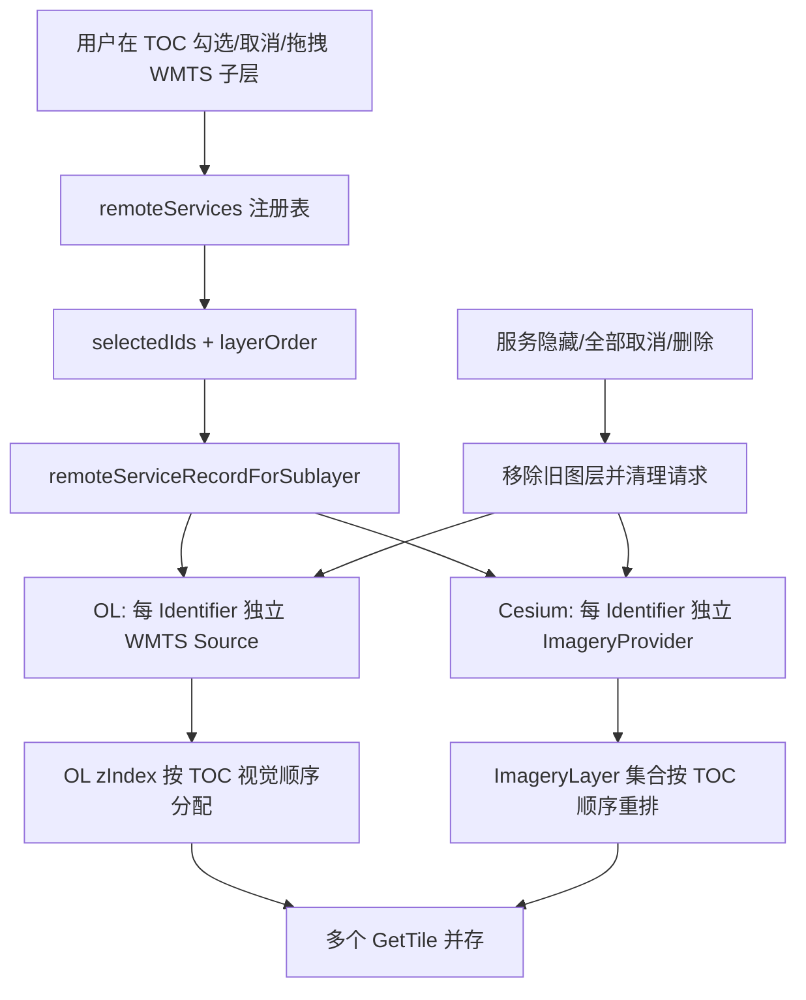

# V3.7.5 — WMS / WMTS / MVT / XYZ 协议接入与 TOC 多子层控制修复

- 日期时间：2026-11-18
- 任务等级：L2
- 版本记录：本次按用户指令记为 V3.7.5（原临时记录名 V3.7.7，已归并）
- 触发：用户指出 WMTS 子图层只能单选，开启第二个会自动隐藏第一个；要求 TOC 中每个子层独立显隐、独立排序，并停止浏览器模拟，由用户自行实机测试。

## 1. 症状与原因分析

原逻辑在 `setRemoteServiceSublayer()` 中对 WMTS 做了单选特判，每次勾选直接把 `selectedIds` 和 `layerOrder` 重置为单元素数组；`remoteServiceNodeBuilder.ts` 又禁止 WMTS 子层拖拽。这导致用户无法同时保留多个 Identifier，也无法控制视觉顺序。

WMTS GetTile 每次只表达一个 `LAYER=<Identifier>`，不能套用 WMS GetMap 的多层拼接模型。因此正确实现是：每个已选 Identifier 建立独立 OL Source / Cesium Provider，由注册表的 `selectedIds + layerOrder` 同时驱动请求集合与层序。

## 2. 可选方案对比

| 方案 | 说明 | 结论 |
|------|------|------|
| A | 每个 WMTS Identifier 独立 Source / Provider，共用现有 TOC 选择状态 | 采用；协议正确、逐层显隐和排序可控 |
| B | 把多个 Identifier 拼入一个 GetTile | 不采用；WMTS 没有 WMS 式多图层组合语义，无法可靠控制层序 |
| C | 只删除单选特判，继续由主图层保存唯一 matrix/style | 不采用；多个 Identifier 会共用最后选择项的协议参数 |

## 3. 数据流与模块交互图

## 4. 修改内容

### 4.1 WMTS 选择与排序契约

- `remoteServices.ts` 删除 WMTS 单选特判，通用 `setRemoteServiceSublayer()` 现在只切换目标 Identifier，不再覆盖其他选择。
- `RemoteServiceSublayer` 携带 `matrixSet/style/format/srs`；新增 `remoteServiceRecordForSublayer()`，供双引擎生成各 Identifier 的独立渲染记录。
- `renderSignature()` 纳入已选 WMTS 子层、视觉顺序及逐层协议参数；勾选、取消、拖拽和参数变化都会触发适配器同步。
- `remoteServiceNodeBuilder.ts` 将 WMTS 纳入 `hasSublayerOrdering`，子层允许拖拽；TOC 数组头部始终表示视觉上层。
- WMTS 不采用 WMS 式 `LAYERS=A,B` 拼接，避免不符合单层 GetTile 语义的请求。

### 4.2 OL / Cesium 生命周期

- OL：每个已选 Identifier 建立独立 `TileLayer + WMTS Source`；按实际选中数量分配服务 zIndex 子带，不再受旧 20 槽截断影响。
- OL：异步建源结果同时校验服务签名和子层身份；隐藏、空选择、删除或过期重建时移除图层、清理瓦片请求，迟到结果不得挂回新图层。
- Cesium：每个 Identifier 建立独立 `WebMapTileServiceImageryProvider`，按 TOC 视觉顺序重排 ImageryLayer；隐藏或空选择时移除对应 Provider。
- MVT 继续仅在 OL 渲染，Cesium 保持既有显式跳过策略。

### 4.3 同批四协议接入修正

- WMS/WMTS Capabilities：保留 token/key 等鉴权参数，读取各自 GetMap/GetTile KVP 端点；WMS XML 使用命名空间安全解析并兼容 1.3.0 CRS。
- WMS query 直链在具备合法 `info.layers` 时纳入在线服务 TOC，不再因 URL 带查询参数漏注册。
- XYZ/TMS：识别 `{-y}` 并反转行序；OpenFreeMap `/planet/latest/` 改写仅限 `tiles.openfreemap.org`，不污染自托管 MVT 主机。

## 5. Agent 已执行（代码级验证）

| 检查 | 实际结果 |
|---|---|
| Node 22 TypeScript 注册表探针 | 通过：A/B 同时选择、独立 matrix/style/format/srs、独立取消、拖拽、空选择均符合预期；输出 `PASS WMTS multi-select, per-layer parameters, independent visibility, ordering and empty-selection lifecycle` |
| 相关 ESLint（4 个核心文件） | 退出码 0 |
| `npm run typecheck` / `vue-tsc --noEmit` | 退出码 0 |
| `npm run build` / `vite build` | 通过：4761 modules transformed，14.24s；仅有既有大 chunk 提示 |
| 仓库门禁 | `CheckStructureTree` 736/736；`CheckConfigRegistry`、`CheckVueParadigm`、`CheckDomainDeps` 全部通过 |
| `git diff --check` | 退出码 0 |
| 平台红线自查 | 首次扫描仅命中 `maxRayDistance`（`xray` 子串的已知假阳性），无其他 §11.1 禁项；`deploy/.env` 未命中 `ALLOW_PRIVATE_HOSTS=true`、`ALLOWED_HOSTS=*`、`RATE_LIMIT=0`，生产基线未被破坏 |
| 浏览器实机 | 按用户要求不执行；不得据此宣称多子层实际出图已通过 |

## 6. 用户手动验收步骤

1. 启动前端，打开 DevTools → Network，启用 Preserve log，过滤 `GetTile`。
2. 在二维模式添加 `https://tiles.maps.eox.at/wmts/1.0.0/WMTSCapabilities.xml`，在 TOC 依次勾选两个外观不同的子图层。
   - 预期：两个复选框同时保持选中，两个图层同时可见；Network 中同时存在不同 `LAYER=<Identifier>` 的 GetTile，不出现 `LAYER=A,B`。
3. 单独取消其中一个子图层，再平移/缩放地图。
   - 预期：仅该 Identifier 不再发起新 GetTile，另一个仍正常加载；重新勾选后恢复。
4. 拖拽两个已选子图层交换 TOC 顺序，再平移/缩放。
   - 预期：TOC 上方的图层在地图中位于视觉上层，另一个不自动取消；Network 仍保留两类 Identifier 请求。
5. 关闭整个 WMTS 服务节点，再平移/缩放地图。
   - 预期：该服务全部子层隐藏；已发出的请求允许完成，但不再发起该服务的新 GetTile。重新打开后按原选择恢复。
6. 将所有 WMTS 子层逐个取消，再平移/缩放地图。
   - 预期：地图无该服务内容，不再发起该服务的新 GetTile；随后勾选任意一个即可独立恢复。
7. 切换三维模式，重复第 2～6 步。
   - 预期：多选、独立显隐、层序和空选择语义一致。此项尚无本轮实机证据，是重点验收项。
8. 回归四类协议：WMS 检查 `request=GetMap` 且 token 保留；WMTS 检查 `request=GetTile` 且每层参数独立；XYZ/TMS 检查 `{-y}` 与常规 `{y}` 行序；MVT 检查官方 OpenFreeMap 与自托管 URL 均未被错误改写。

> 说明：本任务仍遵循当前双引擎 Web Mercator 兼容范围，4326-only WMTS 图层不在可加载选项内；这不是本轮多子层修复扩大或改变的范围。

## 7. 变更文件清单（L2 本批）

| 路径 | 性质 | 简述 |
|------|------|------|
| `frontend/src/domains/common/basemap/remoteServices.ts` | 修改 | WMTS 多选/排序/逐层参数/生命周期签名 |
| `frontend/src/domains/common/basemap/remoteServiceNodeBuilder.ts` | 修改 | WMTS 子层 TOC 拖拽 |
| `frontend/src/domains/common/basemap/wmsService.ts` | 修改 | WMS 端点、鉴权参数、版本与 query 选项 |
| `frontend/src/domains/common/basemap/wms/capabilities.ts` | 修改 | WMS 命名空间 XML 与 GetMap 端点 |
| `frontend/src/domains/common/basemap/xyzWmtsCapabilities.ts` | 修改 | WMTS 鉴权参数/相对端点与 TMS 行序 |
| `frontend/src/domains/ol/services/olRemoteServiceAdapter.ts` | 修改 | 每 Identifier 独立 Source、zIndex 与请求清理 |
| `frontend/src/domains/cesium/services/cesiumRemoteServiceAdapter.ts` | 修改 | 每 Identifier 独立 Provider 与层序 |
| `frontend/src/domains/ol/tile-source/wmsSource.ts` | 修改 | WMS query 来源建源资格 |
| `frontend/src/domains/ol/tile-source/xyzSource.ts` | 修改 | OpenFreeMap latest 改写主机白名单 |
| `frontend/src/domains/ol/layer/composables/useLayerControlHandlers.ts` | 修改 | WMS query 直链 TOC 注册 |
| `README.md` / `Docs/Guide/CHANGELOG.md` / `Docs/Guide/frontend-structure.md` | 修改 | V3.7.5 与职责文档同步 |
| `Docs/LLM_record/26-11/2026-11-18/2026-11-18-wmts-protocol-and-toc-v3.7.5.md` | 新增 | 本维护日志 |
