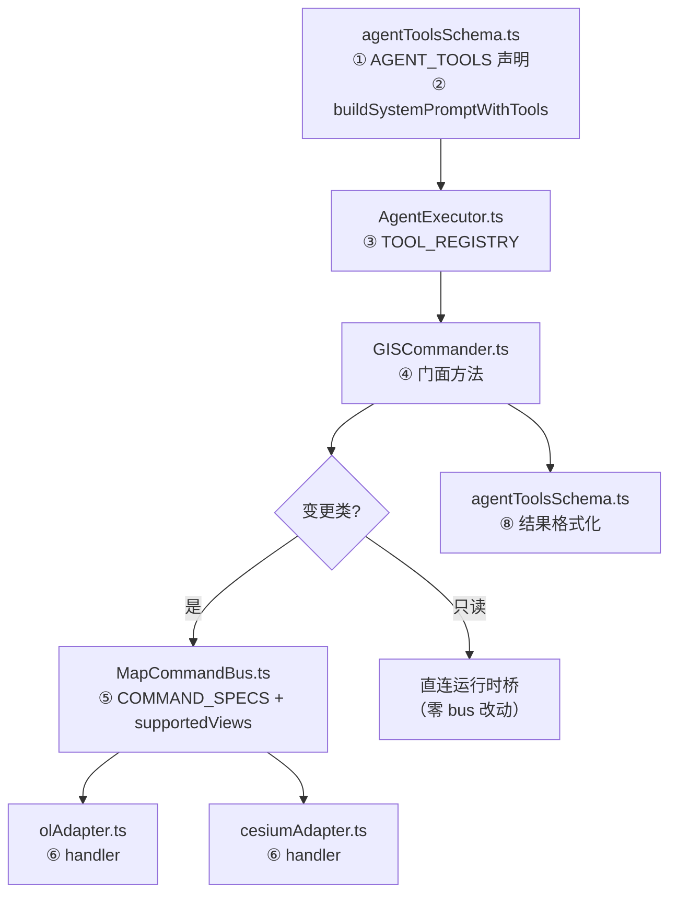

# Agent 工具能力扩展：图层管理 9 个工具（L3）

## 日期与时间

2026-11-23 18:10

## 任务等级

**L3（架构级）** —— 跨 `chat` / `command-bus` / `ol` / `cesium` 四域，改动既有公共函数签名（5 个图层操作从 `void` 改为结构化返回），并扩展 Agent 工具协议。

方案文档：[`Docs/TODO/2026-11-23-agent-tool-expansion-plan.md`](../../TODO/2026-11-23-agent-tool-expansion-plan.md)（含架构 Mermaid 图，已获用户批准：批次 A + B + 导出限 500 要素）

## 问题分析

### 核心症状

Agent 只有 7 个工具（`set_map_view` / `set_view_center` / `set_camera_orientation` / `zoom_to_extent` / `search_and_zoom` / `switch_basemap` / `get_weather`），全部围绕视图与外部查询。用户问「当前有哪些图层」「把这个图层透明度调低」「刚才量的面积是多少」时，模型只能回答做不到。

### 根本原因（两层）

**表层**：图层管理、测量结果读取、属性查询等能力系统已实现，但未接入 Agent 工具体系。

**深层（必须先修）**：图层操作函数**全部返回 `void` 且在目标不存在时静默 `return`**：

| 函数 | 位置 | 问题 |
|---|---|---|
| `setUserLayerVisibility` | `ol/layer/composables/useUserLayerActions.ts` | 无返回值，找不到图层静默 no-op |
| `setUserLayerOpacity` | 同上 | 同上 |
| `soloUserLayer` | 同上 | 同上 |
| `zoomToUserLayer` | 同上 | fire-and-forget，`getView().then()` 后无回传 |
| `setVisible` / `setOpacity` / `flyTo` | `cesium/stores/cesiumLayers.ts` | 不支持时只 `console.warn` |

直接暴露会更糟：Agent 判断不了成败，会把静默失败当成功回传，用户看到「已帮你调到 30%」而地图没变。**谎报成功比不提供能力更糟**。

### 受影响模块

前端「AI 对话」→ Agent 工具链路 → 地图命令总线 → OL / Cesium 图层体系。

## 解决方案

### 工具链路：新增一个工具要同步的 8 处



**关键杠杆**：只读工具可跳过 ⑤⑥（`get_weather` 已证明该路径），因此 4 个只读工具只改 4 处。

### 底座：统一结果契约

在**跨引擎契约**位置（`domains/common/map-adapter/types.ts`）新增：

```ts
export interface LayerActionResult {
    success: boolean;
    code: string;           // OK / LAYER_NOT_FOUND / OPACITY_UNSUPPORTED / ADAPTER_NOT_READY / ...
    message?: string;
    layerId?: string;
}
```

配套 `layerActionOk()` / `layerActionFailed()` 工厂。放在 common/map-adapter 而非 chat/agent，避免 OL/Cesium 域反向依赖 Agent 域。

### 只读数据来源

新增 `agentMapRuntimeBridge.listLayers()` 与 `getMeasureResult()`，由 `useHomeEngineSwitch` 实现（它能同时访问两个容器 ref 与引擎 store）：

- 2D：遍历 `mapInstance.getLayers()`，按 `managedLayerId` 过滤受管图层（排除底图/标注），读 `getVisible()` / `getOpacity()` / 要素数；
- 3D：读 `cesiumLayers.records`（含 `supportsOpacity` / `featureCount` 等元数据）；
- 3D id 带 `cesium:` 前缀对齐 TOC 节点协议，变更命令两种写法都接受（adapter 内部剥离）。

## 修改内容

### 1. 底座契约（2 文件）

- `map-adapter/types.ts`：新增 `LayerActionResult` + `layerActionOk` / `layerActionFailed`。
- `ol/layer/composables/useUserLayerActions.ts`：`setUserLayerVisibility` / `setUserLayerOpacity` / `soloUserLayer` 改为返回 `LayerActionResult`；`zoomToUserLayer` 改 `async` 并 `await source.getView()`，无可用范围返回 `EXTENT_UNAVAILABLE`。
- `cesium/stores/cesiumLayers.ts`：`setVisible` / `setOpacity` / `flyTo` 返回 `LayerActionResult`；区分 `LAYER_NOT_FOUND` / `OPACITY_UNSUPPORTED` / `ADAPTER_NOT_READY`。

### 2. 命令总线（3 文件）

- `MapCommandBus.ts`：`COMMAND_SPECS` 新增 5 条 —— `setLayerVisibility` / `setLayerOpacity` / `zoomToLayer`（双引擎）、`soloLayer`（仅 ol）、`exportLayerGeoJson`（仅 ol）。
- `mapCommand/shared.ts`：新增 `normalizeLayerIdArg` / `toMapCommandResult`（**fail-closed**：sink 无结构化返回判失败）/ `truncateGeoJsonFeatures`（要素数 + 60k 字符双闸门）。
- `mapCommand/olAdapter.ts`：新增 5 个 handler 与 sink 注入。
- `mapCommand/cesiumAdapter.ts`：新增 3 个 handler，id 自动剥离 `cesium:` 前缀。

### 3. 门面与注入（3 文件）

- `command-bus/GISCommander.ts`：deps 扩展 `getLayers` / `getMeasureResult`；新增 4 个只读方法（`getMapState` / `listLayers` / `getLayerInfo` / `readMeasureResult`）+ 5 个变更方法（含导出），变更类自动补齐用户可读 `message`。
- `useAgentMapContext.ts`：转发 `listLayers` / `getMeasureResult`（异常降级为结构化失败，不抛给上层）。
- `app/composables/useHomeEngineSwitch.ts`：bridge 扩展两个只读方法；OL/Cesium 适配器各注入 sink；`cesiumLayersStore` / `drawMeasureStore` 上移到 composable 开头（避免 bridge 引用时的 TDZ）。

### 4. 工具声明（3 文件）

- `agentToolsSchema.ts`：`AGENT_TOOLS` 新增 9 条；系统提示词工具清单 7 → 16、选型规则补 6 条、约束补 4 条（id 必须来自 `list_layers`、`solo_layer` 要列出被隐藏项、3D 不支持要如实说明、导出截断不得说「全部导出」）；`formatToolResultForLLM` 的 `extraKeys` 补 14 个字段，并对 `geojson` 做 6000 字符二级截断。
- `AgentExecutor.ts`：`TOOL_REGISTRY` 新增 9 条映射。
- `chatIntentFallback.ts`：显示名映射新增 9 条。

## 修改原因

Agent 的价值取决于它能操作多少系统能力。7 个工具只能「看地图」，无法管理用户自己的数据图层 —— 而图层恰恰是 GIS 使用者的主要工作对象。同时，原有图层函数静默失败的设计在 UI 场景可容忍（用户能看见没反应），在 Agent 场景不可容忍（模型看不见，会谎报成功）。因此本次先修契约、再暴露能力。

## 影响范围

| 模块 | 影响 |
|---|---|
| Agent 工具数 | 7 → 16 |
| 上下文成本 | 每个工具声明约 150–250 token，新增 9 个约 +1.8k token |
| OL 图层操作 | 返回值由 `void` 变为 `LayerActionResult`（UI 调用方忽略返回值，向后兼容） |
| `zoomToUserLayer` | 由 fire-and-forget 改为 `async`（UI 不 await 亦兼容，但不再吞掉失败） |
| 3D 图层操作 | 语义不变，新增结构化错误码 |
| 3D 不支持项 | `solo_layer` / `export_layer_geojson` 返回 `COMMAND_UNSUPPORTED_FOR_VIEW`（显式声明，非静默降级） |
| 未暴露的能力 | 删除、URL 导入、文件下载、截图、路径规划（理由见方案文档 §四） |

## 性能指标

未实测（功能扩展，无基线）。设计约束：
- `list_layers` 默认返回 50 条、上限 200，超出用 `total` / `truncated` 提示；
- `export_layer_geojson` 双闸门：要素数 ≤ 500（默认，可调至 2000）+ 序列化 ≤ 60k 字符；进 LLM 前再截到 6k 字符。

## 测试方案

### Agent 已执行

- `npx vue-tsc --noEmit` —— 0 报错（含 4 轮阶段性复检）
- `npx eslint`（变更的 8 个文件）—— 0 warning
- `npm run build` —— **首次失败**（`emptyDir` 删除 dist 时的文件锁，非代码问题），重跑成功（4764 modules transformed）
- 代码级复核：确认 `useDeferredUserLayerApis.callUserLayerAction` 与 `useUserLayerApiFacade` 均 `return api[method](...args)`，异步返回值可透传到 adapter

### 待用户实机验证

1. **只读链路**：提问「现在有几个图层」「当前缩放级别是多少」「有哪些 3D 图层」→ 预期如实回答，地图不动。
2. **显隐**：导入一个 GeoJSON → 说「把 XX 图层隐藏」→ 预期图层消失；再说「显示出来」→ 恢复。
3. **透明度**：2D 说「把这个图层透明度调成 30%」→ 预期肉眼可见变淡；3D 对不支持的图层类型说同样的话 → 预期模型回复「该类型不支持」而非谎称成功。
4. **缩放**：说「缩放到 XX 图层」→ 预期视图贴合该图层范围。
5. **单独显示**：说「只留 XX 图层」→ 预期其余用户图层隐藏，模型回复中列出被隐藏的图层名。
6. **导出**：说「把这个图层的要素给我看看」→ 预期返回要素摘要；要素超过 500 时模型应说明「共 N 个，返回前 500 个」。
7. **3D 不支持项**：切到 3D 后说「只留这个图层」→ 预期模型说明 3D 不支持并建议切 2D，而不是静默无反应。
8. **不存在的 id**：让它操作一个不存在的图层 → 预期返回「找不到图层」而非「已完成」。

## 变更文件清单

| 文件 | 说明 |
|---|---|
| `frontend/src/domains/common/map-adapter/types.ts` | 新增跨引擎 `LayerActionResult` 契约与工厂 |
| `frontend/src/domains/ol/layer/composables/useUserLayerActions.ts` | 4 个图层操作改为结构化返回，`zoomToUserLayer` 改 async |
| `frontend/src/domains/cesium/stores/cesiumLayers.ts` | 3 个图层操作改为结构化返回 |
| `frontend/src/domains/common/chat/agent/MapCommandBus.ts` | COMMAND_SPECS 新增 5 条命令 |
| `frontend/src/domains/common/chat/agent/mapCommand/shared.ts` | 新增结果归一转、id 规整、GeoJSON 截断 |
| `frontend/src/domains/common/chat/agent/mapCommand/olAdapter.ts` | 新增 5 个 handler 与 sink |
| `frontend/src/domains/common/chat/agent/mapCommand/cesiumAdapter.ts` | 新增 3 个 handler，id 前缀剥离 |
| `frontend/src/domains/common/command-bus/GISCommander.ts` | 新增 9 个门面方法 + deps 扩展 |
| `frontend/src/domains/common/chat/composables/useAgentMapContext.ts` | 转发只读图层与测量 |
| `frontend/src/app/composables/useHomeEngineSwitch.ts` | bridge 扩展、sink 注入、store 上移 |
| `frontend/src/domains/common/chat/constants/agentToolsSchema.ts` | 9 条工具声明 + 提示词 + 结果格式化 |
| `frontend/src/domains/common/chat/agent/AgentExecutor.ts` | TOOL_REGISTRY 新增 9 条 |
| `frontend/src/domains/common/chat/composables/chatIntentFallback.ts` | 显示名映射新增 9 条 |
| `Docs/TODO/2026-11-23-agent-tool-expansion-plan.md` | L3 方案文档（含 Mermaid） |
| `README.md` / `Docs/Guide/CHANGELOG.md` / `Docs/Guide/frontend-structure.md` | 版本号与结构树同步 |

## 遗留与风险

1. **`list_layers` 的 2D 侧依赖 `managedLayerId` 属性**：只覆盖「受管图层」（导入/搜索/绘制产生的层）。底图与在线服务不在列表内，这是有意的（它们由 `switch_basemap` 管理）。若后续要管理在线服务，需额外接 `remoteServices` 注册表。
2. **`solo_layer` 仅 2D**：3D 图层分组 `draggable:false`、且 store 无 solo 语义，本轮不实现，返回显式不支持。
3. **`export_layer_geojson` 仅 2D**：3D 的 `exportData` 走浏览器下载（写文件），不符合「不写文件」约定。
4. **`zoomToUserLayer` 改为 async 后 UI 未 await**：TOC 菜单点击仍是 fire-and-forget，失败只 `console.warn`。若要 UI 也提示失败，需另行改造菜单回调（本轮不动，避免扩大范围）。
5. **属性查询、空间分析、路径规划仍未暴露**：分别涉及「需用户点选要素」「后端依赖且无返回值」「消耗天地图 token 配额」，建议各自单独立项。
6. **上下文成本未实测**：16 个工具约 +1.8k token，若后续继续扩张需考虑按场景分组装载（如只在用户提到图层时才注入图层工具）。
