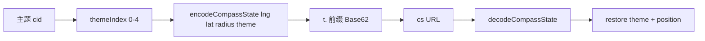

# 2026-11-24 将五种罗盘样式纳入 cs 分享短码

- **日期与时间**：2026-11-24 12:00
- **任务等级**：L2（URL 协议扩展）
- **版本**：V3.7.31（并行会话占用 V3.7.30，按规范顺延）

## 需求

`cs` 目前只编码经度、纬度、物理半径，分享链接打开后总是默认「古朱砂」主题；用户切换成其他四种样式后分享，接收方看到的仍是默认主题。需要把五类主题编码进 `cs`。

## 协议设计

### 主题编号（3 bit，0~4）

| 编号 | cid | 名称 |
|---|---|---|
| 0 | ancient-cinnabar | 古朱砂（默认） |
| 1 | jade-realm | 翡翠境 |
| 2 | cyber-blueprint | 赛博蓝图 |
| 3 | dark-gold | 暗金 |
| 4 | minimalist | 极简 |

5~7 保留；解码时拒绝，避免未来误配。

### 短码版本

| 版本 | 前缀 | 载荷 |
|---|---|---|
| 历史 | 无前缀 | lng(28) + lat(28) + radius(23)，默认主题 0 |
| V2 | `r.` | lng(28) + lat(28) + radius(28)，默认主题 0 |
| V3 | `t.` | lng(28) + lat(28) + radius(28) + theme(3)，主题 0~4 |

Base62 字符表与打乱顺序不变。V3 仅追加 3 bit，短码长度通常 +1 位。

## 兼容性

- 旧链接无前缀 / `r.` 前缀仍可解码，主题回退为 0（古朱砂）。
- 新写入统一用 `t.` 前缀。
- `cs=0` 仍表示罗盘关闭。
- 非法主题编号返回 null，按无效 cs 处理并清理参数。

## 改动范围

- `positions.ts`：新增主题位宽/掩码/前缀；`encodeCompassState(..., themeIndex)` 支持 V3；`decodeCompassState()` 返回 `themeIndex`。
- `urlState.ts`：`CompassUrlPayload` 增加 `themeIndex`；读写透传。
- `CompassManager.ts`：写 cs 时带当前主题编号；恢复时按编号调用 `setCidAndLoad()`。
- 新增共享主题编号映射，避免 store 与 URL 编码各写一份。

### Mermaid 图

## 测试方案

### Agent 已执行

- 五主题编解码往返全部正确：古朱砂 `t.AWBXRyYSsyvEFPD`、翡翠境 `t.AWBXRyYSsyvEFPs`、赛博蓝图 `t.AWBXRyYSsyvEFP6`、暗金 `t.AWBXRyYSsyvEFPV`、极简 `t.AWBXRyYSsyvEFP3`，解码后 `themeIndex / themeCid` 均匹配。
- 默认编码（不传主题）与旧 V2 短码 `r.CjTAzony19Ixu05` 均回退 `themeIndex=0 / ancient-cinnabar`。
- 浏览器端到端：打开 `cs=t.AWBXRyYSsyvEFPs` 后 store 自动恢复 `cid=jade-realm`、`enabled=true`、`radius=500000`；切换 `dark-gold` 后 cs 自动更新为 `t.ASLWeaYBFzj5nSB`，解码主题 3；关闭罗盘后 cs 被清除。
- `vue-tsc --noEmit` 0 报错；ESLint（6 个文件）0 warning。
- 结构树 746/746、配置登记、Vue 范式 72/72、领域隔离全绿；生产构建临时目录成功（4771 modules，12.68s）。

### 待用户实机验证

1. 切到任一主题后复制链接，打开新页面应自动恢复该主题。
2. 旧 `cs` 链接仍恢复古朱砂主题。
3. 关闭罗盘后 `cs` 仍被清除。

## 变更文件清单

| 文件 | 说明 |
|---|---|
| `common/url-state/codec/positions.ts` | V3 cs 编解码 |
| `common/url-state/crypto.ts` / `index.ts` | 必要时补充导出 |
| `common/compass/services/urlState.ts` | payload 增加主题编号 |
| `common/compass/services/CompassManager.ts` | 写入/恢复主题 |
| `common/compass/stores/useCompassStore.ts` | 使用共享主题编号映射 |
| 共享主题编号映射文件 | 五主题 cid ↔ index |
| `Docs/Guide/frontend-structure.md` / `README.md` / `Docs/Guide/CHANGELOG.md` | 文档同步 |
| 本文件 | L2 维护日志 |

## 遗留与风险

- 主题编号顺序固定，未来新增主题需追加编号而非插入，避免旧链接错配。
- V3 短码比 V2 多 3 bit，URL 长度略增，可接受。
