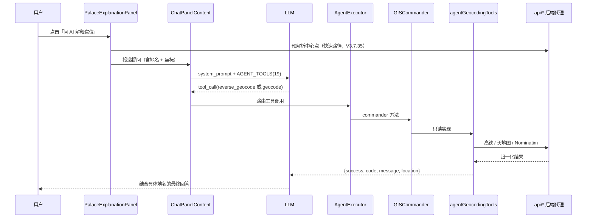

# 2026-11-24 V3.7.36 Agent 双向地理编码工具（reverse_geocode / geocode）

- **日期与时间**：2026-11-24 12:25
- **任务等级**：L2（跨 chat / command-bus / api / compass 域的功能开发）
- **版本号**：V3.7.36（承接 V3.7.35，当前无并行撞号）
- **用户指令**：用户指出应先把「经纬度 → 地名」与「地名 → 经纬度」封装成 Agent 可调用的函数工具，而非只由前端预解析。本节按当前会话明确指令调整 V3.7.35 的技术路线（Force_command §0 优先级 1）。

---

## 一、问题分析

### 1.1 核心症状

V3.7.35 已把罗盘中心点经纬度在**前端**逆地理编码后写进提问，但 Agent 自身仍不具备地理编码能力：

1. 工具清单 17 个，无正/逆地理编码工具；模型只能被动接收前端塞给它的地名，无法自主复核或响应追问（如「这个坐标具体属于哪个街道」「把西湖翻译成坐标」）。
2. 现有 `search_and_zoom(query)` 虽内部做了地理编码，但**必然移动地图并落图进 TOC**，属于有画布副作用的变更工具，不能当只读查询用；模型若只为取坐标而调它，会意外改变用户视图。
3. 系统提示 V3.7.33 写有「罗盘问答不需要调用任何工具」，与「让 Agent 调用地理编码工具」的新要求直接冲突，需同步修订。

### 1.2 根本原因

能力边界定义不完整：地理编码是 GIS 助手的基础数据查询能力，此前被内嵌在 `searchAndZoom` / `getWeather` 的实现细节里，未提升为独立、只读、可组合的工具契约。

### 1.3 受影响模块

| 模块 | 影响 |
|---|---|
| `chat/constants/agentToolsSchema.ts` | 工具声明 17 → 19；系统提示工具清单、选型、罗盘段落、约束同步 |
| `chat/agent/AgentExecutor.ts` | 工具注册表新增 2 条映射 |
| `command-bus/GISCommander.ts` | 门面暴露 2 个只读方法（不走 MapCommandBus） |
| `chat/agent/agentGeocodingTools.ts` | **新增**：两个工具的实现单一职责封装 |
| `chat/composables/useAgentMapContext.ts` | 动作日志补全两个只读工具的可读摘要 |
| `api/index.ts` / `api/geocoding.ts` / `api/locationSearch.ts` | 仅复用，不改动 |
| `locales/{zh-CN,en-US}/misc.ts` | `askAgentPrompt` 解除「勿调任何工具」的绝对化表述 |
| 文档 | README 三处版本号、CHANGELOG、前端结构树 |

---

## 二、修改内容

1. 新增 `agentGeocodingTools.ts`，导出 `reverseGeocodeTool({lng,lat})` 与 `geocodeTool({address,city})`：
   - 双向均返回 `{success, code, message, location}` 结构化结果；入参校验失败返回 `INVALID_ARGUMENT`，无命中返回 `*_NOT_FOUND`，网络/配额失败返回 `*_FAILED`，**不抛异常、不弹全局告警**（统一 `silent:true`）。
   - 逆地理复用 `apiReverseGeocodeWithFallback`（高德优先、天地图兜底，内部 WGS-84→GCJ-02）；输出省/市/区/乡镇/详细地址/adcode/provider。
   - 正地理编码顺序：高德地址编码 → 高德 POI 文本 → Nominatim（国际兜底）；输出统一为 WGS-84。
   - **只读**：不调用 `setViewCenter`、不建图层、不经 MapCommandBus。
2. `agentToolsSchema.ts` 新增工具 `18 reverse_geocode`、`19 geocode`；系统提示补充选型规则，并将罗盘段落修订为「以知识解答为主；需要确认地点时可调只读 reverse_geocode，不要调其它工具操作罗盘」。
3. `AgentExecutor.TOOL_REGISTRY` 新增 `reverse_geocode → reverseGeocode`、`geocode → geocode`。
4. `GISCommander` 暴露两个门面方法，转调新模块（与 `getWeather` 同属「只读外部数据」类，不进命令总线）。
5. `useAgentMapContext.summarizeAction` 补两个 case，避免动作日志退化为 `[reverse_geocode] reverse_geocode` 噪声。
6. i18n `compass.askAgentPrompt` 中「无需调用任何地图工具」改为「仅在需要确认地点时调用 reverse_geocode（只读），不要调用其它地图操作工具」，中英同步。

---

## 三、修改原因

- **能力对等**：Agent 应能独立回答「这是什么坐标 / 这个地名在哪」，而不是依赖调用方预先拼好答案。
- **副作用隔离**：把地理编码从 `search_and_zoom` 中拆出只读版本，避免查询动作污染地图视图与图层树。
- **组合性**：`geocode` 的输出（WGS-84 坐标）可直接作为 `reverse_geocode`、`set_view_center`、`zoom_to_extent` 的输入，形成多轮编排闭环。
- **兼容 V3.7.35**：前端预解析仍保留为零往返快速路径；新增工具服务于模型自主复核与后续追问，两者互补而非互斥。

---

## 四、影响范围

| 模块 | 影响 |
|---|---|
| 全部 Agent 对话 | 工具数 17 → 19；新增两个只读工具，不改变既有工具语义 |
| 罗盘宫位提问 | 提问末尾的「勿调工具」改为「仅限只读 reverse_geocode」；前端地名上下文仍保留 |
| 地图画布 | **零副作用**：两个工具都不发地图命令、不建图层、不改 URL |
| 后端 | 无新接口，复用既有 `/api/proxy/amap/geocode/{geo,regeo}` 与 `/api/proxy/search/nominatim` |
| 配置 | 无新增配置 key |

---

## 五、解决方案

### 5.1 候选方案对比

| 方案 | 做法 | 评价 |
|---|---|---|
| A. 复用 `search_and_zoom` | 让模型用它取坐标 | 否决：必然移动地图并落图，查询动作产生副作用 |
| B. 只保留前端预解析（V3.7.35） | 提问里写死地名 | 否决：Agent 无自主地理编码能力，无法响应追问 |
| **C. 新增两个只读工具** | 独立封装双向编码 + 门面注册 + 提示词约束 | **采用**：零副作用、可组合、与既有只读工具（get_weather / get_map_state）模式一致 |

### 5.2 数据流与文件交互

### 5.3 实施步骤

1. 文档先行（本节）→ 2. 新增工具实现文件 → 3. 注册链路（schema / executor / commander / context / i18n）→ 4. 版本与文档同步 → 5. 门禁与类型检查。

---

## 六、性能指标

未实测。设计上 `reverse_geocode` 为 1 次后端代理请求（高德失败才追加天地图），`geocode` 最多 3 次串行尝试（高德地址 → 高德 POI → Nominatim）；均为低频只读操作，不进入地图动画等待链。

---

## 七、测试方案

### 7.1 Agent 已执行

| 检查 | 结果 |
|---|---|
| `npx vue-tsc --noEmit`（工具接线完成后） | `EXIT=0`，无输出 ✅ |
| `python Scripts/CheckStructureTree.py` | 文档条目 747 · 磁盘文件 747 · 漏登记 0 · 幽灵条目 0 ✅ |
| `python Scripts/CheckConfigRegistry.py` | B1–B4 / F1–F7 全通过；catalog 138 key · 前端 VITE_ 11 个 ✅ |
| 工作区 diff 规模 | 9 个已有文件共 95 行新增 / 6 行删除，无整文件级漂移；新建 2 个文件已统一 CRLF ✅ |
| 平台红线自查 | 本次未触及 backend / deploy / .github，按 Force_command §11.2 适用范围无需执行；无新增密钥与配置 key ✅ |

> 说明：以上为静态验证（类型、门禁、代码审阅）。工具实际网络调用与画布零副作用需用户按 7.2 实机验证。**未声称实机通过。**

### 7.2 待用户实机验证

1. 打开 AI 助手，输入「坐标 120.129721, 30.259242 是哪里」
   - 预期：模型调用 `reverse_geocode`，回答中出现浙江省杭州市西湖区及详细地址；回答中**不出现**地图移动、图层新增。
2. 输入「西湖的经纬度是多少」
   - 预期：模型调用 `geocode`，返回 WGS-84 坐标与地址；地图视图**保持不变**。
3. 点罗盘宫位「问 AI 解释宫位」
   - 预期：提问含预解析地名；若模型自行调用 `reverse_geocode` 复核，回答仍正常，不出现「无需调用工具」类冲突话术。
4. 输入无效坐标（如 999, 999）或空地名
   - 预期：工具返回 `INVALID_ARGUMENT`，模型如实说明参数无效，不编造地名或坐标。
5. 输入境外地名（如 "Tokyo"）
   - 预期：高德未命中后降级 Nominatim，返回坐标；若全部失败返回 `GEOCODE_NOT_FOUND` 并如实告知。

---

## 八、变更文件清单

| 文件 | 改动 |
|---|---|
| `frontend/src/domains/common/chat/agent/agentGeocodingTools.ts` | 新增：双向地理编码只读工具实现 |
| `frontend/src/domains/common/chat/constants/agentToolsSchema.ts` | 工具声明 +2；系统提示工具清单/选型/罗盘/约束修订；LLM 结果透传字段 |
| `frontend/src/domains/common/chat/agent/AgentExecutor.ts` | 注册表 +2 |
| `frontend/src/domains/common/command-bus/GISCommander.ts` | 门面方法 +2 并转调新模块 |
| `frontend/src/domains/common/chat/composables/useAgentMapContext.ts` | 动作日志摘要 +2 |
| `frontend/src/locales/zh-CN/misc.ts` / `en-US/misc.ts` | `askAgentPrompt` 工具约束措辞调整 |
| `README.md` / `Docs/Guide/CHANGELOG.md` / `Docs/Guide/frontend-structure.md` | 版本号 V3.7.36、变更条目、新文件登记 |

---

## 九、遗留与风险

1. 高德 POI 文本检索兜底会计入后端代理配额；仅在前两次尝试失败时触发，属低频路径。
2. Nominatim 对中文地址的支持弱于高德；境外地名走 Nominatim 时返回的是 OSM 的 `display_name`，可能与高德行政区名称不一致，工具结果里用 `provider` 字段显式区分。
3. 前端 V3.7.35 预解析与工具 `reverse_geocode` 可能对同一点重复调用两次；当前未做结果缓存，后续可在 `chatStore` 层加会话级缓存。
4. 系统提示仍为提示工程约束，不保证所有模型版本都严格只在需要时调工具；已通过只读设计与「不要操作罗盘」的双重措辞降低误用风险。
