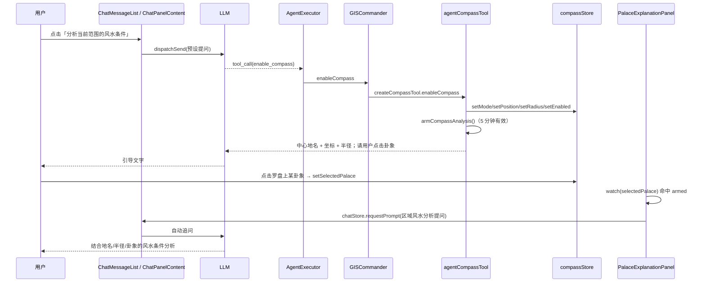

# 2026-11-24 V3.7.37 对话驱动的区域风水分析流程

- **日期与时间**：2026-11-24 12:35
- **任务等级**：L2（跨 chat / compass / command-bus 域的功能开发）
- **版本号**：V3.7.37（承接 V3.7.36）

---

## 一、问题分析

### 1.1 需求

在聊天空状态的建议词中增加「分析当前范围的风水条件」。用户点击后，Agent 应能**自主启用罗盘**（落在当前地图视图中心），提示用户在罗盘上点击想分析的卦象；用户一点卦象，即自动进入分析，不再需要额外点一次「问 AI」按钮。

### 1.2 现状与障碍

| 现状 | 障碍 |
|---|---|
| `ChatMessageList.ts` 的 `suggestions` 只有定位/底图/搜索/天气 4 条 | 无风水分析入口 |
| 罗盘由用户在控制面板手动开启（`compassStore.setEnabled`） | Agent 没有启用罗盘的工具，工具清单 19 个均无罗盘控制能力 |
| `PalaceExplanationPanel` 已有「问 AI 解释宫位」按钮，走 `chatStore.requestPrompt` 队列 | 需用户多点一次；且提问是通用释义，未带「当前范围/半径」语义 |
| V3.7.33 系统提示明确「不要尝试调用工具去操作罗盘」 | 与新需求直接冲突，必须同步修订 |

### 1.3 根因

Agent 没有「罗盘控制 + 用户选择回传」的闭环：既有桥接是单向的（面板 → 聊天队列），缺少 Agent → 面板的方向。

---

## 二、修改内容

1. **预设提示词**：新增 `chat.suggestions.compassFengShui`（中：`分析当前范围的风水条件`），作为第 5 条建议词；触屏档补 ≥40px 点击目标。
2. **新增 Agent 工具 `enable_compass`**：
   - 参数可选 `themeId`、`radiusMeters`；从地图上下文取当前中心（WGS-84），设置罗盘模式为 vector、位置、半径、主题，然后 `setEnabled(true)`。
   - 复用 `reverse_geocode` 的解析能力，把中心点地名写进工具结果，让 Agent 能告诉用户「罗盘已落在××」。
   - **调用后武装一次会话级「等待卦象选择」标志**（带 5 分钟过期），用户点击卦象后自动消费一次。
3. **卦象选择自动触发分析**：
   - `PalaceExplanationPanel` 监听 `selectedPalace`，当会话标志处于 armed 时，自动组装「区域风水条件分析」提问并投递 `chatStore.requestPrompt`。
   - 提问包含：主题 / 层号 / 层名 / 卦象名 + 罗盘中心地名与坐标 + **半径范围**；要求结合地形、水系、气候、人文格局做当地化分析。
   - 用户手动点「问 AI 解释宫位」的行为保持不变；armed 标志只影响自动触发。
4. **系统提示修订**：罗盘段落从「不要调用工具操作罗盘」改为「用户要求分析当前范围风水时，先调 `enable_compass` 启用罗盘，再请用户点击卦象；用户选择会自动回传，届时再作答」。

---

## 三、修改原因

- **闭环**：把「Agent → 罗盘 → 用户选择 → Agent」串成一次连贯任务，而不是让用户自己找面板、再找按钮。
- **降低误用**：`enable_compass` 只设置罗盘中心为当前地图中心，不移动地图、不改 URL 之外的状态；URL 同步由既有 `CompassManager` watcher 负责。
- **避免重复逻辑**：自动分析复用面板已有的层名/宫位名解析与逆地理上下文，只新增一条 i18n 提问模板。

---

## 四、影响范围

| 模块 | 影响 |
|---|---|
| 聊天空状态 | 建议词 4 → 5 |
| Agent 工具 | 19 → 20；罗盘系统提示段落改写 |
| 罗盘 | Agent 可启用/定位罗盘；用户点击卦象后自动向聊天投递一次分析提问 |
| 地图画布 | `enable_compass` 不移动地图；罗盘图层由既有渲染链路管理 |
| 后端 | 无新增接口；复用逆地理代理 |

---

## 五、解决方案

### 5.1 候选方案

| 方案 | 做法 | 评价 |
|---|---|---|
| A. 预设词只是普通文本 | 用户点后 Agent 用文字指导用户手动开罗盘 | 否决：无法自主启用，链路断裂 |
| B. 工具启用罗盘 + 用户再点按钮 | Agent 开罗盘，用户点卦象后再点「问 AI」 | 否决：多一次点击，与「点击卦象即分析」诉求不符 |
| **C. 工具启用 + 会话标志 + 面板自动投递** | Agent 启用并武装；用户点卦象自动回传 | **采用**：闭环最短，复用既有队列与消费守卫 |

### 5.2 数据流

### 5.3 关键约束

- 会话标志一次性消费，5 分钟过期，避免用户很久之后随便点卦象被误判为本次任务的回答。
- 不改动 `setSelectedPalace` 本身；自动触发放在面板层，便于关闭/回退。
- 新增文件均为 `.ts`；不新增配置 key。

---

## 六、性能指标

未实测。新增一次工具调用（含逆地理代理）与一次自动追问；罗盘渲染沿用既有链路。

---

## 七、测试方案

### 7.1 Agent 已执行

| 检查 | 结果 |
|---|---|
| `npx vue-tsc --noEmit`（全部接线完成后） | `EXIT=0`，无输出 ✅ |
| `python Scripts/CheckStructureTree.py --quiet` | 文档条目 749 · 磁盘文件 749 · 漏登记 0 · 幽灵条目 0 ✅ |
| `python Scripts/CheckConfigRegistry.py` | B1–B4 / F1–F7 全通过；catalog 138 key · 前端 VITE_ 11 个 ✅ |
| 新建文件行尾 | 3 个新文件均统一 CRLF，无 `\r\r\n` 损坏 ✅ |
| 平台红线自查 | 未触及 backend / deploy / .github，按 Force_command §11.2 适用范围无需执行 ✅ |

> 以上为静态验证（类型、门禁、代码审阅）。工具实际调用与「点卦象自动追问」需按 7.2 实机验证，**未声称实机通过**。

### 7.2 待用户实机验证

1. 清空聊天 → 点击第 5 条建议词「分析当前范围的风水条件」
   - 预期：Agent 调用 `enable_compass`；地图视图不移动；罗盘在地图中心出现；回复告知中心地名并请用户点击卦象
2. 点击罗盘上任一卦象（如「子」）
   - 预期：释义面板弹出；**无需再点按钮**，聊天自动追加一条带地名/半径/卦象的分析提问并流式作答
3. 分析完成后再点另一个卦象
   - 预期：只弹出释义面板，不再自动提问（标志已一次性消费）
4. 手动点面板底部「问 AI 解释宫位」
   - 预期：行为与 V3.7.36 完全一致
5. 工具调用后超过 5 分钟再点卦象
   - 预期：不自动追问（标志过期）

---

## 八、变更文件清单

| 文件 | 改动 |
|---|---|
| `chat/agent/agentCompassTool.ts` | 新增：罗盘启用工具实现（含中心解析与武装） |
| `chat/agent/compassAnalysisSession.ts` | 新增：一次性会话标志（带过期） |
| `chat/components/ChatMessageList.ts` / `.vue` | 第 5 条建议词 + 触屏点击目标 |
| `chat/components/ChatPanelContent.ts` | 装配罗盘工具到 GISCommander |
| `chat/agent/AgentExecutor.ts` / `chat/constants/agentToolsSchema.ts` | 工具注册 + 系统提示 |
| `command-bus/GISCommander.ts` | 门面暴露 `enableCompass` |
| `compass/components/PalaceExplanationPanel.ts` | 监听卦象选择，自动投递分析提问 |
| `locales/{zh-CN,en-US}/search-shell.ts` / `misc.ts` | 建议词与分析提问文案 |
| `README.md` / `Docs/Guide/CHANGELOG.md` / `Docs/Guide/frontend-structure.md` | 版本与结构树 |

---

## 九、遗留与风险

1. 用户若未打开聊天面板就启用罗盘（如通过其它入口），自动投递的提问会留在 `chatStore` 队列，等面板挂载/空闲后消费 —— 与 V3.7.30 既有守卫一致。
2. 会话标志为模块级状态，刷新页面即丢失；不跨会话持久。
3. 罗盘主题名取自当前配置；若用户尚未加载主题配置，工具会先调用 `ensureConfigLoaded()`，可能带来一次本地配置读取延迟。
4. 系统提示为提示工程约束：模型若不主动调 `enable_compass`，预设词仍会退化为普通问答；已在工具描述与「选型」段加强触发条件。
