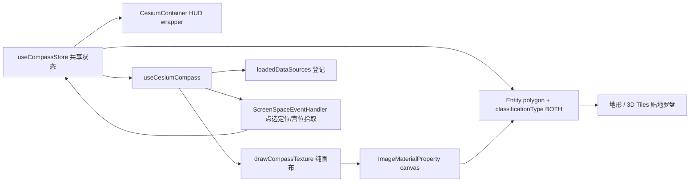

# 2026-11-24 在 Cesium 侧实现 HUD 与贴地风水罗盘

- **日期与时间**：2026-11-24 10:10
- **任务等级**：L2（跨模块功能开发，含 Mermaid 图）
- **版本**：V3.7.13（并行会话已占用 V3.7.12「注记瓦片带下沉」条目，本任务按 Force_command §5 顺延一号）

## 问题分析

### 核心症状

风水罗盘的 Vector（地理实体）与 HUD（固定屏幕）两种模式均绑定在 OL `MapContainer`：

- `MapContainer.vue` 持有 `.compass-hud-wrapper`，渲染 `FengShuiCompassSvg`；
- `CompassManager` 只接收 `ol/Map`，负责图层创建、点选定位、宫位拾取与 URL 同步；
- `HomeView.vue` 在 3D 模式下 `v-show` 隐藏 OL 容器，故切到 Cesium 后罗盘整体消失。

用户要求：在 Cesium 侧实现同类能力，并增加 3D 特有的**贴地**能力。

### 根本原因

这是架构覆盖缺口，不是运行时故障：罗盘状态层（`useCompassStore`）与绘制资源（`FengShuiCompassSvg`、主题配置、绘制工具）都在 `common` 域，但场景宿主与交互管理器只有 OL 实现。3D 容器 `CesiumContainer` 未消费该 store，也未注册任何罗盘场景对象。

### 受影响模块

| 模块 | 文件 | 影响 |
|---|---|---|
| 3D 主容器 | `CesiumContainer.vue` / `.ts` | 缺少 HUD 宿主与罗盘场景入口 |
| 罗盘共享服务 | `common/compass/services/*` | 现有 Canvas 绘制逻辑绑定 OL renderer，需抽出可复用的纯画布函数 |
| Cesium 交互 | 新 `composables/compass/useCesiumCompass.ts` | 贴地实体、点选定位、宫位拾取、生命周期 |
| 数据源登记 | `loadedDataSources` | 场景对象需登记，满足 TOC 单一管理原则 |

## 修改内容

1. 新增 `common/compass/services/drawCompassTexture.ts`：从 OL Canvas 渲染器提炼纯画布绘制函数，输入装备好的 `FengShuiCompassConfig`，输出透明底罗盘 Canvas；不依赖 OL/Cesium。
2. 新增 `cesium/composables/compass/useCesiumCompass.ts`：
   - 以 `Entity.polygon + ImageMaterialProperty(canvas)` 绘制地理罗盘，`classificationType=BOTH` 实现地形与 3D Tiles 双向贴地；
   - 监听 `enabled/mode/position/rotation/opacity/physicalRadiusMeters/cid` 等状态，重建或更新实体；
   - 用独立 `ScreenSpaceEventHandler` 处理点选定位与宫位拾取，避免覆盖绘制/路线等既有 LEFT_CLICK handler；
   - 向 `loadedDataSources` 登记 `cesium:compass`（`managedByModule:true`）并在卸载时清理。
3. `CesiumContainer.vue`：新增与 OL 对齐的 HUD wrapper、`PalaceExplanationPanel`，容器加上 `compass-placement-mode` 光标类。
4. `CesiumContainer.ts`：装配 `useCompassStore`、`compassBgVars`、`FengShuiCompassSvg` 与新 composable，透出模板所需状态并接入卸载清理。
5. `README.md` / `CHANGELOG.md` / 前端结构树同步。

## 修改原因

OL 与 Cesium 的 HUD 是同一个 DOM/SVG 渲染问题，复用现有组件即可；地理罗盘需要 3D 特有的贴地语义，采用 Cesium 原生 Entity polygon classification，而不是把 OL 图层机制硬搬过来。抽出纯 Canvas 函数避免复制约 300 行绘制逻辑，确保两种引擎的视觉配置来自同一份代码。

## 影响范围

- 2D/3D 引擎切换：3D 视图新增罗盘 HUD 与贴地罗盘。
- 罗盘控制面板：原状态无需改动，两种引擎共享同一 store。
- 不影响图层树用户数据、Agent 工具链、后端。

## 解决方案

### 方案对比

| 方案 | 做法 | 结论 |
|---|---|---|
| A. 仅把 OL MapContainer 显示出来 | 3D 下不隐藏 OL 容器 | 否决：地图交互和 DOM 层级冲突 |
| B. Cesium 侧复用 SVG HUD + 原生贴地 polygon | DOM HUD 复用；地理罗盘用 Entity polygon + ImageMaterial + classificationType | **采用** |
| C. 用 Cesium Billboard 贴一张罗盘图 | 始终朝向相机 | 否决：无法贴地，也无法表达地理范围 |

### Mermaid 图

## 测试方案

### Agent 已执行

- `vue-tsc --noEmit`：0 报错（首轮发现 `pickPosition` catch 中无用赋值，已修正）。
- ESLint（4 个改动文件）：0 error / 0 warning。
- 结构树 742/742、配置登记、Vue 范式 72/72、领域隔离全绿（新增 2 个文件已登记）。
- 浏览器实机（Vite dev + `#/home?s=1&view=cesium`）：
  - 切换 HUD 模式：`.compass-hud-wrapper` 出现，DOM 含 8 circle / 245 text，截图显示完整罗盘。
  - 切换 Vector 模式：`cesium-compass` 实体存在，`classificationType=2`（BOTH），地表出现贴地罗盘纹理。
  - 点选定位开启后点击画布：罗盘中心从 `106.455134, 33.538482` 移动到 `106.853883, 33.601571`。
  - 关闭罗盘：实体被移除、HUD 消失，卸载链路生效。
- 生产构建：临时输出目录 `vite build` 成功（4767 modules，16.03s；默认 `dist` 清理仍受沙箱批量删除保护拦截，非代码错误）。
- 平台红线：源码命中均为 Cesium 体积云 `maxRayDistance` 中 `xray` 子串的已知假阳性；生产基线 `REDLINE-CLEAN`。

### 待用户实机验证

1. 3D 视图打开罗盘面板，启用罗盘：屏幕中央出现完整 HUD 罗盘。
2. 切换 Vector 模式：地表出现贴地罗盘，地形起伏处随地形贴合。
3. 开启地图点选定位并点击地表：罗盘中心移动到点击位置。
4. 点击罗盘宫位：出现宫位解释面板；关闭罗盘后两者均消失。

## 变更文件清单

| 文件 | 说明 |
|---|---|
| `frontend/src/domains/common/compass/services/drawCompassTexture.ts` | 纯 Canvas 罗盘纹理绘制 |
| `frontend/src/domains/cesium/composables/compass/useCesiumCompass.ts` | 3D 贴地罗盘与交互 |
| `frontend/src/domains/cesium/components/CesiumContainer.vue` | HUD / 解释面板 / 光标态 |
| `frontend/src/domains/cesium/components/CesiumContainer.ts` | 状态与 composable 装配 |
| `Docs/Guide/frontend-structure.md` | 新增文件登记 |
| `README.md` / `Docs/Guide/CHANGELOG.md` | 版本与变更记录 |
| 本文件 | L2 维护日志 |

## 遗留与风险

- 贴地依赖 `ClassificationType.BOTH`：无地形 / 3D Tiles 时退化为贴椭球面，仍可见。
- Canvas 纹理固定 1024×1024；超大半径下文字清晰度受纹理分辨率限制。
- 3D 地理罗盘使用近似等距经纬矩形构造 polygon，高纬度地区边缘会有轻微形变；当前主题为圆盘视觉，可接受。
