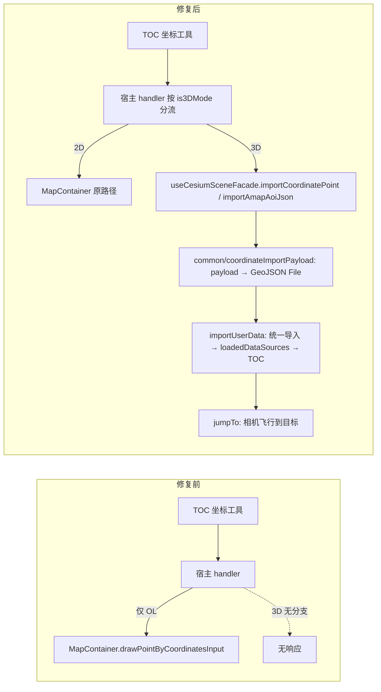

# 2026-11-24 修复 3D 视图下坐标落点与高德 AOI JSON 手绘不生效

- **日期与时间**：2026-11-24 11:28
- **任务等级**：L2（双引擎功能补齐）
- **版本**：V3.7.24

## 问题分析

### 核心症状

在 Cesium 3D 视图中，TOC 坐标工具的“输入坐标落点”与“高德 AOI 详情 JSON 手绘面”均无响应；
同一操作在 2D 视图正常。用户粘贴 JSON 后没有图层生成，也没有错误提示。

### 根本原因

宿主事件只转发给 OL 容器，3D 路径缺失：

1. `app/composables/useHomeTocAndAttributeActions.ts:333-335` 的
   `handleDrawPointByCoordinates` 仅调用 `mapContainerRef.drawPointByCoordinatesInput`。
2. `...useHomeTocAndAttributeActions.ts:337-344` 的
   `handleDrawAmapAoiFromJson` 同样只调用 OL 容器方法。
3. 3D 侧没有同义入口，但存在可复用的完整能力：
   - `CesiumContainer.ts:195` 的 `importUserData` → `useCesiumSceneFacade.ts:397-412`
     走统一导入管线，导入后自动进 `loadedDataSources` / TOC；
   - `CesiumContainer.ts:211` 的 `jumpTo(lng, lat, height)` 提供相机飞行；
   - 坐标解析器 `common/data-import/parsers/amapAoiParser.ts:232` 与 GCJ02→WGS84
     转换 `common/data-import/crs/coordTransform.ts:47` 均为引擎无关实现。

因此无需在 3D 侧重写解析与绘制，只需把 payload 转成 GeoJSON `File` 走既有导入链路。

### 受影响模块

| 模块 | 文件 | 影响 |
|---|---|---|
| 宿主事件分发 | `app/composables/useHomeTocAndAttributeActions.ts` | 3D 下两个事件无接收方 |
| 3D 场景门面 | `domains/cesium/composables/interaction/useCesiumSceneFacade.ts` | 缺坐标/AOI 导入入口 |
| 3D 容器暴露面 | `domains/cesium/components/CesiumContainer.ts` | 缺两个对外方法 |
| common 映射层（新增） | `domains/common/map-view/coordinateImportPayload.ts` | payload → GeoJSON 的纯函数 |

## 修改内容

1. 新增 `common/map-view/coordinateImportPayload.ts`：纯函数，把坐标输入 payload / 高德详情 JSON
   转成 GeoJSON `FeatureCollection` 的 `File`，并给出聚焦中心与缩放级别；复用既有解析器与坐标转换。
2. `useCesiumSceneFacade.ts` 增加 `importCoordinatePoint` / `importAmapAoiJson`：调用 common 转换，
   再走 `importUserData({ resources: [file], silent: true })` 与 `jumpTo`；错误以 `{ error }` 返回，不直接触 UI。
3. `CesiumContainer.ts` 暴露上述两个方法并在 setup 中绑定 sceneFacade 实现。
4. `useHomeTocAndAttributeActions.ts` 两个 handler 增加 `is3DMode` 分支，展示成功/警告提示。

## 修改原因

`common` 的定位是双引擎共用能力；当前解析层已共用，只有宿主分发与 3D 落图入口缺失。
用 GeoJSON 作为中间格式可直接复用统一导入与 TOC 注册，避免在 3D 侧复制一套实体创建与样式逻辑。

## 影响范围

- 仅影响 3D 视图下这两个 TOC 坐标工具事件；2D 行为不变。
- 新增的 GeoJSON 图层走既有导入管线，自动进入 TOC，可被显隐 / 定位 / 移除。
- 不涉及配置 key、密钥、部署面与 UI 图标；无新增移动端控件。

## 解决方案

| 方案 | 做法 | 结论 |
|---|---|---|
| A. 在 CesiumContainer 手写 Entity 绘制 | 新建点/面 Entity 并自行注册 | 否决：重复实现 TOC 注册与样式，违背单一职责 |
| B. payload → GeoJSON File → `importUserData` → `jumpTo` | 复用 common 解析 + 统一导入 | **采用**：能力已存在，改动可控 |
| C. 用 Agent 的 `addSearchResultLayer` 通道 | 借 AI 搜索落图 sink | 否决：语义不同（搜索结果），且带有样式假设 |

实施步骤：先落 common 纯函数 → 再接 sceneFacade → 再暴露容器方法 → 最后改宿主分发；
随后更新版本记录、执行门禁与类型检查。

### Mermaid 图

## 性能指标

不适用（沿用既有导入管线，未引入新的渲染路径，未实测）。

## 测试方案

### Agent 已执行

- 静态核对：`useCesiumSceneFacade.importUserData` 接受 `File[]` 并写入 `loadedDataSources`；`jumpTo` 提供相机飞行；common 解析器与 GCJ02→WGS84 转换均为引擎无关。
- `vue-tsc --noEmit`：0 报错（并行罗盘任务此前的 TS6133 已由对方修复，全量检查恢复通过）。
- ESLint 检查本次改动的 4 个 `.ts` 文件：0 warning / 0 error。
- `CheckStructureTree.py`：新增 1 个文件并同步前端结构树，文档条目 745 · 磁盘文件 745 · 漏登记 0 · 幽灵条目 0。
- `CheckConfigRegistry.py`：B1–B4 / F1–F3 七项全绿。
- `CheckDomainDeps.py frontend/src`：四个方向依赖均 0。
- 版本号写入前复核 README 为 V3.7.23，本任务占用 V3.7.24；收尾复核 README 三处仍为 V3.7.24，未发生撞车。

### 待用户实机验证

1. 切换到 3D 视图，打开 TOC 坐标工具，输入经纬度（可指定 `gcj02`）并落点。
2. 预期：生成一个新的 GeoJSON 点图层并出现在 TOC，相机飞行到该点，属性表有坐标字段。
3. 在 3D 下粘贴高德 AOI 详情 JSON 并手绘。
4. 预期：生成 AOI 面图层并进入 TOC，相机飞行到面中心；解析失败时给出明确提示。
5. 切回 2D 重复上述操作，确认原行为无回归。

## 变更文件清单

| 文件 | 说明 |
|---|---|
| `frontend/src/domains/common/map-view/coordinateImportPayload.ts` | 新增：payload → GeoJSON 纯函数 |
| `frontend/src/domains/cesium/composables/interaction/useCesiumSceneFacade.ts` | 新增两个 3D 导入方法 |
| `frontend/src/domains/cesium/components/CesiumContainer.ts` | 暴露两个新方法 |
| `frontend/src/app/composables/useHomeTocAndAttributeActions.ts` | 两个 handler 增加 3D 分流 |
| `Docs/Guide/frontend-structure.md` | 登记新增的 coordinateImportPayload.ts |
| `README.md` / `Docs/Guide/CHANGELOG.md` | 版本记录 |
| 本文件 | L2 维护日志 |

## 遗留与风险

- GeoJSON 导入的图层样式由统一导入管线决定，可能与 2D `createManagedVectorLayer` 的默认样式不完全一致；功能等价，视觉不保证逐像素相同。
- `importCoordinatePoint` 的相机高度由 `olZoomToCesiumHeight` 按目标 zoom 换算；倾斜视角下的实际取景需实机确认。
- “定位我”仍在 2D 路径（`useHomeLayerAndMapRouting.ts:82-84`），本次未处理。
- 版本写入时 README 为 V3.7.23（并行罗盘任务持续推进），本任务占 V3.7.24；若收尾时 README 已推进到 V3.7.24，则以对方为先占者并按规范处理撞车。
