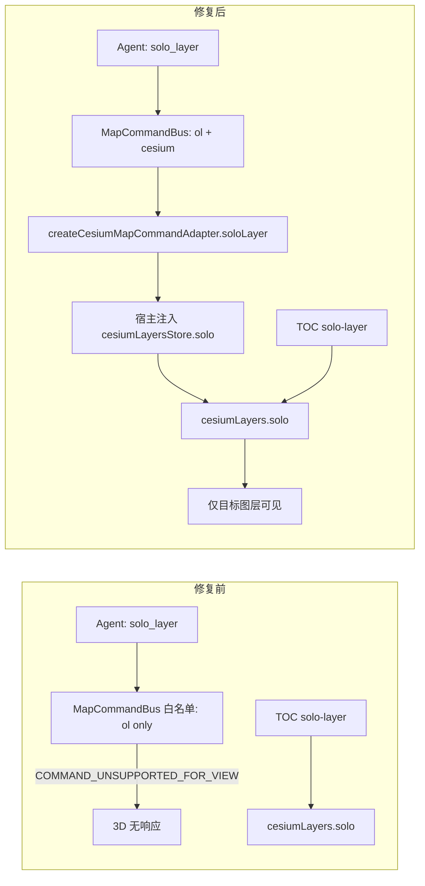

# 2026-11-24 修复 3D 视图下 Agent soloLayer 指令被误判为不支持

- **日期与时间**：2026-11-24 11:15
- **任务等级**：L2（双引擎 Agent 指令补齐）
- **版本**：V3.7.21

## 问题分析

### 核心症状

在 Cesium 3D 视图中，AI 对话调用 `solo_layer`（只显示指定图层）固定返回
`COMMAND_UNSUPPORTED_FOR_VIEW`，模型无法执行“只显示某图层”；同一操作在 2D 视图正常，
在 3D 的 TOC 右键菜单也正常。

### 根本原因

能力层已具备、指令通道未接通，存在三处断点：

1. `common/chat/agent/MapCommandBus.ts:32` 将 `soloLayer` 的 `supportedViews` 写死为 `['ol']`；
   `:27-28` 的注释称“3D 图层分组没有单独显示语义”，与代码现状不符。
2. `common/chat/agent/mapCommand/cesiumAdapter.ts` 的 options / 解构 / 返回列表
   （`:442-453`）均没有 `soloLayer`，即使白名单放行也会因找不到 handler 返回
   `MAP_RUNTIME_NOT_READY`。
3. `app/composables/useHomeEngineSwitch.ts:656-677` 构造 3D adapter 时未注入
   `soloLayer` sink；对比 2D adapter 构造处 `:650` 已注入。

3D 能力本身是完整的：`domains/cesium/stores/cesiumLayers.ts:465-480` 的 `solo(id)`
已实现“仅显示此图层、其余隐藏”，且为纯元数据 + adapter 广播，不依赖引擎侧 solo 状态；
`domains/cesium/layers/toc-adapters/cesiumTocActions.ts:114-116` 已将 TOC 的
`solo-layer` 事件接到该方法。

### 受影响模块

| 模块 | 文件 | 影响 |
|---|---|---|
| Agent 指令路由 | `common/chat/agent/MapCommandBus.ts` | 3D 指令被白名单前置拦截 |
| 3D 指令适配器 | `common/chat/agent/mapCommand/cesiumAdapter.ts` | 缺 handler，无法透传图层操作 |
| 宿主接线 | `app/composables/useHomeEngineSwitch.ts` | 未把 store 能力注入 adapter |
| 3D 图层 store | `domains/cesium/stores/cesiumLayers.ts` | 能力已就绪，无需改动 |

## 修改内容

1. `MapCommandBus.ts`：`soloLayer.supportedViews` 改为 `['ol','cesium']`，并更正
   `:27-28` 中与代码矛盾的注释。
2. `cesiumAdapter.ts`：新增 `soloLayer` sink 的类型声明、构造解构、执行函数与返回项；
   返回形状复用 `toMapCommandResult`，与 `olAdapter.ts:365-375` 一致。因 `cesiumLayers.solo()`
   返回 raw boolean，而 `toMapCommandResult` 只识别结构化结果，执行函数内先把 boolean
   归一为 `{ success, code }`，避免成功操作被误报为 `LAYER_ACTION_NO_RESULT`。
3. `useHomeEngineSwitch.ts`：在 3D adapter 构造处注入
   `soloLayer: (id) => cesiumLayersStore.solo(id)`。

`exportLayerGeoJson` 不在本次范围：3D 的 `exportData` 会触发浏览器下载，是否作为
Agent 工具仍需产品裁决，见「遗留与风险」。

## 修改原因

`common` 的双引擎定位要求同一业务能力在两个引擎都可调用。当前 3D 能力已实现且 TOC 可用，
只有 Agent 通道被策略层误挡，属于纯粹的接线缺口；修复不需要新增 3D 渲染或图层逻辑，
风险与改动面均最小，同时消除注释与代码现状的冲突（Force_command §0 要求显式报告此类矛盾）。

## 影响范围

- 仅影响 Agent 图层工具指令 `soloLayer` 在 3D 下的准入与执行。
- 2D 行为、TOC 右键行为、图层 store 语义均不变。
- 不涉及配置 key、场景数据加载、UI 图标与移动端样式。

## 解决方案

| 方案 | 做法 | 结论 |
|---|---|---|
| A. 放行白名单即可 | 只改 `supportedViews` | 否决：adapter 无 handler，会变成 `MAP_RUNTIME_NOT_READY` |
| B. 白名单 + 3D adapter + 宿主 sink 三点接线 | 复用 `cesiumLayers.solo` | **采用**：改动最小，能力已验证 |
| C. 在 CesiumContainer 另加同义方法 | 容器层新增 `soloUserLayer` | 否决：store 已是唯一入口，会产生第二套 API |

实施步骤：先改策略层白名单 → 再补 adapter handler → 最后在宿主注入 sink；
随后更新版本号与 CHANGELOG，运行门禁与类型检查。

### Mermaid 图

## 性能指标

不适用（本次为指令接线修复，无性能路径变化，未实测）。

## 测试方案

### Agent 已执行

- 静态核对：`cesiumLayers.solo` 已实现且 TOC 已接通；白名单 / adapter / 宿主三处断点定位完成。
- `CheckStructureTree.py`：文档条目 744 · 磁盘文件 744 · 漏登记 0 · 幽灵条目 0，通过。
- `CheckConfigRegistry.py`：B1–B4 / F1–F3 七项全部通过（catalog 138 key，前端 VITE_ 11 个）。
- `CheckDomainDeps.py frontend/src`：`common→ol / common→cesium / cesium→ol / ol→cesium` 均为 0，通过。
- `vue-tsc --noEmit`：首次全量执行 0 报错；修正 boolean 归一后复跑时，并行罗盘任务新写入的
  `drawCompassTexture.ts:17` 出现 TS6133（未使用的 `getBoundaryRadiusAtAngle`），非本任务文件，
  未擅自修改。以 `--noUnusedLocals false` 排除该外部项后复跑 0 报错，确认本任务未引入类型错误。
- ESLint 仅检查本次改动的 3 个 `.ts` 文件，两次执行均 0 warning / 0 error。
- 版本号写入前复核 README 为 V3.7.20，本次占用 V3.7.21；收尾复核时并行罗盘任务已将 README
  推进至 V3.7.22（该任务取号在后，未与本任务重复）。本任务保持 V3.7.21，不存在版本号撞车。

### 待用户实机验证

1. 切换到 3D 视图，导入至少两个矢量图层。
2. 在 AI 对话中说“只显示 <某图层>”（触发 `solo_layer`）。
3. 预期：指令返回成功；TOC 中仅目标图层可见，其余 3D 图层被隐藏；2D 视图行为不变。

## 变更文件清单

| 文件 | 说明 |
|---|---|
| `frontend/src/domains/common/chat/agent/MapCommandBus.ts` | 放行 3D `soloLayer` 并更正注释 |
| `frontend/src/domains/common/chat/agent/mapCommand/cesiumAdapter.ts` | 新增 soloLayer sink / handler / 返回项 |
| `frontend/src/app/composables/useHomeEngineSwitch.ts` | 注入 `cesiumLayersStore.solo` |
| `README.md` / `Docs/Guide/CHANGELOG.md` | 版本记录 |
| 本文件 | L2 维护日志 |

## 遗留与风险

- `exportLayerGeoJson` 在 3D 下仍被白名单拦截。注释认为浏览器下载不适合作为 Agent 工具，
  但 TOC 已提供同一能力；是否开放需产品裁决，本次不处理。
- 3D `solo` 原始返回为 boolean，已在 adapter 内归一为结构化结果；与 2D 相比不附带
  “被隐藏图层名清单”，Agent 侧只消费 `success` / `code`，不影响调用方。
- 本任务与另一并行会话的罗盘修复同日进行：本任务占 V3.7.21，对方随后占 V3.7.22，
   README 当前版本因此为 V3.7.22；两号不重复，本任务日志与 CHANGELOG 条目保持 V3.7.21。
- 收尾复跑全量类型检查时被并行罗盘文件的 TS6133 阻断（见「测试方案」），属外部未完工改动；
  该文件不在本任务范围，未修改。待对方任务完成后全量 `vue-tsc --noEmit` 应恢复 0 报错。
