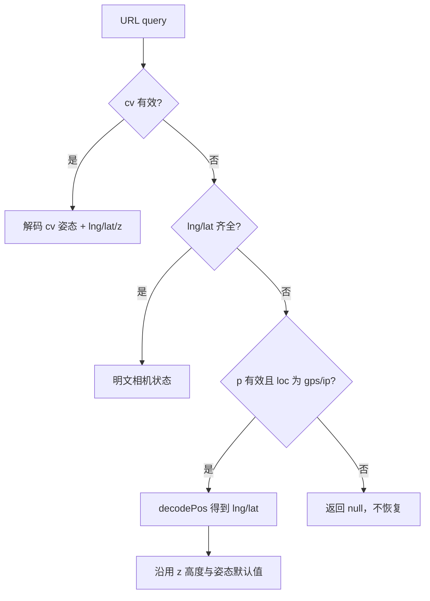

# 2026-11-24 修复 3D 视图不恢复 URL 位置码 p

- **日期与时间**：2026-11-24 11:37
- **任务等级**：L2（双引擎 URL 状态对齐）
- **版本**：V3.7.26（写法时为 V3.7.25，因并行罗盘任务先占 V3.7.25，按 Force_command §5 顺延）

## 问题分析

### 核心症状

带 `p=<位置码>&loc=gps|ip&view=cesium` 的分享链接在 3D 视图打开时不会回到目标位置；
同一链接在 2D 视图可正常恢复。

### 根本原因

`domains/ol` 与 `domains/cesium` 的 URL 恢复路径不对称：

1. `domains/ol/composables/useMapState.ts:157-171`：当 `lng/lat` 缺失、`p` 非空且不为 `0`、
   `loc ∈ {gps, ip}` 时调用 `decodePos` 解码并覆盖经纬度。
2. `domains/cesium/composables/layers/useCesiumUrlTracking.ts:90-117` 的
   `parseCameraStateFromUrl` 只处理 `cv` 编码与 `lng/lat/z` 明文参数，没有 `p` 回退。
3. `common/url-state/crypto.ts:8-13` 已导出 `decodePos`，`common/utils/normalize.ts:28`
   已导出 `normalizeLocationFlag`，3D 侧缺的只是接线。

### 受影响模块

| 模块 | 文件 | 影响 |
|---|---|---|
| 3D URL 相机恢复 | `domains/cesium/composables/layers/useCesiumUrlTracking.ts` | 分享链接丢失位置码语义 |
| 2D URL 恢复 | `domains/ol/composables/useMapState.ts` | 行为正确，作为对齐基准，不改 |
| common 编解码 | `common/url-state/crypto.ts` / `common/utils/normalize.ts` | 能力已就绪，不改 |

## 修改内容

1. `useCesiumUrlTracking.ts` 新增 `decodePos`、`normalizeLocationFlag` 导入。
2. `parseCameraStateFromUrl` 中 `lng` / `lat` 由 `const` 改为 `let`。
3. 在 `cv` 解析之前插入 `p=` 回退：仅当 `lng` 或 `lat` 缺失、位置码有效、`loc` 为
   `gps`/`ip` 时解码并覆盖经纬度；`cv` 与明文 `lng/lat` 优先级保持不变。
4. `height` 改为 `let`：仅当该回退成功且 URL 未带合法 `z` 时，回落到
   `DEFAULT_CESIUM_HEIGHT`，避免存量“只有 p 没有 z”的链接仍被丢弃。

## 修改原因

`p=` 是 2D 定位链路写出的紧凑位置码，`common` 中已有编解码能力但 3D 侧未消费，属于双引擎状态恢复的单向缺口。
修复后同一分享链接在 2D/3D 下语义一致，无需用户手动改写 URL。

## 影响范围

- 只影响 `parseCameraStateFromUrl` 的输入补全，不改 URL 写回逻辑。
- `cv` 存在且有效时行为完全不变；`lng/lat` 明文存在时也不会被 `p` 覆盖。
- 不涉及配置 key、场景数据、UI 与移动端样式。

## 解决方案

| 方案 | 做法 | 结论 |
|---|---|---|
| A. 在 router 层把 p 展开成 lng/lat | 改全局路由守卫 | 否决：影响所有视图，且 2D 已有独立逻辑，易冲突 |
| B. 在 Cesium 相机状态解析入口补 p 回退 | 单文件、与 OL 同条件 | **采用**：改动面最小，优先级链清晰 |
| C. 把 p 写回逻辑也改成 3D 生成 | 让 3D 链接都带 p | 否决：不解决存量链接，且属另一条链路 |

实施步骤：导入 → 变量可变性调整 → 插入回退分支 → 更新版本记录 → 跑门禁与类型检查。

### Mermaid 图

## 性能指标

不适用（URL 解析路径，未引入新的运行时开销，未实测）。

## 测试方案

### Agent 已执行

- 静态核对：`decodePos` 对非法码返回 `null` 且不抛异常；`normalizeLocationFlag` 仅放行 `gps` / `ip`；OL 侧准入条件已逐项对齐。
- `vue-tsc --noEmit`：0 报错；ESLint 检查改动文件 `useCesiumUrlTracking.ts`：0 warning / 0 error。
- `CheckStructureTree.py`：745/745，无漏登记/幽灵条目；`CheckConfigRegistry.py` 七项全绿；`CheckDomainDeps.py` 四个方向均 0。
- 版本：写入时 README V3.7.24 → 先记 V3.7.25；收尾发现并行任务占用 V3.7.25，按 §5 顺延为 V3.7.26 并同步 README / CHANGELOG。

### 待用户实机验证

1. 在 2D 视图通过定位或坐标工具生成带 `p=` 与 `loc=gps`（或 `ip`）的分享链接。
2. 将 `view` 改为 `cesium`（或通过界面切换到 3D 后打开）并加载该链接。
3. 预期：相机回到 `p` 对应的经纬度，高度按 `z` 或默认值恢复；底图等其他参数不受影响。
4. 回归：带有效 `cv` 的 3D 分享链接仍按原姿态恢复，不被 `p` 干扰。

## 变更文件清单

| 文件 | 说明 |
|---|---|
| `frontend/src/domains/cesium/composables/layers/useCesiumUrlTracking.ts` | 新增 p= 位置码解码回退 |
| `README.md` / `Docs/Guide/CHANGELOG.md` | 版本记录 |
| 本文件 | L2 维护日志 |

## 遗留与风险

- `p=` 只由 2D 链路写出；3D 视图自身生成的链接仍以 `cv` + `lng/lat` 为主，本次不改写写出逻辑。
- `loc` 语义沿用 2D 的 `gps` / `ip` 白名单；若未来新增来源标识，需两侧同步。
- 版本写入时 README 为 V3.7.24，本任务先记 V3.7.25；收尾发现并行罗盘任务已占 V3.7.25，
  按 §5“后完成者顺延”改为 V3.7.26，并在 README / CHANGELOG 同步。
