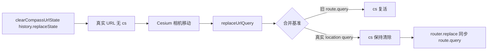

# 2026-11-24 修复 3D 视图关闭罗盘后 cs 参数复现

- **日期与时间**：2026-11-24 10:58
- **任务等级**：L2（URL 状态同步竞态修复）
- **版本**：V3.7.18

## 问题分析

### 核心症状

3D 视图中关闭罗盘后，地址栏的 `cs` 会先被清掉；随后相机移动触发 Cesium URL 同步，`cs` 又带着旧值回到地址栏。2D 侧没有该问题。

### 复现证据

浏览器实机（3D 模式、带 `cs=r.CjTAzony19Ixu05`）：

1. `compassStore.setEnabled(false)` 后 600 ms：地址栏 `cs=null`，但 `route.query.cs` 仍是 `r.CjTAzony19Ixu05`。
2. 触发 `viewer.camera.moveRight(2000)` 后：地址栏重新出现 `cs=r.CjTAzony19Ixu05`，`cv` 也更新。

### 根本原因

`clearCompassUrlState()` 通过 `window.history.replaceState()` 直接改 URL，不经过 Vue Router，因此 `route.query` 保留旧快照。

Cesium 的 `useCesiumUrlTracking.replaceUrlQuery()` 用 `getCurrentQuerySnapshot(route.query)` 作为基准合并新参数，再通过 `router.replace()` 写回。这个**陈旧快照**把已删除的 `cs` 重新带回 URL。OL 侧 URL 同步走的是 router 链路，不存在该分裂。

## 影响范围

| 模块 | 文件 | 影响 |
|---|---|---|
| Cesium URL 同步 | `frontend/src/domains/cesium/composables/layers/useCesiumUrlTracking.ts` | 基于陈旧 route.query 合并，复活已清除/已更新的参数 |
| 罗盘 URL 状态 | `common/compass/services/urlState.ts` | 通过 history.replaceState 写入，行为本身正确，本次不改 |

## 修改内容

`useCesiumUrlTracking.replaceUrlQuery()` 改为以**当前浏览器地址栏的真实查询串**为合并基准：

1. 从 `window.location.hash` 与 `window.location.search` 解析当前 query（与 `readMergedQuery()` 同语义：hash 优先、search 补缺）。
2. 用该快照替代 `route.query` 参与合并与“是否变化”比较。
3. `router.replace()` 写回后，`route.query` 同步刷新，彻底消除 Vue Router 与实际 URL 的分裂。

## 修改原因

只删 `cs` 是治标：即使罗盘仍启用，OL 侧通过 `history.replaceState` 更新 `cs` 后，Cesium 相机同步同样可能把旧 `cs` 写回去。改用真实地址为基准可一次性解决“删不掉”和“旧值复活”两类问题。

## 方案对比

| 方案 | 做法 | 结论 |
|---|---|---|
| A. 在 Cesium 同步时特判删除 cs | 罗盘关闭时删键 | 否决：启用时旧 cs 仍可能复活 |
| B. 用真实 URL 查询串作为合并基准 | 解析 location，再 router.replace | **采用** |
| C. 把罗盘 URL 写入全改为 router.replace | 改 common 服务并注入 router | 否决：改动跨层更大，本次不必 |

### Mermaid 图

## 测试方案

### Agent 已执行

- 修复前实机复现：3D 带 `cs=r.CjTAzony19Ixu05` 打开 → `setEnabled(false)` 后 URL 无 `cs` 但 `route.query.cs` 仍为旧值 → `viewer.camera.moveRight(2000)` 后 URL 重新出现旧 `cs`。
- 修复后同一序列复验：关闭后 URL 无 `cs`，相机移动后 `cs` 仍为 null。
- 附加验证：罗盘启用时把半径从 50 km 改为 100 km，相机移动后 `cs` 解码仍为 100 km，不再回退旧值。
- `vue-tsc --noEmit` 0 报错；ESLint（useCesiumUrlTracking.ts）0 warning。
- 结构树 743/743、配置登记、Vue 范式 72/72、领域隔离全绿；生产构建临时目录成功（4768 modules，11.46s）。

### 待用户实机验证

1. 3D 模式打开带 `cs` 的链接，关闭罗盘后移动相机，`cs` 不再出现。
2. 3D 模式调整罗盘半径后移动相机，`cs` 保持最新值而非回退旧值。
3. 2D 模式行为不变。

## 变更文件清单

| 文件 | 说明 |
|---|---|
| `frontend/src/domains/cesium/composables/layers/useCesiumUrlTracking.ts` | URL 合并基准改用真实 location query |
| `README.md` / `Docs/Guide/CHANGELOG.md` | 版本记录 |
| 本文件 | L2 维护日志 |

## 遗留与风险

- 解析 `location.search` 与 hash 时沿用“hash 优先、search 补缺”的既有语义；不会改变当前参数优先级。
- `router.replace` 仍负责最终写入，避免 route 与地址栏再度分裂。
