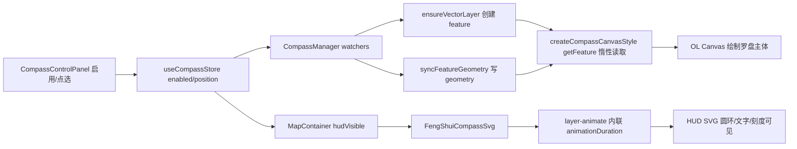

# 2026-11-24 修复罗盘 Vector / HUD 双模式均无法绘制

- **日期与时间**：2026-11-24 09:40
- **任务等级**：L2（Bug 修复，涉及多文件协同）
- **版本**：V3.7.10

## 问题分析

### 核心症状

用户报告：启用风水罗盘、打开「地图点选定位」并在地图中点击位置后，2D 地图上没有绘制罗盘；切换到设备 HUD 模式后只显示红色天心十字，罗盘主体（圆环、宫格、文字、刻度）全部不可见。

### 复现与实测证据

本地启动 Vite（`http://127.0.0.1:5173/#/home?s=1&view=ol`），浏览器实测：

1. Vector 模式：
   - Pinia `compassStore`：`enabled=true`、`mode='vector'`、`placementMode=true`、`position={lng:115.27566,lat:33.97632}`，配置 `data.length=7`。
   - OL 图层存在：`zIndex=1205`、`visible=true`、要素数 1，要素 geometry 与地图中心坐标均有效。
   - 截图与 DOM 检查：地图画布无任何罗盘主体。
2. HUD 模式：
   - `.compass-hud-wrapper` 存在，`FengShuiCompassSvg` DOM 实际生成 8 个 `<circle>`、193 个 `<path>`、555 个 `<line>`、245 个 `<text>`。
   - `.layer-animate` 计算样式：`opacity=0`、`animationName=none`、`animationDuration=0s`；独立的 `.tianxin-cross` 不受该 class 影响，因此成为唯一可见元素。

### 根本原因

这是**两个相互独立、叠加出现的回归**，均源于 V3.7.0 前后的组件范式化 / 渲染拆分：

1. **Vector 模式：renderer 捕获了空的 feature 快照。**
   `CompassManager` 构造函数中先调用 `createNativeCanvasStyle()`，此时 `this.feature` 仍为 `null`；随后 `ensureVectorLayer()` 才创建 `Feature<Point>`。
   `createCompassCanvasStyle({ feature: this.feature })` 是普通对象按值传递，renderer 闭包永久持有 `null`，在 `geometry` 判空处提前返回，故地图永远不绘制罗盘。
   拆分前 renderer 直接访问 `this.feature`，拆分后失去实时引用。

2. **HUD 模式：CSS `v-bind()` 动画时长编译为无效自定义属性，导致主体层停留在 `opacity:0`。**
   `feng-shui-compass-svg.vue` 中 `.layer-animate` 使用：
   `animation: layerFadeIn v-bind('(m.animation?.duration || 0) + "ms"') ease-out forwards;`
   Vite 8 + 当前 SFC 编译结果把表达式原样写进 CSS 变量名：
   `var(--49584cbb-\(m\.animation\?\.duration\ \|\|\ 0\)\ \+\ \"ms\")`，该变量未定义，整条 `animation` 简写失效（`animation-name: none`），而规则同时把 `opacity` 固定为 `0`。淡入动画从未运行，所有套用 `.layer-animate` 的圆环/宫格/文字/刻度永久隐藏；天心十字是另一个不带该 class 的 SVG，所以仍可见。

3. **伴生缺陷（不单独致命但会放大症状）：启用罗盘时未同步几何。**
   store 的 `position` 初始为 `NaN`，`CompassManager` 只在 position watcher 与 `init()` 中调用 `syncFeatureGeometry()`。用户直接勾选「启用」时，`enabled` watcher 只创建图层、刷新与写 URL，不生成默认坐标；feature 保持无几何。即使修复 feature 引用，从「无 cs 参数直接启用」的路径仍不会出现罗盘。

### 受影响模块

| 模块 | 文件 | 影响 |
|---|---|---|
| Canvas 渲染服务 | `frontend/src/domains/common/compass/services/compassCanvasStyle.ts` | renderer 持有 `null` feature 快照，Vector 必不绘制 |
| 罗盘生命周期 | `frontend/src/domains/common/compass/services/CompassManager.ts` | 注入时机错误；启用时缺几何同步 |
| HUD SVG 组件 | `frontend/src/domains/common/compass/svg/feng-shui-compass-svg.vue` | 无效 CSS v-bind 变量导致主体层 `opacity:0` |
| 状态存储 / 控制面板 | `useCompassStore.ts` / `CompassControlPanel.ts` | 状态链路本身正确，无需改动 |

## 修改内容

1. `compassCanvasStyle.ts`：依赖契约由 `feature: Feature<Point> | null` 改为 `getFeature: () => Feature<Point> | null`；renderer 每次渲染惰性取当前 feature。
2. `CompassManager.ts`：构造时传入 `getFeature: () => this.feature`；vector 激活 watcher 中在 `ensureVectorLayer()` 后补 `syncFeatureGeometry()`；补充函数/依赖注释。
3. `feng-shui-compass-svg.vue`：移除 CSS 中的 `v-bind()`；`.layer-animate` 改为静态声明 `animation-name / timing-function / fill-mode`，时长由模板内联 `animationDuration` 提供（默认 500ms），保证无动画时 class 不套用、主体恒可见。
4. 根 `README.md` 三处版本号、`Docs/Guide/CHANGELOG.md` 顶部条目、本日志。

## 修改原因

两个模式的故障点不同但表现一致（「罗盘没画出来」），必须分别修复；仅修 Vector 引用仍会留下 HUD 全隐藏，仅修 CSS 动画仍会留下地图无主体。几何同步补齐后，「无 cs 参数直接启用」与「点选定位后启用」两条路径都能得到有效坐标。

## 影响范围

- 2D OpenLayers 风水罗盘 Vector 渲染。
- 2D 风水罗盘 HUD（固定屏幕）SVG 渲染。
- 不影响图层树、Agent 工具链、Cesium 引擎与后端。

## 解决方案

### 方案对比

| 方案 | 做法 | 结论 |
|---|---|---|
| A. 回滚 V3.7.0 拆分 | 恢复巨型 `CompassManager` | 否决：违背单一职责与既有拆分方向 |
| B. 快照改 getter + CSS 动画内联时长 | 最小改动，保留现有分层 | **采用** |
| C. 重写罗盘渲染器 | 改用独立 Canvas overlay | 否决：范围过大，引入新回归面 |

### Mermaid 图（供审查）

### 实施步骤

1. 先写本日志固定症状、证据与方案（先文档后代码）。
2. 修改 renderer 依赖契约与 `CompassManager` 注入。
3. 修改 SVG 组件动画样式。
4. 浏览器实测双模式，再跑类型检查、构建与门禁。

## 性能指标

未实测（本次为功能修复，无性能目标）。

## 测试方案

### Agent 已执行

- 浏览器实机（Vite dev + s=1 访客模式）复现并抓取 store / 图层 / DOM 计算样式：
  - 修复前 Vector 图层 `zIndex=1205`/`visible=true`/要素 geometry 有效但无绘制；HUD DOM 有 8 circle / 193 path / 555 line / 245 text，但 `.layer-animate` 的 `opacity=0`、`animationName=none`。
  - 修复后 Vector 截图出现完整罗盘；HUD 的 `animationName=layerFadeIn-49584cbb`、`opacity=1`，截图出现完整罗盘。
  - 无有效 `cs` 参数（`cs=0`）时勾选启用 → 位置自动回落到地图中心；点选定位点击后 `position` 与 URL `cs` 均正确更新。
- `npm run typecheck`（vue-tsc --noEmit）：通过，0 报错。
- ESLint（3 个改动文件）：0 error / 0 warning。
- `CheckStructureTree.py`：文档条目 740 / 磁盘文件 740，漏登记 0、幽灵条目 0。
- `CheckConfigRegistry.py`：B1–B4 / F1–F3 全通过（catalog 138 key，前端 VITE_ 11 个）。
- `CheckVueParadigm.py`：72 个范式化组件全部通过；`CheckDomainDeps.py`：common→ol/cesium、cesium→ol、ol→cesium 均为 0。
- 生产构建：`npm run build` 首次因沙箱批量删除保护拦截 `dist/assets` 清理而失败（253 文件 > 阈值 50，非代码错误）；改用临时输出目录 `npx vite build --outDir <temp> --emptyOutDir false` 成功，4765 modules transformed，17.59s 完成。
- 平台红线自查：生产基线 `REDLINE-CLEAN`；模式串命中均来自 `backend/.venv` 第三方包与 Cesium 体积云 `maxRayDistance`（`xray` 子串）等已知假阳性，源码无禁项。

### 待用户实机验证

1. 2D 模式打开罗盘面板，勾选「启用罗盘」→ 地图上立即出现完整罗盘（含圆环与文字）；若位置无效，默认落在地图中心。
2. 勾选「地图点选定位」并点击地图任意位置 → 罗盘中心移动到点击处。
3. 切换「设备 HUD」→ 屏幕中央出现完整罗盘，不再只有十字；切回 Vector 仍正常。

## 变更文件清单

| 文件 | 说明 |
|---|---|
| `frontend/src/domains/common/compass/services/compassCanvasStyle.ts` | renderer 改为惰性读取 feature |
| `frontend/src/domains/common/compass/services/CompassManager.ts` | 传 getter；vector 激活后同步几何；补注释 |
| `frontend/src/domains/common/compass/svg/feng-shui-compass-svg.vue` | 修复无效 CSS v-bind 动画时长 |
| `README.md` | 版本号三处更新 |
| `Docs/Guide/CHANGELOG.md` | 新增 V3.7.10 条目 |
| 本文件 | L2 维护日志 |

## 遗留与风险

- HUD 目前只挂在 OL `MapContainer` 内，3D 视图下仍不可用；该限制由 `Docs/TODO/bugfix-optimization-plan.md` 跟踪，本次未越权处理。
- `cs=0` 仍被 `readCompassUrlState()` 视为「明确关闭」；这是 URL 状态协议的一部分，本次未改动，用户手动启用后位置合法时会写回有效 `cs`。
- CSS 动画时长改为内联 style 后不再支持 `v-bind` 动态绑定表达式；当前配置仍通过 `m.animation.duration` 在模板中透传，行为等价。
