# 2026-11-24 V3.7.14 修复罗盘关闭后 URL 仍残留 cs 参数

- **日期与时间**：2026-11-24 10:35
- **任务等级**：L2（Bug 修复，3 文件）
- **版本号顺延**：本任务原拟 V3.7.13，实施完成后发现并行会话已将该号用于「Cesium 侧 HUD 与贴地风水罗盘」，按 Force_command §5「多会话并行导致版本号撞车时，后完成者顺延」改为 **V3.7.14**，并在 CHANGELOG 条目中注明。

---

## 一、问题分析

### 1.1 核心症状

用户反馈：罗盘已关闭，但地址栏仍带 `cs` 参数。实测 URL：

```
http://localhost:5173/#/home?ut=guest&p=0&loc=0&lng=115.775386&lat=33.868464&z=10.59&l=3&s=0&view=ol&cs=iCWAbUix3DyHLL
```

### 1.2 根因（三段式空值缺陷，实测复现）

对 `cs=iCWAbUix3DyHLL` 解码，结果为 `lng=0, lat=0, radius=0` —— 地图原点且半径为 0，**语义无效**。反向验证：`encodeCompassState(0, 0, 0)` 的输出**恰好就是** `iCWAbUix3DyHLL`（对照 `encodeCompassState(0,0,10000) = iCWAbUix3DynY8`，排除巧合）。

关闭罗盘时的实际执行链：

| 步骤 | 位置 | 行为 |
|---|---|---|
| ① | `CompassManager.scheduleUrlSync()` L527-533 | `store.enabled === false` → 调 `writeCompassUrlState({ lng: null, lat: null, radius: null })`，**本意是删除 cs** |
| ② | `urlState.ts` `toFinite()` | `Number(null) === 0` → `Number.isFinite(0) === true` → 返回 **0**（未识别 null） |
| ③ | `urlState.ts` L72-74 判定 | 写作 `Number.isFinite(Number(lng))` —— 外层 `Number()` 把 `null` 再次折成 `0` → 判定"坐标有效" |
| ④ | `urlState.ts` L75 | `encodeCompassState(0, 0, 0)` → 返回 `iCWAbUix3DyHLL`（`encodeCompassState` 只拒绝 `radius < 0`，不拒绝 `= 0`） |
| ⑤ | `urlState.ts` L80-81 | `encoded !== '0'` → 走 `query.set('cs', encoded)` —— **本该删除，反而写入** |

### 1.3 为何罗盘确实是关的

读取端 `restoreFromUrlState()` 要求 `radius > 0` 才算有效；解码得 `radius = 0` → 判定无效 → `setEnabled(false)`。所以罗盘保持关闭，与用户观察一致。

### 1.4 为何这个脏值不会自愈

`restoreFromUrlState()` 无效分支仅 `setEnabled(false)` 后 return。若 `enabled` 在刷新后本来就是 `false`，Vue `watch` 不会回调（值未变）→ `scheduleUrlSync()` 从未执行 → **URL 中的 cs 永久残留**。用户每次刷新都带着它，且每次关闭罗盘都会重新写入同一个假值。

### 1.5 受影响模块

- 罗盘 URL 状态编解码（`domains/common/compass/services/urlState.ts`、`url-state/codec/positions.ts`）
- 罗盘管理器状态恢复（`domains/common/compass/services/CompassManager.ts`）

---

## 二、候选方案对比

| 方案 | 做法 | 评价 |
|---|---|---|
| A | 仅在 `CompassManager` 关闭时手动拼 URL 删 cs | 治标；脏值仍会在其他写入路径产生，读取端也不会自愈 | 
| B | 修 `toFinite` 空值判定 + 修编码边界 + 增加读取端清理 | 三层同时收敛，历史脏值可自愈 | **采用** |
| C | 放弃 `{null,null,null}` 语义，改用独立 `clearCompassUrlState()` | 语义最清晰，但需保留 `writeCompassUrlState` 对其他调用方的行为 | 采纳为 B 的组成部分 |

**选定 B（含 C）**：既修产生端，也修读取端，使已存在的脏 cs 在下次加载时被主动清除。

---

## 三、实施内容

1. **`urlState.ts`**
   - `toFinite()`：`null` / `undefined` / 空串显式返回 `null`（不再依赖 `Number()` 的隐式折算）。
   - `writeCompassUrlState()`：有效性判定改为直接 `Number.isFinite(lng)`（不外包 `Number()`），杜绝 null 被折成 0。
   - 新增 `clearCompassUrlState()`：仅当 URL 中确实存在 `cs` 或任一历史 key 时才重写 URL，避免无谓的 `replaceState`。
2. **`codec/positions.ts`**
   - `encodeCompassState()`：`radius` 校验由 `< 0` 收紧为 `<= 0`（半径为 0 无业务意义，属脏值）。
3. **`CompassManager.ts`**
   - `restoreFromUrlState()` 无效分支追加 `clearCompassUrlState()`，实现历史脏值自愈。
   - `scheduleUrlSync()` 关闭分支改用 `clearCompassUrlState()`，语义显式化。
4. **`services/index.ts`**：导出 `clearCompassUrlState`。

### 变更前后关系

```mermaid
flowchart TB
    subgraph before["变更前（关闭罗盘）"]
        B1["scheduleUrlSync<br/>enabled=false"] --> B2["writeCompassUrlState<br/>{null,null,null}"]
        B2 --> B3["toFinite(null)=0<br/>Number.isFinite(Number(0))=true"]
        B3 --> B4["encodeCompassState(0,0,0)"]
        B4 --> B5["cs=iCWAbUix3DyHLL<br/>写入 URL ❌"]
    end
    subgraph after["变更后（关闭罗盘）"]
        A1["scheduleUrlSync<br/>enabled=false"] --> A2["clearCompassUrlState()"]
        A2 --> A3["query.delete('cs')<br/>仅在存在时重写"]
        A3 --> A4["URL 无 cs ✅"]
    end
    subgraph heal["刷新加载（历史脏值自愈）"]
        C1["restoreFromUrlState"] --> C2{"radius > 0 ?"}
        C2 -->|否| C3["setEnabled(false)<br/>+ clearCompassUrlState()"]
        C3 --> C4["残留 cs 被清除 ✅"]
    end
```



---

## 四、修改原因

URL 携带无意义参数会污染分享链接、让"是否开启罗盘"无法从地址判断，且用户每次关闭罗盘都会重新写入同一假值，属确定性缺陷而非偶发。

---

## 五、影响范围

| 模块 | 影响 |
|---|---|
| 罗盘 URL 同步 | 关闭时正确删除 `cs`；启用时写入逻辑不变 |
| 页面加载 | 新增一次按需清理（仅当 cs/历史 key 存在时触发 `replaceState`） |
| 分享链接 | `cs` 不再凭空出现；`TopBar` 保留 cs 的行为不变（罗盘开启时仍可分享位置） |
| 其他 URL 参数 | 不受影响（清理只动 `cs` 与 `clng/clat/crot/cid/cmode`） |
| Cesium 3D | 无影响（`cs` 仅 2D 罗盘使用） |

---

## 六、测试方案

### Agent 已执行（实测结果）

| 检查 | 结果 |
|---|---|
| 解码复现 | `cs=iCWAbUix3DyHLL` → `lng=0, lat=0, radius=0`，`radius>0` 判定为无效 |
| 编码反证 | `encodeCompassState(0,0,0) === 'iCWAbUix3DyHLL'`（逐字符一致）；对照 `encodeCompassState(0,0,10000) === 'iCWAbUix3DynY8'` 排除巧合 |
| 缺陷点确认 | 修复前 `toFinite(null) === 0`、`Number.isFinite(Number(null)) === true` |
| 修复后判定链 | `{null,null,null}` → `complete=false` → 删除 cs ✅；`undefined`/空串 → 删除 ✅；正常数值/字符串数值 → 写 cs ✅ |
| 双重保险 | `{0,0,0}` 虽通过 complete 判定，但 `encodeCompassState(0,0,0)` 现返回 `'0'` → 走删除分支 ✅ |
| 前端类型检查 | `npx vue-tsc --noEmit` → `EXIT=0`，无输出 ✅ |
| 结构树门禁 | 文档条目 742 · 磁盘文件 742 · 漏登记 0 · 幽灵条目 0 ✅ |
| 配置登记门禁 | B1–B4 / F1–F7 全通过 ✅ |

> ⚠️ **浏览器实测未完成**：chrome-devtools 的 Chrome 实例被其他进程占用（`chrome-devtools-mcp/chrome-profile` 已被锁定），无法接管页面。上述结论来自编解码逐值验证与判定链等价复刻，**未在真实页面上点击开关验证**。请以「待用户实机验证」为最终判据。

### 待用户实机验证

1. 打开带 `cs=iCWAbUix3DyHLL` 的旧链接
   - **预期**：页面加载后地址栏中的 `cs` 自动消失，其余参数（ut/p/loc/lng/lat/z/l/view）保留
2. 开启罗盘 → 地址栏出现 `cs=...`
   - **预期**：`cs` 为有效编码；刷新后罗盘位置正确恢复
3. 关闭罗盘
   - **预期**：`cs` 立即消失（约 120ms 防抖后），不再变成 `iCWAbUix3DyHLL`
4. 反复开关罗盘 3 次
   - **预期**：地址栏 `cs` 随之出现/消失，无残留
5. 复制分享链接
   - **预期**：罗盘关闭时分享链接不含 `cs`

---

## 七、变更文件清单

| 文件 | 说明 |
|---|---|
| `frontend/src/domains/common/compass/services/urlState.ts` | 修 `toFinite` 空值语义、修有效性判定、新增 `clearCompassUrlState()` |
| `frontend/src/domains/common/url-state/codec/positions.ts` | `encodeCompassState` 收紧 radius 校验（`<= 0` 拒绝） |
| `frontend/src/domains/common/compass/services/CompassManager.ts` | 无效恢复分支清理脏 cs；关闭分支改用显式清理 |
| `frontend/src/domains/common/compass/services/index.ts` | 导出 `clearCompassUrlState` |

---

## 八、遗留与风险

1. **`writeCompassUrlState` 会丢弃 `location.search`**（`nextUrl` 只拼 `pathname + hash`）。当前应用把参数都放在 hash query 中，暂无实测影响；但若有外链把参数放 search，罗盘同步后会被清掉。属既有行为，本次未改，已记入 TODO。
2. `LEGACY_PARAM_KEYS`（`clng/clat/crot/cid/cmode`）在清理时一并删除，与既有 `writeCompassUrlState` 行为一致。
