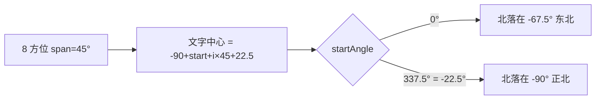

# 2026-11-24 修复罗盘方位文字整体偏移 22.5°

- **日期与时间**：2026-11-24 11:30
- **任务等级**：L2（主题数据修正）
- **版本**：V3.7.23

## 问题分析

### 核心症状

`theme-crice` 与 `theme-polygon` 的罗盘里，「北」跑到东北方向，整个方位层看起来顺时针偏了 22.5°。

### 根本原因

方位文字画在**扇区中心**，角度公式为：

```text
angleMid = -90° + startAngle + (i + 0.5) × span
```

8 方位 `span = 45°`，要让第 0 格「北」落在正北 `-90°`，必须满足 `startAngle + 22.5° = 0`，即 `startAngle = -22.5°`（等价 337.5°）。

但这些主题的方位层都配了 `startAngle: 0`，于是第 0 格中心落在 `-67.5°`（东北），「北」显示在右上，整体顺时针偏移半个格（22.5°）。外圈刻度 `0°` 仍在正北，形成明显错位。

## 影响范围

| 主题 | 文件 | 影响 |
|---|---|---|
| 圆规尺 | `theme-crice.ts` | 方位层偏移 22.5° |
| 多边形 | `theme-polygon.ts` | 方位层偏移 22.5° |
| 极简 | `theme-simple.ts` | 同一配置，同样偏移 |

`theme-compass` / `theme-dark` 不含该中文方位层，不受影响。

## 修改内容

将三个主题的「方位」层 `startAngle: 0` 改为 `337.5`（即 -22.5°，保持 0~360 正值语义）。

方位标签现在：

| 序号 | 文字 | 中心角 |
|---|---|---|
| 0 | 北 | -90°（正北） |
| 1 | 东北 | -45° |
| 2 | 东 | 0° |
| ... | ... | ... |

## 修改原因

这是主题数据配错，不是绘制引擎错误；改数据可同时修正 HUD / 2D OL / 3D Cesium 三条链路，且不动其他层的文字布局。

## 方案对比

| 方案 | 做法 | 结论 |
|---|---|---|
| A. 改渲染公式，让方位层用 `(i+0.5)-0.5` | 在 renderer 特判方位层 | 否决：影响所有层，破坏 24 山等布局 |
| B. 改三个主题方位层 startAngle | 数据层修正 | **采用** |
| C. 只改静态预览 PNG | 治标 | 否决：实际渲染仍错 |

### Mermaid 图



## 测试方案

### Agent 已执行

- 三个主题方位层实测 `startAngle=337.5`；角度代入 `angleMid` 后第 0 格「北」中心为 `-90°`（正北）。
- 2D OL 实机（`jade-realm` 主题、半径 500 km、zoom 6.5）截图复验：北在正上、东北在右上、东在正右、南在正下、西在正左，与刻度 0/90/180/270 对齐。
- `vue-tsc --noEmit` 0 报错；ESLint（3 个主题文件）0 warning。
- 结构树 744/744、配置登记、Vue 范式 72/72、领域隔离全绿；生产构建临时目录成功（4769 modules，11.72s）。

### 待用户实机验证

1. `theme-crice` / `theme-polygon` / `theme-simple` 三个主题，「北」位于正上方并与刻度 0° 对齐。
2. 「东/南/西」分别位于正右/正下/正左。
3. 静态 `images/*.png` 预览图仍是旧图（未在 UI 中使用）；如需同步缩略图可另行重新导出。

## 变更文件清单

| 文件 | 说明 |
|---|---|
| `frontend/src/domains/common/compass/svg/themes/theme-crice.ts` | 方位层 startAngle 0→337.5 |
| `frontend/src/domains/common/compass/svg/themes/theme-polygon.ts` | 同上 |
| `frontend/src/domains/common/compass/svg/themes/theme-simple.ts` | 同上 |
| `README.md` / `Docs/Guide/CHANGELOG.md` | 版本记录 |
| 本文件 | L2 维护日志 |

## 遗留与风险

- `themes/images/` 下的静态预览 PNG 仍是旧朝向；当前代码未把它们渲染到界面，仅作素材留存。
- 24 山、九星等层未改动。
