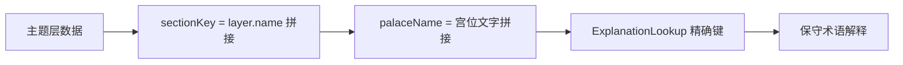

# 2026-11-24 核对并修正五个罗盘主题的层符号与解释文本

- **日期与时间**：2026-11-24 11:55
- **任务等级**：L2（解释数据校正）
- **版本**：V3.7.29（并行会话占用 V3.7.28，按规范顺延）

## 核查范围

- `frontend/src/domains/common/compass/svg/Explanation/*.json`（5 份）
- 五个主题的实际层 `name / data / startAngle`
- 解释面板的查询链：`PalaceExplanationPanel.ts` → `themeExplanationMapper.ts` → `explanationLookup.ts`

## 发现的问题（均有实据）

1. **主题识别失效**：`theme-crice` 的 `info.name` 已改为「翡翠境」，而 `normalizeCompassConfig()` 会把 `info.id` 规范成 cid 字符串，`themeExplanationMapper.getThemeExplanationByConfig()` 只匹配 `themeName === '二' || themeId === 1`，导致 jade-realm 实际落到 polygon 解释。
2. **八数解释体系错**：主题数据已按「先天卦数配先天方位」重排为 `八四三二一五六七`，解释仍写「一数为坎水正北、二数为坤土西南」等后天洛书说法，和盘面符号位置矛盾。
3. **八卦层解释键错**：当前层数据为后天卦 / 先天卦 / 龙上八煞三行，先天卦行已在 V3.7.25 重排；解释中的 `☰/☲/☱...` 仍按旧顺序描述。且查询时 `palaceName` 是三行拼接（如「坎☷辰」），原 JSON 以单字为键，实际只会命中第一个字。
4. **二十四山方位错**：compass_explanation 把「壬」写成正北偏东（应为北偏西）；dark_explanation 把「甲」写成东北（应为东偏北）、「辛」写成西北（应为西偏北）。
5. **二十四天星名错**：数据与解释中的「天桔」按徽盘应为「天棓」。徽盘顺序以壬起天辅、子天垒、癸天汉、丑天厨、艮天市、寅天棓……亥天皇。
6. **透地六十龙解释杜撰**：原文给每一龙编造五行吉凶和“主事业/主偏财”等断语，缺乏文献依据；可靠口径是杨公五气脉分类（甲子旬冷气孤虚、丙子旬正气珠宝、戊子旬败气火坑、庚子旬旺气珠宝、壬子旬退气孤虚），并须结合三七/正/五五龙气分数与砂水。
7. **八宅八星术语错**：polygon 层数据把「六煞」写成「六杀」；解释把八宅游星泛称“八大吉局/凶局”，标准术语是四吉（生气、延年、天医、伏位）与四凶（绝命、五鬼、六煞、祸害）。
8. **polygon 两层 name 都是 `--`**：解释 JSON 的 `吉凶等级` / `八煞八局` 无法被 sectionKey 命中。
9. **circle 解释文件仍对应旧主题**：jade-realm 已重做为八数/八卦/九星/二十四山/微盘/方位六层，旧解释仍是圆规尺刻度与空层。

## 资料依据

- 先天八卦方位与卦数：乾南、兑东南、离东、震东北、巽西南、坎西、艮西北、坤北；乾一、兑二、离三、震四、巽五、坎六、艮七、坤八。
- 后天八卦方位：坎北、艮东北、震东、巽东南、离南、坤西南、兑西、乾西北。
- 龙上八煞：坎辰、艮寅、震申、巽酉、离亥、坤卯、兑巳、乾午。
- 玄空九星方位：贪狼坎北、巨门坤西南、禄存震东、文曲巽东南、廉贞中宫、武曲乾西北、破军兑西、左辅艮东北、右弼离南。
- 二十四天星（徽盘）：https://k.sina.cn/article_6535849307_18591255b001008kxi.html
- 透地六十龙五气脉：https://yi958.com/yixuebaijiahao/71996
- 八宅八星：https://yzt.app/wiki/articles/bazhai-baxing-wuxing/

## 修复策略

1. 只改**有文献依据**的术语、方位、吉凶等级；删除或改写无依据的“主某人某财”式断语。
2. 解释文本改为“术语定位 + 文献依据 + 使用时须结合砂水/元运/龙气分数”的保守表述。
3. 八卦三行改用**拼接键**（如 `坎☷辰`）精确命中，避免只解释第一个字。
4. 修正主题识别映射、polygon 层名与「六煞」字形，确保查询链可达。
5. 不改几何、startAngle、已验证的绘制数据；仅 `天桔→天棓`、`六杀→六煞` 两处字形纠正。

### Mermaid 图

## 测试方案

### Agent 已执行

- 浏览器调用 `ExplanationLookup.lookupThemeLayer()` 对 5 个主题共 24 个代表性宫位逐项验证，全部 `hit=true`：
  - ancient-cinnabar → compass，cyber-blueprint → dark，jade-realm → circle，dark-gold → polygon，minimalist → simple。
  - 八数「八」解释为先天坤正北；八卦「坎☷辰」同时覆盖后天坎/先天坤/龙上八煞；二十四山「子」为正北坎水；天星「天辅」为徽盘壬山；六十龙「甲子」按甲子旬冷气孤虚解释。
- 五份 JSON 均可解析（6/7/7/5/2 个 section）。
- `vue-tsc --noEmit` 0 报错；ESLint（mapper + 4 主题文件）0 warning。
- 结构树 745/745、配置登记、Vue 范式 72/72、领域隔离全绿；生产构建临时目录成功（4770 modules，11.15s）。

### 待用户实机验证

1. 五个主题任点宫位，解释标题与内容对应实际符号。
2. 八数不再出现「一为坎水正北」等后天混用说法。
3. 八卦三行点击后解释同时覆盖后天卦、先天卦与八煞。

## 变更文件清单

| 文件 | 说明 |
|---|---|
| `Explanation/circle_explanation.json` | 按 jade-realm 六层重建 |
| `Explanation/compass_explanation.json` / `dark_explanation.json` | 修正八数/八卦/二十四山/天星/六十龙 |
| `Explanation/polygon_explanation.json` | 修正八宅八星、八卦拼接键、九星 |
| `Explanation/simple_explanation.json` | 修正九星/方位保守表述 |
| `themeExplanationMapper.ts` | 支持 cid 字符串识别 |
| `theme-polygon.ts` | 层名改为吉凶等级/八宅八星，六杀→六煞 |
| `theme-compass.ts` / `theme-dark.ts` | 天桔→天棓 |
| `README.md` / `Docs/Guide/CHANGELOG.md` | 版本记录 |
| 本文件 | L2 维护日志 |

## 遗留与风险

- 天星、六十龙等流派差异大，解释采用徽盘/杨公五气通行口径并注明“须结合砂水”，避免把民俗断语当定论。
- 八卦层无法知道用户点的是三行中的哪一行，故用拼接键给三行合并解释。
