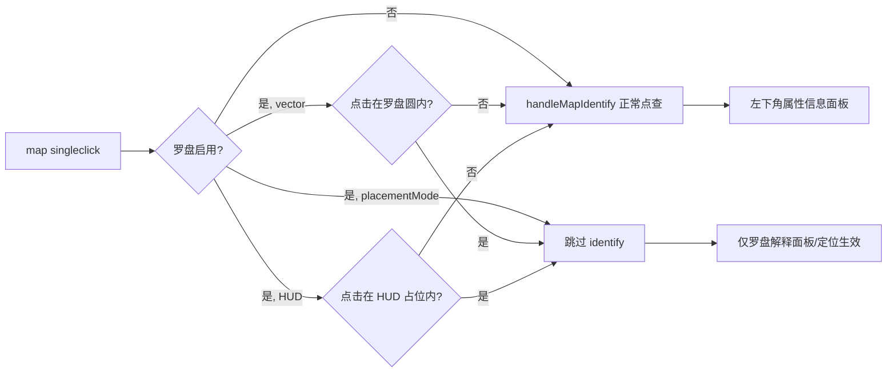

# 2026-11-24 修复启用罗盘时误触发左下角属性信息面板

- **日期与时间**：2026-11-24 09:52
- **任务等级**：L2（Bug 修复）
- **版本**：V3.7.11

## 问题分析

### 核心症状

罗盘启用后，在地图上点击罗盘宫位查看解释时，左下角同时弹出「属性信息 / Attribute info」面板（内容形如 `Layer 0 / FEATUREUID / MODE / TOTALHITS`）。用户明确表示：开启罗盘时不需要这个属性弹窗。

### 根本原因

左下角面板并非罗盘自身组件，而是 HomeView 的在线服务点查面板：

```text
OL map singleclick
  → CompassManager.handleMapSingleClick  → selectedPalace → PalaceExplanationPanel
  → useMapEventHandlers（受管矢量要素点查）→ feature-selected → showQueryPanel=true
  → useLayerControlHandlers.handleMapIdentify（在线服务点查）→ service-feature-query → showQueryPanel=true
```

同一次点击被三条独立 listener 消费。罗盘已经把这次点击解释为「选宫位 / 放置罗盘」，但两条点查链路仍把它当作普通地图点击。实测截图中的 `mode:'replace' / totalHits:1` 数据形状来自 `useMapEventHandlers` 的受管要素点查，而非在线服务 identify；因此必须同时拦两条链路。

### 受影响模块

| 模块 | 文件 | 影响 |
|---|---|---|
| 在线服务点查 | `frontend/src/domains/ol/layer/composables/useLayerControlHandlers.ts` | 新增共享守卫并用于 identify 入口 |
| 受管要素点查 | `frontend/src/domains/ol/composables/useMapEventHandlers.ts` | singleclick 属性查询分支共用守卫 |
| 罗盘交互 | `frontend/src/domains/common/compass/services/CompassManager.ts` | 行为正确，无需改动 |
| HomeView 查询面板 | `frontend/src/app/HomeView.vue` / `useHomeTocAndAttributeActions.ts` | 只是结果展示，无需改动 |

## 修改内容

1. 在 `useLayerControlHandlers.ts` 模块级导出纯守卫 `shouldSkipIdentifyForCompass(map, evt)`：
   - 罗盘启用且处于 `placementMode`：所有地图点击都由罗盘定位消费，直接跳过点查。
   - Vector 模式：点击落在罗盘圆周范围内时跳过点查；圆外点击仍可正常点查。
   - HUD 模式：点击落在屏幕中央 HUD 罗盘占位范围内时跳过点查。
2. 两条点查链路共用该守卫：`handleMapIdentify()` 入口、`useMapEventHandlers` 的 `singleclick` 中属性查询分支各调用一次。
3. 复用 `useCompassStore` 的 `enabled` / `mode` / `placementMode` / `position` / `hudSizePx`，复用 `samplePixelRadius()` 做地理半径到像素半径的量测，避免另写一套几何。

## 修改原因

用户要的是「罗盘操作不弹出属性面板」，而不是全局禁用在线服务点查。因此采用**精确让路**而非「罗盘开启即关闭 identify」：保留罗盘圆外、HUD 占位外的正常点查能力。

## 影响范围

- 仅 2D OpenLayers 的在线服务点查。
- 不影响 Cesium、图层属性表、罗盘宫位解释与点选定位。

## 解决方案

### 方案对比

| 方案 | 做法 | 结论 |
|---|---|---|
| A. 罗盘开启即全局关闭 identify | `enabled` 时直接 `return` | 否决：误伤圆外点查 |
| B. 识别罗盘消费的点击后让路 | placement 全跳过；vector/HUD 按命中范围跳过 | **采用** |
| C. 改 HomeView 面板显示条件 | 在 UI 层隐藏 | 否决：请求仍会发出，治标不治本 |

### Mermaid 图



## 测试方案

### Agent 已执行

- 浏览器实机（Vite dev + s=1 访客模式）：
  - 首次验证发现仅拦在线服务 identify 不够：点击罗盘宫位仍由 `useMapEventHandlers` 弹出 `mode:'replace' / totalHits:1` 面板；补共享守卫后复验，`selectedPalace` 正常写入且 `showQueryPanel=false`、`featureQueryResult=null`。
  - 开启「地图点选定位」后点击地图：罗盘中心移动到点击坐标，`showQueryPanel` 保持 false。
  - 直接导入守卫函数实测：`shouldSkipIdentifyForCompass(map, 圆内像素)=true`，`(map, 圆外像素)=false`，确认不是全局关闭点查。
- `vue-tsc --noEmit`：0 报错。
- ESLint（2 个改动文件）：0 error / 0 warning。
- 结构树 740/740、配置登记、Vue 范式 72/72、领域隔离全绿；平台红线扫描源码无禁项（生产基线 `REDLINE-CLEAN`）。
- 生产构建：临时输出目录 `vite build` 成功（4765 modules，20.75s；默认 `dist` 清理仍受沙箱批量删除保护拦截，非代码错误）。

### 待用户实机验证

1. 开启罗盘 → 点击宫位 → 只出现宫位解释，不出现左下角属性信息。
2. 开启「地图点选定位」→ 点击地图任意位置 → 罗盘移动，不出现属性信息。
3. 关闭罗盘后点击地图可查询服务 → 属性信息面板仍正常出现。

## 变更文件清单

| 文件 | 说明 |
|---|---|
| `frontend/src/domains/ol/layer/composables/useLayerControlHandlers.ts` | 导出共享守卫并用于在线服务 identify 入口 |
| `frontend/src/domains/ol/composables/useMapEventHandlers.ts` | 受管要素点查分支共用守卫 |
| `README.md` | 版本号三处更新 |
| `Docs/Guide/CHANGELOG.md` | 新增 V3.7.11 条目 |
| 本文件 | L2 维护日志 |

## 遗留与风险

- 判定依赖 `physicalRadiusMeters` 与地图投影量测；极端跨日期变更线场景未单独验证，常规 WGS-84 / EPSG:3857 路径已覆盖。
- HUD 占位按 `hudSizePx/2 + 16px` 估算（含 wrapper padding），不随设备像素比变化；仅用于「点击是否落在 HUD 视觉区域」的粗判定。
