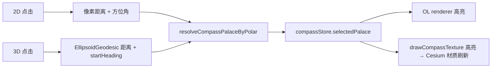

# 2026-11-24 修复罗盘宫位命中不准与 3D 点击高亮缺失

- **日期与时间**：2026-11-24 10:26
- **任务等级**：L2（Bug 修复 + 算法改进）
- **版本**：V3.7.16（并行会话已占用 V3.7.14 / V3.7.15，按 Force_command §5 顺延）

## 问题分析

### 核心症状

1. 3D 贴地罗盘点击宫位后没有像 2D 那样的高亮扇区，用户看不出命中了哪一层哪一宫。
2. 宫位判定「总是不准」：点击位置与解释面板显示的宫位经常对不上，3D 透视与地形起伏下偏差更明显。

### 根本原因

1. **高亮缺失**：`drawCompassTexture()`（3D 贴地纹理）只绘制圆环、分隔线与文字，未把 `selectedPalace` 映射成高亮扇区；2D 的 `compassCanvasStyle.ts` 已有高亮，但 3D 复用的是新抽出的纯纹理函数。
2. **命中算法各自为政且依赖屏幕像素近似**：
   - 2D：用 `getPixelFromCoordinate(center)` 与东向采样半径 `samplePixelRadius()` 把点击换算成「像素距离 + 屏幕角度」。
   - 3D：用 `SceneTransforms.worldToWindowCoordinates()` 投影中心与东向点，再用屏幕像素距离/角度判定。
   - 两者都把罗盘当成屏幕上的正圆。3D 下透视投影、地形起伏、相机倾斜会把圆压成椭圆，屏幕角度与地理方位角不再一致，导致命中偏移。
3. 旋转补偿与 `startAngle` 的换算散落在两个 handler 中，缺乏单一事实来源，容易出现正负号/基准角漂移。

## 影响范围

| 模块 | 文件 | 影响 |
|---|---|---|
| 共享绘制 | `common/compass/services/drawCompassTexture.ts` | 增加选中扇区高亮 |
| 共享命中 | 新 `common/compass/services/compassHitTest.ts` | 统一极坐标命中算法 |
| 2D 交互 | `CompassManager.ts` | 改用共享命中函数 |
| 3D 交互 | `useCesiumCompass.ts` | 改用测地距离/方位角命中，纹理随选中态刷新 |

## 修改内容

1. 新增 `resolveCompassPalaceByPolar()`：输入「距离 / 方位角 / 半径 / 配置 / 旋转」，统一输出 `{layerIndex, segmentIndex, data}`，层带、天池比例、刻度外沿比例全部与绘制函数共用同一套常量。
2. `drawCompassTexture()` 增加 `selectedPalace` 选项，在文字与分隔线之前绘制高亮扇区（`rgba(255,215,0,0.38)`），与 2D 视觉一致。
3. 2D `CompassManager.handleMapSingleClick`：用共享函数替换本地像素角度计算。
4. 3D `useCesiumCompass`：点击时用 `EllipsoidGeodesic.surfaceDistance` 与 `startHeading` 做地理极坐标判定，彻底绕开透视变形；同时把 `selectedPalace` 纳入 watch，选中后即时重建材质显示高亮。

## 修改原因

用户需要「点哪亮哪」。屏幕空间判定在 3D 下先天不准，必须回到地理空间；2D 虽未受透视影响，但同样算法能保证两端行为一致，避免后续再次漂移。

## 方案对比

| 方案 | 做法 | 结论 |
|---|---|---|
| A. 只在 3D 补高亮 | 保留屏幕像素判定 | 否决：命中仍不准 |
| B. 统一极坐标判定 + 3D 高亮 | 共享函数；2D 用像素极坐标，3D 用测地极坐标 | **采用** |
| C. 用 Cesium picked entity 的 UV | 从材质 UV 反算宫位 | 否决：entity polygon 无直接 UV，改动面过大 |

### Mermaid 图

## 测试方案

### Agent 已执行

- `vue-tsc --noEmit`：0 报错；ESLint（4 个改动文件）：0 error / 0 warning。
- 结构树 743/743、配置登记、Vue 范式 72/72、领域隔离全绿；生产构建临时目录成功（4768 modules，12.68s）；平台红线 `REDLINE-CLEAN`（命中项仍为体积云 `maxRayDistance` 假阳性）。
- 共享命中函数直接验证：北向 → 第 3 层第 0 宫「子」；东向 → 第 0 宫「卯」；旋转 90° 后东向映射回「子」；罗盘外 → null。
- 3D 浏览器实机：贴地罗盘点击后 `selectedPalace` 写入 `{layerIndex:2, segmentIndex:3, data:'文'}`；材质 Canvas 金色像素由 5577 → 7458（+1881），确认高亮扇区真实绘制；选中变化触发材质刷新。
- 2D 侧仅替换本地命中计算为共享函数，绘制高亮沿用原 `compassCanvasStyle.ts`，类型与 lint 通过。

### 待用户实机验证

1. 2D / 3D 分别点击罗盘不同层、不同宫位，解释面板文字与高亮扇区一致。
2. 3D 倾斜视角、贴地形区域点击，命中仍准确。
3. 点击天池或罗盘外，清除选中与高亮。

## 变更文件清单

| 文件 | 说明 |
|---|---|
| `frontend/src/domains/common/compass/services/compassHitTest.ts` | 新增共享极坐标宫位命中函数 |
| `frontend/src/domains/common/compass/services/drawCompassTexture.ts` | 增加选中扇区高亮 |
| `frontend/src/domains/common/compass/services/CompassManager.ts` | 2D 改用共享命中 |
| `frontend/src/domains/cesium/composables/compass/useCesiumCompass.ts` | 3D 测地命中 + 高亮刷新 |
| `README.md` / `Docs/Guide/CHANGELOG.md` / `Docs/Guide/frontend-structure.md` | 版本、日志索引与结构树 |
| 本文件 | L2 维护日志 |

## 遗留与风险

- 3D 高亮依赖纹理重建（1024px Canvas），频繁点击会有一次材质刷新开销，实测可接受。
- 地理极坐标判定假定罗盘 footprint 为经纬矩形；高纬度边缘轻微形变仍存在，但宫位判定基于真实测地距离，不再受屏幕椭圆影响。
