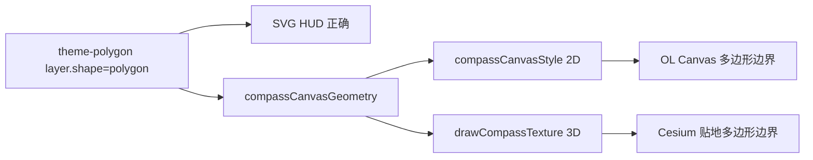

# 2026-11-24 修复 Canvas 罗盘忽略 polygon 层形状

- **日期与时间**：2026-11-24 11:04
- **任务等级**：L2（跨引擎样式修复）
- **版本**：V3.7.19

## 问题分析

### 核心症状

`theme-polygon` 参考图中，中心三层边界是**直线多边形**（近似八边形），最外层才是圆。HUD（SVG）显示正确，但 2D OL 与 3D Cesium 贴地罗盘都把每一层画成同心圆。

### 根本原因

SVG 组件 `feng-shui-compass-svg.ts` 有完整分支：

- `getLayerBorderPath()`：`layer.shape === 'polygon'` 时按 `layer.data.length` 个顶点连线；
- `getLatticePath()`：polygon 层用直线弦构成宫格，circle 层才用 `A` 弧。

而 Canvas 侧两套实现都无条件调用 `ctx.arc()`：

- `compassCanvasStyle.ts`（2D OL renderer）
- `drawCompassTexture.ts`（3D Cesium 贴地纹理）

两层都只消费了 `layer.data`、`startAngle`、`textColor`，完全忽略 `layer.shape`，所以 polygon 主题在 Canvas 路径下退化为全圆。

### 受影响模块

| 模块 | 文件 | 影响 |
|---|---|---|
| 2D Canvas 渲染 | `compassCanvasStyle.ts` | 层边界与高亮扇区全为圆弧 |
| 3D 贴地纹理 | `drawCompassTexture.ts` | 同上 |
| 共享几何 | 新 `compassCanvasGeometry.ts` | 统一 polygon / circle 路径 |

## 修改内容

1. 新增纯 Canvas 几何工具 `compassCanvasGeometry.ts`：
   - `traceLayerBorder()`：circle 画圆，polygon 按 `sides` 个顶点连线；
   - `traceLattice()`：circle 用双弧扇形，polygon 用内外直线弦梯形。
2. `compassCanvasStyle.ts`：层边界与选中宫位高亮改为调用共享几何函数。
3. `drawCompassTexture.ts`：同样改为共享几何函数，保证 2D/3D 视觉一致。
4. `Docs/Guide/frontend-structure.md` 登记新文件；README / CHANGELOG 升版。

## 修改原因

HUD 已经给出正确语义：`shape` 是主题契约的一部分，Canvas 侧不能只读文字数据。抽出共享几何函数避免再复制两套 polygon 判定，同时保证高亮扇区也贴合对应层形状。

## 方案对比

| 方案 | 做法 | 结论 |
|---|---|---|
| A. 各 Canvas 文件各写一份 polygon 分支 | 快速复制 | 否决：两端易漂移 |
| B. 抽出共享 Canvas 几何函数 | 单一实现，两端调用 | **采用** |
| C. 全部改用 SVG 渲染 | 2D/3D 都转 DOM | 否决：3D 贴地需要 Canvas 纹理 |

### Mermaid 图

## 测试方案

### Agent 已执行

- 确认主题真值：`dark-gold` → `theme-polygon`，`shape` 序列为 `['polygon','polygon','polygon','circle','circle']`；`cyber-blueprint` 是青色科技全圆主题，不是 polygon。
- 2D 实机切到 `dark-gold` 并放大：中心三层出现直线多边形边界，外层仍为圆；HUD 未受影响。
- 3D 实机切到 `dark-gold` 并俯视：贴地罗盘中心三层同样为直线多边形边界，与参考图一致。
- `vue-tsc --noEmit` 0 报错；ESLint（3 个改动文件）0 warning。
- 结构树 744/744、配置登记、Vue 范式 72/72、领域隔离全绿；生产构建临时目录成功（4769 modules，15.94s）。

### 待用户实机验证

1. 切换 Cyber Blueprint / polygon 主题，2D 地图与 3D 地表罗盘中心三层显示直线多边形边界。
2. HUD 模式显示不变。
3. 点击 polygon 层宫位，高亮扇区跟随直线边界而非圆弧。

## 变更文件清单

| 文件 | 说明 |
|---|---|
| `frontend/src/domains/common/compass/services/compassCanvasGeometry.ts` | 新增共享 Canvas 层边界/宫格几何 |
| `frontend/src/domains/common/compass/services/compassCanvasStyle.ts` | 2D 改用共享几何 |
| `frontend/src/domains/common/compass/services/drawCompassTexture.ts` | 3D 改用共享几何 |
| `Docs/Guide/frontend-structure.md` / `README.md` / `Docs/Guide/CHANGELOG.md` | 文档同步 |
| 本文件 | L2 维护日志 |

## 遗留与风险

- polygon 层与相邻 circle 层衔接处不额外补弧；SVG 会补一圈过渡弧，Canvas 当前只保证主体边界形状正确，视觉差异极小。
- 多边形顶点从正东方向起算，与 SVG `getLayerBorderPath()` 完全一致。
