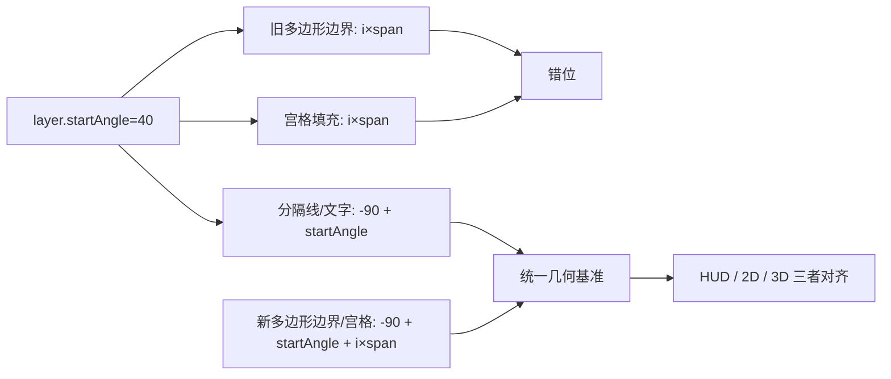

# 2026-11-24 修复 polygon 罗盘边界与分隔线错位

- **日期与时间**：2026-11-24 11:15
- **任务等级**：L2（几何一致性修复）
- **版本**：V3.7.20

## 问题分析

### 核心症状

polygon 主题下，层边界多边形的顶点与层内分隔线没有对准：分隔线端点落在多边形边上或越出边界，用户截图可见明显错位。

### 根本原因

三套绘制对 `startAngle` 的消费不一致：

1. 分隔线（SVG `getDividerPosition()`、Canvas renderer）使用 `-90° + startAngle + i×span`；
2. 文字也使用同一角度；
3. 但 polygon 层边界（SVG `getLayerBorderPath()`、Canvas `traceLayerBorder()`）的顶点仍按 `i×span` 从正东起算，**漏掉 `-90° + startAngle`**。

`theme-polygon` 第一层 `startAngle: 40`，因此顶点与分隔线相差 40°（再叠加 -90° 基准），错位被放大；其余层 `startAngle: 0` 时虽角度集合可能因 8 边形重合而看似正常，但基准仍不统一。

同样，`getLatticePath()` 也漏掉 `startAngle`，导致宫格填充与分隔线不同步（Canvas 侧 `traceLattice()` 已含 startOffset）。

## 影响范围

| 模块 | 文件 | 影响 |
|---|---|---|
| SVG HUD | `feng-shui-compass-svg.ts` | 多边形边界/宫格填充错位 |
| 共享 Canvas 几何 | `compassCanvasGeometry.ts` | 多边形顶点角度基准错误 |
| 2D/3D Canvas | `compassCanvasStyle.ts` / `drawCompassTexture.ts` | 经共享函数继承错位 |

## 修改内容

1. `compassCanvasGeometry.traceLayerBorder()` 增加 `startOffset` 参数，polygon 顶点角改为 `-π/2 + startOffset + i×span`，与分隔线一致。
2. 2D / 3D 调用处传入当前层 `startOffset`。
3. SVG `getLayerBorderPath()` polygon 分支改用 `rads((360/sides)×i + startAngle)`。
4. SVG `getLatticePath()` 两个分支的角度补上 `startAngle`，使宫格填充也对齐分隔线。

## 修改原因

用户要的是"点线面全对齐"：边界顶点、分隔线、宫格填充、文字必须共用同一个角度公式。之前只修了形状（polygon vs circle），没修角度基准，属于同一缺陷的第二层。

## 方案对比

| 方案 | 做法 | 结论 |
|---|---|---|
| A. 只旋转 Canvas 多边形 | 不动 SVG | 否决：HUD 仍错位，三端不一致 |
| B. 三端统一 `-90 + startAngle` 基准 | 修 Canvas helper + SVG 两处 | **采用** |
| C. 去掉主题里的 startAngle | 改数据迁就绘制 | 否决：破坏文字定位与主题设计 |

### Mermaid 图

## 测试方案

### Agent 已执行

- 确认 `theme-polygon` 首层 `startAngle=40`，确为错位放大量；其余层 `startAngle=0`。
- Canvas 几何与 SVG 现在统一使用 `-90° + startAngle + i×span`：
  - `traceLayerBorder()` 传入并消费 `startOffset`；
  - SVG `getLayerBorderPath()` 顶点改用 `rads((360/sides)×i + startAngle)`；
  - SVG `getLatticePath()` 两个分支补 `startAngle`。
- 3D 实机截图复验：`dark-gold` 主题中心多边形分隔线端点落在边界顶点上，不再越界；宫位高亮仍落在正确扇区。
- `vue-tsc --noEmit` 0 报错；ESLint（4 个文件）0 warning。
- 结构树 744/744、配置登记、Vue 范式 72/72、领域隔离全绿；生产构建临时目录成功（4769 modules，24.49s）。

### 待用户实机验证

1. `dark-gold` 主题第一层 `startAngle=40`，多边形顶点与分隔线端点重合，不再越界。
2. 其余层与 HUD 同样对齐；点击宫位高亮落在正确扇区。

## 变更文件清单

| 文件 | 说明 |
|---|---|
| `frontend/src/domains/common/compass/services/compassCanvasGeometry.ts` | 多边形顶点角度加入 startOffset |
| `frontend/src/domains/common/compass/services/compassCanvasStyle.ts` | 传入 startOffset |
| `frontend/src/domains/common/compass/services/drawCompassTexture.ts` | 传入 startOffset |
| `frontend/src/domains/common/compass/svg/feng-shui-compass-svg.ts` | SVG 边界/宫格角度统一 |
| `README.md` / `Docs/Guide/CHANGELOG.md` | 版本记录 |
| 本文件 | L2 维护日志 |

## 遗留与风险

- 修改会轻微改变 polygon 主题 HUD 的顶点朝向，使其与文字/分隔线一致；这是纠正而非视觉退化。
- circle 层不受影响。
