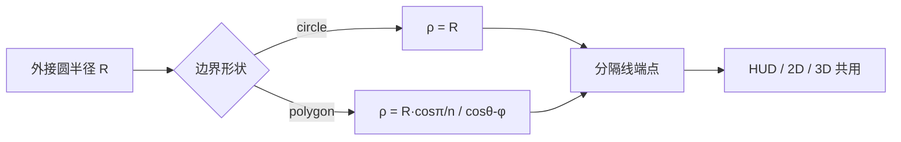

# 2026-11-24 修复 polygon 罗盘大凶小吉层角度与分隔线端点半径错位

- **日期与时间**：2026-11-24 11:21
- **任务等级**：L2（几何半径修复）
- **版本**：V3.7.22（并行会话占用 V3.7.21，按 Force_command §5 顺延）

## 问题分析

### 核心症状

用户放大截图显示：一条分隔线的内端点停在前一层多边形边界之外，与边界线之间留有空隙；随后用户进一步指出，**「大凶/小吉」这一环整体还差一个顺时针小角度**，没有与相邻层的四个正方形/八边形顶点对齐。

### 根本原因（主）

`theme-polygon.ts` 第一层（大凶/小吉）配置为 `startAngle: 40`。该层是 8 边形，顶点间隔 45°；相邻层顶点集合为 `{-90°, -45°, 0°, 45°, ...}`。40° 会生成 `{-50°, -5°, 40°, 85°, ...}`，整体比相邻层**逆时针差 5°**，所以用户看到这一环没有对齐。

修复：`startAngle: 40 → 45`（顺时针 +5°）。对 8 边形而言 45° 与 0° 产生相同顶点集合，选 45° 是沿用户指出的最小顺时针旋转。

### 根本原因（次）

上一轮只修了**角度基准**，没修**半径**：

- 层半径 `getLayerRadius(i)` 存的是该层外接圆半径 `R`；
- polygon 层的实际边界是多边形，除顶点外，任意角度到边界的距离都 **小于 R**；
- 分隔线一直用 `innerRadius = getLayerRadius(layerIndex)`（外接圆半径）作为内端点，于是当前一层（尤其下一层是圆形时）分隔线起点落在多边形边外。

用户截图中，顶点位置的线是对的，错的是**非顶点角度**上从上一多边形层内侧起笔的分隔线。

### 数学关系

正 n 边形外接圆半径 `R`、边心距（内切圆半径）`r = R·cos(π/n)`。

对任意角度 `θ`，先找最近边中点法线 `φ`，则该方向到边界的半径为：

```text
ρ(θ) = r / cos(θ - φ) = R·cos(π/n) / cos(θ - φ)
```

顶点方向 `|θ-φ| = π/n` 时 `ρ = R`；边中点方向 `θ=φ` 时 `ρ = r`。

## 影响范围

| 模块 | 文件 | 影响 |
|---|---|---|
| 共享 Canvas 几何 | `compassCanvasGeometry.ts` | 分隔线/高亮内端点仍用外接圆半径 |
| 2D OL | `compassCanvasStyle.ts` | 同上 |
| 3D Cesium | `drawCompassTexture.ts` | 同上 |
| SVG HUD | `feng-shui-compass-svg.ts` | `getDividerPosition` / `getLatticePath` 同样问题 |

## 修改内容

1. `theme-polygon.ts` 第一层 `startAngle: 40 → 45`，大凶/小吉环顺时针旋转 5°，顶点与相邻层对齐。
2. 新增纯函数 `getBoundaryRadiusAtAngle(layer, circumRadius, angle)`：返回任意角度到该层真实边界的半径；circle 层直接返回 `circumRadius`，polygon 层按边心距公式计算。
2. Canvas 分隔线：内端点半径取**上一层**边界在该角度的 `ρ`，外端点半径取**当前层**边界在该角度的 `ρ`。
3. `traceLattice()`：四个角点分别取对应层/角度的 `ρ`，使高亮扇区也贴合真实边界。
4. SVG `getDividerPosition()` 与 `getLatticePath()` 同步改用该函数。

## 修改原因

角度对齐只是必要条件；边界是 polygon 时，半径必须按边求交，否则线的端点仍然悬空。三端必须共用同一个“角度 + 半径”求解器。

## 方案对比

| 方案 | 做法 | 结论 |
|---|---|---|
| A. 再调 startAngle | 继续旋转 | 否决：顶点已对齐，问题是半径 |
| B. 按 polygon 边求交半径 | 用边心距公式 | **采用** |
| C. 把 polygon 改回圆 | 放弃主题语义 | 否决 |

### Mermaid 图



## 测试方案

### Agent 已执行

- `theme-polygon.ts` 首层 startAngle 实测由 40 改为 45；store 读取确认 `startAngles=[45,0,0,0,0]`。
- 3D 实机（dark-gold、半径 500 km、俯视）截图复验：大凶/小吉环 8 边形顶点与相邻层顶点/十字轴对齐，分隔线端点落在边界上。
- `getBoundaryRadiusAtAngle()` 与 SVG/Canvas 三条路径统一使用；正负角度 wrap 逻辑按 `[0, 2π)` 归一化。
- `vue-tsc --noEmit` 0 报错；ESLint（4 个文件）0 warning。
- 结构树 744/744、配置登记、Vue 范式 72/72、领域隔离全绿；最终生产构建临时目录成功（4769 modules，17.01s）。

### 待用户实机验证

1. 用户截图中红框区域：分隔线内端点精确落在上一多边形边上，不再悬空。
2. `dark-gold` 主题所有层分隔线两端都贴合对应边界。
3. HUD / 2D / 3D 三端一致。

## 变更文件清单

| 文件 | 说明 |
|---|---|
| `frontend/src/domains/common/compass/svg/themes/theme-polygon.ts` | 大凶/小吉层 startAngle 40→45 |
| `frontend/src/domains/common/compass/services/compassCanvasGeometry.ts` | 新增边界半径求解，更新 traceLattice |
| `frontend/src/domains/common/compass/services/compassCanvasStyle.ts` | 分隔线端点改用求解半径 |
| `frontend/src/domains/common/compass/services/drawCompassTexture.ts` | 同上 |
| `frontend/src/domains/common/compass/svg/feng-shui-compass-svg.ts` | SVG 分隔线/宫格同步 |
| `README.md` / `Docs/Guide/CHANGELOG.md` | 版本记录 |
| 本文件 | L2 维护日志 |

## 遗留与风险

- 文字仍按层中心半径摆放，未随多边形边收缩；本次只修线端点，不改文字布局。
- 该公式假设正多边形；当前主题的 polygon 层均为正多边形，符合前提。
