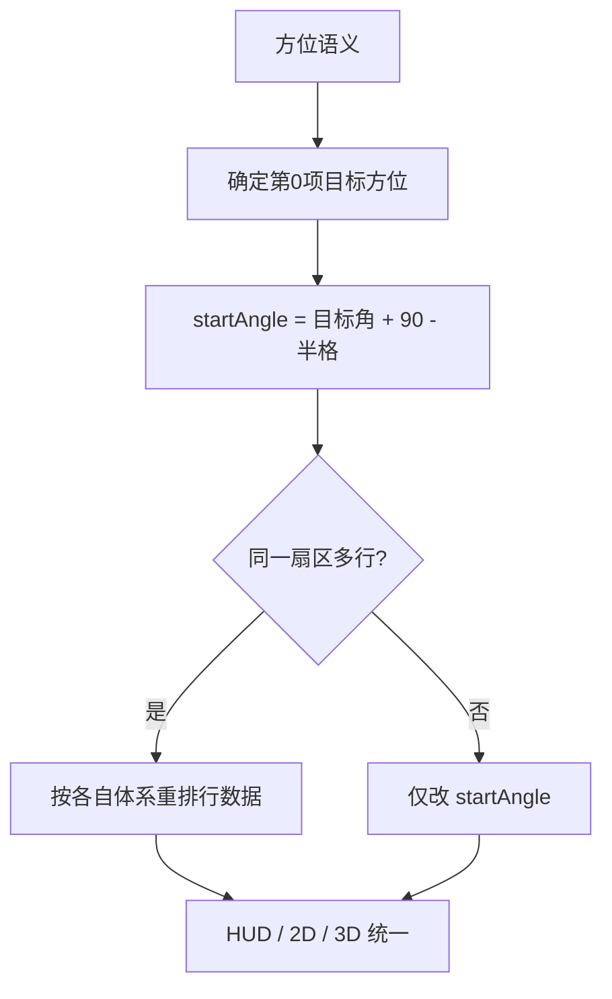

# 2026-11-24 全量校正五个罗盘主题各层起始角

- **日期与时间**：2026-11-24 11:38
- **任务等级**：L2（多主题数据校正）
- **版本**：V3.7.25（并行会话占用 V3.7.24，按规范顺延）

## 核查方法

渲染公式（HUD / 2D / 3D 共用）：

```text
分隔线角 = -90° + startAngle + i × (360° / n)
文字中心 = -90° + startAngle + (i + 0.5) × (360° / n)
```

判定规则：

- 若该层第 0 项应位于正北，则 `startAngle = -180°/n`（等价 `360 - 180/n`）；
- 若第 0 项应位于北偏左半格（如二十四山从「子」起、甲子从子方起），按实际半格偏移计算；
- 若同一扇区多行文字属于不同体系（后天八卦 / 先天八卦 / 龙上八煞），允许重排行数据而不改 `startAngle`。

## 资料依据

- 二十四山：正北坎卦「壬子癸」，正东震卦「甲卯乙」，正南离卦「丙午丁」，正西兑卦「庚酉辛」；子午卯酉为正北/南/东/西。
- 先天八卦方位：乾南、坤北、离东、坎西、兑东南、震东北、巽西南、艮西北；先天卦数：乾一、兑二、离三、震四、巽五、坎六、艮七、坤八。
- 后天八卦方位：坎北、艮东北、震东、巽东南、离南、坤西南、兑西、乾西北。
- 龙上八煞：坎龙辰、艮龙寅、震龙申、巽龙酉、离龙亥、坤龙卯、兑龙巳、乾龙午。
- 九星北斗次序：贪、巨、禄、文、廉、武、破、辅、弼；玄空九星方位：贪狼坎（北）、巨门坤（西南）、禄存震（东）、文曲巽（东南）、廉贞中、武曲乾（西北）、破军兑（西）、辅艮（东北）、弼离（南）。
- 二十四天星：天皇在亥、天市在艮、少微在酉、太微在丙；当前数据为逆序排列，起点天辅、终点天皇。
- 透地六十龙：甲子始于子方。

主要参考来源：

- https://m.pc89.com/fengshui/zhishi/6483.html
- https://www.peiwengfengshui.com/page95.html?article_id=166&brd=1
- https://fs.yi958.com/Article_7264.html
- https://www.tblibrary.org/?act=article&id=276
- http://www.chinafsxy.com/news/2184.html

## 审计结论表

| 层 | 标准语义 | 正确 startAngle | 原值 | 处理 |
|---|---|---|---|---|
| 方位（8） | 北在正北 | 337.5 | 0 | 已修为 337.5 |
| 八卦（8，三行） | 后天八卦坎在北 | 337.5 | 66 / 0 / 0 | 改 337.5；先天行与八数按方位重排 |
| 八数（8） | 先天数配先天方位 | 337.5 | 60 / 0 | 改 337.5；数据按 N/NE/E/SE/S/SW/W/NW 重排为 `八四三二一五六七` |
| 九星（9） | 贪狼在北；北斗次序廉在武前 | 340 | 0 | 改 340；数据交换廉/武为 `贪巨禄文廉武破辅弼` |
| 二十四山（24） | 数据从「子」起，子居中 | 352.5 | 0 | 改 352.5 |
| 微盘二十四星（24） | 天皇在亥、天市在艮、少微在酉、太微在丙 | 337.5 | 0 | 改 337.5（逆序数据与标准锚点全部吻合） |
| 透地六十龙（60） | 甲子始于子方 | 357 | 0 | 改 357 |
| 透地六十龙旺相（60） | 与六十龙同radial基准 | 357 | 0 | 改 357 |
| 大凶小吉（8，polygon） | 顶点对齐相邻层 | 45 | 40 | 已在 V3.7.22 修为 45 |
| 圆规尺刻度 / 刻度标记（8） | 占位符，不承载方位语义 | 保持 | 0 | 不改 |

## 数据重排明细

1. 八卦层先天卦行：`[☰,☲,☱,☴,☵,☶,☳,☷]` → `[☷,☳,☲,☱,☰,☴,☵,☶]`，对应 N=坤、NE=震、E=离、SE=兑、S=乾、SW=巽、W=坎、NW=艮。
2. 八数层：`[一,二,三,四,五,六,七,八]` → `[八,四,三,二,一,五,六,七]`，与先天卦数/方位对应。
3. 九星层：`[贪,巨,禄,文,武,廉,破,辅,弼]` → `[贪,巨,禄,文,廉,武,破,辅,弼]`。

## 方案对比

| 方案 | 做法 | 结论 |
|---|---|---|
| A. 只改 startAngle | 不管多行数据错位 | 否决：先天八卦/九星仍错 |
| B. 数据 + startAngle 一起按标准重排 | 三端统一 | **采用** |
| C. 改渲染特判 | 每加一层特判一次 | 否决：不可维护 |

### Mermaid 图



## 测试方案

### Agent 已执行

- 浏览器逐主题读取最终配置，首项方位角（bearing，0=正北）实测：
  - ancient-cinnabar / cyber-blueprint：八数首项「八」=0°；八卦首项「坎/☷/辰」=0°；九星「贪」=0°；二十四山「子」=0°；微盘首项「天辅」=345°；六十龙「甲子」=0°。
  - jade-realm：方位「北」=0°。
  - dark-gold：八煞「伏位」=0°；八卦「坎/☷/辰」=0°；方位「北」=0°；九星「贪」=0°。
  - minimalist：方位「北」=0°；九星「贪」=0°。
- 微盘二十四星锚点复核：天皇=330°（亥）、天市=45°（艮）、少微=270°（酉）、太微=165°（丙），与资料一致。
- 2D OL 实机截图（专业版）确认罗盘文字整体归位。
- `vue-tsc --noEmit` 0 报错；ESLint（5 个主题文件）0 warning。
- 结构树 745/745、配置登记、Vue 范式 72/72、领域隔离全绿；生产构建临时目录成功（4770 modules，11.08s）。

### 待用户实机验证

1. 各主题「北」在正北、二十四山「子」在正北、八卦后天「坎」在正北。
2. 九星「贪」在北、二十四天星「天市」在东北、「天皇」在西北偏北。
3. 透地六十龙「甲子」起于子方。

## 变更文件清单

| 文件 | 说明 |
|---|---|
| `theme-compass.ts` / `theme-dark.ts` | 八数/八卦/九星/二十四山/微盘/六十龙/旺相全量校正 |
| `theme-polygon.ts` | 伏位层/八卦/九星校正；大凶小吉 45 与方位 337.5 保持 |
| `theme-simple.ts` | 九星校正；方位 337.5 保持 |
| `README.md` / `Docs/Guide/CHANGELOG.md` | 版本记录 |
| 本文件 | L2 维护日志 |

## 遗留与风险

- 罗盘各层流派众多，九星存在“坐山九星”和“玄空九宫”两套体系；本项目采用 9 扇区玄空九星方位（与数据量 9 一致）。
- 静态 `themes/images/*.png` 预览图未重新导出，当前 UI 未使用。
