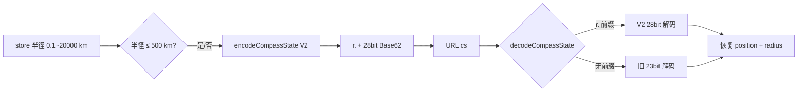

# 2026-11-24 修复罗盘分享链接大半径丢失问题

- **日期与时间**：2026-11-24 10:52
- **任务等级**：L2（URL 短码协议兼容扩展）
- **版本**：V3.7.17

## 问题分析

### 核心症状

3D 罗盘分享链接打开后，半径总是回到 1 km。用户怀疑 `cs` 没编码半径；后续补充说 2D 也有同样问题。

### 根因

`cs` 短码**确实包含半径**，但编码上限与 UI 上限不一致：

- UI 半径滑杆/输入框允许 `0.1 ~ 20000 km`（20,000,000 m）；
- `src/domains/common/url-state/codec/positions.ts` 中 `RADIUS_MAX_SCALED = 500000 * 10`，即 **500 km**；
- 当半径 > 500 km 时 `encodeCompassState()` 返回 `'0'`，`writeCompassUrlState()` 删除 `cs`；
- 打开链接时 `readCompassUrlState()` 读不到 `cs`，`CompassManager.restoreFromUrlState()` 判定无有效状态、罗盘关闭或回落默认 1 km。

实测证据：

- `encodeCompassState(113.5, 34.2, 50000)` → `HQL8Mnck9Zne55`，解码回 `{lng:113.5,lat:34.2,radius:50000}`；
- 用该链接分别以 `view=ol` / `view=cesium` 打开，store 半径均恢复为 50000，说明恢复链路本身正常；
- 问题只在半径超过 500 km 时出现。

### 受影响模块

| 模块 | 文件 | 影响 |
|---|---|---|
| URL 短码编解码 | `common/url-state/codec/positions.ts` | 半径位宽/上限过窄 |
| URL 状态写入 | `common/compass/services/urlState.ts` | 超限时删除 cs（行为正确，但源数据被编码器判无效） |
| 2D/3D 恢复 | `CompassManager.ts` / `useCesiumCompass.ts` | 本身正常，无需改动 |

## 修改内容

1. 将罗盘短码半径位宽从 **23 bit 扩到 28 bit**，上限从 500 km 扩到 **20,000 km**，与 UI 上限对齐；缩放精度保持 0.1 m。
2. 新短码使用 `r.` 前缀标识 V2 格式，解码端同时兼容：
   - `r.<base62>`：28 bit 半径（新格式）；
   - 无前缀旧码：23 bit 半径（历史链接不失效）。
3. 更新 `README.md` / `CHANGELOG.md` 版本记录；结构树无文件增删。

## 修改原因

直接改 `RADIUS_BITS` 会让历史短码按新布局错解（经纬度/半径全部错位），因此必须做**格式版本化 + 双解码路径**。前缀采用与 Cesium 相机 `p.` 同风格，短且不与 Base62 字符冲突。

## 方案对比

| 方案 | 做法 | 结论 |
|---|---|---|
| A. 只扩大位宽，不兼容旧码 | 改常量 | 否决：历史分享链接全坏 |
| B. 新格式加 `r.` 前缀 + 旧码双解码 | 版本化短码 | **采用** |
| C. cs 后拼接明文半径 | `cs=xxx&cr=...` | 否决：破坏单一短码契约与分享简洁性 |

### Mermaid 图

## 测试方案

### Agent 已执行

- 浏览器编解码边界用例：
  - 50,000 m → `r.CjTAzony19Ixu05` → 解码回 50,000 m
  - 500,000 m → `r.CjTAzony19I1yd1` → 解码回 500,000 m
  - 5,000,000 m → `r.CjTAzony199lJg4` → 解码回 5,000,000 m
  - 20,000,000 m → `r.CjTAzony19sdaaL` → 解码回 20,000,000 m
  - 20,000,001 m → `'0'`（超限拒绝）
  - 旧码 `HQL8Mnck9Zne55` 仍解码为 `{lng:113.5,lat:34.2,radius:50000}`
  - `decodePos` 对新 `r.` 码返回 null，确认短码不串用
- 浏览器分享链路：用 5,000 km 的 V2 链接分别硬刷新打开 `view=cesium` 与 `view=ol`，store 半径均恢复为 `5000000`。
- `vue-tsc --noEmit` 0 报错；ESLint（positions.ts / CompassManager.ts）0 warning。
- 结构树 743/743、配置登记、Vue 范式 72/72、领域隔离全绿；生产构建临时目录成功（4768 modules，13.81s）。

### 待用户实机验证

1. 3D 设置半径 10 km / 500 km / 5000 km，分享链接后打开，半径一致。
2. 旧链接（无 `r.` 前缀）仍可正常恢复。
3. 2D 分享链接同样保留大半径。

## 变更文件清单

| 文件 | 说明 |
|---|---|
| `frontend/src/domains/common/url-state/codec/positions.ts` | 半径位宽 23→28、上限 500km→20000km、V2 前缀与双解码 |
| `README.md` / `Docs/Guide/CHANGELOG.md` | 版本记录 |
| 本文件 | L2 维护日志 |

## 遗留与风险

- 新短码比旧码长约 1~2 字符，分享链接仍保持单参数。
- 0.1 m 精度保持不变；20,000 km 时缩放值 200,000,000 < 2^28（268,435,455），有余量。
