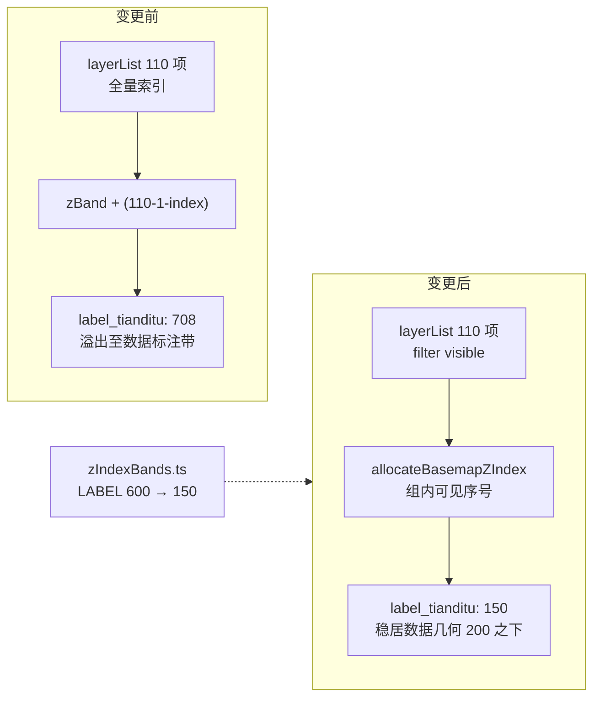

# 2026-11-24 V3.7.12 注记瓦片带下沉至数据几何之下 + 带内 zIndex 分配修正

- **日期与时间**：2026-11-24 10:20
- **任务等级**：L2（常量值变更 + 两处分配算法收敛 + 多文件注释同步）

---

## 一、问题分析

### 1.1 核心症状

用户反馈：**在线底图的注记瓦片层（天地图注记、奥维注记等）显示在用户导入数据的几何之上**，遮挡面/线要素填色，需要把注记瓦片调到数据几何之下。

线上实际层序（`Z_BAND` 当前值）：

```
底图影像 0 < 在线服务 100 < 数据几何 200 < 瓦片注记 600 < 数据标注 700 < 区划 850 < 系统 900
```

瓦片注记（600）本就高于数据几何（200）。这是 V3.6.6 刻意设计的「夹心」：底图地名压住数据填色、但用户自己的属性文字仍浮在最上（见 `Docs/Guide/CHANGELOG.md` V3.6.6 条目）。本次属**需求变更**，非缺陷修复。

### 1.2 根本原因（两层）

**第一层（显性）**：`Z_BAND.LABEL = 600` 硬编码在数据几何带（200~599）之上。

**第二层（隐性，须一并处理）**：带内偏移用**全量底图列表长度**计算，而全量列表有 **110 项**：

| 位置 | 现行算法 | `label_tianditu`（index 1）实得 z |
|---|---|---|
| `useBasemapLayerBootstrap.ts:61,67` | `zBand + (list.length - 1 - index)` | `600 + 108 = 708` |
| `useMapBasemapInstances.ts:82` | 同上 | `708` |
| `useMapBasemapInstances.ts:208` | `zBand + index`（栈内序号） | `601` |

`LABEL` 带标称容量 100（600~699），实际偏移上限 109，**已溢出 8 个值侵入数据标注带 700~849**。因此若只把 `LABEL` 改成 150 而不动算法，注记层会变成 `150 + 108 = 258`，**仍然高于数据几何 200**，用户诉求无法达成。

### 1.3 受影响模块

- 底图层级分配（`domains/ol/basemap/`、`domains/ol/composables/useMapBasemapInstances.ts`）
- 图层显示带 SSOT（`domains/ol/layer/zIndexBands.ts`）
- 用户矢量双层（几何/标注）注释口径
- 结构树注释（`Docs/Guide/frontend-structure.md`）

**不受影响**：Cesium 侧无 zIndex 分带体系（底图/在线服务走 `imageryLayers.raiseToTop`，用户数据走导入期 `polygon.zIndex` 桶），本次改动对 3D 无副作用。

---

## 二、候选方案对比

| 方案 | 做法 | 优点 | 缺点 | 结论 |
|---|---|---|---|---|
| A | 仅 `LABEL: 600 → 150` | 改一行 | 带内偏移仍溢出 → 实得 258 > 200，**诉求未达成** | 否决 |
| B | `LABEL: 600 → 150`，同时把整个 `DATA` 带上移至 1000+ | 只改常量文件 | 连带 `DATA_LABEL/DISTRICT/SYSTEM` 全部重排，破坏 850/900 历史数值语义；且 708 式溢出依旧存在 | 否决 |
| C | `LABEL: 600 → 150`，带内偏移改为**按可见项编号** | 偏移恒为 0 ~ (可见层数-1)，彻底消除溢出；语义「列表靠前=带内更高」不变 | 需改两个文件、新增一个纯函数 | **采用** |
| D | 保留全量索引，钳制到带容量 | 改动小 | 多层被压到同一 z，相对顺序丢失 | 否决 |

**选定 C**。理由：底图 110 项中同一时刻可见者通常仅 1~3 层（一个预设栈），对不可见层分配 z 无渲染意义，按可见项编号既是正确修复，也是消除既有溢出 bug 的最小侵入手段。

---

## 三、实施内容

### 3.1 新层序

```
底图影像 0~99 < 在线服务 100~149 < 卷帘对比 120~ < 注记瓦片 150~199 < 数据几何 200~599
          < 数据标注 700~849 < 区划 850 < 系统 900+
```

`Z_BAND.LABEL`：**600 → 150**。

### 3.2 分配算法收敛

新增 `zIndexBands.ts` 内的纯函数 `allocateBasemapZIndex(list, resolveCategory)`：

- 只遍历 `visible === true` 的项，按 `category === 'label'` 分 `label` / `basemap` 两组
- 组内偏移 = `组内可见数 - 1 - 组内序号`，故偏移恒 `< 可见层数`，不可能越带
- 不可见项不返回，调用方回落至带基准值

`useBasemapLayerBootstrap.ts`、`useMapBasemapInstances.refreshLayerInstances()` 改为调用该函数；`switchLayerById` 原有的 `zBand + index`（预设栈内序号，本就不溢出）保持不变。

### 3.3 变更前后关系



---

## 四、修改原因

原「夹心」设计让底图注记压住用户数据填色，出发点是不让建筑白模/面填色糊掉地名。但实际使用中用户导入的专题面（土地利用、行政区、分析结果）被注记切碎，可读性受损，且注记层因溢出实际落在 708（比数据标注 700 还高），行为与设计意图已不一致。本次按用户显式要求将注记瓦片沉到数据几何之下。

---

## 五、影响范围

| 模块 | 影响 |
|---|---|
| 底图层级分配 | 全部 110 个底图配置的 zIndex 计算改用可见项编号 |
| 注记瓦片显示 | 由 600/708 降至 150 档，低于数据几何 |
| 用户矢量双层 | 几何 200+、标注 700+ 不变 |
| Cesium 3D | 无影响（不读 `Z_BAND`） |
| 卷帘对比 | 120+ 不变，仍在注记之下 |

---

## 六、解决方案（实施步骤）

1. `zIndexBands.ts`：`LABEL` 改 150，重写分层方案/层序注释，新增 `allocateBasemapZIndex()`
2. `useBasemapLayerBootstrap.ts`：`initializeBasemapLayers` 改用分配器
3. `useMapBasemapInstances.ts`：`refreshLayerInstances` 改用分配器
4. 注释口径同步：`useManagedLayerRegistry.ts`、`useCreateManagedVectorLayer.ts`、`useUserLayerActions.ts`
5. 结构树 `frontend-structure.md` 注释同步
6. 版本号三处 + CHANGELOG

---

## 七、性能指标

未实测。分配函数在 `refreshLayerInstances` 中每次切换底图执行一次，复杂度 O(n)（n=110），相较原实现仅多一次 `filter` 遍历，量级不变。

---

## 八、测试方案

### Agent 已执行（实测结果）

| 检查 | 命令 | 结果 |
|---|---|---|
| 结构树门禁 | `python Scripts/CheckStructureTree.py` | ✅ 文档条目 740 · 磁盘文件 740 · 漏登记 0 · 幽灵条目 0 |
| 配置登记门禁 | `python Scripts/CheckConfigRegistry.py` | ✅ B1–B4 / F1–F3 全通过；catalog 138 key · 前端 VITE_ 11 个 |
| 前端类型检查 | `cd frontend && npx vue-tsc --noEmit` | ✅ `EXIT=0`，无输出。首次运行报 TS6133 ×2（移除 `index` 计算后参数未使用），已删除该参数后复跑转绿 |
| 平台红线自查 | `grep -riE "<§11.2 模式串>" backend/ deploy/ frontend/src/ .github/` | ✅ 业务代码零命中。命中项均为 `backend/.venv/` 第三方依赖（certifi / packaging / pygments / rasterio / uvicorn / websockets）与已知假阳性 `maxRayDistance`（含 xray）；`.venv` 已在 `.gitignore` |

> ⚠️ 环境备注：本机 `rg` 不在 PATH，§11.2 原命令直接执行会走 `|| echo REDLINE-CLEAN` 产生**假绿**。本次改用 `grep -riE` 等价重跑，结论以上表为准。

### 静态推演（未在浏览器实跑，供实机对照）

以「天地图影像」预设 `stack: ['imagery_tianditu', 'label_tianditu']` 为例：

| 图层 | 计算 | zIndex |
|---|---|---|
| imagery_tianditu | 底图组仅 1 项 → `0 + (1-1-0)` | 0 |
| label_tianditu（初始化路径） | 标注组仅 1 项 → `150 + (1-1-0)` | 150 |
| label_tianditu（`switchLayerById` 路径） | 栈内序号 1 → `150 + 1` | 151 |
| 用户上传面图层 | `DATA + offset` | 200 |
| 该图层属性文字 | `DATA_LABEL + offset` | 700 |

层序 `0 < 150/151 < 200 < 700` 成立。另验 `label_tianditu` + `label_tianditu_vector` 同时可见：分别得 151 / 150，仍在 150~199 带内，不溢出。

### 待用户实机验证

1. 选择「天地图影像」预设（含 `label_tianditu` 注记）→ 上传一个面状 GeoJSON 并开启填充
   - **预期**：面填色完整可见，天地图地名被面要素覆盖，不再压在面之上
2. 开启该图层的属性文字标注
   - **预期**：属性文字仍浮在面与底图注记之上
3. 切换到「天地图矢量」预设
   - **预期**：矢量注记同样位于数据几何之下
4. 卷帘对比（若可用）→ 对比层仍在注记之下，不遮挡地名
5. 3D 模式切换回来 → 二维层序应保持不变（无回归）

---

## 九、变更文件清单

| 文件 | 说明 |
|---|---|
| `frontend/src/domains/ol/layer/zIndexBands.ts` | `LABEL` 600→150；新增 `allocateBasemapZIndex()`；重写分层注释 |
| `frontend/src/domains/ol/basemap/composables/useBasemapLayerBootstrap.ts` | 初始化改用可见项分配器 |
| `frontend/src/domains/ol/composables/useMapBasemapInstances.ts` | `refreshLayerInstances` 改用可见项分配器 |
| `frontend/src/domains/ol/layer/composables/useManagedLayerRegistry.ts` | 注释口径同步 |
| `frontend/src/domains/ol/layer/composables/useCreateManagedVectorLayer.ts` | 注释口径同步 |
| `frontend/src/domains/ol/layer/composables/useUserLayerActions.ts` | 注释口径同步 |
| `Docs/Guide/frontend-structure.md` | 结构树 zIndexBands 注释同步 |
| `README.md` | 版本号三处 V3.7.11 → V3.7.12 |
| `Docs/Guide/CHANGELOG.md` | 追加 V3.7.12 条目 |

---

## 十、遗留与风险

1. **在线服务带与卷帘带重叠（既有，未修）**：`olRemoteServiceAdapter.ts` 的 `REMOTE_CAPACITY = 50` 使在线服务实际可用 100~149，而 `Z_BASEMAP_SWIPE_OFFSET = 120` 的卷帘层占 120+，两者在 120~149 区间冲突。本次仅修正该文件注释使之与容量一致，**未改数值**，已记入 `Docs/TODO/bugfix-optimization-plan.md`。
2. **`switchLayerById` 与分配器口径差异**：前者用预设栈内序号（0,1,2），后者用可见项倒序；两者结果差值 ≤2，不跨带，不影响层序。未强行统一以避免改动栈内语义。
3. **回归风险**：若后续新增 `category: 'label'` 的底图且被设为默认可见，其 z 仍由分配器保证不越带，无需额外处理。
