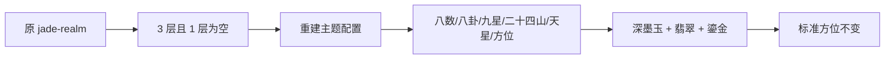

# 2026-11-24 重做 jade-realm（翡翠境）罗盘主题

- **日期与时间**：2026-11-24 11:45
- **任务等级**：L2（主题视觉与语义重建）
- **版本**：V3.7.27（并行会话占用 V3.7.26，按规范顺延）

## 问题分析

`theme-crice.ts` 当前只有「圆规尺刻度」「方位」「刻度标记」三层，其中第三层数据为空。整体只有数字与单薄方位文字，视觉和信息量都偏少，撑不起 `jade-realm / 翡翠境` 的主题名。

同时原配色是亮绿边框 + 灰刻度 + 黄字，既不像翡翠，也缺少层次。

## 设计目标

在不改渲染引擎、不引入新依赖的前提下，仅通过主题配置把 `jade-realm` 做成：

1. **有层次**：保留方位层，补齐八数、八卦、九星、二十四山、二十四天星五层风水语义。
2. **有风格**：深墨玉底 + 翡翠绿文字 + 鎏金刻度/方位，符合「翡翠境」命名。
3. **有重点**：用 `latticeFill` 突出正北「子」与八数「八」，避免满盘同色。
4. **不改标准方位**：所有层沿用 V3.7.25 校正后的 `startAngle` 与数据顺序。

## 层级设计

| 层 | 内容 | startAngle | 配色 |
|---|---|---|---|
| 0 | 八数（先天数按方位） | 337.5 | 浅翡翠 |
| 1 | 后天八卦 / 先天八卦 / 龙上八煞 | 337.5 | 白翡 / 青翡 / 金 |
| 2 | 九星（北斗次序，贪居北） | 340 | 柔青 |
| 3 | 二十四山（子正北） | 352.5 | 亮白玉 |
| 4 | 微盘二十四星 | 337.5 | 淡青 |
| 5 | 方位 | 337.5 | 鎏金 |
| 6 | 天心十字 | — | 淡金 |

外圈刻度由 `scaclStyle` 与 `line.scaleColor` 统一控制，不再占一个空数据层。

## 方案对比

| 方案 | 做法 | 结论 |
|---|---|---|
| A. 只改颜色 | 加几个绿色 | 否决：信息量仍不足 |
| B. 加一层文字 | 治标 | 否决：层次仍单薄 |
| C. 重建主题数据 + 配色 | 六层语义 + 玉色体系 | **采用** |

### Mermaid 图

## 测试方案

### Agent 已执行

- 浏览器读取 `jade-realm` 最终配置：`info.name='翡翠境'`，层级为八数/八卦/九星/二十四山/微盘二十四星/方位共 6 层，startAngle 与 V3.7.25 标准一致。
- 2D OL 实机预览：翡翠绿文字 + 鎏金方位 + 深墨玉边框，层次明显比原 3 层丰富；正北高亮生效。
- `vue-tsc --noEmit` 0 报错；ESLint（theme-crice.ts）0 warning。
- 结构树 745/745、配置登记、Vue 范式 72/72、领域隔离全绿；生产构建临时目录成功（4770 modules，16.80s）。

### 待用户实机验证

1. `jade-realm` 主题在 2D/3D/HUD 都有六层文字与金色方位。
2. 「子」「贪」「坎」「北」均在正北。
3. 正北「子」与八数「八」有低饱和度填充高亮。

## 变更文件清单

| 文件 | 说明 |
|---|---|
| `theme-crice.ts` | 主题配色、层级、latticeFill、info.name 重建 |
| `README.md` / `Docs/Guide/CHANGELOG.md` | 版本记录 |
| 本文件 | L2 维护日志 |

## 遗留与风险

- `themes/images/theme-crice.png` 仍是旧缩略图；当前 UI 未读取预览图渲染，如需同步需另行导出。
- 主题数据变多，低缩放下密集层可能自动跳过文字（渲染器已有 `showDenseText` 逻辑）。
