# 2026-11-24 暂存区 Code Review 与 V3.7.10 版本归并

- **日期与时间**：2026-11-24 12:40
- **任务等级**：L2（常规）
- **本次版本**：V3.7.10（2026-11-24）
- **依据**：用户在当前会话明确要求「暂存区多次不规范的 commit 信息整合为统一版本 V3.7.10、修复潜在 bug、更新文档和文件树」，依 `Docs/Force_command.md` §0 优先级 1 临时豁免 §5「同日多任务不合并升号」；全程禁止 Git 写操作。

---

## 一、问题分析

### 1. 核心症状

1. 暂存区包含 95 个文件、7263 行新增，版本号被逐次推进到 V3.7.37，README 三处、CHANGELOG 顶部 28 个分段条目、27 份过程日志形成碎片化版本叙事。
2. `flushPendingPrompt()` 在配额耗尽时仍消费 `pendingPrompt`，但 `dispatchSend()` 会因 `quotaExhausted` 直接返回，预置提问被静默丢弃且不可恢复。
3. 系统提示仍写「solo_layer（仅 2D）」「3D 下 solo_layer 返回 COMMAND_UNSUPPORTED_FOR_VIEW」，与已落地的 3D `soloLayer` sink 矛盾，误导模型拒绝合法请求。
4. `setPhysicalRadiusMeters()` 只做 `Math.abs`，面板外的写入路径可写入越界半径，使滑杆、输入框与地图半径不一致。
5. 3D 坐标落点与 AOI 导入忽略 `importUserData()` 返回的新数据源句柄：导入失败时仍向宿主回报 `success: true`，出现「提示已绘制但场景为空」。
6. 3D 视图的 ArcGIS 在线服务点查未接入罗盘让路守卫：点击罗盘宫位会同时弹出「要素属性」InfoBox（2D 已有同类守卫）。
7. `Docs/TODO/bugfix-optimization-plan.md` 仍有「UI 20,000 km 与 URL 500 km 冲突」条目，但本批次已通过 V2 短码 28 bit 解决，属于过期待办。

### 审查中排除的疑点（未修改）

- **主题短码编号 ↔ 本地主题数组**：核对 `theme-dark.ts`（科技青/霓虹红 = 赛博蓝图）与 `theme-polygon.ts`（深灰/鎏金 = 暗金）后确认，暂存区的 `getCompassThemeIndex()` 与 `COMPAT_CID_ALIASES` 已经把旧 `dark`/`polygon` 别名语义修正到位；旧的 `LOCAL_THEME_INDEX_BY_CID` 是未使用的历史残留，不构成当前 bug。

### 2. 根本原因

- 版本碎片化来自每次增量改动各自升号；用户要求按单次交付归并，故在文档层合并为单条 V3.7.10，并保留过程日志作为历史记录（沿用 2026-11-14 V3.7.1 归并先例）。
- 主题编号错配来自把「URL 协议编号」直接复用为「本地主题数组下标」；两个序列为不同目的而设计，缺一层显式映射。
- 提问丢失来自消费与发送分离：`consumePrompt()` 无条件清空队列，而 `dispatchSend()` 有多个前置守卫；新增 `quotaExhausted` 守卫后未同步到消费端。
- 提示词漂移来自功能补丁只改了工具能力与 adapter，未回写 prompt 中的能力说明。
- store 缺少区间不变量，钳制只写在面板层，违反「状态维护集中在 store」的分层约定。

### 3. 受影响模块

| 模块 | 影响 |
|---|---|
| `domains/common/url-state`、`domains/common/compass/stores` | 主题短码↔本地配置映射；离线/首屏主题一致性 |
| `domains/common/chat/components`、`constants` | 批量预置提问可靠性；Agent 能力说明准确性 |
| `Docs/Guide/*`、`Docs/TODO/*` | 版本单一事实来源；结构树门禁；待办有效性 |

---

## 二、解决方案与选型

| 决策点 | 候选方案 | 选定方案与理由 |
|---|---|---|
| 版本整合 | A. 保留 V3.7.10~37 逐条记录；B. 合并为单条 V3.7.10，并声明中间号为过程编号 | **B**。用户明确要求统一版本；过程日志不迁移、不改写，CHANGELOG 顶部加归并说明，符合 2026-11-14 先例。 |
| 主题映射 | A. 继续「修复」编号顺序；B. 核对实际主题文件后确认无 bug，不改 | **B**。`theme-dark.ts` 已是赛博蓝图、`theme-polygon.ts` 已是暗金，暂存区映射与解释文件一致；臆造修复会引入回归。 |
| 提问丢失 | A. 发送失败时把文本写回队列；B. 消费前复刻 `dispatchSend` 的全部前置守卫并监听恢复 | **B**。避免两次消费与重复消息；配额/服务恢复后由既有 watcher 自动 flush。 |
| 3D 导入假成功 | A. 在宿主再次查询数据源；B. 消费 `importUserData()` 句柄并为 null 返回错误 | **B**。一次判断、零额外 IO，宿主无需感知 3D 内部管线。 |
| 3D 罗盘点查冲突 | A. 全局关闭 3D identify；B. 在 `arcgisIdentify` 中按 placement/vector/hud 三种模式让路 | **B**。与 2D 守卫语义一致，罗盘外的点查能力保留。 |
| 半径越界 | A. 所有调用方各自钳制；B. store 层钳制，面板保持现有输入体验 | **B**。不变量下沉到唯一真相源，改动面最小。 |
| zIndex 卷帘重叠 / search 被丢弃 | 本次修复 vs 记入 TODO | **记入 TODO**。前者需重排显示带（影响面大），后者当前无实际影响；按 §2.5 不越权扩大范围。 |

### 模块关系（Mermaid）

```mermaid
flowchart LR
    subgraph BEFORE["修复前"]
        A1["PalaceExplanationPanel<br/>requestPrompt"] --> Q1["chatStore.pendingPrompt"]
        Q1 -->|无条件 consume| F1["flushPendingPrompt"]
        F1 -->|quotaExhausted 仍发送| D1["dispatchSend 直接 return<br/>提问丢失"]
        I1["3D 坐标/AOI 输入"] --> M1["importUserData 返回 null"]
        M1 -->|被忽略| R1["回报 success=true<br/>场景为空"]
        C1["3D 罗盘点选"] --> G1["arcgisIdentify LEFT_CLICK"]
        G1 --> P1["属性 InfoBox 与宫位面板同时弹出"]
    end
    subgraph AFTER["修复后"]
        A2["PalaceExplanationPanel"] --> Q2["pendingPrompt"]
        Q2 -->|守卫：service/quota/loading| F2["flushPendingPrompt"]
        F2 -->|配额恢复后 watch 补发| D2["dispatchSend<br/>成功投递"]
        I2["3D 坐标/AOI 输入"] --> M2["importUserData 返回句柄"]
        M2 -->|null → error| R2["宿主如实提示失败"]
        C2["3D 罗盘点选"] --> G2["shouldSkipForCompass 守卫"]
        G2 -->|罗盘半径内让路| P2["只弹宫位面板"]
    end
```

---

## 三、修改内容（实施阶段逐条勾选）

- [x] `flushPendingPrompt()` 补齐 `quotaExhausted` 守卫与恢复监听。
- [x] 系统提示中的 solo_layer 能力描述与 3D 支持对齐。
- [x] `setPhysicalRadiusMeters()` 增加区间钳制。
- [x] 3D 坐标/AOI 导入以 `importUserData()` 返回句柄判定成败，杜绝假成功。
- [x] 3D ArcGIS 点查加入 `shouldSkipForCompass()`，罗盘操作不再触发属性弹窗。
- [x] 主题短码映射核对后确认一致，未改动主题代码（避免误修回归）。
- [x] CHANGELOG 顶部 28 个分段整合为单条 V3.7.10；README 三处版本号统一；版本演进表保持 3 行。
- [x] 前端结构树核对（已由暂存区更新，本次无文件增删）。
- [x] TODO 中已解决的半径编码条目标注关闭，保留尚待裁决项并统一版本标识。

## 四、修改原因

统一用户可见的版本语义；修复代码审查中确认的状态/协议不一致；避免用户提问丢失与 Agent 能力误判；保证 SSOT 文档无冲突。

## 五、影响范围

罗盘主题加载（首屏、离线回退、分享链接恢复、Agent `enable_compass`）、聊天预置提问（宫位问答、区域分析）、Agent 工具提示词、配置半径校验、版本文档。均不涉及后端、部署面与新配置 key。

## 六、性能指标

未实测。本次为正确性修复，无性能目标。

## 七、测试方案

**Agent 已执行**：
- `python Scripts/CheckStructureTree.py`：文档条目 749 · 磁盘文件 749 · 漏登记 0 · 幽灵条目 0；
- `python Scripts/CheckConfigRegistry.py`：7 项全通过（catalog 138 key / 前端 VITE_ 11 个）；
- `python Scripts/CheckDomainDeps.py frontend/src`：common→ol / common→cesium / cesium→ol / ol→cesium 均为 0；
- `python Scripts/CheckVueParadigm.py frontend/src`：72/72 范式化组件通过；
- `node node_modules/vue-tsc/bin/vue-tsc.js --noEmit`：0 错误；
- `node node_modules/eslint/bin/eslint.js`（7 个直接修改的源文件，无 `--fix`）：0 error / 0 warning；
- `node node_modules/vite/bin/vite.js build --outDir <系统临时目录>`：14.36s 构建成功（仅有既存 chunk size / dynamic import 警告）；
- 平台红线 §11.2 只读扫描：模式串命中项全部为 `maxRayDistance`（体积云 raymarch 参数，规范已列明的假阳性）；`deploy/.env` 生产基线三项均无命中。

**待用户实机验证**：
1. 切换五种罗盘主题，刷新页面与打开旧 `cs` 分享链接，确认主题视觉与名称一致（重点：赛博蓝图、暗金）。
2. 配额耗尽时点击「问 AI 解释宫位」，恢复配额或切换默认 AI 后确认提问仍被发送。
3. 3D 视图让 Agent 调用 `solo_layer`，确认不再返回 `COMMAND_UNSUPPORTED_FOR_VIEW`。
4. 罗盘半径输入框输入越界值后失焦，确认钳制到 0.1~20000 km 且滑杆/地图同步。

## 八、变更文件清单

本次 Code Review 直接改动：
- `frontend/src/domains/common/compass/stores/useCompassStore.ts`：半径 store 层钳制（主题映射核对后未改）。
- `frontend/src/domains/common/chat/components/ChatPanelContent.ts`：预置提问消费守卫 + 版本注释归一。
- `frontend/src/domains/common/chat/constants/agentToolsSchema.ts`：solo_layer 提示纠偏 + 版本注释归一。
- `frontend/src/domains/cesium/composables/interaction/useCesiumSceneFacade.ts`：3D 导入成功判定。
- `frontend/src/domains/cesium/composables/layers/arcgisIdentify.ts`：3D 点查罗盘让路守卫。
- `README.md` / `Docs/Guide/CHANGELOG.md` / `Docs/TODO/bugfix-optimization-plan.md`：版本与待办归并。
- 13 个源码文件的中间版本号注释归一为 V3.7.10（无逻辑变更）。

暂存区原有 95 个文件（功能实现 + 27 份过程日志 + 结构树）保持原样；本日志为新增文件。

## 九、遗留与风险

- CHANGELOG 声明 V3.7.11~V3.7.37 为过程编号；27 份过程日志保留原编号以便追溯，非版本冲突。
- OL 在线服务带与卷帘对比带区间重叠、`location.search` 被罗盘同步清除两项仍在 TODO，未越权修改。
- 无后端/部署面改动；平台红线扫描仅为 DoD 完整性执行。
