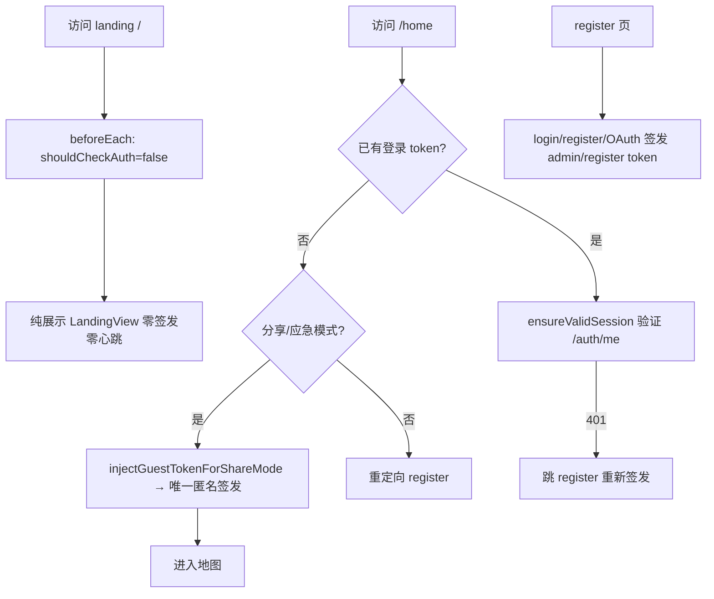

# 2026-11-25 会话签发架构收敛（landing 零签发）

- **日期与时间**：2026-11-25 17:24
- **任务等级**：L3（架构级，方案已获用户批准：选项 A2）
- **本次版本**：V3.7.13（并入本版本批次）
- **批准依据**：`Docs/TODO/2026-11-25-auth-issuance-architecture-plan.md`（含 Mermaid 图与矛盾点裁决）

## 问题分析

**核心症状**：在线人数长期虚报 1~2 人，根因之一是自动化脚本访问首页即获得有效 guest token，
经 25s presence ping 标活后长期计入在线。

**根本原因**：签发入口位置错误——`main.ts:67` 在应用入口无条件执行 `ensureGuestSession()`，
任何页面访问（含 landing 纯展示页、爬虫、探针）都会走到 `/api/auth/guest/session` 签发 HMAC guest token。
landing 路由虽 `shouldCheckAuth=false`（自身不验证），但无法阻止入口层的全局签发。

**用户论断核查结果**（基于实际代码）：
1. "只有 register 能签发三类 token"——**部分符合**：session token 签发出口有 register/login/OAuth 三类
   （本质都是登录）加 `/auth/guest/session`；后者由入口无条件触发，是缺陷所在。
2. "应用内检测 bearer 无效跳 register"——**基本符合**：路由守卫 + `ensureValidSession()` 验证 `/auth/me`，
   401 → markSessionExpired → 跳 register。
3. "landing 无需签发验证"——**符合设计但代码未做到**：LandingView 自身不调 API，但被入口全局签发绕过。

**受影响模块**：前端入口编排（main.ts）、路由守卫（router/index.ts）、游客身份服务调用时机。

## 修改内容

1. `main.ts`：删除顶层 `void ensureGuestSession()` 及其导入；新增架构收敛注释。
   landing 根目录现在是零签发、零验证、零 presence 心跳（LandingView 与 FloatingAccountPanel
   均不在 landing 挂载，已核实）。
2. `router/index.ts`：明确匿名签发只发生在 `/home` 守卫内的两条合法路径——
   分享模式（`injectGuestTokenForShareMode`）与应急游客模式；已登录用户走 `/auth/me` 验证。
   普通游客访问 /home 仍按既有 `requiresAuth` 语义重定向 register（不改鉴权策略）。
   曾尝试加通用签发兜底，但分析发现到达该分支时 token 已注入或已登录，属死代码，已移除。

## 修改原因

用户明确要求根治"脚本访问首页签发 token 纳入在线"的架构缺陷，并批准 A2 方案
（保留分享链接与应急游客模式，仅迁移签发时机）。

## 影响范围

仅前端签发时机；后端鉴权/限频/配额/签发端点语义零改动；register 仍是 admin/register token 唯一签发页；
分享链接 `s=1` 与 EMERGENCY_GUEST_MODE 行为保持不变。

## 解决方案

**为何选 A2 而非严格字面方案 B**：guest 身份是分享链接查看与应急游客浏览的基础，
若强制只在 register 签发 guest token，分享功能会失效。A2 将签发点从"应用入口"收敛到
"进入地图的路由守卫"，既满足 landing 零签发，又保留匿名能力。

**为何不在后端加 Referer 校验**：Referer 可伪造/缺失，不可靠，弃用（方案文档已记录）。

## 性能指标

未实测：签发次数从"每次页面加载"降为"仅进入 /home"，减少无效签发请求。

## 测试方案

### Agent 已执行

- `vue-tsc --noEmit`：0 错误。
- 静态核实：`useRealtimeStats`（presence ping 源）仅在 HomeView 相关 composable 与账户面板调用，
  LandingView 不挂载账户面板 → landing 确实无心跳。
- 门禁与构建见本批次收尾。

### 待用户实机验证

1. 直接访问 `webgis.negiao.cn`（landing）：DevTools Network 中**无** `/auth/guest/session`、
   **无** `/statistics/presence/ping`；在线人数不因本次访问 +1。
2. 从 landing 点"进入地图"到 `/home`：此时才有签发/验证；地图正常显示。
3. 打开分享链接 `?s=1`：分享模式仍可正常查看（guest 注入未破坏）。
4. 登录态进入 /home：走 `/auth/me` 验证；token 失效时跳 register。

## 变更文件清单

- `frontend/src/main.ts`：删除入口无条件 guest 签发及其导入，加架构收敛注释。
- `frontend/src/router/index.ts`：`beforeEach` 的 `/home` 分支新增匿名签发兜底（唯一匿名签发点）。
- `Docs/TODO/2026-11-25-auth-issuance-architecture-plan.md`：L3 方案文档（Mermaid 图、论断核查、矛盾点裁决）。
- `README.md` / `Docs/Guide/CHANGELOG.md`：版本 V3.7.13 与条目。
- 本日志：完整分析、方案对比与验证。

## 遗留与风险

- 严格字面要求"guest 也只在 register 签发"未采纳（选项 B），因其破坏分享链接；已由用户批准 A2。
- `EMERGENCY_GUEST_MODE` 分支仍在守卫内，后端离线时游客可浏览，行为不变。
- 历史已签发的 guest token 仍有效（后端判过期），本次不改变其与在线的关联逻辑。

## Mermaid 图

