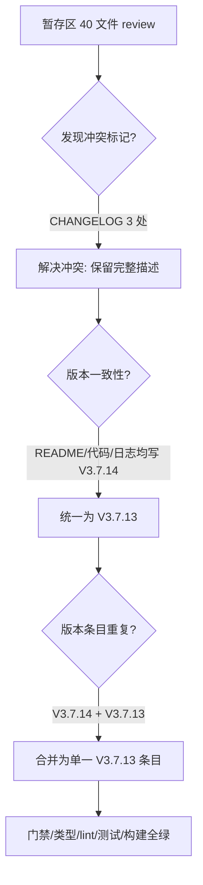

# 2026-11-25 暂存区 Code Review 与版本合并（V3.7.13）

- **日期与时间**：2026-11-25 19:15
- **任务等级**：L2（文档合并 + review 修复；无业务逻辑改动）
- **本次版本**：V3.7.13（按用户指令合并，无升号）

## 问题分析

**用户诉求**：code review 暂存区代码，本次版本 3.7.13，合并文档。

**Review 发现**：

| # | 问题 | 严重度 | 处置 |
|---|---|---|---|
| 1 | `Docs/Guide/CHANGELOG.md` 含未解决的 Git 合并冲突标记（`<<<<<<< HEAD` / `=======` / `>>>>>>>`），共 3 行 | **Blocker** | 已解决：保留 HEAD 侧 5/6/7 项完整描述，删除冲突标记与对方简版 |
| 2 | README 三处、CHANGELOG、多个代码注释、日志、方案文档都写 V3.7.14，与用户要求"本次版本 3.7.13"冲突 | **Blocker** | 已统一为 V3.7.13（用户报告 URL 中的 `?v=3.7.14` 是事实记录，保留不改写） |
| 3 | CHANGELOG 同时存在 V3.7.14 与 V3.7.13 两个条目，违反单一版本入口 | 中 | 已合并：V3.7.14 的 7 项并入 V3.7.13（成为 12–18 项），只保留 V3.7.13 条目 |
| 4 | README 版本演进表出现两行 V3.7.13、缺失 V3.7.12（3 行规则被破坏） | 中 | 已修复：合并两行为一条，补回 V3.7.12，保持 3 行 |
| 5 | 多份日志的"本次版本"行带并行会话塞入的怪异括注（`V3.7.14  （按用户…归并至 V3.7.13；保留原始表述不改写）`） | 低 | 已清理为统一格式 `V3.7.13（并入本版本批次）` |
| 6 | 代码逻辑 review：session_archive / realtime_stats / statistics / URL 清洗 / 分享 / One Tap 等改动未见功能性 bug；`e:` 不可数身份 hash 碰撞无实际影响（本就不可数） | 通过 | 无需改动 |

**受影响模块**：文档（README / CHANGELOG / 日志 / 方案文档）+ 代码注释版本号；业务逻辑零改动。

## 修改内容

1. 解决 CHANGELOG 合并冲突标记，保留完整的 ut/FedCM/单端登录三项描述。
2. 将 V3.7.14 的 7 项改动合并进 V3.7.13 条目（现共 18 项），更新版本归并说明。
3. README 三处版本号统一为 V3.7.13；版本演进表恢复 3 行（V3.7.13 / V3.7.12 / V3.7.11）。
4. 统一 10 个源文件注释与 9 份文档中的 V3.7.14 → V3.7.13（保留用户报告 URL 原文事实）。

## 修改原因

用户明确要求本次版本为 3.7.13 并合并文档；且暂存区 CHANGELOG 带冲突标记属 release blocker，必须在提交前解决。

## 解决方案

以用户当前指令（版本 3.7.13）为准，按规范 §0 优先级 1 覆盖此前的 V3.7.14 升号决定；
采用"版本归并"模式（与 V3.7.12 先例一致）：多个过程日志归到单一版本条目，日志原文保留不改写。

## 性能指标

不适用（文档与注释改动）。

## 测试方案

### Agent 已执行

- 全仓冲突标记扫描：CHANGELOG 3 处已清除，其余 `====` 为注释分隔线（误报已排除）。
- 门禁 4 项全绿（结构树 754/754、配置登记、依赖方向、Vue 范式）。
- `vue-tsc --noEmit` 0 错误；`eslint src/` 0 错误。
- 后端 pytest：174 passed / 1 既有失败（test_webhook_helpers，基线状态，与本次无关）。
- 生产构建成功（18.51s）。
- 版本三处核验：README 简介 / 演进表首行 / 页脚均为 V3.7.13。

### 待用户实机验证

无需功能验证（本次仅文档与注释改动）；用户需自行 `git add` 将工作区改动纳入暂存区后提交。

## 变更文件清单

- `Docs/Guide/CHANGELOG.md`：解决冲突标记，V3.7.14 条目合并进 V3.7.13（18 项）。
- `README.md`：三处版本统一 V3.7.13，演进表恢复 3 行。
- 7 个源文件注释：`useGoogleOneTapAuth.ts` / `urlParamSanitizer.ts` / `auth.ts` / `main.ts` / `router/index.ts` / `session_archive.py` / `test_session_expiry.py`（版本号注释统一）。
- 9 份日志/方案文档："本次版本"行统一 V3.7.13。
- 本日志：review 发现清单与处置、版本合并说明。

## 遗留与风险

- **Git 状态**：本次修改均为工作区未暂存改动（`MM`/`AM`），Agent 按规范未执行 `git add`/`commit`；
  用户提交前需自行 `git add -A`，否则暂存区仍是带冲突标记的旧版本。
- 代码审查为人工静态 review，未运行浏览器端 E2E；功能测试结论沿用各功能日志中的记录。

## Mermaid 图

