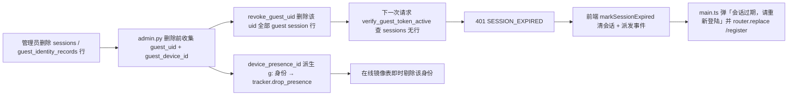

# 2026-11-25 暂存区 Code Review 与 V3.7.12 版本归并

- **日期与时间**：2026-11-25 13:37
- **任务等级**：L2（常规：Code Review + 缺陷修复 + 文档版本收口）

## 问题分析

- **核心症状**：暂存区包含多次不规范 commit 对应的 39 个文件、2274 行新增，CHANGELOG 中同一批工作被拆为 V3.7.11 的 5 个追加条目；需要按用户指令整合为单一版本 V3.7.12。
- **根本原因**：多轮连续修复在线人数、会话过期、在线明细表与 UI 控件时逐次写入暂存区，未做统一版本收口；跨模块链路（鉴权 → tracker → admin 镜像表 → 前端提示/跳转）存在几处边界缺陷。
- **受影响模块**：`backend/api/auth/*`、`backend/api/realtime_stats.py`、`backend/api/statistics.py`、`backend/api/admin.py`、`backend/app.py`、`frontend/src/api/backend/client.ts`、`frontend/src/main.ts`、`frontend/src/domains/common/user/*`、文档与结构树。

## 修改内容

1. 版本归并：根 README 三处版本号 → V3.7.12；CHANGELOG 顶部新增单一 V3.7.12 条目，V3.7.11 仅保留原 1–5 项；5 份过程日志保留不迁移、不改写。
2. Code Review 修复：
   - DB 查询异常不再被误判为 token 过期，避免瞬时 DB 故障把全站用户集体踢下线（`_authenticate_login_or_guest`）。
   - 游客 session 登记写入 `guest_device_id`（此前固定为空，导致按设备撤销在线与管理员查看设备失败）。
   - 管理员删除 `sessions` / `guest_identity_records` 行时，按 `guest_device_id` 派生 `presence_id` 精确撤销在线，而不再错误地按 `g:<guest_uid>` 撤销。
   - 游客在线镜像在缺少 `guest_identity_records` 时回查 `sessions` 补全 IP / UA / 设备 / 时间。
3. 结构树已登记新增 `ThemedSelect.ts/.vue`；本次无新增前端文件。

## 修改原因

用户明确要求按 `Docs/Force_command.md` 审阅暂存区代码、修复潜在 bug、把多次不规范提交整合为统一版本 V3.7.12，并提供可直接使用的 commit message。依据优先级 §0：当前会话用户明确指令优先。

## 影响范围

鉴权（三类身份会话）、实时在线统计、管理员在线明细、用户中心管理 UI、版本文档与目录树。未触及部署面与配置 key。

## 解决方案

选型理由：保持 `sessions` 为三类身份唯一会话真值，不引入第二张撤销状态表；撤销与在线清理按设备维度精确执行，避免误伤同账号其它标签页。

## 性能指标

未实测。

## 测试方案

### Agent 已执行

- `pytest tests/test_guest_identity.py tests/test_realtime_stats.py -q`：53/53 通过（含新增 DB 异常不误判过期、设备上下文收集用例）。
- 后端全量 `pytest tests/ -q`：165 passed / 1 个既有异步插件标记失败（`test_shutdown_webhook_watches_noop_when_idle`，与本版本无关）。
- `vue-tsc --noEmit`：0 错误；ESLint（用户中心 + 新组件）：0 错误；`npm run build`：成功（4774 modules）。
- `CheckStructureTree.py` 751/751、`CheckConfigRegistry.py`、`CheckDomainDeps.py`、`CheckVueParadigm.py` 73/73 全绿。
- 平台红线扫描：排除 `.venv` / `node_modules` 后仅命中已知假阳性 `maxRayDistance`（体积云 raymarch 参数），生产基线 `ALLOW_PRIVATE_HOSTS=true / ALLOWED_HOSTS=* / RATE_LIMIT=0` 未命中，REDLINE-CLEAN。
- 未执行任何 Git 写操作（`add` / `commit` / `push` / `stash` / `reset` 均未执行）。

### 待用户实机验证

1. 部署后删除 `sessions` 中一条 admin / registered / guest 会话，对应用户下一次操作应弹「会话过期，请重新登陆」并跳转 `/register`。
2. 管理员在线明细页应展示身份、IP、设备与最近心跳，且身份下线后 ≤10s 从表中消失。
3. 用户中心数据管理页与偏好设置不再出现浏览器原生确认框 / 下拉，样式与主题一致。

## 变更文件清单

- `README.md`：三处版本改为 V3.7.12，版本演进表首行替换。
- `Docs/Guide/CHANGELOG.md`：新增 V3.7.12 单条，V3.7.11 移除后续追加项。
- `backend/api/auth/dependencies.py`：DB 异常与 token 过期分流。
- `backend/api/auth/guest_token.py`：游客 session 登记写入 guest_device_id。
- `backend/api/auth/routes.py`：签发时传入设备 ID。
- `backend/api/admin.py`：删除前收集设备上下文并按 presence 精确撤销。
- `backend/api/statistics.py`：游客在线详情回查 sessions 补全字段。
- `backend/tests/test_guest_identity.py`：新增 / 更新回归用例。
- 本日志：本轮 Code Review 与版本归并全貌。

## 遗留与风险

- 5 份过程日志仍标注各自当时的 V3.7.11 过程号，按 Force_command §4「过程日志保留不迁移、不改写」处理，统一以 CHANGELOG 的 V3.7.12 条目为准。
- 工作区相对暂存区会产生新的未暂存 diff（README / CHANGELOG / 上述后端修复与测试），这是用户要求“查看 changes 状态、不擅自入暂存区”的预期结果。
- 线上部署仍由用户执行；本任务未执行 push。
