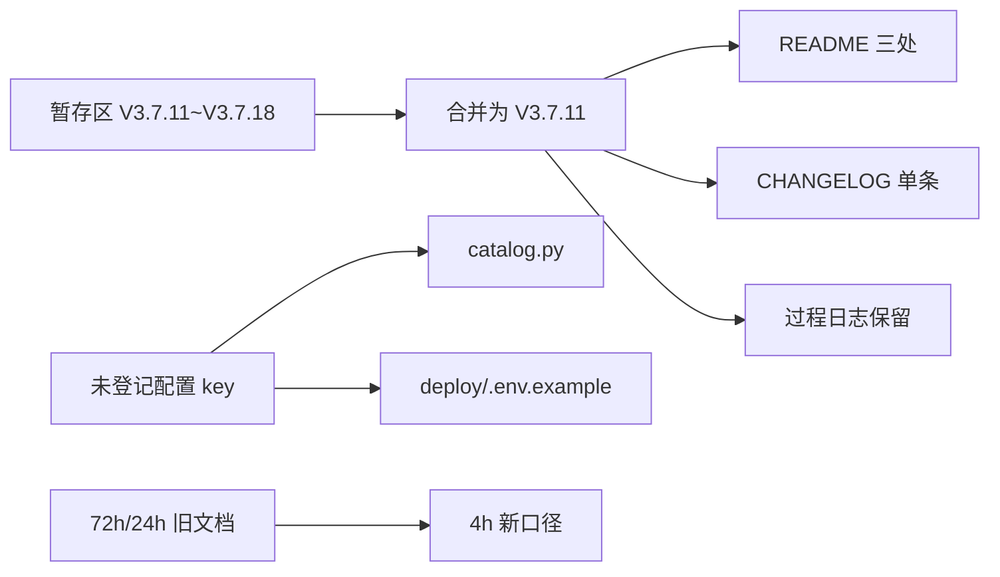

# 2026-11-25 将暂存区版本统一合并为 V3.7.11

- **日期与时间**：2026-11-25 09:45
- **任务等级**：L2（版本与文档治理、配置登记修复）
- **版本**：V3.7.11

## 问题分析

- **核心症状**：用户指定提交版本为 V3.7.11，但暂存区 README / CHANGELOG 最新条目为 V3.7.18，中间存在 V3.7.12 ~ V3.7.18 八条分段版本。
- **根本原因**：昨日多个 Agent 子任务各自按 L2 递增修订号，未在执行最终版本归并。
- **受影响模块**：版本 SSOT（README）、CHANGELOG、配置登记、认证配置文档。

## 修改内容

1. README 三处版本号统一为 V3.7.11：项目简介行、版本演进表首行、页脚。
2. 版本演进表只保留最近 3 条：V3.7.11 / V3.7.10 / V3.7.9。
3. CHANGELOG 顶部 V3.7.12 ~ V3.7.18 合并为单条 V3.7.11；保留各过程日志链接，不迁移、不改写历史日志。
4. 修复 Code Review 阻断项：
   - `AUTH_DB_ALLOW_EMPTY_FALLBACK` 登记到 `backend/config/catalog.py` 与 `deploy/.env.example`；
   - `deploy/.env.example` / `backend/README.md` / `Docs/Architecture/account-system-ai-quota.md` 中 72h / 24h 旧值同步为 4h。
5. 用户明确要求“更改合并为 3.7.11”，依据 Force_command §0 优先级 1 覆盖常规版本号递增规则；本归并仅对本次提交生效。

## 修改原因

消除版本不一致与配置登记门禁失败，使暂存区达到可提交状态；避免多个中间版本污染版本历史。

## 影响范围

- 版本标识与文档；
- 配置登记表；
- 认证配置说明；
- 不改变运行时业务逻辑。

## 解决方案

采纳“保留过程日志、合并正式版本条目”的方案：既不丢失追溯链，又满足 SSOT 与用户指定版本。

## 性能指标

未实测（非性能任务）。

## 测试方案

### Agent 已执行

- README 三处、CHANGELOG 顶部、配置登记与 4h 文档同步完成并逐项核对。
- `CheckConfigRegistry.py`：139 key，全部通过（原 B2 阻断已修复）。
- `CheckStructureTree.py`：749/749，通过；领域隔离与 Vue 范式门禁通过。
- 后端相关单测 44/44、vue-tsc、ESLint、生产构建在 Code Review 阶段已通过；本次未改运行时逻辑。
- 未执行任何 git add / commit / push。

### 待用户实机验证

1. 提交前确认 `README.md` 三处均为 V3.7.11。
2. 提交前确认 `git status --short` 无意外 `MM` 状态。
3. 用户自行决定是否提交；Agent 不执行 Git 写操作。

## 变更文件清单

| 文件 | 说明 |
|---|---|
| `README.md` | 版本三处统一 V3.7.11，演进表保留 3 条 |
| `Docs/Guide/CHANGELOG.md` | V3.7.12~V3.7.18 合并为 V3.7.11 |
| `backend/config/catalog.py` | 登记 AUTH_DB_ALLOW_EMPTY_FALLBACK |
| `deploy/.env.example` | 登记新 key，TTL 同步 4h |
| `backend/README.md` | 会话 TTL 文档同步 4h |
| `Docs/Architecture/account-system-ai-quota.md` | 会话 TTL 文档同步 4h |
| 本文件 | L2 维护日志 |

## 遗留与风险

- 过程日志仍保留 V3.7.12~V3.7.18 的标题，属历史记录，不改写。
- `agentToolsSchema.ts` 此前存在未暂存改动，提交前需由用户确认是否一并暂存。
