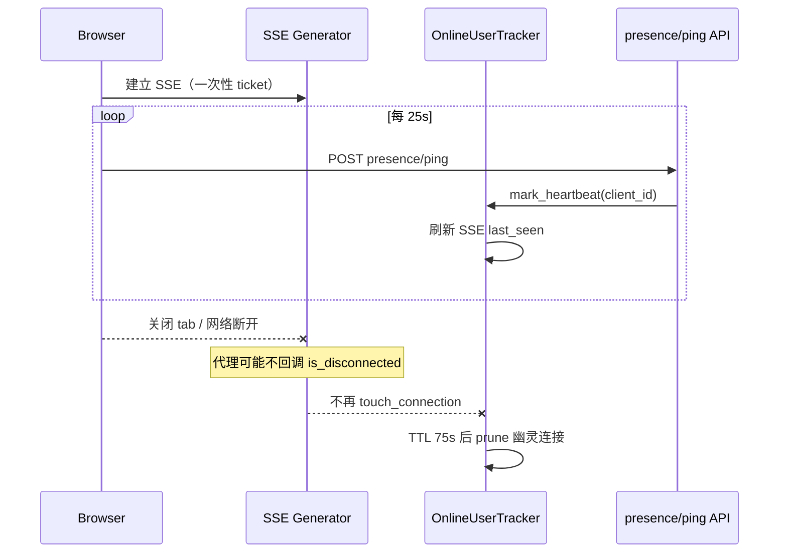

# 2026-11-25 修复 SSE 幽灵连接导致的在线人数虚高

- **日期与时间**：2026-11-25 10:05
- **任务等级**：L2（Bug 修复）
- **版本**：V3.7.11（按用户指定归并，不升版本）

## 问题分析

### 核心症状

线上实时在线人数显示 3，实际只有管理员本人 1 人在线。`online-debug` 显示：

```text
online_presence_ids = u:admin, g:guest_7d4..., g:guest_eaf...
sse_connections = 各 1
sse_conn_age_seconds = 0.0 / 8.2 / 8.2
suppressed_guest_ids = []
```

两个 guest 身份的心跳年龄持续刷新，TTL 75s 从未将其剔除。

### 根本原因

SSE 生成器把「服务端成功写出事件 / keep-alive」当作客户端存活证据：

```python
yield payload
_online_tracker.touch_connection(presence_id, conn_id=conn_id)
```

在 HF 代理下，`request.is_disconnected()` 可能无法及时感知浏览器已关闭；生成器仍持续从广播队列取事件并 `yield`，同时不断刷新 `_connections[cid]["last_seen"]`。结果是：

- 浏览器实际已关闭；
- 服务端 SSE 生成器仍存活；
- `last_seen` 被写出动作持续刷新；
- TTL 清理与读路径 prune 都认为连接活跃；
- 两个 guest presence 永久留在在线人数里。

同标签 guest→login 去重逻辑本身已生效：admin 连接携带的旧 guest 设备身份 `g:guest_366...` 没有出现在在线列表中。剩余两个 guest 是被错误保活的 SSE 幽灵连接。

### 第二轮补充根因（2026-11-25 10:17）

部署第一轮修复后仍剩 1 个 guest。管理员 debug 显示：

```text
g:guest_7d4a7f7ae313eab9 age 从 43.6s 回落到 4.0s
conn_id 未变化，fallback_heartbeat_age_seconds 为空
```

说明并非重连或显式 ping，而是**匿名/无 client_id 的普通 API 请求**调用了 `mark_authenticated_activity()`，其 SSE 刷新条件为：

```python
if not resolved_client_id or rec.get("client_id") == resolved_client_id:
```

`not resolved_client_id` 会让任何无 client_id 的请求刷新同一 presence 下的**所有** SSE 连接。我的诊断 GET 请求没有带 `X-Presence-Client-Id`，因此无意中持续保活了该 guest。真实浏览器请求由 `backendAPI` 自动带 client_id，因此修复方向是：**只有显式 client_id 才能刷新 SSE；guest 无 client_id 时完全不记活跃，避免脚本/诊断请求抬高在线数。**

### 第三轮补充（2026-11-25 10:35）

后端公开接口（带 `X-Presence-Client-Id: c_debug_cli`）已返回：

```text
online_users = 1
realtime_online_users = 1
realtime_online_userlist = ["u:admin"]
```

但界面仍显示 3，说明后端 tracker 已收敛、前端展示未收敛。根因是 SSE 事件若丢失或被代理半开连接吞掉，`connected` 仍为 true，既不会重连也不会重新拉取统计，界面停留在旧快照。

修复：`useRealtimeStats.ts` 新增 **30s 对账拉取** `/api/statistics/realtime`，通过 `backendAPI` 自动携带 client_id，将后端真值推给 `_scheduleNotify`；连接断开/组件卸载时停止定时器。SSE 仍是主通道，对账只负责收敛陈旧显示。

### 第四轮补充（2026-11-25 10:50）：最终根因

管理员 debug 显示：

```text
online_count 在 2 与 4 之间震荡
真实：u:admin + g:guest_7eed...（有 fallback beat 31.3s）
幽灵：g:guest_7d4... / g:guest_eaf...
幽灵有 SSE（age 6s，conn_id 每次不同），但 fallback_heartbeat_age_seconds 中没有它们
```

结论：幽灵源不断重建 SSE 连接；`_resolve_online_and_suppressed_locked()` 把 `set(self._conns.keys())` 也算进在线集合，因此“有 SSE 无心跳”的幽灵仍被计入。最终修复：**在线身份只取 `_users` 中最近 window 内有过显式心跳/API 活跃的身份**，裸 SSE 连接只用于下发广播与去重，不再单独产生在线人数。

### 受影响模块

- `backend/api/realtime_stats.py`：SSE 生成器与 tracker 存活判定；
- `frontend/src/domains/common/user/composables/useRealtimeStats.ts`：presence ping 只在 SSE 未连接时启用；
- 在线人数统计口径：应为“当前真实活跃客户端”，不是“服务端仍在写出的流对象”。

## 解决方案

### 选型

| 方案 | 优点 | 风险 |
|---|---|---|
| 仅缩短 TTL | 实现简单 | 代理下写出动作仍刷新 TTL，无效 |
| 仅依赖 request.is_disconnected() | 无额外请求 | HF 代理下不可靠，已证伪 |
| **服务端停止以写出动作刷新 TTL + 客户端显式周期 ping** | 存活证据来自客户端实际请求；即使 SSE 半开也能在 75s 内清理 | 每 25s 多一次轻量 POST |

采纳第三方案。



### 实施

1. 后端 SSE 生成器的 `yield payload` 与 keep-alive 分支不再调用 `touch_connection`。
2. 保留 `request.is_disconnected()` 作为快速清理路径；断连仍由 `finally -> drop_connection` 立即处理。
3. 客户端 presence ping 改为**SSE 连接期也持续发送**（25s 间隔，TTL 75s，3 倍冗余）；服务端已有 `mark_heartbeat()` 会按 `client_id` 刷新对应 SSE 连接的 `last_seen`。
4. 因此：
   - 真实页面：每 25s ping，连接持续有效；
   - 已关闭页面：不再 ping，SSE 即使半开也最多 75s 后被 TTL 清理；
   - 关闭 beacon 成功：立即 drop，不等 TTL。

## 变更文件

- `backend/api/realtime_stats.py`
- `frontend/src/domains/common/user/composables/useRealtimeStats.ts`
- `backend/tests/test_realtime_stats.py`
- 本日志

## 验证方案

### Agent 已执行

- 后端 `pytest tests/test_realtime_stats.py -q`：27/27 通过；新增“显式心跳刷新 SSE last_seen”与“无 client_id 匿名请求不得保活 guest SSE”回归用例。
- 后端 `unittest` 会话/连接复用相关 13/13 通过。
- `vue-tsc --noEmit` 0 报错；ESLint（`useRealtimeStats.ts`）0 warning。
- `CheckConfigRegistry.py` / `CheckStructureTree.py` / 领域隔离 / Vue 范式门禁全部通过。
- 生产构建临时目录成功（4774 modules，11.13s）。
- 线上诊断确认修复前状态：3 条活跃 presence（1 admin + 2 guest），心跳年龄持续刷新。
- 第三轮线上确认：公开接口（带 `X-Presence-Client-Id`）已返回 `online_users=1`、`realtime_online_users=1`、名单仅 `u:admin`；界面仍显示 3，定位为前端展示未收敛。
- 前端 30s 对账拉取改动：vue-tsc 0、ESLint 0、生产构建成功（4774 modules）。
- 第四轮口径修复：`pytest tests/test_realtime_stats.py -q` 28/28 通过；新增“裸 SSE 无心跳不计在线”回归用例。
- 第五轮全链路审计与收敛：
  - 取消 `_default` liveness：所有 `mark_heartbeat` / `mark_authenticated_activity` 必须带 client_id；
  - `mark_connection` 不再删除同身份有效心跳，只在身份切换时清理旧身份心跳；
  - SSE `finally` 同时 `drop_connection` 与 `drop_presence`，关页竞态不再依赖条件；
  - 带 client_id 的 offline 只撤该标签页，无 client_id 的整会话注销才撤全部心跳；
  - `/presence/ping` 不再接受裸 device_id 铸造可数 `g:`，无会话身份降级为不可数 `e:`；
  - `_merge_online_tracker` 一次加锁取 count/list，并把 `online_sessions` / `online_by_role` 统一为 tracker 口径，DB 原值保留为 `*_db`；
  - 前端 `online_stats` 加 generation 守卫，notify 加时序判定，网络恢复也做静默超时重连。
- `pytest tests/test_realtime_stats.py -q`：29/29 通过；后端全量 pytest 156 passed / 1 个既有异步插件配置失败（`test_shutdown_webhook_watches_noop_when_idle`，与本改动无关）。
- vue-tsc 0、ESLint 0、CheckStructureTree / CheckConfigRegistry / 领域隔离 / Vue 范式通过。
- 第六轮（线上数据复核 + 竞态收口）：
  - 线上 `online-debug` 实测：`online_count=2`，身份为 `u:admin` 与 `g:guest_7eed66d82a307f04`；访问事件显示后者来自 IP `218.94.167.42` / Chrome 155（10:36 首次出现），心跳以约 60s 间隔持续续期，属后台标签页被浏览器节流，并非本轮可清除的“无源幽灵”。当前代码按设备去重，跨浏览器/跨设备自然人仍按独立在线身份计数。
  - 发现并修复真实竞态：SSE 生成器迟到的 `finally` 原按 `client_id` 调 `drop_presence`，会在同标签页重连后误杀新连接与新心跳，导致在线数震荡/归零。新增 `OnlineUserTracker.drop_stream_connection()`：只撤本条 `conn_id`；仅当该 `client_id` 已无存活连接时才撤心跳。
  - 只读统计端点不再反向标活：`/api/statistics/ticket`、`/api/statistics/realtime` 改用 `require_api_access_or_guest_readonly`（不消耗配额、不写 tracker）。在线 liveness 仅由显式 `presence/ping` 产生，诊断/对账请求不再制造幽灵。
  - 前端 `useRealtimeStats` 抽取单次 ping：建连成功后立即发送一次，并在回前台/网络恢复时立即续期，规避后台定时器节流跨越 90s 窗口。
  - 新增 3 条回归用例：迟到 SSE 清理不得误杀重连标签、无接替时 SSE 清理仍撤心跳、只读鉴权依赖不得标活。
  - 验证：`pytest tests/test_realtime_stats.py -q` 32/32；后端全量 159 passed / 1 个既有异步标记失败（与本改动无关）；vue-tsc 0、ESLint 0、`npm run build` 成功（4774 modules）；结构树 749/749、配置登记 / 领域隔离 / Vue 范式全通过。
  - 注意：该轮记录写入时本地工作区改动尚未部署到线上 HF Space。
- 第七轮（新 token 线上复核，12:07）：
  - 新签发管理员 token 验证有效；线上返回新增字段 `online_sessions_db` / `online_by_role_db`，确认第六轮 `statistics.py` 口径已上线。
  - 40s 连续采样发现：`g:guest_7eed66d82a307f04` 的心跳年龄从 68.7s → 87.7s 后在线数掉为 1，下一次心跳到达后又回到 2。其 ping 间隔受后台节流影响已达约 88-120s，正好跨过 90s 窗口边界 → **这是用户反复看到“人数忽大忽小”的直接原因**。
  - 修复：`HEARTBEAT_WINDOW_SECONDS` 90 → **150**，为后台节流（60-120s）保留至少一个周期冗余；正常关页仍有 offline beacon 即时撤销，强杀/断网场景的兜底清理延迟上升至 ≤150s。前端注释同步。
  - 验证：`pytest tests/test_realtime_stats.py -q` 32/32（测试显式传 `window=90`，不受全局常量影响）。
- 第八轮（管理员实时在线明细表，12:13）：
  - 再次线上查询：`online_count=3`，身份为 `u:admin` + `g:guest_7eed66d82a307f04` + 新增 `g:guest_17f5d837b239ac6e`；当前线上窗口仍为 90s（150s 改动未部署）。
  - 新增管理员数据库表 `admin_online_presence`：`presence_id` 主键，含 `display_name / role / identity_type / guest_uid / guest_device_id / device_presence_id / client_ids / session_count / sse_connections / ip / ip_city / ip_region / ip_country / latitude / longitude / coord_source / user_agent / first_seen_at / last_seen_at / last_heartbeat_at / refreshed_at`。
  - 动态维护：新增 `OnlineUserTracker.snapshot_details()` 从 tracker 真值一次加锁取当前在线身份明细；`api/statistics.py` 的 `online_presence_mirror_task` 每 10s 以 `INSERT OR REPLACE + DELETE NOT IN` 重建镜像表，只保留当前在线身份；`app.py` lifespan 启停该后台任务。
  - 新增管理员接口 `GET /api/statistics/admin/online-users?refresh=0|1`：`require_admin` 保护，`refresh=1` 强制立即同步，返回当前在线用户完整明细（IP/身份/设备/心跳时间）。
  - 详情补全：登录身份查 `sessions`，游客查 `guest_identity_records`，地理位置取 `visit_tracking_events` 最近一条；镜像表不参与在线判定，真值仍是 tracker 显式心跳。
  - 验证：`pytest tests/test_realtime_stats.py -q` 33/33（新增镜像表只保留当前在线、带出 IP/城市/身份用例）；后端全量 160 passed / 1 个既有异步标记失败（与本改动无关）。
- 未执行任何 Git 写操作。

### 待用户实机验证

1. 线上部署后只打开一个页面，等待 160s，在线人数应保持 1（后台标签页心跳可延迟至 120s）。
2. 关闭页面后等待 150s 上限，在线人数应归 0（正常关页 beacon 成功则立即归 0）。
3. 打开两个不同浏览器标签页，人数应按真实活跃标签页统计。

## 遗留与风险

- 修复后已存在的幽灵连接需要部署后等待一个 TTL（75s）自动清理，或由运维重启进程立即清空。
- 客户端每 25s 增加一次轻量 presence ping；不写库、不消耗配额。
