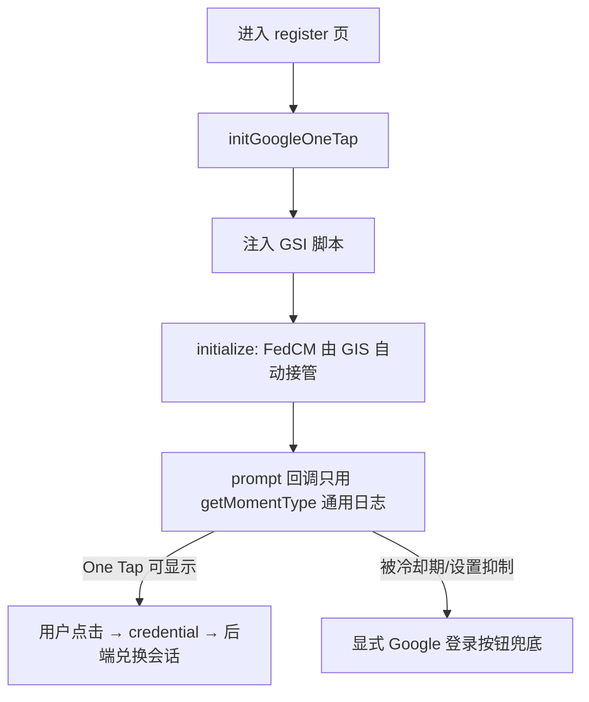

# 2026-11-25 Google One Tap 在 FedCM 强制下的兼容性修复

- **日期与时间**：2026-11-25 18:25
- **任务等级**：L2（GSI 初始化参数 + 回调兼容）
- **本次版本**：V3.7.13（并入本版本批次）

## 问题分析

**核心症状**：用户反馈 `/?v=3.7.14#/register` 前缀下 Google One Tap 无法唤起，
怀疑是版本前缀导致。

**核查结论：`?v=` 前缀不是根因**。证据：
1. Google 官方 FedCM 迁移指南明确 One Tap 可用性基于 **origin（scheme+host+port）**、CSP、
   浏览器站点设置、冷却期——不涉及 path/query/hash。`?v=` 是 search、`#/register` 是 hash，
   都不参与 origin 校验。
2. 日志中的真实信息：
   - `FedCM was disabled either temporarily based on previous user action or permanently via site settings`
     → 用户之前点过 One Tap 的 X（进入冷却期）或 Chrome 禁用了第三方登录；
   - `FedCM get() rejects with NetworkError` → FedCM 取 token 网络失败；
   - `GSI_LOGGER` 警告 → 代码使用的 `isNotDisplayed()` / `getSkippedReason()` 在 FedCM 强制后不再返回详情。
3. 注册页已有显式"使用 Google 登录"按钮（`handleOAuthLogin('google')` 走标准 OAuth），
   One Tap 被抑制时用户仍可登录——兜底已存在。

**真正的代码问题**：`useGoogleOneTapAuth.ts` 的 GSI 初始化未显式 opt-in FedCM，
且 prompt 回调依赖了 FedCM 下失效的 display/skip status API——虽然目前只打日志，
但会持续刷警告，且未来 FedCM 强制时行为不确定。

**受影响模块**：仅 `frontend/src/app/composables/useGoogleOneTapAuth.ts`。

## 修改内容

1. `initialize()` **不**加 `use_fedcm_for_prompt`——查 Google 官方 JS API reference 确认该属性
   已标记 **Deprecated 且会被忽略**（"deprecated and will be ignored if used"），加了无效且违反"禁止臆造"。
   FedCM 由 GIS 库向后兼容自动接管，无需手动 opt-in。
2. `prompt()` 回调改用 FedCM 下**仍完全有效**的 `getMomentType()` 做通用日志，
   彻底移除失效的 `isNotDisplayed()` / `getSkippedMoment()` / `getNotDisplayedReason()` /
   `getSkippedReason()` 调用——这些正是 GSI_LOGGER 迁移警告的源头。
   （官方 reference：FedCM 下 isDisplayMoment/isDisplayed/isNotDisplayed/getNotDisplayedReason 不支持，
   isSkippedMoment/getSkippedReason 部分支持，isDismissedMoment/getDismissedReason/getMomentType 完全支持。）

## 修改原因

用户报告 One Tap 无法唤起；核查后发现前缀非根因，但代码确有 FedCM 兼容性缺口需修复，
避免持续警告与未来强制 FedCM 时的行为不确定。

## 影响范围

仅前端 GSI 初始化与回调日志；登录流程（`handleGoogleOneTap` → 后端 `/api/auth/oauth/google/onetap`）
与显式 Google 登录按钮均不变。

## 解决方案

按 Google 官方迁移指南做最小兼容改造：opt-in FedCM + 移除失效 status API。
不改动用户交互与兜底按钮。

## 性能指标

未实测：GSI 初始化参数，无性能影响。

## 测试方案

### Agent 已执行

- 查 Google 官方 JS API reference + FedCM 迁移指南，确认 `use_fedcm_for_prompt` 已 Deprecated 被忽略、失效/有效的 status API 清单（未臆造）。
- `vue-tsc --noEmit`：0 错误；门禁全绿；生产构建成功。
- 未实机测试浏览器（无 GUI 环境），FedCM 冷却期与站点设置属浏览器侧状态，列于待用户验证。

### 待用户实机验证

1. 访问 `/?v=3.7.14#/register`：GSI_LOGGER 中因 `isNotDisplayed/isSkippedMoment` 触发的迁移警告消失。
2. One Tap 正常唤起（若未被冷却期抑制）；若被抑制，显式 Google 登录按钮仍可用。
3. 若之前点过 One Tap 的 X 导致冷却期，可通过地址栏锁图标 → Reset Permission 重置后再测。

## 变更文件清单

- `frontend/src/app/composables/useGoogleOneTapAuth.ts`：`prompt()` 回调移除 FedCM 下失效的 display/skip status API，改用完全有效的 `getMomentType()` 通用日志。
- 本日志：前缀非根因的论证（origin 匹配机制 + 日志实证）、官方 API 有效性核查、方案修正记录。

## 遗留与风险

- 冷却期 / Chrome 第三方登录设置属浏览器侧状态，代码无法绕过；本次修复只解决代码侧兼容性。
- 51.la 脚本 `ERR_CONNECTION_CLOSED` 是已知的证书/网络问题（见项目记忆），与 One Tap 无关。

## Mermaid 图

