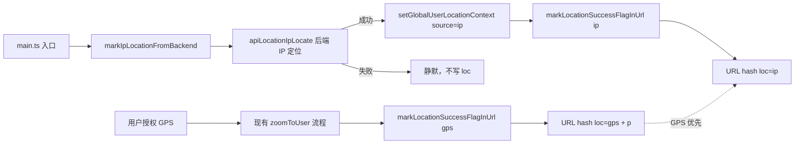

# 2026-11-25 实现进入系统自动定位并标记 loc=ip

- **日期与时间**：2026-11-25 15:29
- **任务等级**：L2（入口自动定位编排 + URL 标记）
- **本次版本**：V3.7.13（并入本版本批次）

## 问题分析

**核心症状**：用户进入系统后，即使后端 IP 定位成功，URL 也不出现 `loc=ip`。

**根本原因**（三重）：
1. 系统**没有进入时的自动定位**——`zoomToUser` / `zoomToUserCityByIp` 只在用户手动点击时调用；
2. `zoomToUserCityByIp` 要求 `extent.length >= 4` 才继续（`useUserLocation.ts:124-135`），
   但后端 `ip-locate` 成功时返回 `extent: None`、只有 `latitude`/`longitude`
   （`backend/api/location.py:245-257`），因此永远走不到标记处；
3. 标记依赖 `setGlobalUserLocationContext` + 地图 fit 成功，与"定位成功"本身耦合过深。

**受影响模块**：首页入口编排、URL 定位标记、后端 IP 定位端点消费。

## 用户明确语义

进入系统的定位只有三种结果：
1. 用户授权 GPS 定位成功 → `loc=gps`（携带 p 编码）
2. 后端 IP 定位成功 → `loc=ip`（无 p 编码）
3. 两者都失败 → 不写 loc 参数

## 候选方案对比

| 方案 | 做法 | 结论 |
|---|---|---|
| A 修 zoomToUserCityByIp 兼容无 extent | 让 extent 缺失时用 lat/lng 构造 | 仍需用户手动触发，不满足"进入系统自动定位" |
| **B 入口轻量自动定位 + 标记** | 入口调后端 IP 定位，成功即标记；GPS 由现有流程覆盖 | 选定：满足自动、解耦地图就绪、GPS 优先级不变 |
| C 后端直接写 URL | 不可能（URL 在浏览器） | 排除 |

## 修改内容

1. **复用既有标记函数，未重写**：`markLocationSuccessFlagInUrl()`（`userLocationMath.ts`）
   与 `setGlobalUserLocationContext()` 均为原有实现，本模块直接调用；GPS 优先判定
   （`currentLoc === 'gps'` 不降级）完全沿用原逻辑。
2. **迁移既有 IP 请求逻辑为共享函数**：将 `useUserLocation.buildIpCandidate` 内的
   `apiLocationIpLocate` 请求、GCJ-02→WGS-84 转换、精度估算提取为
   `fetchIpLocationCandidate()`（放 `services/autoLocationMark.ts`），并兼容后端
   新版 `latitude`/`longitude`（`extent=null`）返回。
   - `useUserLocation.buildIpCandidate` 改为调用共享函数
   - `useUserLocation.zoomToUserCityByIp` 改为调用共享函数
   - 入口自动标记 `markIpLocationFromBackend` 调用共享函数
   - 结果：`apiLocationIpLocate` 全仓仅一处直接调用（共享函数内），三路业务同源。
3. 首页入口（`main.ts`）在游客身份签发之后非阻塞调用（与 `ensureGuestSession` 并列）。

## 修改原因

用户明确要求进入系统自动定位并按三种状态标记 URL，当前实现缺入口编排且被 extent 卡住。

## 影响范围

新增一次后端 IP 定位请求（后端有 1h 内存缓存，且该端点为 optional session，游客可用）。
不改动 GPS 定位流程与 `zoomToUser` 现有语义。

## 解决方案

**为何放 main.ts 而非 HomeView**：定位是所有入口（含直接访问 /register 后的 home）的通用行为，
入口层调用避免与引擎装配时序耦合；GDPR 敏感地区仍只做 IP 粗定位、不请求 GPS 权限。

**为何不复用 zoomToUserCityByIp**：它绑定了地图 fit 与 extent，职责是"飞到城市"，
不是"标记定位成功"；拆出轻量标记服务符合单一职责。

## 性能指标

一次额外 HTTP（后端缓存命中约 10ms 级），非阻塞，不影响首屏渲染。

## 测试方案

### Agent 已执行

- `vue-tsc --noEmit`：0 错误。
- 门禁 `CheckConfigRegistry` / `CheckDomainDeps` / `CheckStructureTree`（新增文件已登记）/ `CheckVueParadigm`：全绿。
- 生产构建成功。

### 待用户实机验证

1. 清除定位缓存与 URL 参数，访问首页 → 后端 IP 定位成功后 URL 出现 `loc=ip`，无 `p`。
2. 用户授权 GPS → URL 更新为 `loc=gps` 且带 `p` 编码；IP 不得降级覆盖 gps。
3. 断网/后端定位失败 → URL 无 `loc` 参数（不写占位）。

## 变更文件清单

- `frontend/src/domains/common/map-view/services/autoLocationMark.ts`（新增）：`fetchIpLocationCandidate`（从 useUserLocation 迁移的共享 IP 候选构造）+ `markIpLocationFromBackend`（入口自动标记）。
- `frontend/src/domains/common/map-view/useUserLocation.ts`：`buildIpCandidate` 与 `zoomToUserCityByIp` 改为复用共享函数，移除重复请求与转换代码。
- `frontend/src/main.ts`：入口非阻塞调用自动定位标记。
- `Docs/Guide/frontend-structure.md`：结构树登记新文件。
- `Docs/Guide/CHANGELOG.md`：V3.7.13 补第 5 条。
- 本日志：根因分析、方案对比、Mermaid 图与验证。

## 遗留与风险

- 自动 IP 定位会在每次整页加载触发一次（模块级 Promise 仅防同页重复），后端缓存兜底。
- 用户手动 GPS 授权后的 `loc=gps` 由现有流程写入，优先级由 `markLocationSuccessFlagInUrl` 保证。

## Mermaid 图

