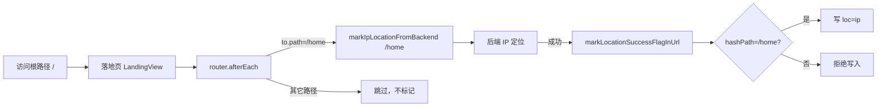

# 2026-11-25 修复落地页被写入 loc=ip 定位标记

- **日期与时间**：2026-11-25 16:19
- **任务等级**：L2（自动定位触发时机修复）
- **本次版本**：V3.7.13（并入本版本批次）

## 问题分析

**核心症状**：访问 `webgis.negiao.cn` 后地址栏出现 `?v=3.7.13#/?loc=ip`——
落地页（根路径 `/`）URL 被写入了定位标记。

**根本原因**：V3.7.13 新增的入口自动 IP 定位在 `main.ts` 顶层无条件调用，
不管当前路由是落地页 `/` 还是地图页 `/home`；后端 IP 定位成功后
`markLocationSuccessFlagInUrl` 直接往当前 hash 路径写 `loc=ip`，于是落地页变成 `#/?loc=ip`。
而 `/` 是 LandingView（落地页），根本不需要定位标记，只有 `/home` 地图页才需要。

## 修改内容

1. `main.ts`：自动定位改为 `router.afterEach` 在进入 `/home` 时触发，并把 route.path
   传给标记函数（避免依赖 location.hash 写入时序）。
2. `autoLocationMark.ts::markIpLocationFromBackend(routePath?)`：
   - 新增 routePath 参数，非 `/home` 直接返回 false，且不占用一次性 Promise（后续进 /home 仍可触发）；
   - 省略参数时从 location.hash 推断路径。
3. `userLocationMath.ts::markLocationSuccessFlagInUrl`：增加防御性路由检查——
   非 `/home` 路径不写入 loc（覆盖 GPS 流程潜在误调用）。

## 修改原因

用户明确要求修复落地页被误标 loc=ip 的问题；定位标记只应属于地图主页。

## 影响范围

仅前端定位标记触发时机；后端 IP 定位接口与落地页/注册页本身行为不变。

## 解决方案

采用"路由守卫触发 + 标记函数防御"双层防护：前者精准控制触发时机，
后者兜底防止任何调用方在非地图页写入标记。

## 性能指标

未实测：路由守卫判断 + 一次 IP 定位请求（后端缓存兜底）。

## 测试方案

### Agent 已执行

- `vue-tsc --noEmit`：0 错误。
- 门禁 `CheckConfigRegistry` / `CheckDomainDeps` / `CheckStructureTree` / `CheckVueParadigm`：全绿。
- 生产构建成功。

### 待用户实机验证

1. 访问 `webgis.negiao.cn` → 落地页 URL 保持 `?v=3.7.13#/`，不出现 loc。
2. 从落地页进入地图（/home）→ 此时才出现 `loc=ip`。
3. GPS 授权 → 正常覆盖为 `loc=gps`。

## 变更文件清单

- `frontend/src/main.ts`：自动定位改由 `router.afterEach` 在进入 /home 时触发。
- `frontend/src/domains/common/map-view/services/autoLocationMark.ts`：`markIpLocationFromBackend` 新增 routePath 参数与非 /home 短路。
- `frontend/src/domains/common/map-view/userLocationMath.ts`：`markLocationSuccessFlagInUrl` 增加非 /home 防御检查。
- 本日志：根因分析、方案与验证。

## 遗留与风险

- 历史已产生的 `#/?loc=ip` 链接再次打开时，落地页仍带 loc 参数（不影响功能，仅地址栏显示）；
  本次未清理历史链接，避免越权清除用户可能在落地页保留的参数。

## Mermaid 图

