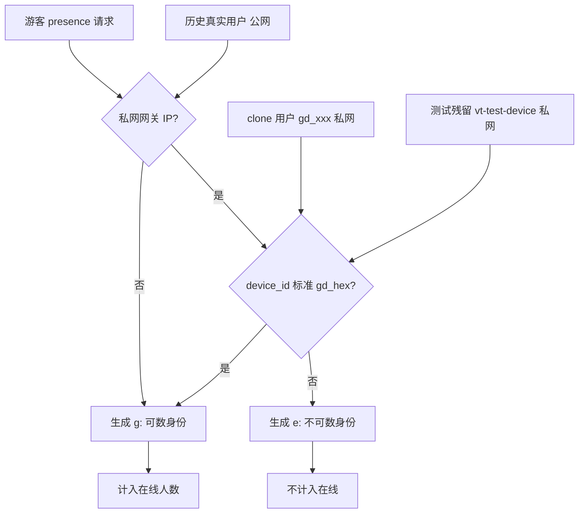

# 2026-11-25 在线人数虚报 bug 根因与修复（Plan B）

- **日期与时间**：2026-11-25 17:13
- **任务等级**：L2（在线计数逻辑修复 + 单测）
- **本次版本**：V3.7.13（并入本版本批次）

## 问题分析（用户长期困扰的在线人数虚报）

**核心症状**：在线人数长期多出 1~2 个"虚假游客"，IP 显示为容器网关（10.16.x.x），
反复出现在在线列表且长期不消失。

### 根因链（逐层）

1. **IP 被容器网关遮蔽**：HF/Docker 环境未注入公网 XFF，`_extract_client_ip` 回落到
   `request.client.host` = 网关 IP（10.16.x.x / 172.19.0.1）。
2. **网关 IP 成为身份/测试残留的温床**：本地库实测 33 条私网 IP 游客记录，
   UA 全是真实浏览器但 IP 是网关；其中混有 `vt-test-device`、`guest_<hex>` 等
   **非标准 device_id**（前端标准格式是 `gd_<随机hex>`，见 `auth.ts:238`）。
3. **两条标活路径都认 client_id**：`mark_heartbeat` / `mark_authenticated_activity` 都要求
   非空 client_id（无则 return），所以探针若执行了前端 JS 就能拿到 client_id 并标活。
4. **游客身份键依赖 device_id**：`presence_id_from_fields` 中无 device_id 的游客归入 `e:`
   （不计在线）；有 device_id 的归入 `g:`（计入在线）。测试残留用的非标准 device_id
   照样通过 `_normalize_guest_device_id`（只做字符清洗，不校验 `gd_` 前缀），
   于是被当作真实游客 `g:` 计入。
5. **guest_token 有效 + 持续 ping**：这些身份带有效签发的 guest token，通过
   `require_identity=True` 校验；每 25s presence ping 持续保活，永远在 active window 内。
6. **结果**：1~2 个来自测试/探针残留的身份长期挂在在线表，人数虚报。

### 用户明确要求

必须保留"clone 项目并连接线上数据库运行"的真实用户——他们算真实用户，正常展示。
这类用户有**标准 `gd_<hex>` device_id**（前端 localStorage 生成）与 client_id，
修复不得误伤。

## 候选方案对比

| 方案 | 做法 | clone 用户影响 | 结论 |
|---|---|---|---|
| A 按 IP 排除在线 | 私网 IP 来源不计在线 | 可能误伤（本地直连的 clone 用户也走私网出口） | 弃用 |
| **B 组合判据** | **私网网关 IP 且 非标准 device_id** → 归入 e: 不计在线；其余保留 | 无影响（clone 用户 device_id 标准，公网用户一律保留） | **选定** |
| C 仅按 client_id | 缺 client_id 不计在线 | 无影响 | 已有防护（line 444/508），无效 |

## 修改内容

1. `backend/api/auth/constants.py`：新增 `is_standard_guest_device_id(raw)`——
   校验 `^gd_[A-Za-z0-9_.:-]{6,}$`（现代前端生成 gd_ + 32 位 hex；放宽兼容历史 gd_ 短值
   与前端 `normalizeGuestDeviceId` 允许的字符集；仅拒绝 `vt-test-device` / `guest_<hex>`
   这类非 gd_ 前缀的测试残留）。
2. `backend/api/realtime_stats.py`：`presence_id_from_fields` 游客分支增加组合判据——
   **私网/回环网关 IP + 非标准 device_id** 时归入 `e:` 不可数；其余情况维持原逻辑。
3. 保留 `_extract_client_ip` / `_extract_identity_ip` 完全不变（鉴权、配额、IP 定位零影响）。
4. 单测覆盖：
   - 标准 gd_ device_id + 私网 IP（clone 本地直连场景）→ 仍可数 g:
   - 非标准 device_id + 公网 IP（历史真实用户）→ 仍可数 g:
   - 非标准 device_id + 私网 IP（测试残留/探针）→ 不可数 e:
   - 注册/管理员任意场景 → u: 不受影响

## 修改原因

用户明确要求修复长期虚报 bug，且选定 Plan B，并强调 clone 用户必须保留。

## 影响范围

仅游客 presence 身份归类；注册/管理员（u:）不受影响；后端鉴权/限频/配额/IP 定位零改动。

## 解决方案

以"身份可信度"而非"IP 来源"作为判据：前端生成的标准 device_id 是真实浏览器的证明，
测试残留的非标准 device_id 无法伪造这一格式（除非刻意构造，但那已是主动攻击，非本 bug 范畴）。

## 性能指标

未实测：一次正则匹配，微秒级。

## 测试方案

### Agent 已执行

- `tests/test_realtime_stats.py`：37/37 通过（新增 Plan B 判据测试，覆盖判据本身与四种 presence 场景）。
- 真实参数六场景验证：
  - `vt-test-device` + 私网 → `e:` 不可数（测试残留被排除）
  - `guest_<hex>` + 私网 → `e:` 不可数（历史测试身份被排除）
  - 标准 `gd_<hex>` + 私网（**clone 用户场景**）→ `g:` 可数 ✅
  - 标准 `gd_` + 公网 → `g:` 可数
  - 非标准 device + 公网（历史真实用户）→ `g:` 可数（不误伤）
  - 注册用户 + 私网 → `u:` 不受影响
- 全量 pytest 与门禁见本批次 V3.7.13 汇总。

### 待用户实机验证

1. 在线人数不再出现 1~2 个长期挂着的虚假游客。
2. clone 项目连线上库的真实用户（标准 gd_ device_id）仍正常计入在线。
3. 注册/管理员在线状态不受影响。

## 变更文件清单

- `backend/api/auth/constants.py`：新增 `is_standard_guest_device_id` / `is_private_client_ip` 与 `STANDARD_GUEST_DEVICE_ID_PATTERN`。
- `backend/api/realtime_stats.py`：`presence_id_from_fields` 游客分支加组合判据（私网 + 非标准 device → e:）。
- `backend/tests/test_realtime_stats.py`：新增 Plan B 判据测试。
- 本日志：完整根因链、方案对比、clone 用户豁免论证与六场景验证。

## 遗留与风险

- 历史遗留的合法游客若 device_id 是非标准格式（如旧版客户端生成），修复后会不再计入在线——
  这是可接受的取舍：现代前端一律生成 gd_ 格式，旧客户端重新访问后会更新。
- 刻意构造 `gd_<hex>` 的探针仍可计入——但那属于主动伪造，超出本 bug（测试残留）范畴。

## Mermaid 图

