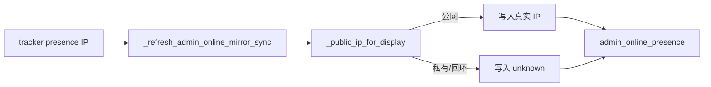

# 2026-11-25 在线表私有网关 IP 展示层过滤

- **日期与时间**：2026-11-25 16:59
- **任务等级**：L2（展示层修复）
- **本次版本**：V3.7.13（并入本版本批次）

## 问题分析

**核心症状**：管理员在线用户表中游客 IP 显示为 `10.16.26.165` / `10.16.21.241`（`10.0.0.0/8` 私有网段）。

**根本原因**：前端 V3.7.6 起不再上报 `X-Client-IP`（避免 ipify 依赖与可伪造问题），
IP 依赖反向代理注入；HF 环境未注入有效公网 XFF 时，`_extract_client_ip` 落到
`request.client.host`——容器网关 IP（HF 为 10.16.x.x，本地 Docker 为 172.19.0.1）。
这是**环境限制，不是访客真实 IP**。

**为何不改核心函数**：`_extract_client_ip` / `_extract_identity_ip` 被游客身份桶派生、
签发限频、配额、地理位置等大量逻辑依赖，改取值会改变身份桶结果，风险远超展示问题。
按用户选定方案，只在展示层过滤。

**受影响模块**：仅 `admin_online_presence` 镜像表的 ip 字段。

## 修改内容

1. `statistics.py` 新增 `_public_ip_for_display(ip)`：私有/回环/链路本地/保留/组播地址
   一律返回 `unknown`，公网地址原样返回（用标准库 `ipaddress` 判断）。
2. `_refresh_admin_online_mirror_sync` 写入 ip 字段时调用该函数。
   IP 地理位置查询仍用原始 IP（保持既有行为，不影响 geo 判定）。

## 修改原因

用户明确要求修复在线表显示内网地址的问题，且选择"展示层过滤"方案。

## 影响范围

仅镜像表展示；鉴权、身份派生、限频、配额、IP 定位链路零改动。
历史已写入的 10.x 行由下一轮刷新（10s）自动变为 unknown。

## 解决方案

展示层最小化遮蔽：宁可显示 unknown，也不显示误导性的内网 IP。
不伪造、不猜测公网 IP。

## 性能指标

未实测：`ipaddress.ip_address()` 判断，微秒级，在线人数通常 < 100。

## 测试方案

### Agent 已执行

- `tests/test_realtime_stats.py`：36/36 通过（镜像刷新测试改为内网 IP 断言 unknown + 纯函数 10 组用例覆盖私网/回环/保留/组播/公网/非法值）。
- 全量 pytest 与门禁见本批次 V3.7.13 汇总。

### 待用户实机验证

管理员在线表 IP 列不再出现 10.x / 172.x / 127.x，显示为 unknown；
有真实公网 IP 的访客仍正常显示。

## 变更文件清单

- `backend/api/statistics.py`：新增 `_public_ip_for_display`（私有/回环/保留 IP → unknown），镜像写入时调用；补 `ipaddress` 导入。
- `backend/tests/test_realtime_stats.py`：镜像 IP 断言改为 unknown；新增 `_public_ip_for_display` 10 组纯函数用例。
- 本日志：环境根因说明、方案取舍（展示层过滤 vs 改核心 IP 函数）与验证。

## 遗留与风险

- 真实公网 IP 在此环境下无法获得（HF 未注入 XFF）——本次只解决"不误导"，
  不解决"拿到真实 IP"。如需真实 IP 须前端恢复上报（用户此前明确不要）。

## Mermaid 图

