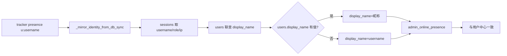

# 2026-11-25 修复在线镜像表 display_name 与用户中心 ID 不一致

- **日期与时间**：2026-11-25 16:36
- **任务等级**：L2（后端镜像表字段口径修复）
- **本次版本**：V3.7.13（并入本版本批次）

## 问题分析

**核心症状**：`admin_online_presence` 表的 `display_name` 与用户中心显示的 ID 完全不同。

**根本原因**：两处数据来源不一致：
- **用户中心**：`session` 经 `session.py:252-283` 从 `users` 表读取 `display_name`（用户昵称），
  `statistics.py::_build_center_user_payload` 用 `session.display_name` 展示；
- **在线镜像表**：`statistics.py::_mirror_identity_from_db_sync` 的 registered/admin 分支
  只从 `sessions` 表取 `username`（登录名）作 `display_name`。

本地库实测复现：`users` 中 `username=NEGIAO`、`display_name=NGEIAO`（拼写不同），
用户中心显示 `NGEIAO`，镜像表显示 `NEGIAO`。

**受影响模块**：管理员在线用户明细（`GET /api/statistics/admin/online-users`）、
镜像表 `admin_online_presence` 的 display_name 字段。

## 修改内容

`_mirror_identity_from_db_sync`：
- **`u:`（注册/管理员）分支**：从 `sessions` 查出 username 后，联查 `users` 表取 `display_name`；
  `display_name` 优先用 `users.display_name`，无值回退 `sessions.username`（与 `session.py:277` 口径一致）。
- **`g:`（游客）分支**：改用 `_guest_visible_username(id)` 生成 `guest_<guest_identity_records.id>`，
  不再取可能残留旧值（`user_N` / `guest_<hex16>`）的 `username` 列；与前端 `getUserDisplayName`
  及 URL `ut=guest_<id>` 完全同口径。本地实测 `id=1134`/`username=user_1133` 的游客，镜像显示 `guest_1134`。

## 修改原因

用户明确要求两处显示一致；管理员在线列表应显示用户昵称而非登录名。

## 影响范围

仅后端镜像刷新逻辑；不改表结构、不改鉴权、不改用户中心 payload。
镜像表由后台任务每 10s 重建，修复后下一轮自动刷新为新口径。

## 解决方案

在既有单次 DB 连接内做一次 `users` 联查（按 username 主键索引，开销可忽略），
复用与会话鉴权相同的取值优先级，避免两处口径再次漂移。

## 性能指标

每个在线注册用户多一次主键查询（SQLite 索引命中，微秒级）；管理员在线人数通常 < 100。

## 测试方案

### Agent 已执行

- `tests/test_realtime_stats.py`：35/35 通过（新增 users 表与 display_name 断言）。
- 全量 pytest：171 passed / 1 个既有异步标记失败（与本次无关）。
- 本地真实库实测：镜像行 `u:NEGIAO` 的 display_name 由 `NEGIAO`（登录名）变为 `NGEIAO`（users 昵称），与用户中心一致。
- 游客分支实测：本地 `id=1134` / `username=user_1133` 的游客，镜像 display_name 由旧值变为 `guest_1134`（与用户中心一致），PASS。
- 门禁 `CheckConfigRegistry` / `CheckDomainDeps` / `CheckStructureTree` / `CheckVueParadigm`：全绿。

### 待用户实机验证

1. 管理员查看在线用户列表 → display_name 与对应用户中心显示的昵称一致。
2. 游客在线行仍显示 `guest_<序号>`。

## 变更文件清单

- `backend/api/statistics.py`：`_mirror_identity_from_db_sync` 的注册/管理员分支联查 `users.display_name`，与用户中心口径对齐；缺表时回退 username。
- `backend/tests/test_realtime_stats.py`：补 users 表与 display_name 断言。
- 本日志：根因分析、方案与验证。

## 遗留与风险

- 若 `users.display_name` 为空，回退 username（与用户中心一致），不会产生空显示。
- 历史镜像行由下一轮刷新（10s）自动纠正，无需手工清理。

## Mermaid 图

