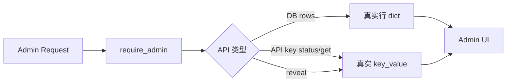

# 2026-11-25 管理员接口恢复返回密钥/敏感列真实值

- **日期与时间**：2026-11-25 10:30
- **任务等级**：L2（管理员 API 语义调整）
- **版本**：V3.7.11（按用户指定归并，不升版本）

## 问题分析

- **核心症状**：管理员面板读取 API key 与数据库表时，`key_value`、`token`、`password_hash` 等列返回 `sk-a****7890` 这类掩码值，管理员无法直接读取/复制真实值进行运维管理。
- **根本原因**：V3.7.6 引入 `core/secret_masking.py`，在 `/api/admin/db/table/{table}/rows`、`/api/admin/api-keys/status`、`GET /api/admin/api-keys/{key_name}` 默认掩码敏感字段。
- **用户决策**：管理员身份本身已由 `require_admin` 校验，掩码没有必要；应返回真实值以便管理数据库与 API key。依据 Force_command §0 优先级 1 覆盖既有设计。

## 修改内容

1. `backend/api/admin.py`
   - 表行查询不再调用 `mask_sensitive_row`，直接返回真实行；
   - insert/update 不再调用 `assert_no_masked_writeback`。
2. `backend/api/api_keys_management.py`
   - `/status` 与 `GET /{key_name}` 直接返回真实 `key_value`；
   - `/{key_name}/reveal` 保留为兼容别名。
3. `backend/core/secret_masking.py`
   - 模块说明改为“保留工具函数，但管理员 API 不再调用”。
4. 单元测试 `test_secret_masking.py` 保留，仍覆盖 helper 本身，不影响主链路。

## 影响范围

- 管理员数据库浏览器；
- 管理员 API key 管理；
- 不影响普通用户接口；
- 不改变认证、配额与密钥存储逻辑。

## 安全取舍

- 真实值只在通过 `require_admin` 的管理员接口返回；
- 管理面板/网络日志/截图将暴露真实敏感值，这是用户明确接受的风险；
- 不再阻止 `****` 掩码占位值写回敏感列，因为接口现在返回真实值，掩码守卫已失去意义。

## 测试方案

### Agent 已执行

- `pytest tests/test_secret_masking.py tests/test_realtime_stats.py -q`：42/42 通过。
- `import api.admin, api.api_keys_management`：模块导入通过。
- Grep 复核：`backend/api/` 下已无 `mask_secret` / `mask_sensitive_row` / `assert_no_masked_writeback` 调用。
- 未执行任何 Git 写操作。

### 待用户实机验证

1. 管理员打开 API key 管理，列表/详情应显示真实 key。
2. 管理员数据库浏览器查看 `api_keys` / `sessions` 表，应显示真实值。
3. 非管理员访问上述接口应仍被拒绝。

## 变更文件清单

- `backend/api/admin.py`
- `backend/api/api_keys_management.py`
- `backend/core/secret_masking.py`
- 本日志
