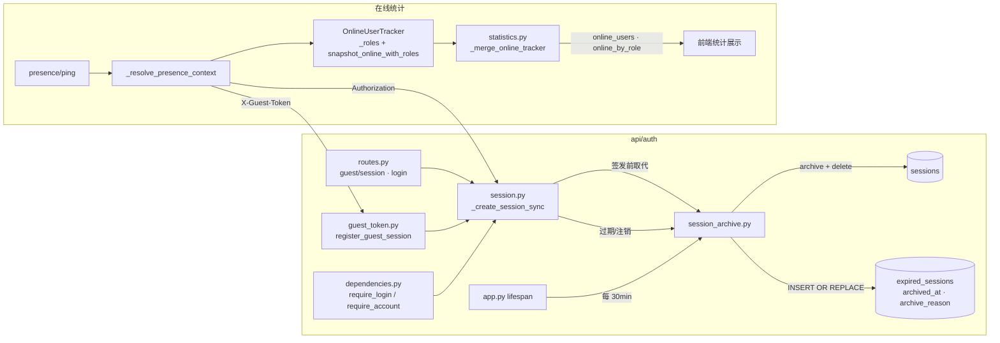

# 会话归档 · 在线角色口径 · 账号级鉴权收敛

- **日期与时间**：2026-11-25 14:30
- **任务等级**：L3（含数据库结构变更：新增 `expired_sessions` 归档表）
- **依据**：用户在当前会话给出的 7 条明确指令（§0 优先级 1），已构成 L3 方案批准

---

## 一、问题分析

### 1.1 来源：V3.7.12 Code Review 的 P1/P2/P3 结论

Code Review 已确认暂存区 41 文件改动在功能与门禁上全绿，但遗留三档问题：

| 档位 | 问题 | 结论 |
|---|---|---|
| P1-1 | 游客 token 4h 到期不静默续签、强制跳 `/register` | **设计如此**，不改行为，只同步注释与文档口径 |
| P1-2 | 部署瞬间存量游客首次请求被 401 踢一次 | 设计如此，需在 CHANGELOG 写明升级影响 |
| P1-3 | `sessions` 表无过期清理；每次签发新增一行且永不删除 | 需修复：签发即取代旧 token + 归档表 + 定时清理 |
| P2-4 | 游客 presence ping 拿不到会话，只能靠 `/auth/me` 搭车保活 | 需修复：三类身份同口径统计在线 |
| P2-5 | `online_sessions` / `online_by_role` 语义被静默改写，管理员用 `u:admin` 字符串硬编码 | 需修复：保留 DB 原值 + 真实 role 分类 |
| P2-6 | 游客 token 入 `sessions` 后能穿过 `require_login` | 需修复：新增 `require_account` |
| P2-7 | 确认弹窗 Promise 在卸载/未点击时永久挂起 | 需修复 |
| P3-8..12 | 重复索引、i18n 惰性、CHANGELOG 空行、过期 docstring、两套下拉实现 | 全修 |

### 1.2 根本原因

1. **会话只增不减**：`sessions` 表是三类身份的唯一真值，但删除路径只有「主动 logout」「token 再次被出示时判过期」，重签后的旧 token 永远不会再出现，于是留下永久行。
2. **游客在线依赖隐式路径**：`presence/ping` 只从 `Authorization` 取身份，游客 token 走 `X-Guest-Token`，永远拿不到 `g:` 身份，只能靠 `/auth/me`（60s 轮询）搭车刷新，与「liveness 只由显式心跳产生」的注释自相矛盾。
3. **角色分类用字符串猜**：`online_by_role.admin = pid == "u:admin"` 对任何改名的管理员都会算错。
4. **鉴权只看"表里有没有行"**：`require_login` 不区分 role，游客 token 因此具备账号级权限面。

### 1.3 受影响模块

鉴权（`api/auth/*`）、在线统计（`api/realtime_stats.py`、`api/statistics.py`）、应用生命周期（`app.py`）、管理前端（`components/AdminControlPanel.*`、`ApiKeysManagementPanel.ts`、`composables/useAdmin*`、`ui/ThemedSelect.*`）、统计展示（`useRealtimeStats.ts`）。

---

## 二、解决方案

### 2.1 会话生命周期（指令 1/2/3）

**新增 `backend/api/auth/session_archive.py`**

- `archive_session_rows_locked(conn, rows, reason)`：把会话行写入 `expired_sessions`。**尽力而为**——旧库未建表或写入异常只告警，绝不阻塞删除（注销/过期删除是安全动作，优先级高于留痕）。
- `supersede_sessions_locked(conn, keep_token, guest_uid / username+ip+ua)`：签发新 token 前归档并删除旧 token。
  - 游客：按 `guest_uid` 全量取代（同一浏览器只保留最新 token）；
  - 账号：按 `username + ip + user_agent` 取代（同一设备重复登录只留最新，多设备互不影响；缺指纹时不做跨会话清理，避免误踢其他设备）。
- `archive_expired_sessions_sync(now, limit=1000)`：过期判定与 `_get_session_sync` 完全一致（`expires_at <= now` 或 `created_at + 4h <= now`），先归档再删除，单轮限 1000 行防网络盘长事务。
- `session_archive_task()`：启动即清一次，此后每 30 分钟一轮；`CancelledError` 原样上抛。

**接入点**

| 位置 | 改动 |
|---|---|
| `api/auth/schema.py` | 新增 `expired_sessions` 表 + 3 个索引；删除重复的 `idx_sessions_guest_uid`（P3-8） |
| `api/auth/session.py` `_create_session_sync` | 插入前 `supersede_sessions_locked` |
| `api/auth/session.py` `_get_session_sync` 过期分支 | `archive_and_delete_tokens_locked(reason=expired)` |
| `api/auth/session.py` `_delete_session_sync` / `_delete_sessions_by_username_sync` | 删除前归档（reason=revoked） |
| `api/auth/guest_token.py` `register_guest_session` / `revoke_guest_uid` | 签发即取代同 uid 旧 token；撤销前归档 |
| `backend/app.py` | 注册/停止 `session_archive_task` |

**指令 1/2 的口径同步**（行为不变，只改说明与文档）

- `guestTokenStore.ts`：注释由「24h 有效」改为「上限 4h、到期不静默续签、401 → 清 token → 跳 /register」。
- `guestIdentity.ts`：说明「不做静默续签」的原因（否则被撤销身份可借续签绕回），只有分享模式首次 `force` 才重签。
- `ApiKeysManagementPanel.ts`：修正「后端默认只下发掩码值」的过期注释。

### 2.2 在线统计口径（指令 4/5）

**`_resolve_presence_context` 增加游客身份解析**：优先级 = 登录会话 → 已验签游客 token（`X-Guest-Token`/Cookie，需 `sessions` 行仍在）→ 裸设备头（`require_identity` 时降级为不可数 `e:`）。返回元组新增 `role`。

**tracker 记录真实 role**：`mark_connection` / `mark_authenticated_activity` / `mark_heartbeat` 新增 `role` 参数写入 `_roles`，随身份生命周期清理；新增 `snapshot_online_with_roles()` 一次加锁返回 `(count, ids, by_role)`，角色缺省时按 `u:admin` / `u:` / `g:` 前缀兜底。

**`_merge_online_tracker`**：

- `online_users` / `realtime_online_users` = tracker 口径（三类身份一致，与是否游客无关）；
- `online_by_role` = 按真实 role 分类；
- `online_sessions` **恢复为 sessions 表原义**，实时在线数新增 `online_sessions_presence`；
- `*_db` 字段继续保留 DB 原值供对比。

**前端**：`_buildPresenceHeaders` 在无登录 Bearer 时附带 `X-Guest-Token`，游客心跳不再依赖 `/auth/me` 搭车。

### 2.3 账号级鉴权（指令 6）

新增 `require_account`（= `require_login` + 拒绝 `role=guest`，403 `ACCOUNT_REQUIRED`），替换以下账号级端点：OAuth 绑定 start/complete、解绑、改密、改头像、改昵称、绑邮箱、偏好更新、`agent_chat /user-config`。注销仍走 `require_login_for_logout`（游客需能清身份）。

### 2.4 前端交互修复（指令 7 + P3）

- `useAdminTable.ts`：`onBeforeUnmount` 释放未决确认 Promise；Esc 视为取消（document keydown 监听，卸载时移除）。
- `ApiKeysManagementPanel.ts`：同一套 Esc + 卸载释放；`requestConfirm` 不再可能永久挂起。
- `pageSizeOptions` 改为 computed（切语言即时生效，P3-9）。
- `ThemedSelect` 升级为可访问组件：`role=combobox/listbox/option`、`aria-expanded/controls/activedescendant/selected`、↑↓/Home/End/Enter/Space/Esc、高亮项自动滚入视野、触屏档 ≥40px。
- `AdminControlPanel.vue` 三处内联 `.custom-select`（底图/数据表/分页）替换为 `<ThemedSelect>`，删除约 80 行重复样式与三个 dropdown 展开状态（P3-12）。

### 2.5 架构关系（变更后）

---

## 三、修改内容

### 后端

1. 新增 `backend/api/auth/session_archive.py`（归档 / 取代 / 过期清理 / 后台任务）。
2. `backend/api/auth/schema.py`：新增 `expired_sessions` 表与索引；移除重复索引。
3. `backend/api/auth/session.py`：签发取代旧 token；过期/注销改为归档后删除。
4. `backend/api/auth/guest_token.py`：游客签发取代同 uid 旧 token；撤销前归档。
5. `backend/api/auth/dependencies.py`：新增 `require_account`。
6. `backend/api/auth/routes.py`、`backend/api/agent_chat/routes.py`：账号级端点切换到 `require_account`。
7. `backend/api/auth/__init__.py`：导出 `require_account`。
8. `backend/api/realtime_stats.py`：游客 token 解析为可数 `g:` 身份；tracker 记录真实 role 并输出分类快照；心跳/连接/活跃接口透传 role；legacy heartbeat docstring 修正（P3-11）；清理未使用的 `_default` 注释口径。
9. `backend/api/statistics.py`：`online_sessions` 恢复 DB 原义，新增 `online_sessions_presence`；`online_by_role` 按真实 role。
10. `backend/app.py`：注册与停止过期会话归档任务。
11. `backend/tests/test_session_expiry.py`：假连接支持归档断言；新增「过期归档后删除」「同 uid 取代旧 token」两个用例。
12. `backend/tests/test_guest_identity.py`：新增 `require_account` 拒绝游客 / 放行注册用户两个用例。
13. `backend/tests/test_realtime_stats.py`：新增「已验签游客计入在线并归为 guest」「角色分布用真实 role」两个用例。

### 前端

14. `frontend/src/domains/common/user/composables/useRealtimeStats.ts`：presence 头附带 `X-Guest-Token`。
15. `frontend/src/domains/common/user/composables/useAdminTable.ts`：确认弹窗 Esc + 卸载释放；`pageSizeOptions` 改 computed；新增 `tableSelectOptions`；移除两个 dropdown 状态。
16. `frontend/src/domains/common/user/composables/useAdminSettings.ts`：移除底图 dropdown 状态。
17. `frontend/src/domains/common/user/components/ApiKeysManagementPanel.ts`：Esc + 卸载释放；修正密钥展示注释。
18. `frontend/src/domains/common/ui/ThemedSelect.ts` / `.vue`：键盘导航、ARIA、滚动跟随、触屏档。
19. `frontend/src/domains/common/user/components/AdminControlPanel.ts` / `.vue`：三处内联下拉改用 `ThemedSelect`，删除重复样式。
20. `frontend/src/domains/common/user/services/guestTokenStore.ts` / `guestIdentity.ts`：4h 上限与「不静默续签」注释同步。
21. `frontend/src/locales/{zh-CN,en-US}/admin.ts`：新增 `pageSizeLabel`。

### 文档

22. `Docs/Guide/backend-structure.md`：登记 `session_archive.py`。
23. `Docs/Guide/CHANGELOG.md`：V3.7.13 条目（含升级影响）。
24. `README.md`：版本号三处。

---

## 四、修改原因

- **安全**：`sessions` 无限堆积会让管理员难以判断哪些 token 仍有效；同时游客 token 具有账号级权限面属越权风险。
- **可排查性**：token 被删后无法解释「为何掉线」，归档表提供签发时间、失效原因与设备指纹。
- **统计正确性**：把「游客」当作不计在线会让公开站点人数长期偏低，且与「只统计在线用户」的产品语义矛盾。
- **可维护性**：两套下拉实现是典型漂移源；确认弹窗 Promise 泄漏会在慢网络下产生僵尸 await。

---

## 五、影响范围

| 面 | 影响 |
|---|---|
| 数据库 | 新增 `expired_sessions` 表；`sessions` 行数将稳定在「当前有效会话」规模 |
| 鉴权 | 游客访问账号级端点由「隐式可用」变为 403 `ACCOUNT_REQUIRED` |
| 在线统计 | 游客通过显式心跳计入在线；`online_by_role` 语义改为真实角色；`online_sessions` 恢复会话数语义 |
| 前端 | 管理面板下拉统一为 `ThemedSelect`（含键盘操作）；游客 presence 请求新增一个头 |
| 部署 | 后端需重新部署；前端需重新构建 |

---

## 六、性能指标

未实测。预期影响：

- `sessions` 表规模从「历史累计」降为「当前有效」，`WHERE token = ?` 主键查询不受影响。
- 归档任务每 30min 一次、单轮上限 1000 行，与既有游客保留期任务同量级。
- presence ping 对游客多一次 `verify_guest_token_active`（HMAC + 主键查询），25s 一次，可忽略。

---

## 七、测试方案

### Agent 已执行

| 检查 | 结果 |
|---|---|
| `pytest tests/test_session_expiry.py tests/test_guest_identity.py -q` | 27 passed |
| `pytest tests/test_realtime_stats.py -q` | 35 passed |
| `pytest -q`（后端全量） | **171 passed / 1 failed**（`test_shutdown_webhook_watches_noop_when_idle`，既有异步标记失败，与本改动无关） |
| `vue-tsc --noEmit` | 通过 |
| ESLint（10 个改动文件） | 通过 |
| `python Scripts/CheckStructureTree.py` | 751/751，漏登记 0、幽灵 0 |
| 内存库执行 `init_auth_tables_sync` | `sessions` + `expired_sessions` 均建表成功；归档表 13 列、3 索引；`idx_sessions_guest_uid` 仅一份（重复已删） |
| 前端生产构建 | 成功 |
| 平台红线扫描（§11.2） | 仅 `xray` 命中 `maxRayDistance` 已知假阳性；生产基线未被破坏 |

### 待用户实机验证

1. 后端重新部署后，`GET /api/statistics/admin/online-debug` 应只列出真实在线身份，`fallback_heartbeat_age_seconds` 中每位都有条目。
2. 用游客设备打开站点，25s 后管理端在线人数 +1（游客也计入）。
3. 同一游客重复签发（清 localStorage 后刷新）→ `sessions` 中该 `guest_uid` 只应有 1 行，`expired_sessions` 中 `archive_reason='superseded'` 出现旧 token。
4. 用游客 token 调 `POST /api/auth/change-password`，应返回 403 `ACCOUNT_REQUIRED`。
5. 管理面板「数据管理」页签：下拉可用鼠标与 ↑↓/Enter/Esc 操作；切换语言后分页「全部」标签立即变。

---

## 八、变更文件清单

见「三、修改内容」第 1–24 项。

---

## 九、遗留与风险

1. **升级影响（必须告知）**：旧版本签发的游客 token 没有 `sessions` 行，部署后首次请求会 401 并强制回 `/register` 一次。
2. **账号多设备**：同一账号在**不同设备**登录仍保留多 token（按 IP+UA 判断设备）；若 UA 因浏览器升级变化，旧行会留到自然过期后由归档任务回收。
3. **归档表不自动清理**：按用户要求保留历史；若长期运行体积膨胀，可在未来加保留期（如 180 天）。
4. **`expired_sessions` 含 token 明文**：仅供管理员回源，接口层不暴露；与「管理面返回真实值」的既定策略一致。
5. **确认弹窗 Esc 为全局监听**：管理面板与 API Key 面板同时挂载时，Esc 会同时关闭两者的弹窗（后关闭者覆盖），不影响正确性。
6. `test_shutdown_webhook_watches_noop_when_idle` 仍因既有 async 标记问题失败，未在本次范围内修复。
