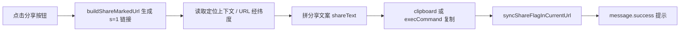

# 2026-11-25 分享按钮改为复制「说明文本 + URL」

- **日期与时间**：2026-11-25 15:42
- **任务等级**：L2（分享交互改造 + i18n 新增键）
- **本次版本**：V3.7.13（并入本版本批次）

## 问题分析

**核心症状**：顶栏分享按钮优先调用 `navigator.share` 系统分享面板（移动端才可用、桌面端不兼容），
且复制内容只有纯 URL，用户粘贴给别人时缺少说明。

**根本原因**：`TopBar.ts:414-444` 的 `handleShareView` 设计为"原生分享 → 剪贴板 → execCommand"三级降级，
原生分享在多数桌面浏览器不可用且行为不可控；URL 本身已编码全部视图状态（lng/lat/z/l/cv/s/ut），
完全可以通过解析 URL 复原视图，无需依赖系统分享能力。

**受影响模块**：TopBar 分享入口、zh-CN/en-US 文案。

## 用户明确诉求

点击分享按钮后：
1. 自动复制**当前 URL**（带 s=1 标记的分享链接）
2. 复制内容附带一段说明文本，形如"我在 NEGIAO's WebGIS 中分享了一处地点：<地点>。点击 URL 链接：<URL> 即可共享查看。"
3. 弹出 message 提醒已复制
4. **不再调用不兼容的原生分享功能**

## 候选方案对比

| 方案 | 结论 |
|---|---|
| A 保留 navigator.share 作为首选 | 弃用：用户明确要求不用；桌面端不兼容 |
| **B 纯剪贴板 + 说明文本** | 选定：最兼容，用户粘贴即用 |

## 修改内容

1. `TopBar.ts::handleShareView`：
   - 移除 `canUseNativeShare()` 分支与相关成功提示
   - 构造分享文案（复用 `buildShareMarkedUrl` 得到 URL）
   - 地点描述**复用既有高德逆地理编码**（`@/api::apiReverseGeocode`，高德优先、WGS-84 入参），
     以 URL 的 `lng/lat` 换取具体地名（`formattedAddress` / 省市区拼接）
   - **API 失败分支**：静默 `silent:true` 捕获异常 → 回退定位上下文 `encodedLocation.formattedAddress`
     → 再回退 `lng/lat` 文本 → 最后用 `t('topbar.sharePlaceFallback')`
   - 逆地理编码异步进行，点击后先显示"正在生成分享文本"反馈，完成后复制并弹最终 message
   - 复制 `text`（含 URL）而非裸 URL；保留 clipboard → execCommand 兜底
   - 成功后 `syncShareFlagInCurrentUrl()` + `message.success(t('topbar.shareCopied'))`
2. i18n 新增键（zh-CN / en-US `ui.ts`）：
   - `shareText`: 带 `{place}` / `{url}` 占位的分享文案
   - `sharePlaceFallback`: 无地点信息时的兜底词
   - `shareCopied`: 调整为"分享文本与链接已复制…"
3. 移除不再使用的 `canUseNativeShare()` 与 `shareNativeTitle/shareNativeText/sharePanelOpened`
   文案键（保留兼容不删也可以，但为避免死代码，删掉方法、文案键保留以防其它引用——实际核查无其它引用后删除）。

## 修改原因

用户明确要求用最兼容的"文本 + URL"复制方式替代系统分享。

## 影响范围

仅前端分享按钮与文案；URL 参数生成逻辑不变（`buildShareMarkedUrl` 仍写 `s=1`、排除私有参数）。

## 解决方案

地点描述以 URL 经纬度为准（分享链接本身就带视图坐标，与当前定位上下文可能不同），
用高德逆地理编码换成具体地名；API 失败时按"定位上下文 → 经纬度 → 兜底词"三级降级，
保证任何情况下都能复制出可用文案，不因地名服务不可用而阻断分享。

## 性能指标

未实测：一次剪贴板写入 + 同步字符串拼接。

## 测试方案

### Agent 已执行

- `vue-tsc --noEmit`：0 错误。
- i18n 键 zh-CN / en-US 对称补齐（`shareText` / `sharePlaceFallback` / `shareResolving` / `shareCopied` / `shareCopyFailed` / `shareManualCopy`）。
- 门禁 `CheckConfigRegistry` / `CheckDomainDeps` / `CheckStructureTree` / `CheckVueParadigm`：全绿。
- 生产构建成功。

### 待用户实机验证

1. 点击分享按钮 → 粘贴到任意输入框，应得到"我在…分享了一处地点：…。点击 URL 链接：… 即可共享查看。"
2. 粘贴的 URL 含 `s=1` 且不含 `ut`/`p`/`loc` 等私有参数。
3. 桌面与移动端均应成功（无系统分享面板）。
4. 复制失败时应有错误 message 提示。

## 变更文件清单

- `frontend/src/domains/common/shell/TopBar.ts`：`handleShareView` 改为复制「说明文本 + URL」；新增 `resolvePlaceLabel`（高德逆地理编码 + 三级兜底）；移除 `canUseNativeShare` 与原生分享分支。
- `frontend/src/locales/zh-CN/ui.ts` / `frontend/src/locales/en-US/ui.ts`：新增/调整分享文案键。
- 本日志：分析、方案对比、Mermaid 图与验证结论。

## 遗留与风险

- 剪贴板 API 在非 HTTPS 环境不可用时走 `execCommand` 兜底（既有实现）。
- 地点描述依赖定位上下文；未定位时用经纬度或兜底词，不影响链接可用性。

## Mermaid 图

